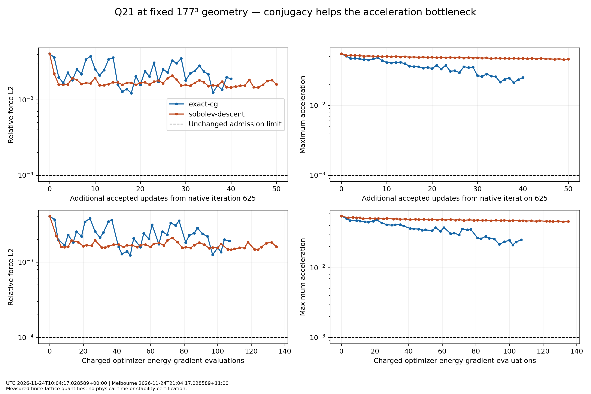
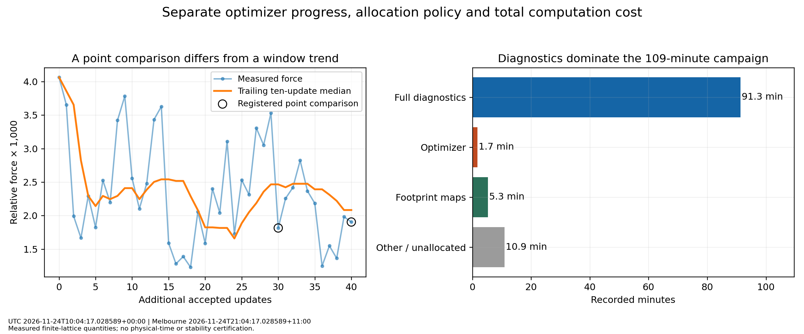
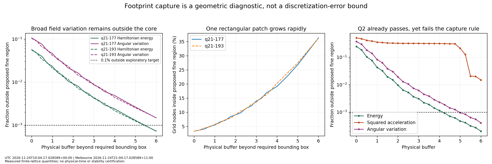

# Q21 footprint and minimizer campaign: scientific assessment

Review timestamps: UTC 2026-11-24T10:04:17.028589+00:00; Australia/Melbourne 2026-11-24T21:04:17.028589+11:00. Run: **20261124t073157z-b6ad806d**. Received archive SHA256: `b9468cec089b41197eab3b4279a8d9c855cd6ddceaa9bef464abeb9844cac642`.

**The campaign completed successfully as a numerical assessment. Q21 improved substantially under continued conjugate-gradient relaxation, but neither arm reached stationarity. Removing conjugacy did not solve the acceleration bottleneck. The footprint maps support investigating nonuniform resolution, while showing that a 2.8% residual neighbourhood cannot simply be treated as the complete fine-grid region.**

## 1. Evidence, execution and scope

The archive passes ZIP CRC, safe/unique path and exhaustive checksum checks: 99 outer payloads, all 50 frozen handover payloads, and the embedded prior CPU evidence with 150 payloads. The execution package matches the previously issued identity, `41b24a463d94391b57eacd460dc6a41f34731f99018f869694a05a513a832173`. The selected source is the correct completed CPU run, `20261123t130300z-db9ba00c`, using its final endpoint rather than a best snapshot.

I independently recalculated gate classifications, optimizer budget/call accounting, energy decrements, best-versus-final scores, matched-update ratios, chronological response fits and allocation decisions. I also checked footprint monotonicity, patch index geometry, selection outcomes and completed-map hashes. All recorded calculations checked agree. This is a compact-record audit, not a new field-array replay: native NPZ arrays remain on the zbook. Their declared hashes agree with included checkpoint seals, but their actual bytes and spatial measurements cannot be independently recomputed here.

The run lasted **1 h 49 min 8 s**, from 18:31:57 to 20:21:05 Melbourne time on 24 November 2026. It used **90 charged and accepted updates out of a 240-attempt ceiling**: 40 CG and 50 descent. The remaining 150 attempts were conditional ceilings, not unfinished work. There were 92 measured states including the two common initial states. All observed representation and boundary gates pass; neither arm reaches stationarity. Physical-time steps: **zero**.

Auto routing selected CUDA after finding about 7.32 GiB free GPU memory against a 6.18 GiB geometry estimate plus a 1 GiB reserve. Both arms use CUDA; footprint calculations use CPU. Thus the exact arm preserves the source optimizer state and algorithm while making an explicitly qualified CPU-to-CUDA arithmetic transfer. It is not a bit-for-bit same-backend CPU continuation. Native energy-gradient audits pass: energy difference about 3.55e-15 and recorded maximum gradient difference zero. Independent constrained directional-difference checks also pass. These checks support operator consistency in the tested directions, not complete stability or Hessian positivity.

The archive does not include a new completed-results publication receipt. It confirms scientific completion, not that these new results have already been merged. No GitHub operation was performed for this review.

## 2. The controlled comparison favours retaining conjugacy for the limiting residual

Both arms start at the same 177³ field, length 30.72, native iteration 625. They share the Sobolev inverse, shift 0.25, tangent projection, normalization, line search, alpha policy, restart schedule and scientific gates. Only conjugacy handling differs. No native iteration-200 restart occurs between iterations 625 and 675.

| Measurement | Common starting field | CG at 40 updates | Descent at 40 updates | Admission limit |
|---|---:|---:|---:|---:|
| Relative force L2 | 0.00406630 | 0.00190406 | 0.00146295 | 0.0001 |
| Maximum acceleration | 0.05449375 | 0.02499894 | 0.04675072 | 0.001 |
| Energy | 12.366904987553 | 12.366711589288 | 12.366857966748 | No energy-only admission gate |
| Optimizer energy-gradient evaluations | 0 | 107 | 108 | Work coordinate, not scientific gate |

At the matched 40-update horizon, descent has about 23.2% lower force but **87.0% higher maximum acceleration**. CG has lower maximum acceleration at every one of the 40 matched noninitial observations. Descent has lower relative force at 31 of those 40 observations. There is a real tradeoff, not a universal winner for every scalar measurement. Because maximum acceleration is a required admission component, the descent alternative does not justify replacing CG on this branch.

Relative to the starting field, the final CG state reduces force by **53.2%**, maximum acceleration by **54.1%**, and component RMS acceleration by **56.5%**. Its final force and maximum acceleration nevertheless remain **19.0 and 25.0 times** their respective limits. The best measured joint CG state occurs at update 38, native iteration 663: force 0.00136261 and maximum acceleration 0.02112209. It is retained separately; the final endpoint remains update 40/native 665 and must not be silently substituted.

Descent receives two additional five-update batches. At its final update 50/native 675, force is 0.00160051 and maximum acceleration 0.04593052, respectively **16.0 and 45.9 times** their limits. Even after those extra updates, its peak acceleration remains worse than CG at update 40. Its best joint state is update 49, with maximum acceleration 0.04525901. This alternative is still a useful controlled negative result: discarding conjugacy helps one measure but does not resolve joint stationarity.

Energy falls monotonically in both arms. The decreases are only about 0.00156% for CG and 0.000442% for final descent, despite much larger changes in derivative residuals. Final-ten median relative energy decrements are 1.68e-7 and 5.74e-8; neither has a final-ten decrement below 1e-9. A smaller energy decrement in descent does not imply a smaller maximum residual. This directly illustrates why energy-change criteria and stationarity residuals cannot be treated as interchangeable.

## 3. Why the campaign stopped: valid policy execution, not a proven plateau

The registered rule compares each response with its value ten accepted updates earlier. At CG update 40, force is 4.92% worse than at update 30, while maximum acceleration improves 5.99%. Joint point-to-point progress therefore fails, and the arm correctly stops after its initial allocation. None of the joint final response fits qualifies: force holdout errors are about 53%, 97% and 53% for linear, quadratic and exponential fits.

However, CG force is oscillatory. The median across updates 31–40 improves **15.5%** over the median across updates 21–30; the corresponding maximum-acceleration median improves **27.0%**. The means also improve. This post-hoc window comparison is not the registered allocation rule and cannot retrospectively change the outcome. It does show that the stop should be described as **failure of the specified recent point-progress rule**, not demonstrated optimizer stagnation or exhaustion of the branch.

For descent, qualified joint fits at updates 40 and 45 authorize extensions, but turning behaviour shortens each batch to five attempts. At update 50, force worsens 9.40% relative to update 40 while acceleration improves only 1.75%, so allocation stops. Final descent force fits have errors within 25%, but fail the required skill improvement against a last-value baseline. Rejecting those models is correct; a curve that does not outperform the baseline should not drive a long extrapolation.

No reliable time-to-admission forecast follows from the final fits. A future continuation can register a noise-aware rule combining adjacent-window summaries, measured component trends and a firm ceiling. That would be an explicit policy revision, not a relaxation of the scientific gates. A small separately registered CG control is defensible; automatic use of all remaining 150 attempts is not.

## 4. What the footprint measurements establish

These maps describe the **incoming native-625 fields** at 177³ and 193³, not the new CG/descent endpoints. The 193³ field received no additional relaxation. A new refinement experiment starting from native 665 must remap that field first; comparing its residual directly with the still-625 finer endpoint would mix relaxation history with spacing.

The earlier 2.8% statistic describes a core-neighbourhood mask. The present smallest rectangular box includes the n3<0 core and energy, gradient and residual peaks. It occupies about 3.3% of nodes and captures most residual activity, but only about 94% of Hamiltonian energy and 89% of angular variation. These are different geometric definitions, so the percentages do not contradict one another.

| Buffer beyond the required box | 177³ nodes inside | Energy captured | Angular variation captured | Squared acceleration captured |
|---|---:|---:|---:|---:|
| 0 | 3.31% | 94.30% | 89.38% | 99.609% |
| 1 | 5.49% | 97.68% | 95.39% | 99.907% |
| 2 | 9.10% | 99.08% | 98.14% | 99.978% |
| 3 | 13.98% | 99.58% | 99.14% | 99.992% |
| 4 | 19.15% | 99.76% | 99.51% | 99.996% |
| 6 | 36.32% | 99.927% | 99.852% | 99.9993% |

The 193³ capture curves are close: at buffer 6, 36.23% of nodes contain 99.926% of energy and 99.850% of angular variation. Agreement of these bulk footprints across the two source resolutions is useful. It does not establish convergence of their residual maxima or of a future composite discretization.

**No tested patch satisfies the exploratory 99.9% simultaneous capture rule.** For Q21, angular variation remains below that target at the largest measured buffer. This is why every proposed_patch field is null. It is a geometric-selection outcome, not a scientific admission failure, and not evidence that adaptive refinement cannot work. The emitted DEFERRALS file names the coupled-grid stage, but does not emphasize these null geometry proposals; this review makes that outcome explicit.

The original illustrative sixfold saving cannot be inferred from the 2.8% mask. Using a two-to-one coarser exterior, the idealized cell-count reduction is about 4.89-fold at buffer 2 but only 2.26-fold at buffer 6, before overlap, interfaces, solver or diagnostics overhead. Neither value is a measured speedup. Conversely, slowly varying outer fields may be adequately represented coarsely even when their cumulative variation is nonzero: requiring 99.9% of every quantity to lie on the fine grid is not itself a discretization-error estimate.

The Q2 reference passes all original gates again, including maximum acceleration 6.64e-5. Yet it also produces no qualifying patch: even at buffer 6, only 98.51% of its squared acceleration lies inside. Its entire residual is already small. This is a useful warning that relative capture of an almost-zero residual can over-refine a valid reference. Future refinement indicators should combine physical scales and absolute residual/error floors with measured coarse-versus-fine representation errors. The scientific admission limits themselves remain unchanged.

Footprint energy uses the static Hamiltonian density, checked on the workstation to integrate to the minimizer objective. Tail/guard metrics retain their historical density convention. Those finite-lattice conventions must not be interchanged when comparing maps and original gates.

## 5. Computational cost and reliability

Recorded full per-update diagnostics consume **91.3 minutes**, about **83.6%** of wall time. Optimizer steps consume **1.66 minutes**, about **1.5%**. Footprint maps consume **5.27 minutes**. The remaining roughly 10.9 minutes include initial measurements, qualification, checkpoint I/O, reporting and overhead that are not individually timed in this record.

CUDA did execute the optimization, but accelerating optimization alone has little room to reduce this campaign's total runtime. Shared intermediate calculations and independently qualified GPU diagnostics are more relevant targets than a faster line search alone. Diagnostic reuse must preserve the operators and gate values; this finding is not authorization simply to skip checks.

The frozen service telemetry records no hard-limit or OOM events. There are 120 MemoryHigh events and a peak near 7 GiB. Some memory pressure is present in the final sample; that sample is not an average over the run. Eight NPZ files with seals are declared, with best/final/restart roles kept distinct. They remain local and must be retained. Compact publication is not evidence that full-field storage is redundant.

## 6. Literature alignment and implications for Q2–Q32

The descent arm is projected **Sobolev-preconditioned** steepest descent, deliberately holding the preconditioner fixed to isolate conjugacy. It is not the exact Hietarinta–Salo algorithm or their discretization. Their 2000 paper describes previous-gradient acceleration, geometric sampling checks and perturbation/return tests; this controlled result does not refute those methods or reproduce their complete acceptance process. Their energy-change criterion remains distinct from force/acceleration limits. Primary source: [Hietarinta and Salo (2000)](https://users.aalto.fi/~ala/pdf/081201R.pdf).

The adaptive-grid idea remains consistent with established hierarchical methods, which require explicit coarse/fine transfers, ghost values and boundary handling. A framework supplies machinery, not a qualified composite Skyrme-Faddeev energy. Primary documentation: [AMReX AmrCore](https://amrex-codes.github.io/amrex/docs_html/AmrCore.html).

For this Q21 branch, the evidence favours retaining CG as the primary baseline and testing spatial representation separately. It shows useful, continuing numerical improvement and a limitation of one allocation policy; it does not establish eventual convergence. There is no physical-time trajectory, perturbation-return test or full Hessian assessment, so neither physical stability nor physical instability is demonstrated. The Q2 control remains valid. Nothing here justifies blanket reanalysis of Q2–Q32, exclusion of a Hopf sector, or applying the same remedy to a candidate whose obstacle is boundary admission.

## 7. Recommended next sequence

1. Record this completed experiment and assessment through the local workstation. Retain both original CPU endpoints and every new best/final/optimizer state. Keep the actual stopping reasons and the unqualified patch selection visible.
2. Use the final CG native-665 endpoint as the declared chronological baseline for follow-up; retain its best native-663 state separately. Remap the chosen field before reusing an old patch geometry. A separately bounded 20–40-update CG control can test a newly registered window-based allocation rule, with all scientific gates unchanged and no unvalidated time-to-admission extrapolation.
3. Before building a full adaptive solver, perform a **read-only representation/transfer pilot**. Hold the full physical domain and fine spacing fixed, coarsen the exterior by a factor of two, reconstruct on a reference grid, and vary only patch extent. Start from measured buffer settings such as 1, 2, 3, 4 and 6. Compare full-domain energy, tangent-gradient differences, peak and regional acceleration, interface errors, approximate charge, corner cone and boundary metrics. Measure the outcome rather than selecting a region solely by cumulative capture.
4. Use Q2 and manufactured/analytic transfer checks to qualify interpolation, normalization and interface treatment. If those pass, implement one composite-domain discrete energy with consistent weights and its corresponding gradient; qualify independent directional derivatives and coarse/fine coupling. A reconstructed-field pilot alone does not qualify that composite solver.
5. Only then relax Q21 on a fixed nested grid and compare with the uniform control. Vary patch extent first, spacing second, and permit adaptive zoom only after the fixed-grid comparison passes. Optimize diagnostic reuse or qualified device evaluation alongside the numerical development, since diagnostics dominate current cost.

The next scientific execution requires the retained arrays on the zbook. This review itself performs no new optimization, physical evolution, publication or source-field modification.
