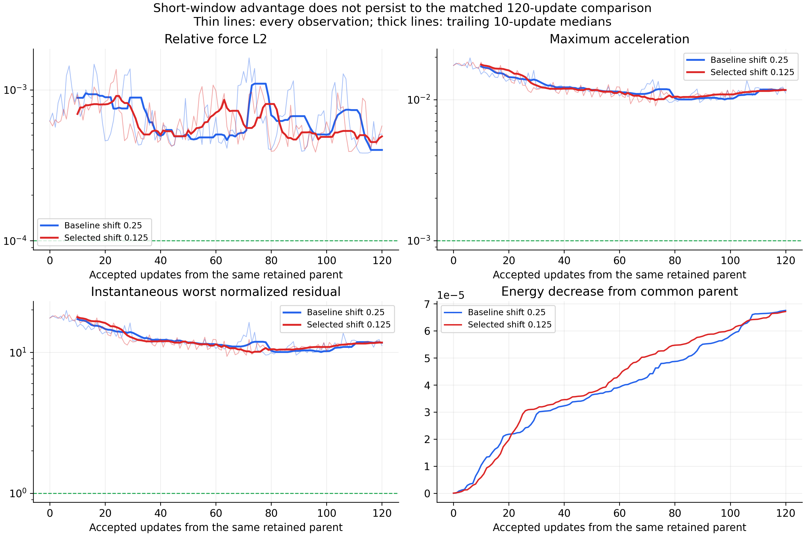
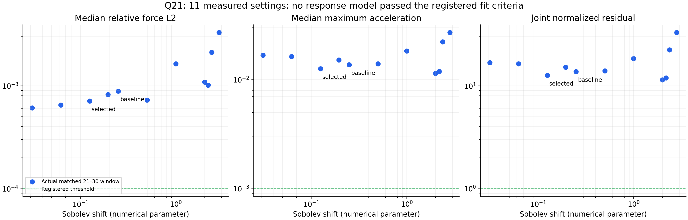
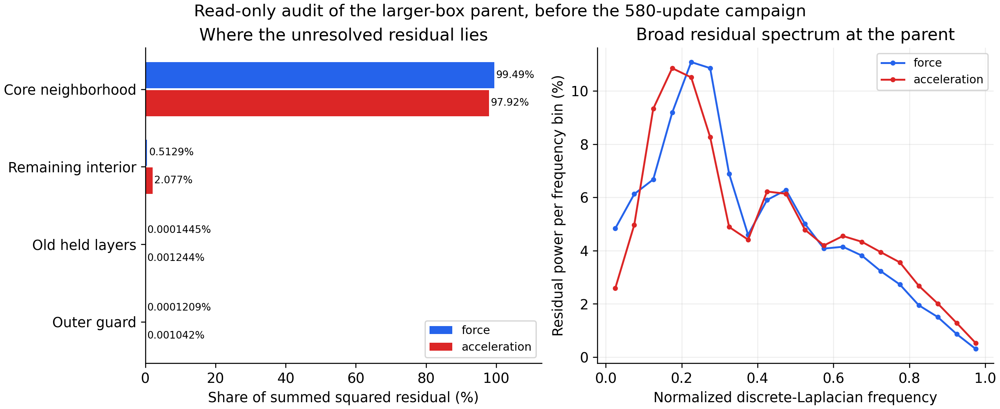

# Q21 conditioning calibration: scientific assessment and Q2–Q32 recommendation

Reviewed 23 November 2026, Australia/Melbourne. Source run: `20261122t102101z-2a8e50ec`. Source archive SHA256: `c0fd32690d23b80fad77e33d1bc27048983ec1cb3335ac36c91004d75c938962`.

**Recommendation:** apply an improved diagnostic and eligibility audit across retained Q2–Q32 candidates, followed by a representative pilot. The present evidence does not justify repeating the entire 580-attempt conditioning sweep for every charge. The experiment provides a useful diagnosis and a documented failure of a short-horizon ranking to transfer to longer relaxation. It establishes no new stationary or physically stable Q21 solution.

## 1. What has been verified

The archive has valid CRCs, unique safe member paths and complete matching hashes for all 182 compact payloads. The former telemetry sealing race has not recurred. The embedded handover is identical to the released package. I independently checked recorded gate decisions, attempt accounting, monotone energy descent, completion seals, retained-field declarations, measured response statistics, model-validation outcomes and selection. Cross-platform fitted coefficients agree within floating-point tolerance; model eligibility and selection are unchanged.

There were 580 charged and accepted optimizer updates across 13 cases: 40 exact-memory control, seven 30-update measurements, four 30-update adaptive measurements, a 90-update baseline extension and a separately restarted 120-update selected-value confirmation. The 593 recorded Q21 observations include repeated initial states and the deterministic replay of one trajectory prefix; they are not 593 independent experiments. All retain representation and boundary admission. None passes strict stationarity or all readiness gates. All 580 independent CPU/CUDA energy-gradient audits pass. Q2 control and constrained directional-derivative checks pass. Physical-time steps: zero.

The run completed at 01:33 AEDT on 23 November, approximately 4 h 12 min after launch. Its single backend was CUDA float64. There were no OOM kills or hard-limit events. The cgroup did record soft MemoryHigh events, which can affect throughput without implying numerical corruption.

Full NPZ fields are absent from the compact archive. The 52 declared local fields total 9.98 GiB. Their recorded hashes and seal cross-references agree, but I have not independently replayed their field-level measurements or reconstructed endpoint morphology here. No new relaxation, physical-time simulation or GitHub interaction was performed for this review.

## 2. The short-run conditioning advantage did not persist

The scan changes the numerical Sobolev preconditioner shift, not the physical action or a mass parameter. Every restarted measurement uses the same iteration-425 field, 129³ grid, box 30.72, spacing 0.24, initial alpha and original gates. The exact-memory control is separate.

| Window / quantity | Baseline shift 0.25 | Selected shift 0.125 | Interpretation |
|---|---:|---:|---|
| Updates 21–30: median relative force | 0.000888258 | 0.000711703 | Selected value 19.88% better |
| Updates 21–30: median maximum acceleration | 0.0137286 | 0.0126337 | Selected value 7.98% better |
| Updates 111–120: median relative force | 0.000399358 | 0.000491390 | Selected value 23.05% worse |
| Updates 111–120: median maximum acceleration | 0.0116778 | 0.0117059 | Selected value 0.24% worse |
| Actual final relative force, update 120 | 0.000508036 | 0.000575989 | Both fail the 0.0001 limit |
| Actual final maximum acceleration, update 120 | 0.0111309 | 0.0116441 | Both fail the 0.001 limit |

These are fractions and model quantities, not percentages or SI electron accelerations. The 0.24% acceleration-window difference is small relative to within-trajectory variation and is not a statistical significance claim. The two final force residuals remain 5.08 and 5.76 times their limit; the acceleration maxima remain 11.13 and 11.64 times theirs. Final tail and guard fractions remain approximately 0.000264 and 0.000470, within the unchanged limits.

The baseline's original-to-final energy decrease is only 0.000548%, despite remaining nonstationary. The final energies differ by approximately 3.26×10⁻⁸ relatively. Almost identical energies therefore do not establish equal residuals or stationarity. Instantaneous and windowed residuals oscillate while energy falls. Near-flat energy and an isolated best residual cannot decide convergence.

The baseline's retained best joint-residual state is update 89; the selected trajectory's is update 64. Both fail readiness. The best instantaneous joint score anywhere in the new experiment is approximately 8.59, at shift 1, update 28; its force and acceleration still exceed their gates. These earlier states must not be silently substituted for matched final endpoints.

At matched update 40, clearing memory at shift 0.25 improves on exact-memory continuation for this parent. This supports treating optimizer memory as a controlled numerical factor, not a universal prescription to clear it.

Thin lines show every measured value; thick lines show trailing ten-update medians. The green dashed lines are unchanged thresholds. The lower-right panel shows falling energy alongside unresolved residuals. The normalized instantaneous score and the median-based registered response are related summaries, not interchangeable definitions.

## 3. What the curves actually establish

Eleven distinct shifts were measured, from 0.03125 to 2.82843. All nine final candidate fits—linear, quadratic and exponential for joint score, median force and median acceleration—fail the registered combined validation criteria. Joint-score range-normalized leave-one-out errors are about 0.319–0.328 against a 0.25 limit; every joint-score model predicts worse than a constant response under leave-one-out validation. The quadratic turn is consequently descriptive and cannot authorize an interpolated optimum. The median-force exponential fit narrowly misses its error limit, but qualifying that component alone would not establish a joint optimum.

The archive correctly records `best_measured_value_without_validated_optimum`. The directory name `optimal-validation` is an implementation label and must not be presented as proof of an optimum. The selected 0.125 setting was a measured fallback; no successful fitted interpolation/extrapolation was demonstrated. Its repeated first 30 updates reproduce the original measurement exactly, confirming deterministic replay rather than providing an independent statistical replicate.

Shift 2 has a better early joint score than 0.125, but worsens median force by about 22.4% relative to the baseline, exceeding the allowed 10% component-worsening bound. Selection correctly respects that constraint. Three of the four adaptive samples were above shift 2 and did not establish a feasible optimum. For future bulk use, the acquisition rule should place more weight on component feasibility, predictive uncertainty and persistence across horizons, with a separately limited exploratory allocation.

The failure of these global fits does not prove that no conditioning relationship exists. It establishes that these simple models and this finite-horizon response were inadequate on the measured support. Do not raise the fit-error limit merely to obtain a curve. More useful next responses include multiple matched-horizon windows, rate of sustained joint progress and cost to an actually measured residual target. Candidate rankings should be required to persist at a longer horizon before a selected parameter transfers to other fields.

These are actual matched-window measurements, shown without a fitted optimum because no fit qualifies. The threshold lines provide scale. The measured response varies irregularly; joining points with a smooth-looking curve would not supply missing predictive validation.

## 4. The strongest result is localized residual diagnosis

At the common larger-box parent, 99.49% of summed squared tangent-force residual and 97.92% of squared acceleration lie in the declared core-neighborhood region. That region contains about 2.76% of grid nodes. The outer guard and former held layers each contribute only tiny fractions. Both residual maxima are in the core region.

This makes a dominant residual located at the outer boundary unlikely for this field. It does not prove finite-domain convergence or eliminate all boundary influence. The finding is specific to this parent and the registered disjoint region definitions.

The spectrum is broad: approximately 48.75% / 46.51% of force / acceleration power is in the defined low-frequency band, and 10.57% / 13.99% is in the defined high-frequency band. High-band power is not automatically numerical noise. It can also represent real, insufficiently sampled core structure.

A small Sobolev shift mainly changes the long-wavelength part of this preconditioner. At the median force-power Laplacian eigenvalue, about 19.66, changing shift 0.25 to 0.125 changes the scalar inverse-filter factor by only about 0.63% for one application. This is a conditioning inference, not a full nonlinear convergence prediction. It helps explain why tuning one constant is not a demonstrated cure for the broadband core residual.

All eight tested residual-oriented constrained-Hessian eigenvalues are positive and agree at the two finite-difference perturbations; the smallest is about 0.0004191. The matrix symmetry check is excellent. However, eight directions sample only a tiny subspace of approximately 3.9 million free tangent degrees of freedom. The field is nonstationary. This is neither the global minimum Hessian eigenvalue nor a dynamical-stability certificate, and its restricted eigenvalue ratio is not the full solver condition number.

The final maximum neighbor angle remains about 42°. This is a useful resolution warning in light of [Hietarinta and Salo](https://users.aalto.fi/~ala/pdf/081201R.pdf), who refined above 30° and found long-lived numerical terraces. Their iteration counts and threshold cannot be transplanted as project gates. Here the Q2 reference has spacing 0.16, while Q21 uses 0.24; Q2 passing does not establish adequate high-Q sampling. A fixed-box resolution study of the core is now more informative than another indiscriminate shift sweep.

The percentages concern summed squared residual, not energy fractions or statistical confidence. The regional and spectral observations describe the parent before this campaign, not a replay of the final full fields.

## 5. Alignment with the reviewed literature

Alignment is strongest at the model and diagnostic-method level. Published-solution reproduction and physical stability remain unestablished. The transfer of matrix-free diagnostics or parameter-continuation practice is an analogy in numerical method; none of these papers validates a universal Sobolev shift for this implementation.

| Paper | What aligns | What remains unresolved |
|---|---|---|
| [Sutcliffe, Knots in the Skyrme-Faddeev model (2007)](https://arxiv.org/pdf/0705.1468) | The normalized neutral sigma-plus-quartic static functional and vacuum boundary convention align at continuum level. His minimizer is artificial energy-removing dynamics. | Current Sobolev-CG is a different minimizer. His multiple rational-map basins and resolution checks are not reproduced by calibrating one retained Q21 field. No known minimum is matched here. |
| [Hietarinta and Salo, Ground state (2000)](https://users.aalto.fi/~ala/pdf/081201R.pdf) | Continued minimization, perturbation checks and resolution awareness support the diagnostic approach. | Their numerical terraces caution against interpreting an early stall or energy plateau as nonexistence. This campaign still lacks a stationary endpoint and perturb-and-return test. |
| [Jennings, Cabling (2015)](https://arxiv.org/abs/1412.8597) | The paper's cable/hyperbolic construction motivates diversity of initial configurations in the same-Q landscape. | This study changes neither seed family nor identified knot class. It is not a cable/hyperbolic reproduction. Abstract and primary publication record checked; full PDF was unavailable through this retrieval route. |
| [Harland et al., Isospinning hopfions (2013)](https://arxiv.org/html/1301.2923v2) | Controlled parameter variation and a genuine gradient stopping test are relevant methodology. | Their BFGS pseudoenergy problem includes a potential and internal rotation. The present numerical shift changes no physical potential or isospin. Their gradient normalization is not interchangeable with our gates. |
| [Foster, The decay of Hopf solitons in the Skyrme model](https://arxiv.org/pdf/1610.01571) | Matrix-free Hessian ideas motivate the directional probe. | His SU(2) setting differs from neutral SF. A positive eight-direction matrix at a nonstationary field does not reproduce a lowest-mode stability calculation. |
| [Harland, Speight and Sutcliffe, Elastic rods (2011)](https://arxiv.org/pdf/1010.3189) | Core geometry remains a useful complementary diagnostic. | This new campaign did not measure final preimage curves, twist or writhe. Rod-model alignment and knot identity cannot be inferred from residuals. |
| [Foster and Harland, Helical buckling (2012)](https://arxiv.org/abs/1202.3988) | The study motivates examining structural instabilities. | Its periodic geometry and varying circumference are absent here; a numerical spectral shift is not the published physical parameter. |
| [Battye and Sutcliffe, Solitons, links and knots (1999)](https://arxiv.org/abs/hep-th/9811077) | Unrestricted field relaxation permits structural changes in principle. | No physical evolution, reconnection measurement or final morphology identification was performed here. |
| [Jäykkä and Speight, Supercurrent coupling (2011)](https://arxiv.org/abs/1106.5679) | Model distinctions remain essential. | Their coupled-model destabilization supplies no direct explanation for this neutral solver's residual plateau; that coupling is absent. |
| [Lin and Yang, Existence of energy minimizers (2004)](https://link.springer.com/article/10.1007/s00220-004-1110-y) | Their publisher abstract reports existence for an infinite subset of charges in full space and all integer charge classes in the bounded-domain setting. | This prevents a numerical failure being treated as nonexistence; it does not guarantee this discrete solver, seed basin or physical electron interpretation. Full proof was not reviewed here. |

Sutcliffe's grid used spacing 0.1, with explicit discussion of finite-grid energy error and relative comparisons. The appropriate transfer is to demonstrate numerical convergence; simply adopting his spacing or energy tolerance would not itself reproduce his solutions. Most importantly, the successful static literature means these numerical difficulties are not evidence that motion must be introduced to obtain stability. Isospinning, translation, static minimization and an altered physical action require distinct analyses.

## 6. Recommended Q2–Q32 bulk approach

**Proceed with a bulk retained-field diagnostic audit; defer a full repeated conditioning campaign until a representative pilot shows a sustained benefit.** Treat a candidate as a specific charge, seed/basin, operator, grid/box, state and optimizer history. There are 31 integers from Q2 through Q32, but potentially many more configurations. No probability of success by charge can be estimated from this one-parent study.

### Stage A: read-only inventory and triage

For every retained candidate, pin source run, code/lock identity, full-field hash, native operator, grid, spacing, box, native counter, alpha and memory state. Select prior state explicitly: an invalid topology-loss endpoint is not interchangeable with its authenticated pre-loss checkpoint. Missing full fields and untested variants remain deferred with reasons.

Replay the correct operator's energy, relative force, zero-rate acceleration, representation and tail/guard gates. Historical cell-functional successes remain historical successes; a D4 readmission failure is a different result. Preserve passing Q2 and any other admitted references unchanged. Add core and shell residual concentrations, residual maxima/quantiles, maximum neighbor angle and a modest spectral summary. These additional diagnostics supplement rather than relax the original gates. Use a larger curvature probe only for selected unresolved cases.

Classify each state as already admitted, boundary-limited, representation/resolution-limited, or core/optimizer-unresolved. These categories may coexist; the ledger must retain all failed gates. Do not charge every class for an optimizer sweep that cannot repair its primary missing admission.

### Stage B: representative controlled pilot

Include Q2 as an unchanged instrument control, a retained low-Q admitted/stationary reference such as the appropriate Q3 state if its source replay qualifies, one Q4/Q6 plateau example, one Q8/Q10 delayed-progress example, Q21 and an authenticated higher-Q alternative family if available. This is stratified testing, not a claim that those retained fields already pass every gate.

For Q21, use the baseline shift-0.25 final endpoint at native iteration545 as the declared final parent. Preserve its earlier best state and all selected-value states separately. First replay the final baseline and repeat its regional/spectral audit, with the earlier best state as a diagnostic comparison. The existing audit describes the pre-campaign parent; the final residual location must be measured before assuming it is unchanged. If core localization persists, compare a finer spacing at the same box, with initialization and relaxation effects reported independently. A comparison of merely interpolated fields is not convergence of stationary solutions. Qualify memory and GPU feasibility before selecting larger grids. If adequate sampling still leaves a core residual, compare a suitably qualified field-dependent/local or second-order minimizer against the same baseline in a separate one-factor experiment. These are proposed methods, not validated repairs.

Use responses at more than one matched horizon, require persistence of joint benefit and do not promote an optimum solely on the first 30 updates. Resolve a genuinely supported local response curve before extrapolation. Account for conjugacy memory, line-search phase and the native periodic restart schedule; the iteration545 state crosses the next native restart after55 updates. No silent variable change is acceptable.

### Stage C: selective extension

Only after the pilot shows a persistent measured benefit should a version of the optimizer policy extend to other eligible states. Boundary failures need a separate fixed-spacing domain comparison. Representation failures need a qualified initialization/resolution study. Already admitted references need retention and appropriate verification, not automatic re-relaxation. Surviving cases require spatial/domain consistency and perturbation checks before physical-time motion assessment. Unsuccessful numerical preparation remains unresolved rather than a physical rejection of a Q value.

### Cost and resource implications

Blindly repeating this exact workload once for each integer would mean17,980 new attempts and, at the observed runtime, roughly130 workstation-hours (5.4 days) serially. Matching the present retention footprint would add about310 GiB before existing data. Multiple seed families increase both figures; differing grid sizes can alter runtime substantially. These are workload extrapolations, not a campaign ETA.

Only about253 seconds of the 15,152-second runtime lie inside the timed optimizer updates. The rest includes source checks, CPU/CUDA audits, full diagnostics, checkpoint operations and other overhead. This does not isolate which component dominates. Add component-level wall-time measurements before scaling, then qualify any GPU diagnostic port or checkpoint-frequency change while preserving scientific gates, provenance and restart safety. Do not trade away admission measurements for apparent throughput.

## 7. What should be recorded next

Record the complete raw campaign and this assessment as a completed unresolved preparation, with the successful controls, failed model fits, short-to-long ranking reversal, localized residual finding, exact and restarted controls, retained best/final states, runtime and all explicit deferrals. Preparation PR93 is not evidence that these newly completed results were already published. Publication should continue exclusively through the workstation.

The next numerical priority is final-field residual replay followed, if justified, by a resource-qualified core-resolution/method pilot, accompanied by the bulk read-only ledger. A universal parameter change, another complete integer-range relaxation campaign or an assertion that motion is necessary is not supported by this evidence.

## Review files

[Independent checks](INDEPENDENT-REVIEW.json), [structured assessment](ASSESSMENT.json), [endpoint summary](ENDPOINTS.csv), [matched-horizon responses](HORIZON-RESPONSE.csv), [all measured updates](measurements.csv), [original completed compact evidence](data/completed-evidence.zip). Full fields stay on the zbook.
