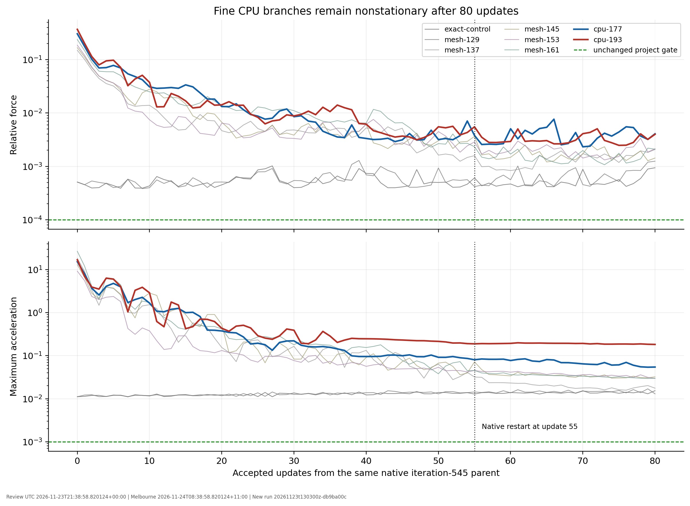
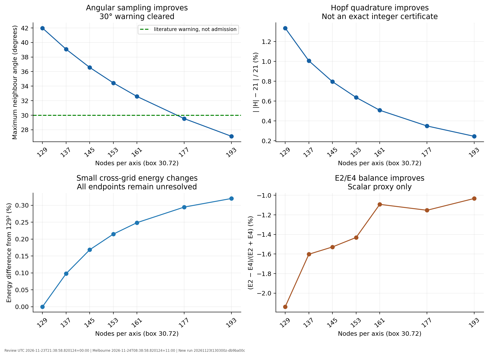
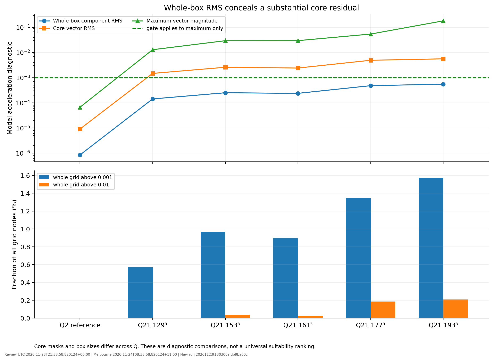
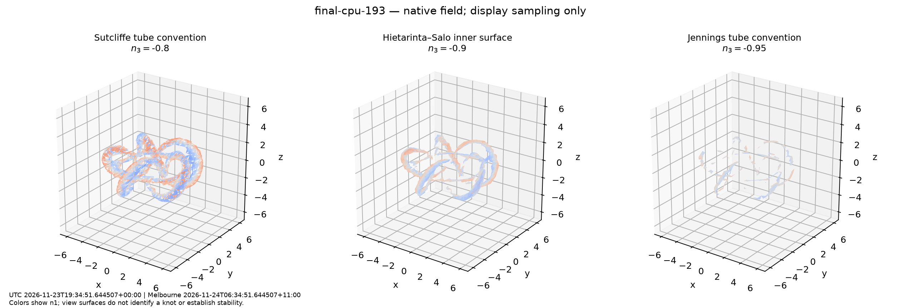

# Q21 CPU resolution supplement: scientific review and implications for Q2–Q32

Review timestamps: UTC 2026-11-23T21:38:58.820124+00:00; Australia/Melbourne 2026-11-24T08:38:58.820124+11:00. Completed run: `20261123t130300z-db9ba00c`. Source SHA256: `e7497eeb4c0f533ff4c999fee37480876436ccfabadc96c74167d41a9261af12`.

**The CPU campaign completed both requested grids and improved geometric sampling, but did not obtain a stationary Q21 field. The principal new result is a stronger diagnosis: the remaining residual is concentrated in the core, persists beyond the 30° sampling warning, and is not removed by using energy-based summaries or whole-box averages. This does not invalidate Q2/Q3 references or exclude any Hopf sector.**

## 1. Files received, integrity and publication

The two supplied ZIPs are identical: the uniquely named collect archive and evidence(20261123-212800).zip both hash to the value above. They are one dataset, not two independent runs. All 150 outer compact payload hashes, archive CRCs and safe/unique paths pass. The embedded original Q21 resolution archive is unchanged; its 307 payloads also pass.

The supplied terminal log records successful documentation checks, two successful documentation CI checks, PR97 merged at `3113d5cdfe704472a1efefaa60eed3dbfe4f4eed`, and 152 publication payloads verified against fetched main. Its collected archive hash matches the received bytes. This confirms the reported local publication transaction; no live GitHub operation was performed here. Documentation CI success is separate from scientific admission.

The campaign contains 160 charged and accepted CPU updates, 162 trajectory observations including two initial states, 15 field audits and four directional-derivative audits. I independently recomputed the recorded gates, budget/restart accounting, response windows, nine model-validation scores, author energy-change summaries, regional/RMS consistency, energy-component sums and prior Q2–Q32 gate accounting. All checks agree.

Eight new full NPZ files are declared, representing four distinct container hashes across best/final/alternating slots and about 4.554 GiB in total. They remain on the workstation. Their seals and relationships can be checked here; actual array hashes, numerical derivatives and topology cannot be independently replayed without those arrays. The record says all 24 original full fields were authenticated before launch.

A small archive-packaging defect remains: the sealer excluded files named SHA256SUMS recursively, omitting two nested handover manifests. All 58 remaining handover files match the authenticated original release; that release supplies the missing manifest provenance. This does not alter the scientific measurements. A future sealer should exclude only its own root manifest and retain nested manifests. No scientific rerun is needed for that correction.

## 2. Measured Q21 outcomes

All arms below use the same box 30.72 and source native iteration 545. Both CPU arms reset conjugacy, like the original mesh arms, retain source alpha/shift/restart policy, and finish at native iteration 625. The native conjugacy reset occurred at iteration 600, after 55 accepted updates. No prior CUDA branch was migrated.

| Case | Backend | Spacing | Final relative force | Final maximum acceleration | Final neighbour angle |
| --- | --- | ---: | ---: | ---: | ---: |
| exact-control | cuda | 0.240000 | 0.000940938 | 0.0153818 | 41.95° |
| mesh-129 | cuda | 0.240000 | 0.00124854 | 0.0129925 | 41.98° |
| mesh-137 | cuda | 0.225882 | 0.00206781 | 0.0175957 | 39.07° |
| mesh-145 | cuda | 0.213333 | 0.00143146 | 0.0322274 | 36.56° |
| mesh-153 | cuda | 0.202105 | 0.00213368 | 0.0296338 | 34.43° |
| mesh-161 | cuda | 0.192000 | 0.00209368 | 0.0298422 | 32.57° |
| cpu-177 | cpu | 0.174545 | 0.0040663 | 0.0544938 | 29.53° |
| cpu-193 | cpu | 0.160000 | 0.00398534 | 0.182941 | 27.10° |

Every Q21 observation in the new branches retains representation and boundary admission, but neither endpoint satisfies force <=1e-4 or maximum acceleration <=1e-3. Final force is about 40.7 and 39.9 times its limit; acceleration is about 54.5 and 182.9 times its limit. Both would also fail the older, tenfold looser preparation targets. They ended at the declared horizon, not because a line search stalled or a physical instability was observed.

The source was already relaxed on 129³. Finer initialization is cubic prolongation, normalization and fixed-layer projection, rather than an independently converged field. Initial CPU forces were 0.304 and 0.368; initial maximum accelerations were 15.34 and 17.00. The final residuals are much smaller, but 80 updates still mainly measure re-equilibration on a different discrete mesh. A fair computational allocation is not automatically a fair comparison of equilibrated solutions.

Within the last two ten-update windows, 177³ force improves about 6.9% and acceleration about 18.0%. At 193³, force worsens about 4.8% while acceleration improves about 4.4%; component RMS worsens slightly. This favours 177³ for a small controlled follow-up, but does not prove a limiting residual floor at either mesh. Extrapolating far beyond this post-restart window is unsupported.

## 3. What refinement helped, and what it did not

The earlier geometric forecast was useful: 177³ measures 29.528°, close to the prior quadratic forecast of 29.516°. At 193³ the measured angle is 27.096°. The 30° warning is cleared, and Hopf quadrature error falls from about 1.34% at 129³ to 0.35% and 0.245%. These are improvements in sampling and integral consistency, not an equilibrium certificate or exact integer topology proof.

Matched final energies are 12.366905 and 12.370040. Their difference is only about 0.0253%, while their maximum accelerations differ by a factor of about 3.36. Relative to the unresolved 129³ reset field, energy differences remain only 0.295% and 0.320%. This demonstrates why energy agreement alone cannot replace a stationarity measurement.

The energy-balance proxy (E2−E4)/(E2+E4) moves from about −2.14% at 129³ to −1.15% and −1.03%. That is useful consistency information. It is a continuum-inspired scalar proxy, not an exact fixed-lattice scaling derivative or proof that the gradient vanishes in all directions.

All runs inherit one Q21 parent/basin. They are not eight independent searches. A CPU/CUDA implementation difference is also confounded with part of the mesh series. The new 177³/193³ comparison is CPU-only, but causal comparisons against the older CUDA trajectories still require care; qualifying energy-gradient arithmetic does not guarantee identical nonlinear optimization paths.

## 4. Core residuals: stronger evidence than a single large maximum

The new native field audits fill the previous gap in finer-grid localization. At 177³ and 193³ the core neighbourhood occupies about 2.82% and 2.87% of nodes, yet contains 99.29% and 99.54% of squared acceleration and 99.89% and 99.92% of squared force. Guard maxima are only about 1.4e-5 and 1.5e-5. The dominant unresolved residual is interior/core-localized at the measured endpoints; this does not independently establish domain convergence.

Whole-grid component RMS acceleration is 0.000480 and 0.000552, below the numerical value 0.001. However, the gate applies to maximum vector magnitude, not component RMS. Core vector RMS is 0.00493 and 0.00563. About 44% and 52% of core nodes exceed 0.001; roughly 1.34% and 1.58% of the entire grids exceed it. At 193³ about 0.208% of all nodes exceed even 0.01. This is not just one exceptional node being penalized by a maximum norm.

The 193³ maximum is nevertheless unusually localized: compared with 177³ it increases 3.36-fold, whereas core RMS increases only about 14% and the 99.9th percentile about 1%. The next diagnostic should preserve both broad-core and hotspot measures, including peak trajectories and local geometry. Neither dropping the maximum nor treating it as a complete description would be justified.

The Q2 control passes again: force 1.154e-5 and maximum acceleration 6.636e-5. Its core vector RMS is about 9e-6 and no node exceeds 0.001. Box, charge and core masks differ, so this is a reference consistency check, not a universal cross-Q ranking. It nonetheless shows that the Q21 discrepancy is substantial rather than a marginal rounding issue.

The four recorded constrained directional-derivative audits pass. The final 193³ energy derivative in the tested downhill direction is approximately −0.002576, consistent with its nonzero gradient. These finite directional probes support operator consistency in the tested directions; they are not a complete Hessian or physical stability test. Repeated CPU evaluations correctly identify themselves as the same implementation, not independent backend evidence.

## 5. Author criteria and the meaning of the new curves

Hietarinta–Salo's reported energy-change levels are evaluated on our accepted updates. Final-ten medians are 8.06e-7 and 6.08e-7; neither CPU arm has a final-ten update below 1e-9. Different optimizers prevent a direct tolerance equivalence. Their perturbation-and-return and known-state checks remain unperformed. Source: [primary paper](https://users.aalto.fi/~ala/pdf/081201R.pdf).

Sutcliffe's approximately 0.1% relative-energy accuracy is a reported estimate, not an admission gate. A 0.0253% difference between our unresolved finest endpoints cannot certify stationary convergence. The paper's artificial relaxation suggests a method comparison, not a requirement for physical motion. Source: [primary paper](https://arxiv.org/pdf/0705.1468).

Jennings used spacing 0.06 and source-specific configurations; our finest spacing is 0.16. Matching a display level or approximate energy does not identify the same state. His minimization procedure and preimage analysis have not been fully reproduced by this supplement. Source: [primary paper](https://arxiv.org/pdf/1412.8597).

The seven-point spacing-response refits reproduce the supplied scores. Force-only linear and exponential models qualify, but no acceleration or joint model does. The joint exponential narrowly misses the registered error cutoff (0.2551 versus 0.25); this is a forecasting qualification decision, not a physical stability boundary. No joint optimum or automatic extra allocation follows. The angle forecast's success demonstrates the value of measuring a predicted setting, but cannot be transferred to another response variable.

A literature-informed method comparison is now more informative than assuming that ever-finer grids or easier gates must solve the problem. Continue to distinguish an approximate field, a stationary lattice solution, a converged continuum solution, a perturbatively stable configuration and a passing physical-time trajectory.

## 6. Visual and morphology limits

Native n3<-0.95 voxel component counts change from 34 at 129³ through 17, 11 and 6 on intermediate grids to 2 at both 177³ and 193³. Threshold-set volumes become similar. These values indicate strong sampling sensitivity in the narrow core region; they are not knot/link counts, nor proof of a two-component link. Six-neighbour voxel connectivity and a single target-value neighbourhood cannot identify a generic preimage invariant.

The supplied pictures also have a rendering limitation introduced by the handover: fields are sampled to roughly 65 display nodes per axis, and excess triangles are discarded by striding. The 193³ field is rendered at effective spacing 0.48, despite native spacing 0.16; some intermediate pictures are coarser still. This can fragment thin surfaces. Apparent gaps in those pictures must not be interpreted as physical breakup or failed topology. A corrected renderer should extract native-grid surfaces in a cropped region and preserve mesh connectivity when simplifying. Existing images should be retained and labelled, not deleted.

## 7. Implications for Q2–Q32 and earlier results

The embedded retained-field ledger remains 118 successful native D4 replays, with 100 distinct charge/geometry/array combinations. Nine readiness rows represent three Q2 aliases and six Q3 rest fields; they are not nine independent new solutions. There are ten strict-stationary rows including the boundary-blocked Q4 state. The current work adds two nonstationary Q21 branches, not a new whole-range screen.

| Candidate group | Supported position after this supplement |
| --- | --- |
| Q2 | Retained reference passes again; earlier short-motion evidence remains separate and intact. No long-time electron claim. |
| Q3 | Six retained static readiness rows remain positive, across routes/resolutions. Existing short-motion outcomes retain their original domain/axis limits. |
| Q4 | Medium-grid stationarity passes; boundary admission remains the obstacle. A fixed-spacing domain test is better motivated than applying the Q21 remedy automatically. |
| Q5–Q10 | Earlier domain, preparation, delayed-progress and deferral findings remain candidate-specific. The earlier Q8 state is a targeted near-admission option, not a new pass. |
| Q11–Q16 | Finite screening evidence remains limited to sampled configurations; no Hopf-sector exclusion or blanket reanalysis is established. |
| Q17–Q20 and Q22–Q32 | Existing sampled branches remain unresolved or historically qualified under their native operators. Historical cell-native Q22 results are not revoked by a D4 classification. |
| Q21 | Better sampling and core diagnosis, with two additional failed stationarity admissions; no observed physical-time instability and no exclusion of other Q21 basins. |

The old 71 deferrals still separate into 11 static reader gaps, 43 physical-time checkpoints and 17 secondary-source items. The new supplement has no deferrals, but it does not repair those older reader/coverage gaps. Deferrals must not become physical rejections. Full-field audits here apply to Q21 and the Q2 reference, not to all 118 old replay rows.

The resulting project lesson is useful: coarse energy/topology screening can triage candidates, but derivative residuals, local structure, grid initialization and domain effects require separate tests. A single residual policy or fitted suitability curve should not be imposed across heterogeneous Q2–Q32 histories without validation.

## 8. Runtime, resources and recommended next work

The CPU campaign ran from 00:03:00 to 06:37:46 AEDT on 24 November: 6 h 34 min 45.7 s. Recorded optimizer work took about 99.2 minutes, same-implementation repeats 59.3 minutes, measurement diagnostics 194.2 minutes and checkpoints 9.3 minutes. The remaining roughly 32.7 minutes include supplementary audits, images and overhead. Optimizer cost is now about 25% of total runtime, unlike the earlier GPU run; diagnostic cost remains largest.

There are no recorded hard-limit/OOM events and no resource deferrals. MemoryHigh events did occur. CPU execution resolved the earlier GPU-routing omission without reducing the resource reserve or scientific gates. Same-implementation repeats consume time without independent implementation evidence; any change to their frequency should be explicit and qualified, not silently labelled an equivalent audit.

Recommended sequence:

1. Retain the merged raw results and this scientific assessment. Keep the original source fields and the new best/final/optimizer checkpoints. Correct future nested-manifest sealing and native-surface rendering without rewriting the original evidence.
2. Use 177³ as the primary affordable, below-30° Q21 diagnostic field; retain 193³ for hotspot/resolution comparison. Do not launch still-finer grids or a fresh Q2–Q32 campaign merely because these endpoints remain unresolved.
3. At one fixed geometry and authenticated starting state, compare a bounded exact Sobolev-CG continuation with one separately qualified literature-inspired minimizer. Hold action, source, boundary, precision and gates fixed. Record gradient-evaluation counts and wall time as well as accepted updates; different algorithms do not have equivalent step costs. Use recent measured joint progress and validated short forecasts to allocate batches. The 177³ recent progress justifies a control continuation, not a guarantee of eventual admission.
4. Qualify any alternative against independent directional energy differences and reference kernels. Keep artificial minimizer dynamics distinct from the physical-time equations. Inspect hotspot locations, local residual percentiles and core geometry before interpreting the 193³ peak.
5. Preserve the separate Q4 fixed-spacing domain opportunity and Q2/Q3 controls. Address old reader gaps and controlled basin comparisons selectively. Duration-specific rest-evolution calibration and perturbation-return belong to explicit later studies; no physical stability claim follows from this run.

No new scientific simulation or GitHub update is initiated by this review pack. The next execution study requires the zbook. The immediate outcome is a better numerical diagnosis and clearer evidence boundaries, rather than a claim that the project's candidate topologies cannot be stable.

## Reproducibility and source materials

[Independent checks](INDEPENDENT-REVIEW.json), [Q21 endpoint table](Q21-ENDPOINTS.csv), [regional measurements](FIELD-AUDIT-REVIEW.csv), [all measured energy changes](ENERGY-CHANGE-REVIEW.csv), [Q2–Q32 ledger](Q2-Q32-LEDGER.csv), [received supplement](data/supplement-evidence.zip), [original released handover](data/original-handover.zip), [terminal log](data/terminal-log.txt). The four review figures are supplied as high-resolution PNG and SVG. See README.md for reproduction commands and limits.
