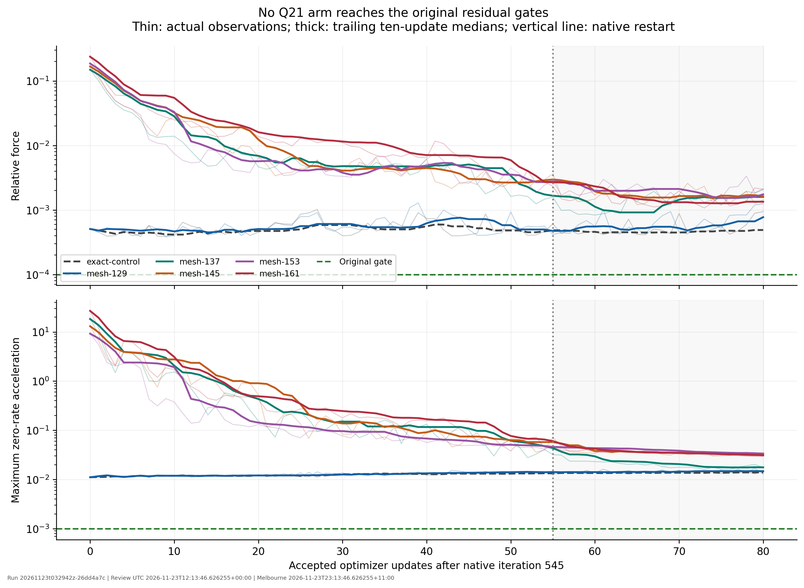
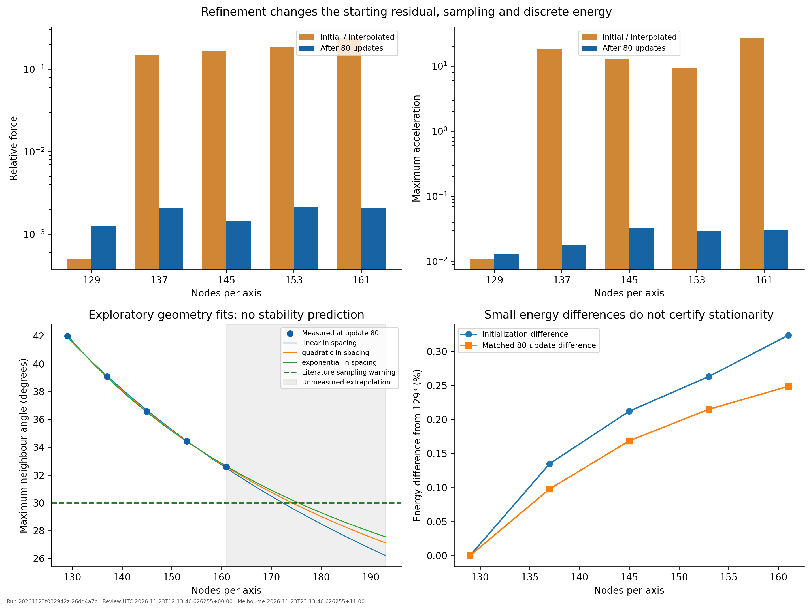
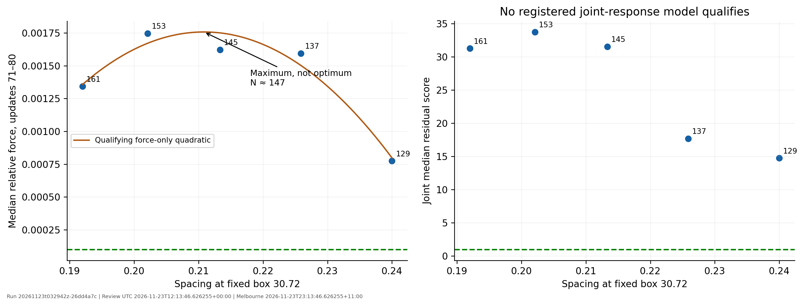
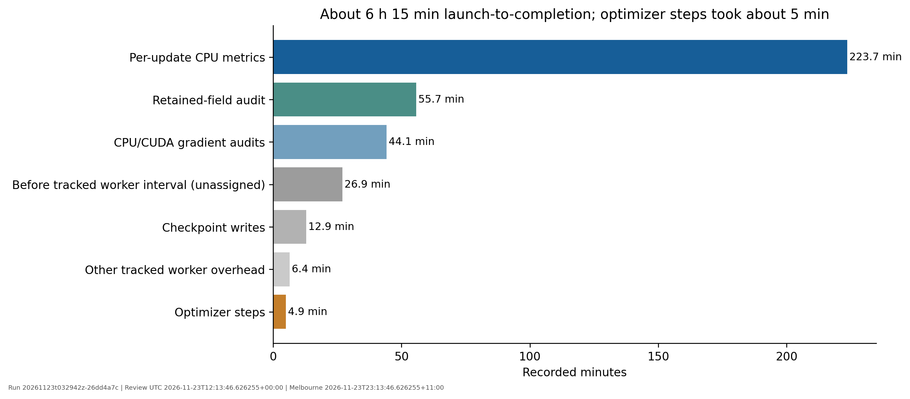

# Q21 resolution pilot and retained Q2–Q32 audit: detailed scientific review

Campaign: 20261123t032942z-26dd4a7c. Source archive SHA256: `36f7e89797230762ad9dec9385d9132543581835b82e60c7610ef33f3ab219d8`. Review timestamps: UTC 2026-11-23T12:13:46.626255+00:00; Australia/Melbourne 2026-11-23T23:13:46.626255+11:00.

**The run completed normally and provides useful numerical diagnosis, but establishes no new stationary Q21 solution or physical stability result. Finer sampling improved geometric resolution, while the 80-update tests mainly re-equilibrated substantially disturbed interpolated fields. Their failure to beat the pre-relaxed coarse baseline is not proof that refinement is ineffective.**

## 1. Integrity, accounting and interpretation limits

All 307 compact payload hashes, unique safe archive paths and CRCs pass. The 31 embedded handover payloads match their manifest and the released package. I independently recomputed 604 recorded gate decisions:486 Q21 observations and 118 bulk replays. Attempt accounting, energy descent, matched response windows, selection, all nine fitted-model scores, native restart phase, checkpoint/seal/field-manifest cross-references, regional sums and spectral sums agree.

There are six Q21 arms, each with 80 charged and accepted optimizer updates:480 in total. The 720 ceiling was not a target. The unused 240 consists of 160 attempts for the two resource-deferred meshes and 80 for the unqualified longer comparison. Native iteration 545 is the correct parent; all completed endpoints are at 625, with the scheduled restart at 600/update 55. All 480 recorded independent CPU/CUDA energy-gradient audits pass. All Q21 observations retain the representation and boundary gates; none reaches strict stationarity. The unchanged Q2 control passes. Physical-time steps are zero.

The source declared 24 retained full NPZ fields totalling 6.319 GiB. Those arrays are absent from the compact evidence. I checked their declared hashes/seals and provenance relationships, not their actual file CRCs or field-derived measurements anew. No new production simulation, source-field mutation or GitHub interaction was performed here. Full-field replay and finer-grid morphology/localization require the zbook.

The supplied terminal and saved receipt identify PR95 as the merged preparation. They do not establish publication of these newly completed results. The raw archive and this assessment should be recorded together next, exclusively through the workstation.

## 2. What remains true about Q21

The final parent is the shift 0.25 baseline at native 545, not the earlier best native 514 field or the selected-shift 0.125 endpoint. Its force is 0.000508036 and maximum acceleration 0.0111309, against 1e-4 and 1e-3 gates.

The fresh final-parent localization confirms 99.567% of squared force and 98.169% of squared acceleration in the registered core neighborhood, which occupies about 2.76% of nodes. The outer guard contributions are tiny. After the new 129³ reset continuation, the fractions are 99.909% and 99.472%. A dominant residual physically located at the outer boundary is therefore an unlikely explanation for this coarse Q21 field. This does not prove domain convergence or localize the newly refined fields.

The source spectrum remains broad: low-band power is about 51.72% of force and 48.28% of acceleration; high-band power is 8.38% and 13.06%. The final 129³ continuation shifts these to 60.52%/58.55% low and 2.07%/4.74% high. Spectral redistribution did not produce stationarity. A high-frequency fraction is not automatically numerical noise, and a restricted spectral summary is not a physical dispersion or stability calculation.

None of the new retained best states improves on the earlier native 514 instantaneous joint score 9.533; the best new 129³ reset score is 11.049. An isolated best score and the registered median-window response are different summaries and must remain separately labelled.

## 3. The mesh experiment: measured results and its principal limitation

The action, box 30.72, baseline shift 0.25, source alpha policy, native counter, gates and resolution-arm memory-reset policy were held fixed. Only the exact-memory control retains conjugacy. The actual final endpoint metrics are below; these are not the medians used for selection.

| Case | Spacing | Final relative force | Final max acceleration | Final max neighbour angle |
| --- | ---: | ---: | ---: | ---: |
| exact-control | 0.240000 | 0.000940938 | 0.0153818 | 41.95° |
| mesh-129 | 0.240000 | 0.00124854 | 0.0129925 | 41.98° |
| mesh-137 | 0.225882 | 0.00206781 | 0.0175957 | 39.07° |
| mesh-145 | 0.213333 | 0.00143146 | 0.0322274 | 36.56° |
| mesh-153 | 0.202105 | 0.00213368 | 0.0296338 | 34.43° |
| mesh-161 | 0.192000 | 0.00209368 | 0.0298422 | 32.57° |

All force/acceleration values are model diagnostics, not SI electron quantities; tail/guard values are fractions. Every final force and acceleration remains above its original gate. Finer fields reduce the angle from 41.98° at 129³ to 32.57° at 161³. The latter is still above the literature's 30° sampling warning; that warning is not a project admission threshold.

The crucial observation occurs at initialization. Cubic prolongation followed by normalization and held-layer projection creates initial force 0.149–0.237 and acceleration 9.24–26.81 on the finer grids, compared with 0.000508 and 0.01113 on the source. The maximum interpolant norm departure is 1.76–2.35%; held-layer component corrections are about 0.000210–0.000517. These are real initialization changes despite valid final unit norms. Changing node count also changes the physical thickness of the two held layers.

After 80 updates, refined force falls 98.6–99.1% from its own initial value, and acceleration falls 99.68–99.90%. This is substantial re-equilibration. It is not stationary convergence: final residuals are still too high. Conversely, a field already relaxed on 129³ has an optimization-history advantage over a regridded field. Equal iteration counts control computational allocation, but do not establish equally converged solutions across meshes.

The registered 80-window joint scores are 14.743 (129 reset),17.690 (137),31.520 (145),33.743 (153) and 31.252 (161). No refined mesh beats the baseline, so `no_persistent_measured_joint_benefit` and the absence of 120-step confirmation are correct under the registered rule. That mode means no persistent comparative advantage, not no progress within a refined case.

From updates 61–70 to 71–80, the 153³ force median falls 17.55% and acceleration 12.52%. At 161³, acceleration falls 10.12% while force rises only 1.83%; at 145³ both improve, by 1.25% and 10.61%. These late trends justify a small prospective continuation test if the finer residuals are properly diagnosed. They do not license unlimited extrapolation or retroactively change this run's registered selection.

The handover localized the new 129³ endpoint only, because no finer mesh was selected. This leaves the location of the refined initial and final residuals unmeasured. The next diagnosis must include these states regardless of their ranking. The interpolated initial arrays were not retained as dedicated snapshots; they can be deterministically reconstructed from the preserved parent and exact interpolation implementation, then checked against the recorded initial metrics. Reconstructed states must be labelled accordingly.

All registered mesh-energy differences pass the 2% diagnostic. At update 80 they range from 0.098% to 0.249% above the 129³ energy. This is useful consistency information, but neither state is stationary, so it cannot certify convergence of stationary solutions. Low or nearly unchanged integrated energy cannot replace gradient or peak-acceleration gates. The purpose of refining spacing is a consistent continuum solution, not the lowest residual or energy after an arbitrary short budget on a coarse lattice.

## 4. What the behavioural curves establish

Five distinct spacings were measured, with 137³ and 153³ acquired as exploratory slope/gap samples. One of the nine registered component/model fits qualifies: the force-only quadratic has leave-one-out range-normalized RMSE 0.2055 and skill 0.7875. No acceleration or joint model qualifies; their best normalized error is 0.3010, above 0.25. Joint scores are acceleration-limited at all five 80-window points, so joint and acceleration fits are scaled versions of the same response, not independent confirmations.

The qualifying force quadratic has negative curvature: approximately -1.1271 h² +0.47526 h -0.048342. Its vertex at h≈0.21083, or N≈146.7, is a **maximum**, not a useful optimum. A component-only fit cannot prescribe a setting when the acceleration/joint response fails validation. No interpolated optimum was established.

As a separate, explicitly post-hoc exploration, I fitted final neighbour angle versus spacing. Linear, quadratic and exponential models have within-support leave-one-out RMSE about 0.159°,0.021° and 0.107°. They place the 30° crossing at approximately 172–175 nodes and predict 29.06–29.75° at 177³. This makes 177³ a defensible next geometric sampling test if resources qualify. It is extrapolation beyond the measured 161³ endpoint, not a confidence interval, a registered optimum or a prediction of stationarity. These fits describe fields after 80 updates, not converged solitons.

## 5. The Q2–Q32 ledger: positive evidence and corrected coverage

The headline 189 refers to catalogued files, not 189 independent configurations. Of 118 successful native D4 replays, there are 100 distinct charge/geometry/field-array tuples. The nine all-readiness passes comprise three Q2 copies with identical field-array bytes and six Q3 rest fields at several resolutions/routes. They confirm previously useful references, not nine newly discovered solutions. Q3 spans coarse, medium, fine and larger-domain states; it remains a real positive result for static numerical admission, with physical-time stability still separate.

There is also one strict-stationary Q4 field that fails boundary admission: q 4-axial 41-medium-fresh, native 225,121³, box 23.04. Force 6.353e-5 and acceleration 5.436e-4 pass. Tail 0.00084198 exceeds 0.00075, and guard 0.00151397 exceeds 0.001. Its neighbour angle is 25.72°. It is a boundary/domain candidate, not a generic optimizer plateau.

The earlier Q8 endpoint at native 600,121³, box 23.04 has force 5.787e-5 (passes), acceleration 0.00120334 (20.3% above the limit), and guard 0.00108797 (8.8% above). Its later campaign endpoint must not be silently replaced by this earlier state; any reuse needs explicit prior-state selection. This is a targeted near-admission example, not a newly passing candidate.

The 71 reported deferrals need a scope correction. Forty-three occur in physical-time case-checkpoint paths, which should have been separated from static eligibility. Seventeen are from the secondary 120027 rapid-screen run with no retained compact archive; that is not the original 094318 source. Eleven are genuine static metadata/reader-support gaps: three native-geometry cases and eight operator-registry refusals. The latter are tooling limitations, not observed physical failures. Actual array geometry/rate metadata for the physical-time checkpoints still needs its own authenticated reader.

The catalogue construction I supplied was over-inclusive, and its registry was too narrow for some legacy static states. The conservative deferrals prevented unsupported admissions, but the 189/71 totals must not be presented as a complete static screening outcome. The corrected accounting is 118 replayed static entries plus 11 static support gaps,43 separate physical-time checkpoints and 17 secondary-source items. The supplement BULK-SCOPE-REVIEW.csv preserves every original row and adds this classification without altering the raw archive.

Among the 118 replays,57 fail boundary admission and 13 fail representation. These overlap with residual failures; the label `core_or_optimizer_unresolved` simply follows failure of strict stationarity and does not prove that all 108 labelled fields have core-localized residuals. Most new meshes/seed basins still lack full convergence and motion assessment. Historical cell-native Q22 success is outside these D4 classifications and is not invalidated by them. Do not fit a universal suitability curve against Q from this heterogeneous ledger: charge, basin, grid, box and optimizer history vary, while deferrals censor the sample. Relationships should be tested within controlled families, one factor at a time.

## 6. Literature alignment

[Hietarinta and Salo (2000)](https://users.aalto.fi/~ala/pdf/081201R.pdf) refine sampling above 30°, describe long-lived numerical terraces, and test final configurations by perturbation and return. These practices support the present resolution diagnosis and caution against interpreting 80 unresolved updates as nonexistence. Their algorithm and iteration counts are not transferable project stopping rules.

[Sutcliffe (2007)](https://arxiv.org/pdf/0705.1468) computes static minima using artificial kinetic-energy removal and discusses finite-grid energy bias and competing basins. Our small cross-grid energy differences do not reproduce a published minimum without stationary fields and comparable morphology. Nothing measured here establishes that physical motion is required for stability.

## 7. Resources and the actual runtime bottleneck

Launch 14:29:42 AEDT to completion 20:44:23: approximately 6 h 15 m. The tracked worker interval is 5 h 48 m; about 26.9 m precedes that interval and cannot be assigned to a specific component from these records. Add startup/import/authentication/load markers before drawing a performance conclusion about that gap.

Within the tracked interval, per-update CPU metrics take 3 h 43 m 41 s (64.3%), independent CPU/CUDA audits 44 m 7 s (12.7%), the bulk audit 55 m 43 s (16.0%), checkpoint writes 12 m 52 s (3.7%), and optimizer steps 4 m 57 s (1.42%). Making the optimizer itself infinitely fast would save only about 1.4% of tracked runtime with everything else unchanged. The next performance work should profile and qualify equivalent measurements, not omit scientific gates or first alter checkpoint safety.

There are no recorded OOM kills or hard-limit events; soft MemoryHigh events did occur.177³ needed 6.181 GiB estimated device memory plus the 0.75 GiB reserve, but only 6.711 GiB was free: a shortfall of about 0.220 GiB.193³ needs about 8.615 GiB including reserve, exceeding the device's 8 GiB even before other uses. Neither deferral is a scientific failure. Closing applications alone cannot make 193³ fit this estimator.

[CuPy's official documentation](https://docs.cupy.dev/en/stable/user_guide/fft.html) confirms cached FFT plans consume workspace and can be inspected or cleared. Such retained workspace is one possible contributor to the observed free-VRAM reduction, not a diagnosed leak. Measure it before changing implementation; retain the current reserve.

## 8. Recommended next work, in order

1. Record the completed raw archive and this review together. Preserve all 24 new full states and prior source fields. Do not resume the completed run or spend its unused 240 as though it were an automatically approved continuation.
2. Complete read-only diagnosis: correct the static/dynamic/secondary catalogue separation; resolve the 11 static reader gaps from authenticated native metadata; localize the 137–161 initial/reconstructed and final residuals independently of selection. Separate normalization, boundary-layer and sampling effects. Do not infer finer-grid core localization from the 129³ measurement.
3. Profile metrics into force, acceleration, topology, densities and reductions on retained fields, and record device pools/FFT-plan workspace. Qualify any faster implementation against independent CPU results before changing a production campaign. Consider clearing unused FFT plans between geometries; do not lower the reserve to force 177³ through.
4. If refined fields remain valid and show sustained joint progress, prospectively register a small continuation of 153³ and 161³, with the 129³ reset control. An initial 40 updates per arm (120 total), followed by adaptive 10–40-update batches with a separately declared ceiling, is more informative than another broad sweep. Allocate from within-arm progress, stable component behaviour and validated near-term curves, not mandatory superiority to the coarse grid at update 30. Counter 625, optimizer memory, alpha policy and backend must remain explicit. Forecasts are not admission.
5. Test 177³ only after resource qualification; the angle fits motivate that measurement. Use separately qualified CPU execution or a validated memory reduction for 193³ if still needed. Do not transfer a running branch silently between backends. If adequately sampled/re-equilibrated fields still stall, compare one qualified alternative minimizer in a separate one-factor study.
6. Apply the triage to other candidates selectively. Q4 deserves a fixed-spacing domain study from its authenticated stationary medium-grid state; Q8 is a later targeted option with explicit earlier-state selection. Zero padding alone is not domain convergence: measure the released old held layers and re-equilibrated core/tails. Keep failed and untested families distinct. A fresh Q2–Q32 blanket conditioning or relaxation campaign is not justified.

The immediate next measurements require the zbook; the current compact review does not. The central result is a more specific numerical diagnosis and a better allocation rule, not a demonstration that Q21 or higher Hopf charges cannot be stable.

## Review materials

[Independent checks](INDEPENDENT-REVIEW.json), [final endpoint table](ENDPOINTS.csv), [all measured updates](MEASUREMENTS.csv), [corrected bulk scope](BULK-SCOPE-REVIEW.csv), [exploratory angle fits](ANGLE-EXPLORATION.json), [unchanged raw evidence](data/completed-evidence.zip). The four plots are provided as PNG and SVG. The source archive remains unchanged.
