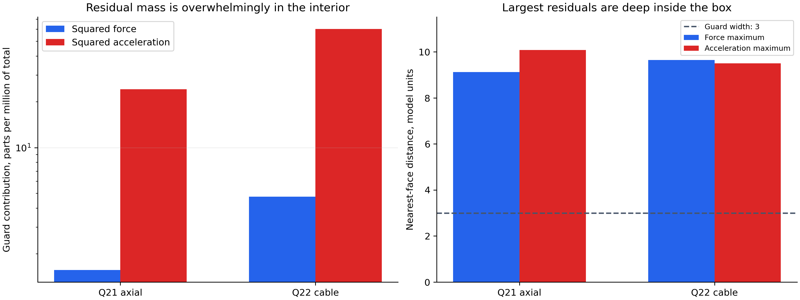
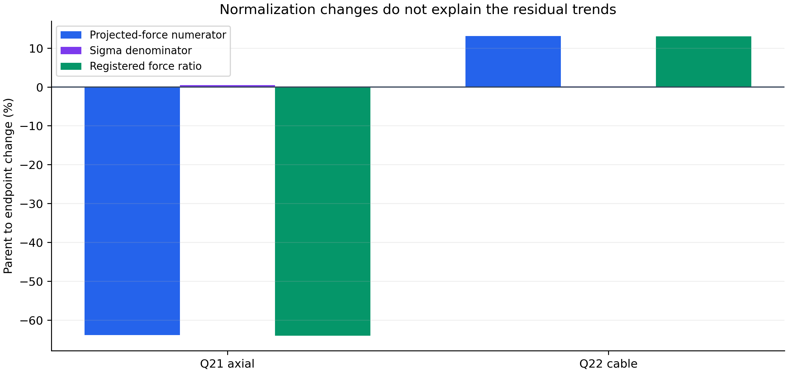
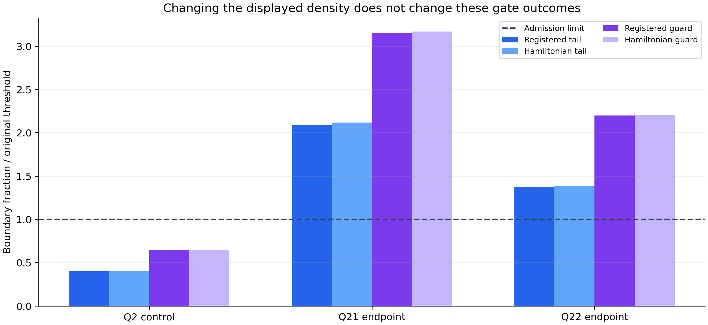

# Retained-field diagnosis: assessment and prior-result reconciliation

Date: 20 November 2026, Australia/Melbourne. Machine-readable outputs contain UTC and Melbourne timestamps.

## Main finding

The Q2 positive control reproduces and passes the original stationarity and boundary gates. Q21 and the current Q22 cable-family field reproduce their recorded metrics but remain unadmitted. Their unresolved force and acceleration are overwhelmingly concentrated in the interior core, not in the boundary guard. The force-ratio trends are genuine changes in the projected residual, rather than an artifact of a large change in its normalization. Switching between the two measured energy-density definitions changes none of the tested boundary pass/fail outcomes.

This changes the next priority: a larger box should not be the first proposed cure for the observed stationarity residual. Boundary-energy admission remains a separate failed condition. Interior localization does not prove that boundaries have no global influence, and it does not identify a unique optimizer defect, resolution error or physical instability.

## What the earlier positive analysis actually said

The recovered S5-B-016 assessment explicitly records bounded cell-functional static successes for Q22 and selected Q17/Q19 branches. It distinguishes those results from unresolved D4 readiness and absent higher-Q motion. Those earlier findings remain part of the project; they are not erased by the present screen. The earlier Q2–Q16 closure likewise retains Q2 and Q3 controls rather than declaring the whole project unsuccessful.

Any summary stating that there is no admitted high-Q parent must be qualified as referring to the current D4 screening preparations. A blanket statement that no useful static high-Q result has ever been obtained would conflict with the retained earlier assessment and should not be carried forward.

| Result | Supported scope | What remains open |
|---|---|---|
| Historical Q22 cable and matched link comparator | Bounded cell/Gauss-functional static benchmark with recorded scalar, refinement/domain and finite-diagram evidence | Current D4 admission of those exact native fields; full stability and dynamics |
| Historical selected Q17/Q19 branches | Static cell-functional results with recorded finite-diagram and numerical controls | Transfer to the D4 lattice action and motion readiness |
| Retained Q2 reference | Current D4 stationarity and boundary control reproduced in this diagnosis | Long-time physical validation remains separate |
| Current Q21 and fresh Q22 cable-family preparations | Reproducible D4 measurements and diagnosis of unresolved interior residuals | Both stationarity and boundary readiness |

The older cell benchmark used an unweighted tangent-gradient RMS criterion below 0.001. The current D4 scheme uses a relative-force limit of 0.0001 and a maximum-acceleration limit of 0.001. These are different finite-lattice operators and metric definitions, although the records place them in a common declared continuum model family.

A prior native Q17 comparison on identical field bytes already measured cell tangent-gradient RMS about 0.0009666 alongside D4 relative force 0.1246 and maximum acceleration 12.35. That is documented operator incompatibility at finite resolution, not a new replay of that native Q17 field here.

For Q22 there is another mismatch: the historical native control identified by the anchor is 129³, length 15.36, spacing 0.12. The current cable-family field is 161³, length 23.04, spacing 0.144. More grid nodes do not make the latter physically finer; its spacing is 20% larger. The field hashes also differ. The present diagnosis does not determine D4 readiness of the exact historical successful Q22 checkpoint. That compatibility question remains open and must not be answered by substituting a fresh seed.

Thus no unexplained same-field replay contradiction was found among the five tested retained fields. This is not a claim that every prior statement has been independently revalidated or every historical compatibility question resolved. The old assertions and their stated limits are preserved in the included pinned source documents.

## Spatial measurements

The guard is the shell within three model units of a box face. It contains about 60% of the grid nodes, yet almost none of the squared residual mass.

| Current endpoint | Force squared outside guard | Acceleration squared outside guard | Acceleration peak distance from face |
|---|---:|---:|---:|
| Q21 axial | 99.999843% | 99.997582% | 10.08 |
| Q22 cable | 99.999523% | 99.993960% | 9.504 |

The maximum force is also in the interior: 9.12 units from the nearest face for Q21 and 9.648 for Q22. The guard width is only three units. Even the largest acceleration inside the guard is below the global acceleration threshold: approximately 0.0518 times the gate for Q21 and 0.0877 times the gate for Q22. The failed maximum acceleration occurs in the core.

These figures use full-field diagnostic outputs, with every cube-shell layer and radial bin included in the underlying source. Squared-residual fractions are not force amplitudes or energy fractions. None of these measurements is physical time evolution. The spatial result weakens a boundary-local residual explanation, while leaving possible nonlocal boundary effects unmeasured.

## Force normalization

| Quantity | Q21 parent → endpoint | Q22 parent → endpoint |
|---|---:|---:|
| Projected-force numerator L2 | 6.76662 → 2.44533 | 3.99164 → 4.51609 |
| Sigma denominator L2 | 1125.74 → 1131.16 | 2465.10 → 2468.60 |
| Numerator change | −63.862% | +13.139% |
| Denominator change | +0.482% | +0.142% |
| Registered force-ratio change | −64.035% | +12.978% |

Q21's force improvement is real under the registered definition: the numerator falls substantially and the denominator barely changes. Q22's worse force ratio similarly reflects a larger projected-force numerator. A normalization explanation does not rescue the endpoint gate outcomes.

This comparison uses exact retained parent/endpoint fields at unchanged geometry within each lineage. It does not compare raw unweighted norms across different grids as a physical convergence measure.

## Energy-density definitions and boundary admission

The registered tail/guard fractions use the continuum `energy_density` output. The D4 action uses the sigma-corrected `hamiltonian_density`. Both were measured on identical fields, and each Hamiltonian integral matches its reported D4 static action.

| Field | Registered tail | Hamiltonian tail | Registered guard | Hamiltonian guard | Outcome under either density |
|---|---:|---:|---:|---:|---|
| Q2 control | 0.00030154 | 0.00030431 | 0.00064638 | 0.00064961 | Pass |
| Q21 endpoint | 0.00156938 | 0.00158836 | 0.00315030 | 0.00316784 | Fail |
| Q22 endpoint | 0.00102974 | 0.00103811 | 0.00219730 | 0.00220636 | Fail |

Original limits remain tail ≤0.00075 and guard ≤0.001. There is no permission or numerical reason here to relabel an alternate diagnostic definition as a gate pass. The distinction matters for consistent reporting, but it does not explain away these failures.

The earlier reports found domain-sensitive integrated stress in other fields and lineages. That remains a valid historical observation. Core localization in the present fields neither reproduces nor disproves those earlier stress/domain experiments; the fields, observables and intervention differ.

## Implications and next steps

1. **Record this assessment with a parallel result ledger.** Keep historical cell-functional static benchmarks marked as supported within their limits; mark current D4 preparations unresolved; keep physical-time stability as a separate unmeasured claim. PRs 82 and 83 already recorded the raw completed results and diagnosis according to the supplied terminal log; this subsequent assessment has not itself been published by this review.
2. **Do not spend the unused 500-ceiling allocation blindly or enlarge the box first.** The large stationarity residual is in the interior. Tail admission remains necessary, but changing the measuring shell alone cannot establish core stationarity. No new broad Q sweep or motion run is supported by these results.
3. **Use one tightly bounded interior preparation test if numerical work continues.** Q21 is the accessible primary target because its residual genuinely improved and it is the closest current high-Q preparation. Check a small number of constrained energy directional derivatives on its exact retained endpoint, then, only if consistent, compare exact CG continuation with clearing conjugacy memory only. Keep the initial alpha, field, grid, box, equations and gates equal; retain the identical line-search policy while allowing its measured accepted alpha to differ. An illustrative budget is 20 attempted updates per arm, 40 new attempts maximum, with matched dense observations, objective-evaluation counts and explicit source lineage. This is a diagnostic fork, not an assertion that memory reset will cure the problem: earlier Q4 and Q8 solver tests did not establish such a general remedy. If the derivative check fails, investigate the implementation instead of relaxing further.
4. **Close the historical Q22 compatibility gap without repeating its old reproduction.** Inventory and authenticate the exact native successful checkpoint. If available, evaluate both historical and D4 operators on its original grid/box before readmission; do not substitute the present fresh cable-family field or resample at this first stage. If it is unavailable, record that deferral. The already measured native Q17 bridge remains evidence of finite-grid operator mismatch; another fresh Q17 solve would not replace the missing Q22 comparison.
5. **Reassess after the small test.** If no matched arm supplies reproducible joint progress, pause this route for a preparation/discretization/model-compatibility decision rather than another increasing budget. Preserve Q2/Q3 controls, all current unresolved fields, and the original Q18 partial-child accounting. Any later refinement, domain or motion activity needs its own exact parent and unchanged relevant gates.

No new experiment is authorized or executed by this assessment bundle. Further field-level work requires the workstation. The current compact-data assessment is complete without additional zbook computation.

## Verification and limits

The diagnostic archive SHA-256 is `c2d762d46422ae6c27647feb46dd76d4df7a98c3ccf1bfad1714cfe381b87bc7`, matching the published snapshot prefix in the supplied PR 83 log. All 94 compact payload hashes and ZIP CRCs pass. The exact 30-payload executed handover identity, eight pinned prior documents and five per-case output seals verify. Field input-array before/after hash receipts agree; all recorded metric replays and gate outcomes reproduce arithmetically.

I independently reconstructed the force numerator/denominator identity, Hamiltonian/action identity, full node counts, force/acceleration squared norms, maxima and energy partitions from both profile families. All partition checks pass. Registered and alternate density gate classifications agree for all five fields. The full-field hash/CRC receipt records 37 checks on the zbook: 36 continuation fields and Q2.

The actual 3D NPZ contents remain local; this review independently audits their compact receipts and scalar/profile consistency, not a fresh full-field evaluation here. The historical native Q22 checkpoint was not among the five diagnosed fields. No new relaxation, time evolution, GitHub access or source modification occurred during this review. Static readiness and instantaneous acceleration do not by themselves establish long-time physical stability or electron properties.

## Files

- `ASSESSMENT.html` / `ASSESSMENT.md`: readable report with measured plots.
- `DIAGNOSTIC-SUMMARY.csv` / `.json`: endpoint localization and normalization comparisons.
- `VALIDATION.json` and `review.py`: portable read-only compact audit.
- `figures/q21-core-slices.svg`, `q22-core-slices.svg`: unchanged diagnostic hotspot slice figures, with their original model-coordinate and log-colour labels. These are instantaneous spatial measurements, not motion frames.
- `prior/`: exact collected earlier assessments, preserved as plain text with original scope and limits.
- `data/diagnostic-evidence.zip`: unchanged uploaded source evidence, including all original diagnostic maps and profiles.
