# Q1–Q16 visual explanation gallery

{"utc": "2026-11-21T00:45:27.908621+00:00", "melbourne": "2026-11-21T11:45:27.908621+11:00"}

[Download the complete offline collection](https://github.com/RDHomeProjects/ElectronFieldTopology/releases/download/visual-q1-q16-2d65859d69cc/matter-waves-q1-q16-offline.zip). Extract it and open viewer.html locally. GitHub does not execute repository HTML. [Release assets](https://github.com/RDHomeProjects/ElectronFieldTopology/releases/tag/visual-q1-q16-2d65859d69cc) include the checksum.

The collection begins with **Q2 as a numerical reference**. The primary completed allocations cover Q2–Q16; Q1 is parked context. Each panel identifies the particular seed lineage, retained state and study stage. A seed label describes its initialization, not a certified final knot type.

The internal field **n** is a unit vector in an internal target sphere, defined at each spatial point. It is not electromagnetic B, a material velocity or an electron spin. The surface marks a stated threshold of **D4-derived continuum energy density**. It is neither the original cell/Gauss density nor automatically the knot core. Dark curves are numerical preimages of the declared near-south target `(0.000007, 0.000011, -1)` after normalization; ambiguous extraction remains unresolved.

Axes use dimensionless model length. The wire box shows the actual finite domain; gray bands show its width-2 tail region. All views keep physical axis limits and internal-component colour range fixed. The internal-field arrows show nₓ/nᵧ components, not velocities. A maximum-over-z acceleration map locates peaks that an average residual can hide. Its cyan contour marks 1e-3; it is a display of the existing D4 operator, not a new acceptance decision. Source and display grids, actual pixel dimensions, numeric thresholds and any triangle sampling are recorded separately. Derivatives are calculated on native arrays before display sampling. A 3840-pixel image does not add numerical field resolution.

**Physical-time videos** use only actual saved states and their recorded model times; sparse states are held without invented intermediates. **Optimizer videos** use native iteration labels and show relaxation, not physical time. **Camera videos** rotate the view of one fixed state and do not show physical spinning. Playback uses two recorded frames per second at 1×, separately from model time; model time has no asserted SI-electron conversion.

Preserved outcomes include Q3's mixed axis/mesh/domain motion tests, Q4 axial41 boundary rejection versus separate axial22 optimizer controls, Q5's pre-loss parent and unresolved representation/domain outcomes, Q8's peak-acceleration failure despite passing force/tail values, and Q10's declining energy with worsening residuals. Q6/Q7/Q9 and Q11–Q16 retain incomplete preparation or coverage rather than physical rejection. All original gates and measurements remain authoritative. Residual maps and extracted curves do not alter those dispositions.

Pleasing geometry, a low residual or a falling energy does not establish full stability, isolated long-time motion, electric charge, quantum spin or an electron model. No new relaxation or physical-time calculation is launched to fill imagery gaps. AI assisted the visual tooling and explanatory prose; this is not independent scientific peer review.

## Q2

### q2-retained-reference — broad

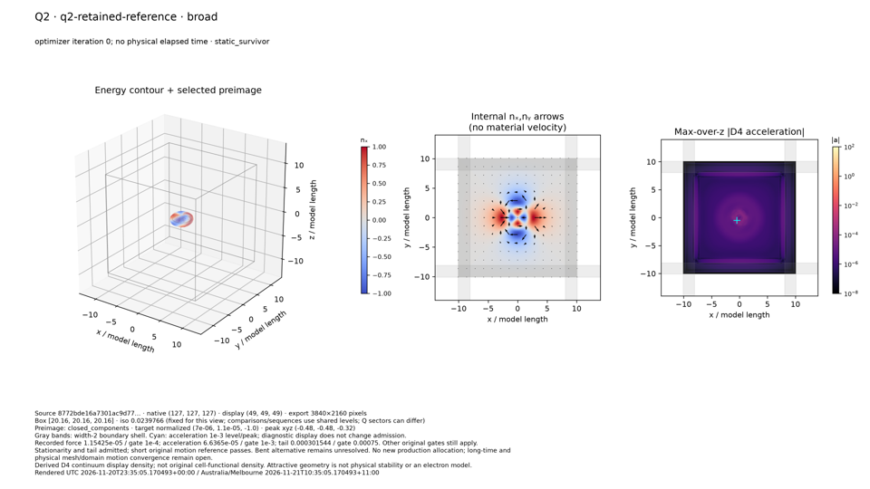

Stationarity and tail admitted; short original motion reference passes. Bent alternative remains unresolved. No new production allocation; long-time and physical mesh/domain motion convergence remain open.

[Source, metrics and render settings](../../reports/s5-b/018-q1-q16-visual-explanations/assessments/20261121t004527z-249b40b8/provenance/q2-retained-reference-broad-0.json). Full PNG and any video are in the offline download.

### q2-bent — broad

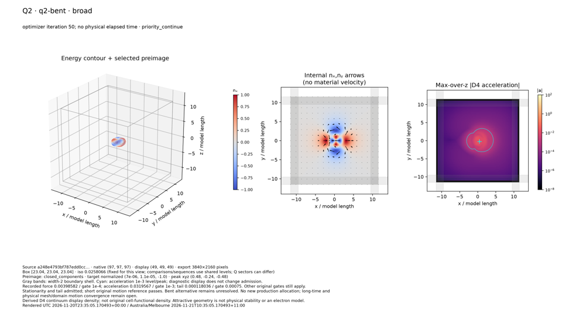

Stationarity and tail admitted; short original motion reference passes. Bent alternative remains unresolved. No new production allocation; long-time and physical mesh/domain motion convergence remain open.

[Source, metrics and render settings](../../reports/s5-b/018-q1-q16-visual-explanations/assessments/20261121t004527z-249b40b8/provenance/q2-bent-broad-50.json). Full PNG and any video are in the offline download.

## Q1 — parked context

### q1 retained rest parent — parked context; parent of admitted temporal study

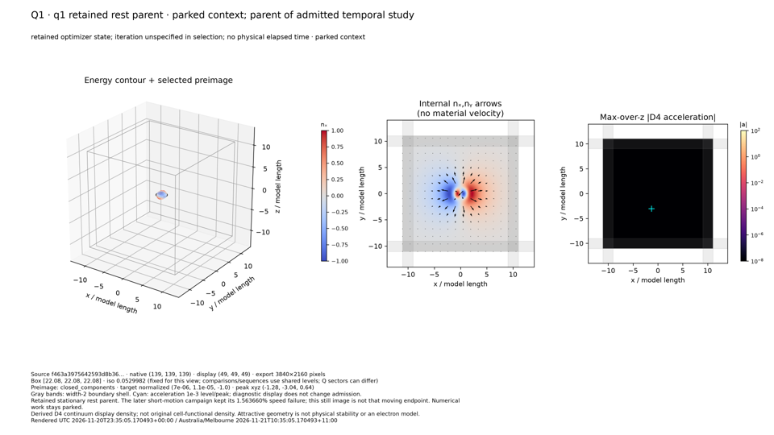

Retained stationary rest parent. The later short-motion campaign kept its 1.563660% speed failure; this still image is not that moving endpoint. Numerical work stays parked.

[Source, metrics and render settings](../../reports/s5-b/018-q1-q16-visual-explanations/assessments/20261121t004527z-249b40b8/provenance/q1-parked-rest-parent.json). Full PNG and any video are in the offline download.

## Q3

### q3-axial — broad

Axial stationary fields on coarse/medium/fine and enlarged domain. Some short motion screens pass; z-axis speed changes with mesh/domain. Preserve mixed motion outcomes and later calibration records; no claim of long-lived converged motion.

[Source, metrics and render settings](../../reports/s5-b/018-q1-q16-visual-explanations/assessments/20261121t004527z-249b40b8/provenance/q3-axial-broad-225.json). Full PNG and any video are in the offline download.

### q3-bent — broad

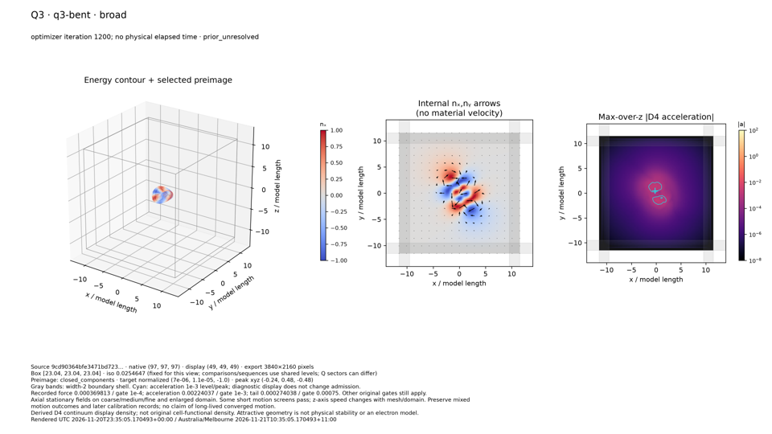

Axial stationary fields on coarse/medium/fine and enlarged domain. Some short motion screens pass; z-axis speed changes with mesh/domain. Preserve mixed motion outcomes and later calibration records; no claim of long-lived converged motion.

[Source, metrics and render settings](../../reports/s5-b/018-q1-q16-visual-explanations/assessments/20261121t004527z-249b40b8/provenance/q3-bent-broad-1200.json). Full PNG and any video are in the offline download.

## Q4

### q4-axial22 — broad

Axial41 medium stationary but tail rejects admission; axial22 exact/memory-clear arms remain above joint gates. Mixed transient benefit does not authorize Q6 transfer. Keep both lineages distinct.

[Source, metrics and render settings](../../reports/s5-b/018-q1-q16-visual-explanations/assessments/20261121t004527z-249b40b8/provenance/q4-axial22-broad-75.json). Full PNG and any video are in the offline download.

### q4-axial41 — broad

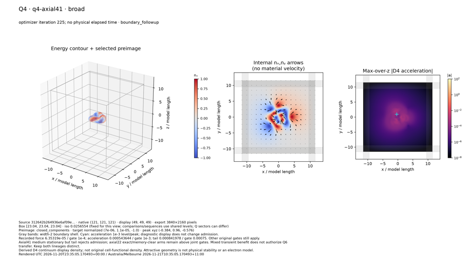

Axial41 medium stationary but tail rejects admission; axial22 exact/memory-clear arms remain above joint gates. Mixed transient benefit does not authorize Q6 transfer. Keep both lineages distinct.

[Source, metrics and render settings](../../reports/s5-b/018-q1-q16-visual-explanations/assessments/20261121t004527z-249b40b8/provenance/q4-axial41-broad-225.json). Full PNG and any video are in the offline download.

### q4-axial22 — campaign2

Axial41 medium stationary but tail rejects admission; axial22 exact/memory-clear arms remain above joint gates. Mixed transient benefit does not authorize Q6 transfer. Keep both lineages distinct.

[Source, metrics and render settings](../../reports/s5-b/018-q1-q16-visual-explanations/assessments/20261121t004527z-249b40b8/provenance/q4-exact-control.json). Full PNG and any video are in the offline download.

### q4-axial22 — campaign2

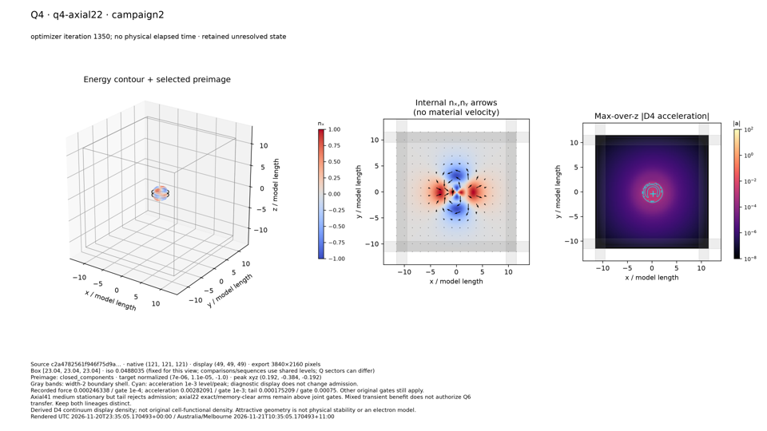

Axial41 medium stationary but tail rejects admission; axial22 exact/memory-clear arms remain above joint gates. Mixed transient benefit does not authorize Q6 transfer. Keep both lineages distinct.

[Source, metrics and render settings](../../reports/s5-b/018-q1-q16-visual-explanations/assessments/20261121t004527z-249b40b8/provenance/q4-memory-clear.json). Full PNG and any video are in the offline download.

## Q5

### q5-axial5-1 — broad

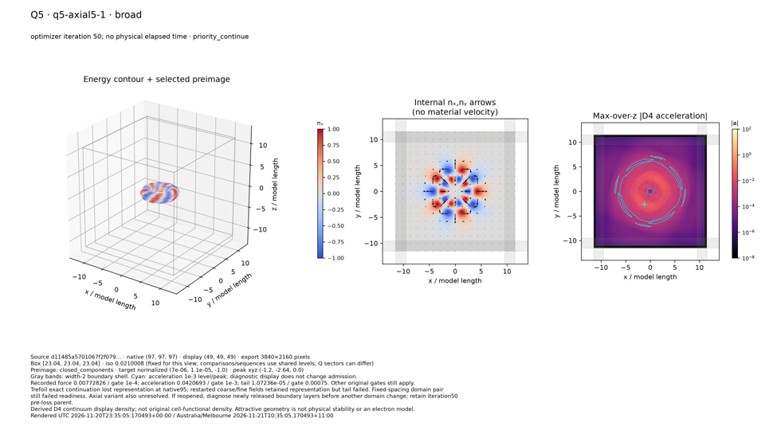

Trefoil exact continuation lost representation at native95; restarted coarse/fine fields retained representation but tail failed. Fixed-spacing domain pair still failed readiness. Axial variant also unresolved. If reopened, diagnose newly released boundary layers before another domain change; retain iteration50 pre-loss parent.

[Source, metrics and render settings](../../reports/s5-b/018-q1-q16-visual-explanations/assessments/20261121t004527z-249b40b8/provenance/q5-axial5-1-broad-50.json). Full PNG and any video are in the offline download.

### q5-trefoil32-1-1 — broad

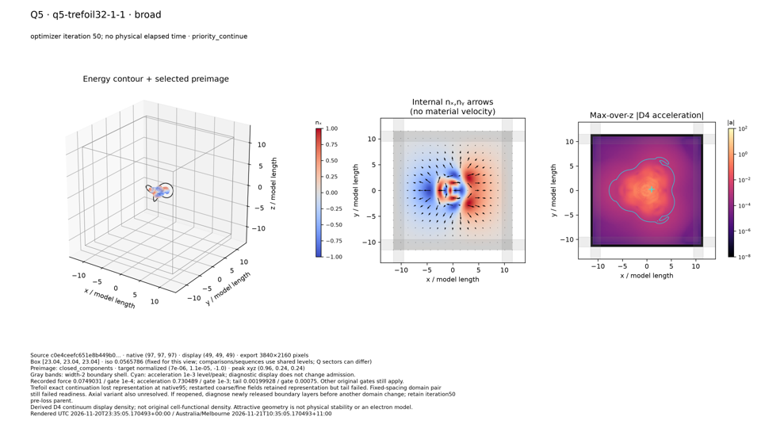

Trefoil exact continuation lost representation at native95; restarted coarse/fine fields retained representation but tail failed. Fixed-spacing domain pair still failed readiness. Axial variant also unresolved. If reopened, diagnose newly released boundary layers before another domain change; retain iteration50 pre-loss parent.

[Source, metrics and render settings](../../reports/s5-b/018-q1-q16-visual-explanations/assessments/20261121t004527z-249b40b8/provenance/q5-trefoil32-1-1-broad-50.json). Full PNG and any video are in the offline download.

### q5-trefoil32-1-1 — campaign2

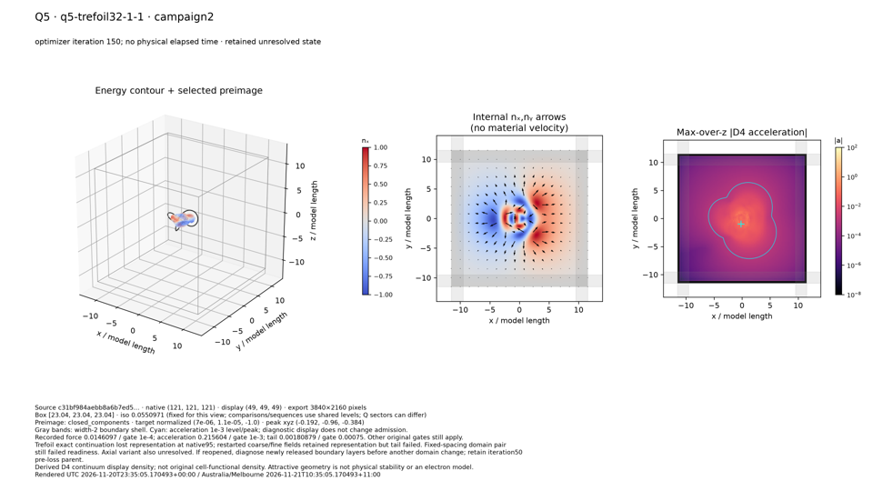

Trefoil exact continuation lost representation at native95; restarted coarse/fine fields retained representation but tail failed. Fixed-spacing domain pair still failed readiness. Axial variant also unresolved. If reopened, diagnose newly released boundary layers before another domain change; retain iteration50 pre-loss parent.

[Source, metrics and render settings](../../reports/s5-b/018-q1-q16-visual-explanations/assessments/20261121t004527z-249b40b8/provenance/q5-domain-control.json). Full PNG and any video are in the offline download.

### q5-trefoil32-1-1 — campaign2

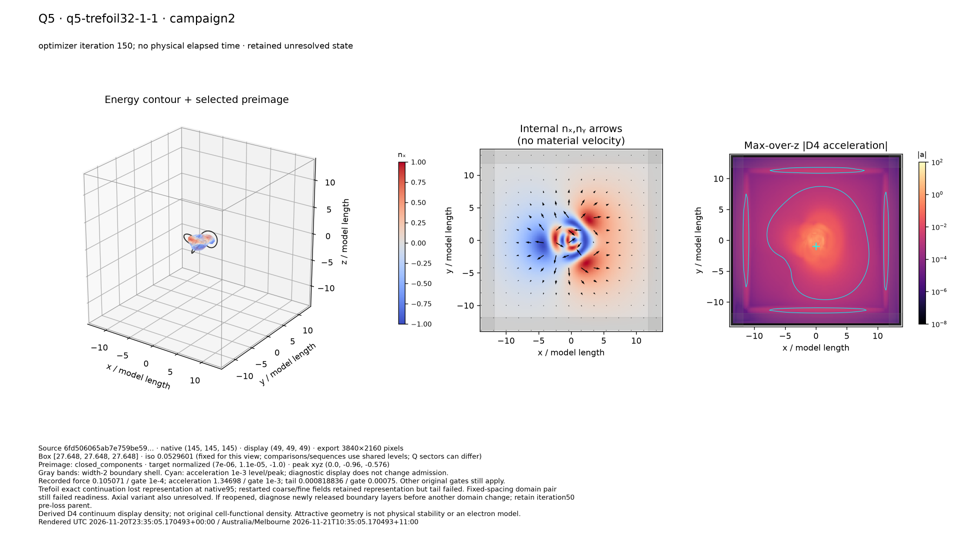

Trefoil exact continuation lost representation at native95; restarted coarse/fine fields retained representation but tail failed. Fixed-spacing domain pair still failed readiness. Axial variant also unresolved. If reopened, diagnose newly released boundary layers before another domain change; retain iteration50 pre-loss parent.

[Source, metrics and render settings](../../reports/s5-b/018-q1-q16-visual-explanations/assessments/20261121t004527z-249b40b8/provenance/q5-domain-expanded.json). Full PNG and any video are in the offline download.

### q5-trefoil32-1-1 — followup

Trefoil exact continuation lost representation at native95; restarted coarse/fine fields retained representation but tail failed. Fixed-spacing domain pair still failed readiness. Axial variant also unresolved. If reopened, diagnose newly released boundary layers before another domain change; retain iteration50 pre-loss parent.

[Source, metrics and render settings](../../reports/s5-b/018-q1-q16-visual-explanations/assessments/20261121t004527z-249b40b8/provenance/q5-trefoil32-1-1-followup-95.json). Full PNG and any video are in the offline download.

## Q6

### q6-axial3-2 — broad

Axial6-1 native400 force/acceleration fail after late worsening; paired Q4 memory test gave no endpoint cure. Other axial seed screened only. Retain native checkpoints; no further Q6 allocation under the closed route.

[Source, metrics and render settings](../../reports/s5-b/018-q1-q16-visual-explanations/assessments/20261121t004527z-249b40b8/provenance/q6-axial3-2-broad-50.json). Full PNG and any video are in the offline download.

### q6-axial6-1 — broad

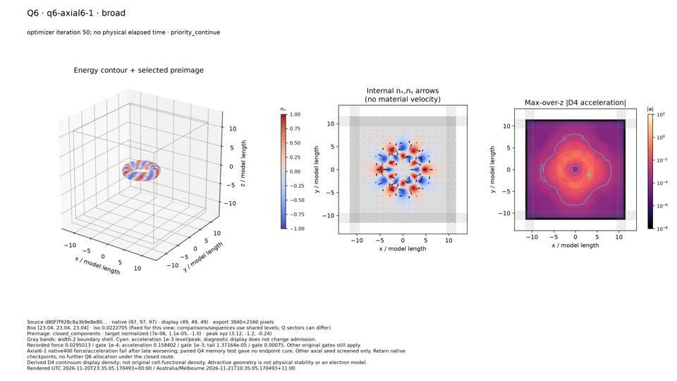

Axial6-1 native400 force/acceleration fail after late worsening; paired Q4 memory test gave no endpoint cure. Other axial seed screened only. Retain native checkpoints; no further Q6 allocation under the closed route.

[Source, metrics and render settings](../../reports/s5-b/018-q1-q16-visual-explanations/assessments/20261121t004527z-249b40b8/provenance/q6-axial6-1-broad-50.json). Full PNG and any video are in the offline download.

### q6-axial6-1 — followup

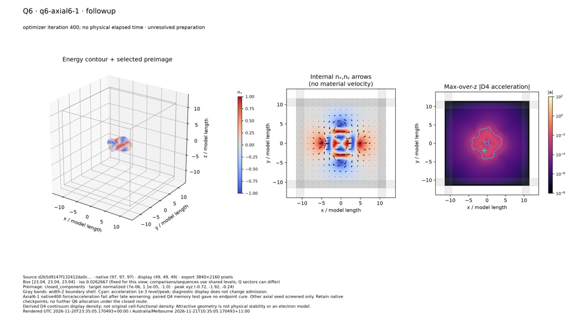

Axial6-1 native400 force/acceleration fail after late worsening; paired Q4 memory test gave no endpoint cure. Other axial seed screened only. Retain native checkpoints; no further Q6 allocation under the closed route.

[Source, metrics and render settings](../../reports/s5-b/018-q1-q16-visual-explanations/assessments/20261121t004527z-249b40b8/provenance/q6-axial6-1-followup-400.json). Full PNG and any video are in the offline download.

## Q7

### q7-axial — broad

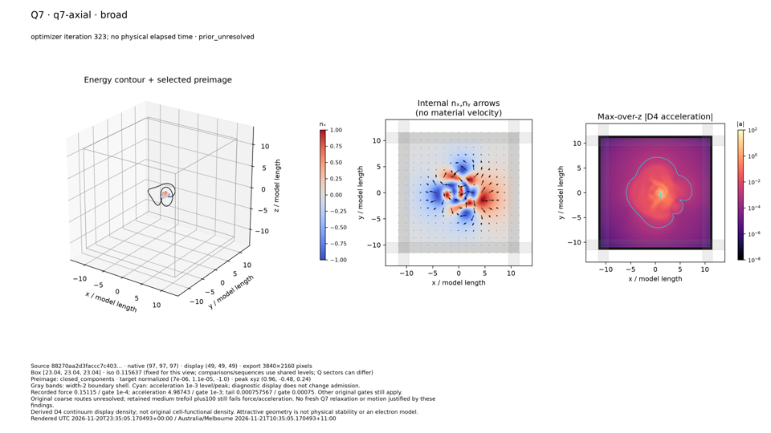

Original coarse routes unresolved; retained medium trefoil plus100 still fails force/acceleration. No fresh Q7 relaxation or motion justified by these findings.

[Source, metrics and render settings](../../reports/s5-b/018-q1-q16-visual-explanations/assessments/20261121t004527z-249b40b8/provenance/q7-axial-broad-323.json). Full PNG and any video are in the offline download.

### q7-trefoil — broad

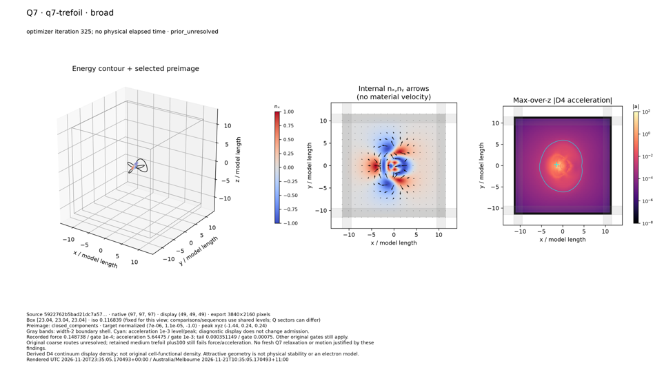

Original coarse routes unresolved; retained medium trefoil plus100 still fails force/acceleration. No fresh Q7 relaxation or motion justified by these findings.

[Source, metrics and render settings](../../reports/s5-b/018-q1-q16-visual-explanations/assessments/20261121t004527z-249b40b8/provenance/q7-trefoil-broad-325.json). Full PNG and any video are in the offline download.

### q7-trefoil — followup

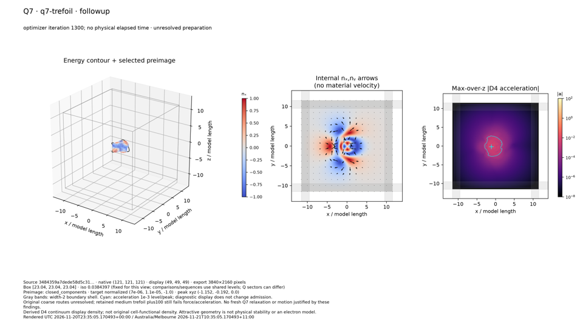

Original coarse routes unresolved; retained medium trefoil plus100 still fails force/acceleration. No fresh Q7 relaxation or motion justified by these findings.

[Source, metrics and render settings](../../reports/s5-b/018-q1-q16-visual-explanations/assessments/20261121t004527z-249b40b8/provenance/q7-trefoil-followup-1300.json). Full PNG and any video are in the offline download.

## Q8

### q8-axial4-2 — broad

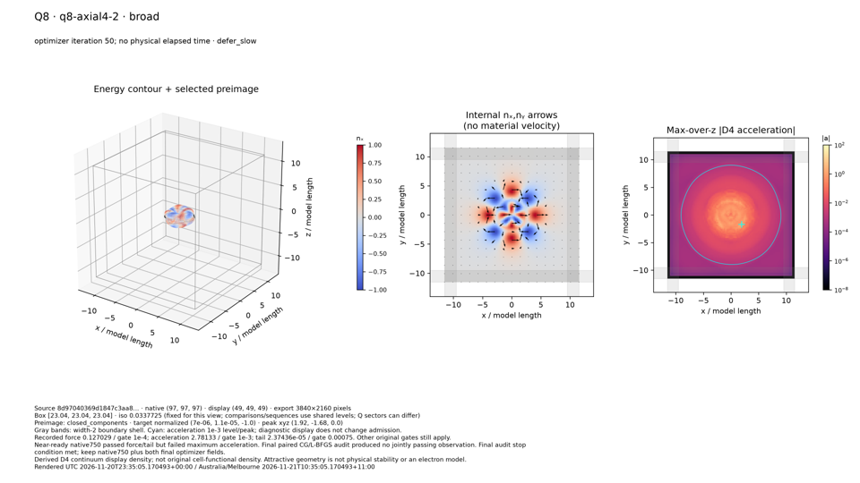

Near-ready native750 passed force/tail but failed maximum acceleration. Final paired CG/L-BFGS audit produced no jointly passing observation. Final audit stop condition met; keep native750 plus both final optimizer fields.

[Source, metrics and render settings](../../reports/s5-b/018-q1-q16-visual-explanations/assessments/20261121t004527z-249b40b8/provenance/q8-axial4-2-broad-50.json). Full PNG and any video are in the offline download.

### q8-trefoil32-1-2 — broad

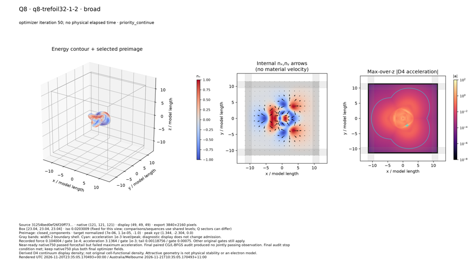

Near-ready native750 passed force/tail but failed maximum acceleration. Final paired CG/L-BFGS audit produced no jointly passing observation. Final audit stop condition met; keep native750 plus both final optimizer fields.

[Source, metrics and render settings](../../reports/s5-b/018-q1-q16-visual-explanations/assessments/20261121t004527z-249b40b8/provenance/q8-trefoil32-1-2-broad-50.json). Full PNG and any video are in the offline download.

### q8-trefoil32-1-2 — campaign2

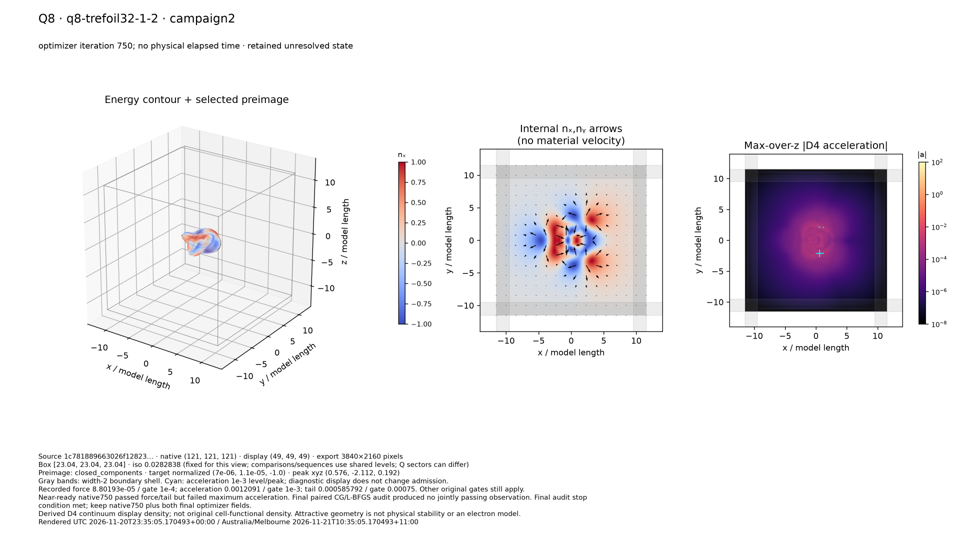

Near-ready native750 passed force/tail but failed maximum acceleration. Final paired CG/L-BFGS audit produced no jointly passing observation. Final audit stop condition met; keep native750 plus both final optimizer fields.

[Source, metrics and render settings](../../reports/s5-b/018-q1-q16-visual-explanations/assessments/20261121t004527z-249b40b8/provenance/q8-continuation-2.json). Full PNG and any video are in the offline download.

### q8-trefoil32-1-2 — decision audit CG-control; native750 parent +50 comparison steps

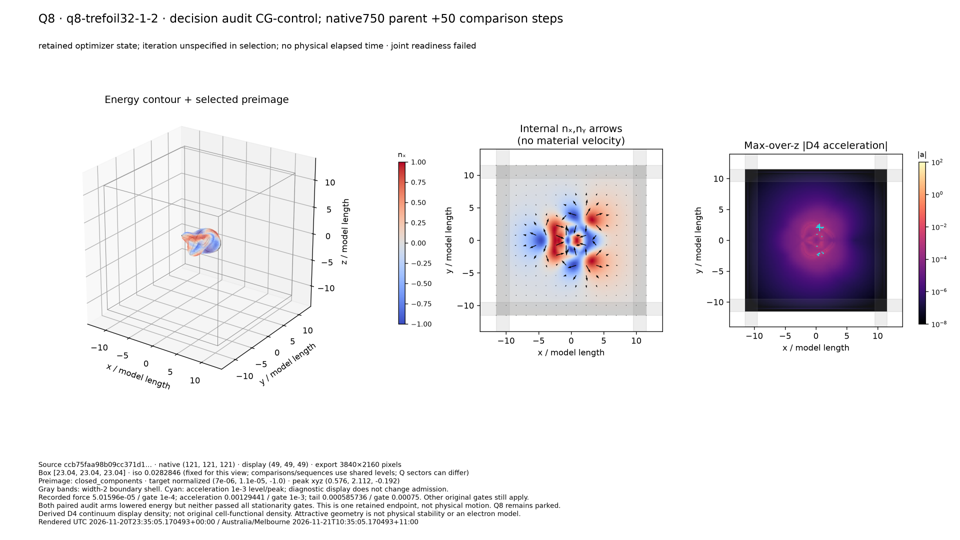

Both paired audit arms lowered energy but neither passed all stationarity gates. This is one retained endpoint, not physical motion. Q8 remains parked.

[Source, metrics and render settings](../../reports/s5-b/018-q1-q16-visual-explanations/assessments/20261121t004527z-249b40b8/provenance/q8-audit-cg-control.json). Full PNG and any video are in the offline download.

### q8-trefoil32-1-2 — decision audit LBFGS-trial; native750 parent +50 comparison steps

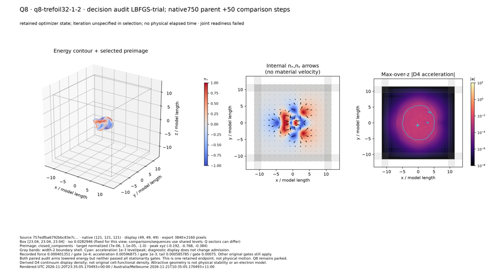

Both paired audit arms lowered energy but neither passed all stationarity gates. This is one retained endpoint, not physical motion. Q8 remains parked.

[Source, metrics and render settings](../../reports/s5-b/018-q1-q16-visual-explanations/assessments/20261121t004527z-249b40b8/provenance/q8-audit-lbfgs-trial.json). Full PNG and any video are in the offline download.

## Q9

### q9-axial3-3 — broad

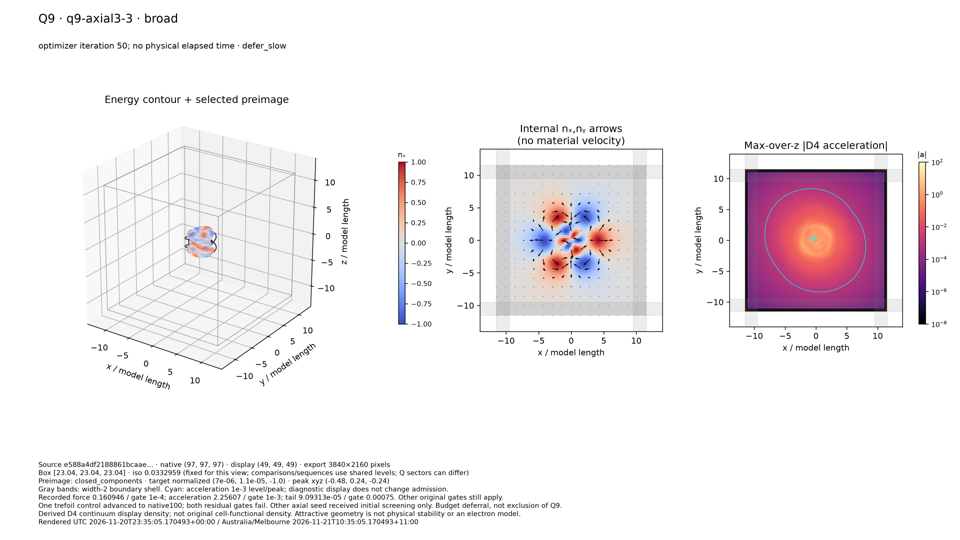

One trefoil control advanced to native100; both residual gates fail. Other axial seed received initial screening only. Budget deferral, not exclusion of Q9.

[Source, metrics and render settings](../../reports/s5-b/018-q1-q16-visual-explanations/assessments/20261121t004527z-249b40b8/provenance/q9-axial3-3-broad-50.json). Full PNG and any video are in the offline download.

### q9-trefoil32-3-1 — broad

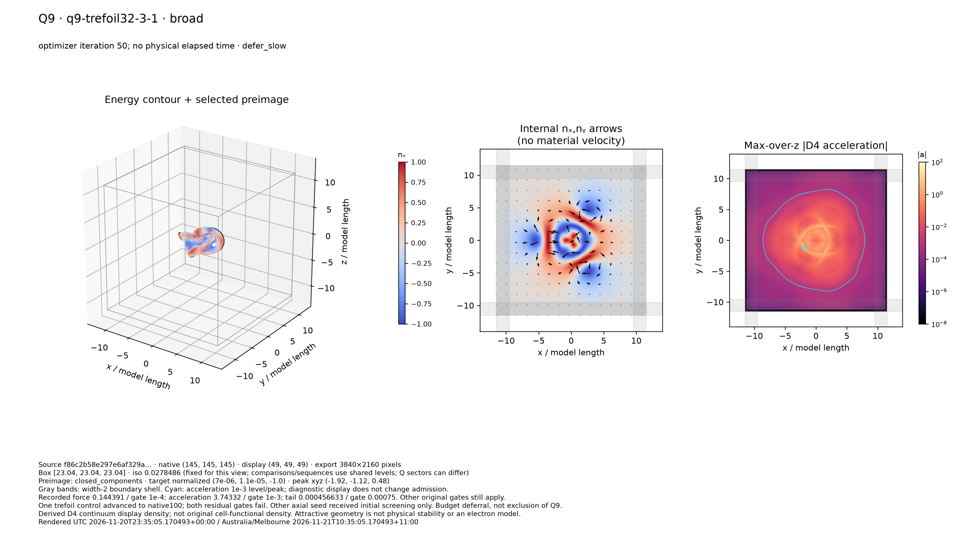

One trefoil control advanced to native100; both residual gates fail. Other axial seed received initial screening only. Budget deferral, not exclusion of Q9.

[Source, metrics and render settings](../../reports/s5-b/018-q1-q16-visual-explanations/assessments/20261121t004527z-249b40b8/provenance/q9-trefoil32-3-1-broad-50.json). Full PNG and any video are in the offline download.

### q9-trefoil32-3-1 — followup

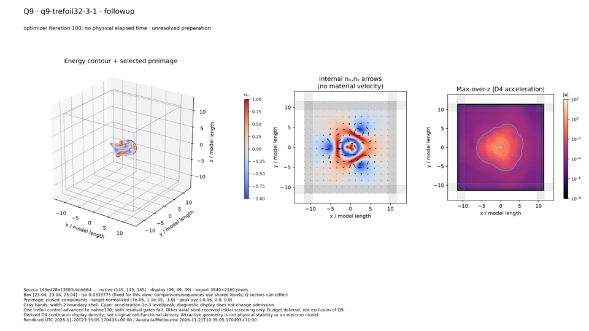

One trefoil control advanced to native100; both residual gates fail. Other axial seed received initial screening only. Budget deferral, not exclusion of Q9.

[Source, metrics and render settings](../../reports/s5-b/018-q1-q16-visual-explanations/assessments/20261121t004527z-249b40b8/provenance/q9-trefoil32-3-1-followup-100.json). Full PNG and any video are in the offline download.

## Q10

### q10-axial5-2 — broad

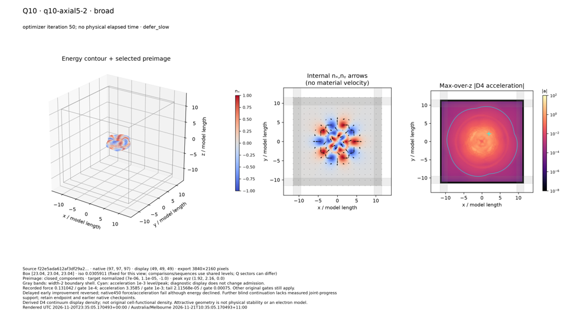

Delayed early improvement reversed; native450 force/acceleration fail although energy declined. Further blind continuation lacks measured joint-progress support; retain endpoint and earlier native checkpoints.

[Source, metrics and render settings](../../reports/s5-b/018-q1-q16-visual-explanations/assessments/20261121t004527z-249b40b8/provenance/q10-axial5-2-broad-50.json). Full PNG and any video are in the offline download.

### q10-trefoil32-2-2 — broad

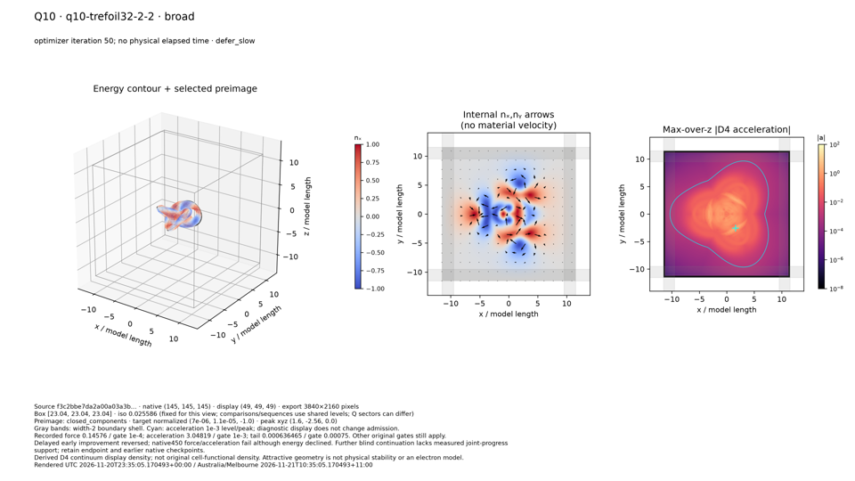

Delayed early improvement reversed; native450 force/acceleration fail although energy declined. Further blind continuation lacks measured joint-progress support; retain endpoint and earlier native checkpoints.

[Source, metrics and render settings](../../reports/s5-b/018-q1-q16-visual-explanations/assessments/20261121t004527z-249b40b8/provenance/q10-trefoil32-2-2-broad-50.json). Full PNG and any video are in the offline download.

### q10-trefoil32-2-2 — campaign2

Delayed early improvement reversed; native450 force/acceleration fail although energy declined. Further blind continuation lacks measured joint-progress support; retain endpoint and earlier native checkpoints.

[Source, metrics and render settings](../../reports/s5-b/018-q1-q16-visual-explanations/assessments/20261121t004527z-249b40b8/provenance/q10-continuation-2.json). Full PNG and any video are in the offline download.

### q10-trefoil32-2-2 — campaign2

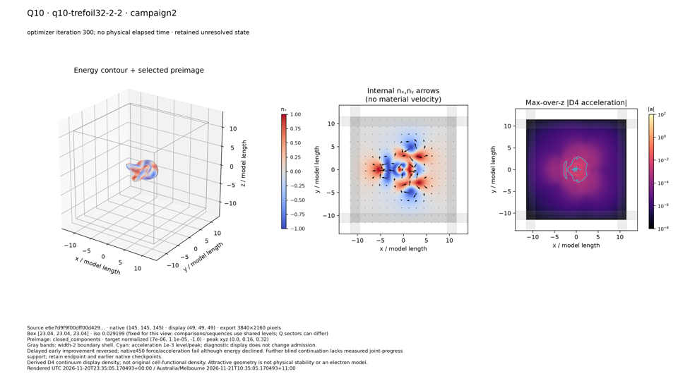

Delayed early improvement reversed; native450 force/acceleration fail although energy declined. Further blind continuation lacks measured joint-progress support; retain endpoint and earlier native checkpoints.

[Source, metrics and render settings](../../reports/s5-b/018-q1-q16-visual-explanations/assessments/20261121t004527z-249b40b8/provenance/q10-iteration-300.json). Full PNG and any video are in the offline download.

### q10-trefoil32-2-2 — campaign2

Delayed early improvement reversed; native450 force/acceleration fail although energy declined. Further blind continuation lacks measured joint-progress support; retain endpoint and earlier native checkpoints.

[Source, metrics and render settings](../../reports/s5-b/018-q1-q16-visual-explanations/assessments/20261121t004527z-249b40b8/provenance/q10-iteration-350.json). Full PNG and any video are in the offline download.

### q10-trefoil32-2-2 — campaign2

Delayed early improvement reversed; native450 force/acceleration fail although energy declined. Further blind continuation lacks measured joint-progress support; retain endpoint and earlier native checkpoints.

[Source, metrics and render settings](../../reports/s5-b/018-q1-q16-visual-explanations/assessments/20261121t004527z-249b40b8/provenance/q10-iteration-400.json). Full PNG and any video are in the offline download.

## Q11

### q11-axial11-1 — broad

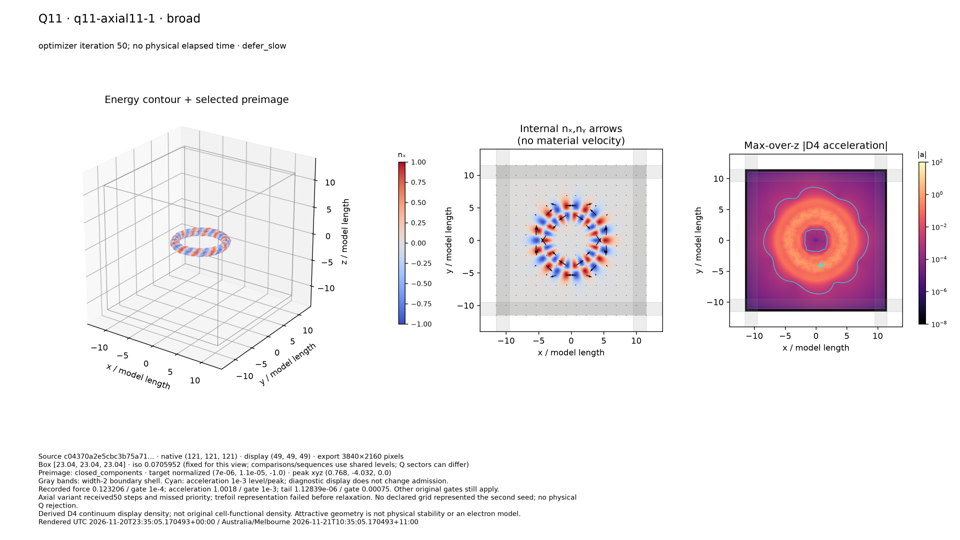

Axial variant received50 steps and missed priority; trefoil representation failed before relaxation. No declared grid represented the second seed; no physical Q rejection.

[Source, metrics and render settings](../../reports/s5-b/018-q1-q16-visual-explanations/assessments/20261121t004527z-249b40b8/provenance/q11-axial11-1-broad-50.json). Full PNG and any video are in the offline download.

### q11-trefoil32-1-3 — broad

Axial variant received50 steps and missed priority; trefoil representation failed before relaxation. No declared grid represented the second seed; no physical Q rejection.

[Source, metrics and render settings](../../reports/s5-b/018-q1-q16-visual-explanations/assessments/20261121t004527z-249b40b8/provenance/q11-trefoil32-1-3-broad-0.json). Full PNG and any video are in the offline download.

## Q12

### q12-axial4-3 — broad

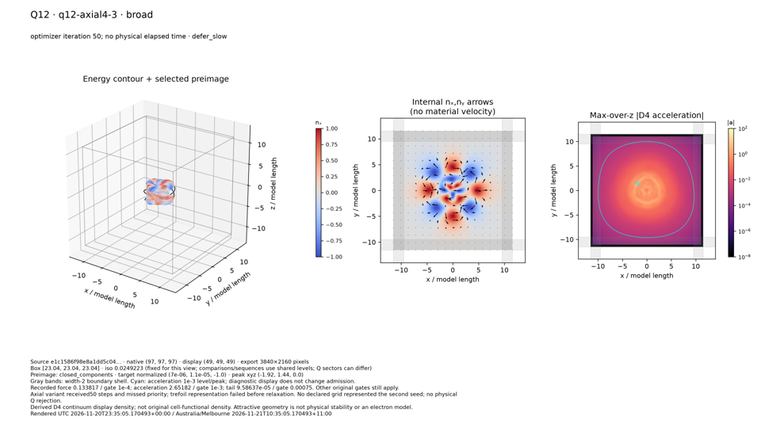

Axial variant received50 steps and missed priority; trefoil representation failed before relaxation. No declared grid represented the second seed; no physical Q rejection.

[Source, metrics and render settings](../../reports/s5-b/018-q1-q16-visual-explanations/assessments/20261121t004527z-249b40b8/provenance/q12-axial4-3-broad-50.json). Full PNG and any video are in the offline download.

### q12-trefoil32-3-2 — broad

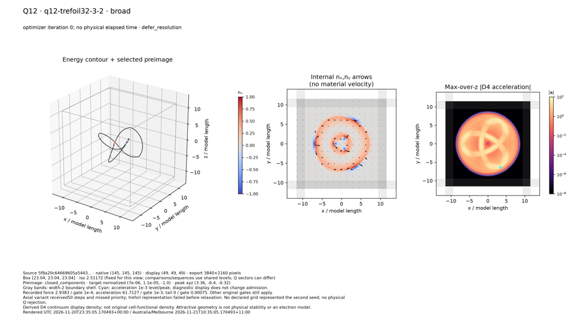

Axial variant received50 steps and missed priority; trefoil representation failed before relaxation. No declared grid represented the second seed; no physical Q rejection.

[Source, metrics and render settings](../../reports/s5-b/018-q1-q16-visual-explanations/assessments/20261121t004527z-249b40b8/provenance/q12-trefoil32-3-2-broad-0.json). Full PNG and any video are in the offline download.

## Q13

### q13-axial13-1 — broad

Axial variant received50 steps and missed priority; trefoil representation failed before relaxation. No declared grid represented the second seed; no physical Q rejection.

[Source, metrics and render settings](../../reports/s5-b/018-q1-q16-visual-explanations/assessments/20261121t004527z-249b40b8/provenance/q13-axial13-1-broad-50.json). Full PNG and any video are in the offline download.

### q13-trefoil32-2-3 — broad

Axial variant received50 steps and missed priority; trefoil representation failed before relaxation. No declared grid represented the second seed; no physical Q rejection.

[Source, metrics and render settings](../../reports/s5-b/018-q1-q16-visual-explanations/assessments/20261121t004527z-249b40b8/provenance/q13-trefoil32-2-3-broad-0.json). Full PNG and any video are in the offline download.

## Q14

### q14-axial7-2 — broad

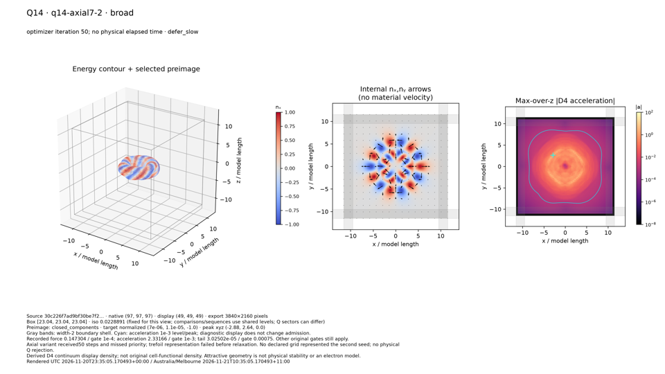

Axial variant received50 steps and missed priority; trefoil representation failed before relaxation. No declared grid represented the second seed; no physical Q rejection.

[Source, metrics and render settings](../../reports/s5-b/018-q1-q16-visual-explanations/assessments/20261121t004527z-249b40b8/provenance/q14-axial7-2-broad-50.json). Full PNG and any video are in the offline download.

### q14-trefoil32-1-4 — broad

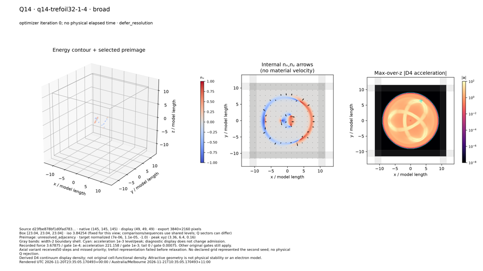

Axial variant received50 steps and missed priority; trefoil representation failed before relaxation. No declared grid represented the second seed; no physical Q rejection.

[Source, metrics and render settings](../../reports/s5-b/018-q1-q16-visual-explanations/assessments/20261121t004527z-249b40b8/provenance/q14-trefoil32-1-4-broad-0.json). Full PNG and any video are in the offline download.

## Q15

### q15-axial5-3 — broad

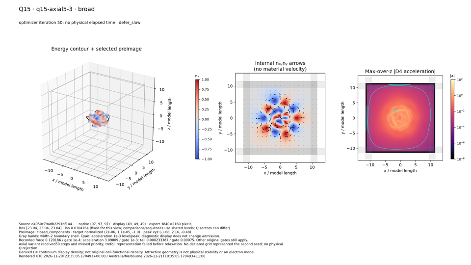

Axial variant received50 steps and missed priority; trefoil representation failed before relaxation. No declared grid represented the second seed; no physical Q rejection.

[Source, metrics and render settings](../../reports/s5-b/018-q1-q16-visual-explanations/assessments/20261121t004527z-249b40b8/provenance/q15-axial5-3-broad-50.json). Full PNG and any video are in the offline download.

### q15-trefoil32-3-3 — broad

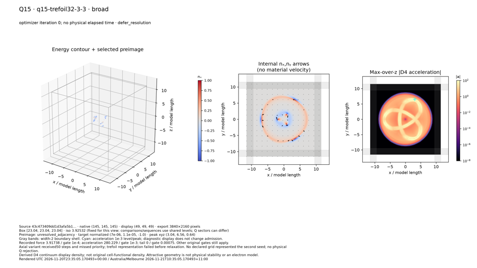

Axial variant received50 steps and missed priority; trefoil representation failed before relaxation. No declared grid represented the second seed; no physical Q rejection.

[Source, metrics and render settings](../../reports/s5-b/018-q1-q16-visual-explanations/assessments/20261121t004527z-249b40b8/provenance/q15-trefoil32-3-3-broad-0.json). Full PNG and any video are in the offline download.

## Q16

### q16-axial4-4 — broad

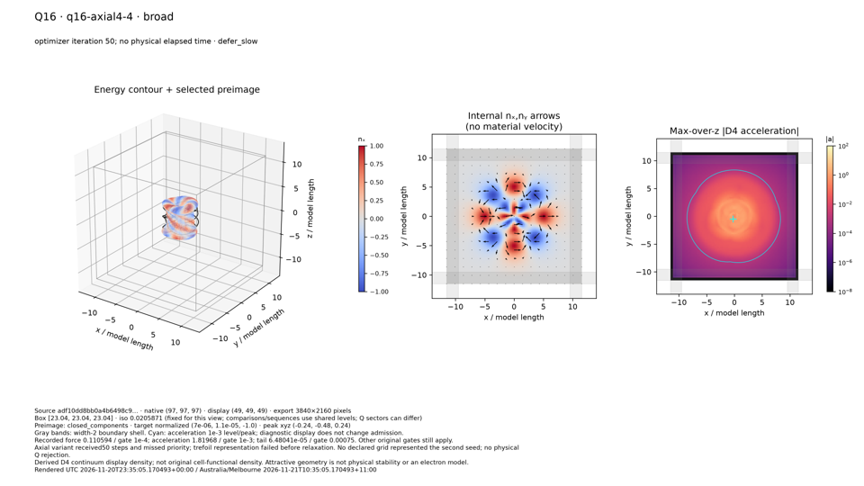

Axial variant received50 steps and missed priority; trefoil representation failed before relaxation. No declared grid represented the second seed; no physical Q rejection.

[Source, metrics and render settings](../../reports/s5-b/018-q1-q16-visual-explanations/assessments/20261121t004527z-249b40b8/provenance/q16-axial4-4-broad-50.json). Full PNG and any video are in the offline download.

### q16-trefoil32-2-4 — broad

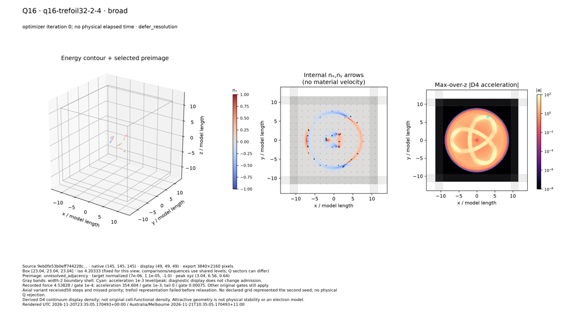

Axial variant received50 steps and missed priority; trefoil representation failed before relaxation. No declared grid represented the second seed; no physical Q rejection.

[Source, metrics and render settings](../../reports/s5-b/018-q1-q16-visual-explanations/assessments/20261121t004527z-249b40b8/provenance/q16-trefoil32-2-4-broad-0.json). Full PNG and any video are in the offline download.
