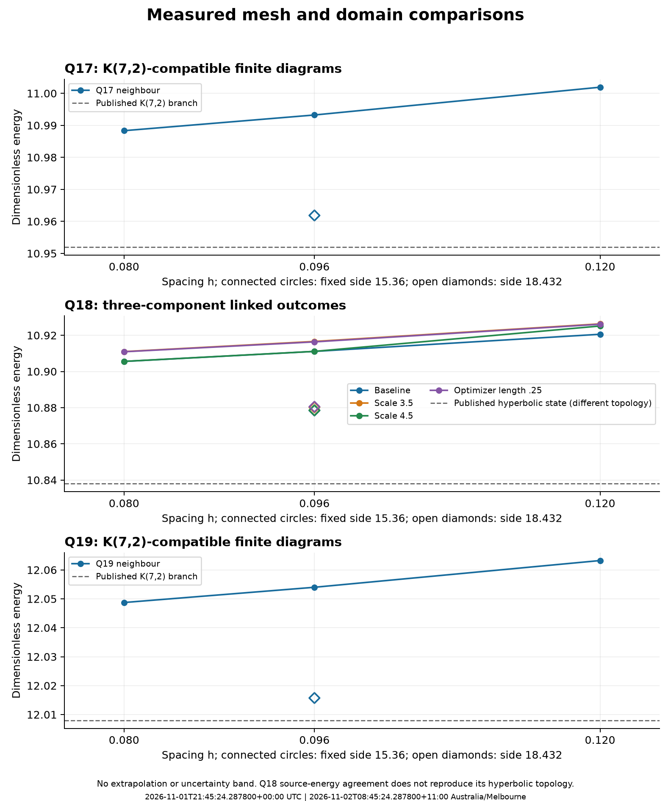
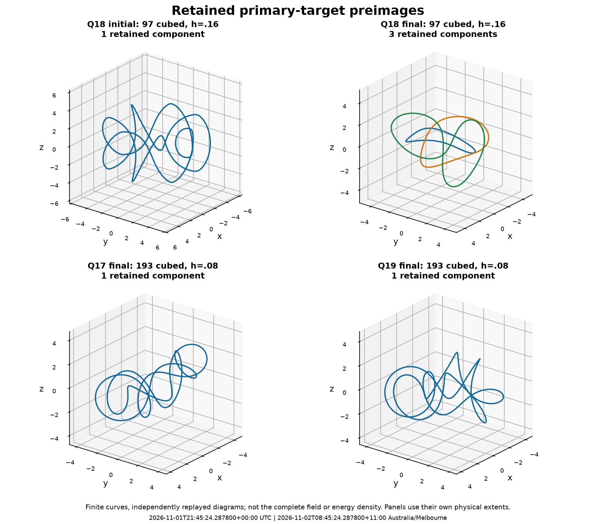

# Scientific assessment: Q18 basin and neighbouring-Q study

Assessed: 2026-11-01T21:45:24.287800+00:00 UTC; 2026-11-02T08:45:24.287800+11:00 Australia/Melbourne. Evidence: [PR50](https://github.com/RDHomeProjects/ElectronFieldTopology/pull/50), results commit `ba456fd0921cb443a5d05234ae5ffffc6a71aa5e`, run commit `c28323ee925371559218c2bc699e6d2804b796bf`. This assessment separates recorded workstation scalar audits, independent retained-curve/diagram calculations, interpretation and unresolved work. AI assisted the review; primary papers remain the scientific sources.

**Finding:** the bounded Q17 and Q19 K(7,2) branch benchmarks are supported by their scalar, refinement, domain and finite-diagram evidence. Q18 consistently reaches a three-component link of individually unknotted components in all four tested branches. The requested hyperbolic Q18 local minimum was not reproduced. The Q18 outcome is robust within these particular starts and controls; it does not establish that the hyperbolic state cannot exist or be reached by another numerical path.

The original [run specification](../../../docs/plans/q18-neighbour-run.md), [plan](plan.json), [raw summary](SUMMARY.md), [machine assessment](assessment-verification-20261102.json) and [replay script](verify_assessment.py) retain exact conditions. No field solver or GPU run was performed during this assessment. Full fields are absent from the published archive; independent calculations here use the retained curves and diagrams. The workstation's full-field energy/gradient/Hopf audits are authenticated as records, not recomputed from fields here.

## Evidence integrity and computation

The 4,933,236-byte archive has SHA-256 `409560f01dbef378c3f1d03db683389d3d931b2a2922ee2ffe9aaed3c3acfed6`. All 504 hashed members, 505 total archive entries, and the readable root copies agree. The audit checks 73 source/lock/config hashes against the exact Git run commit rather than an evolving worktree.

There are 36 solver passes, 72 recorded initial/final CPU endpoint audits and 89 completed analysis jobs. Every pass has a clean run commit, actual float64 CUDA backend/device-validation record, consistent configuration, preserved checkpoint lineage and matching hashes for every published case artifact. The 175 missing case NPZ files are the intentionally local bulk fields. The Q22 control continues a verified retained field; no verified historical Q18 field was found, so the Q18 baseline is explicitly a fresh reconstruction.

Pass statuses are 31 gradient-stationary endpoints, two iteration-limited passes, two residual-not-stationary passes and one time-limited pass. The intermediate limits were followed by further passes and retained; they are not omitted failures or mislabeled final successes. All 31 stage endpoints independently satisfy the recorded scalar criteria, and all five-point coordinate-dilation audits pass. Recorded energy histories are nonincreasing. The largest final CPU residual is 0.000997008, below the unchanged 0.001 gate. The largest reported virial residual is 3.324%, below 5%, at the Q22 control.

The runner's `source_energy` flag defaults to true when a configuration omits `published_energy`. That is a bookkeeping default, not a source comparison. This assessment explicitly recalculates source-energy differences for Q17/Q18/Q19/Q22 instead of relying on that flag. All are below the stated 3% scalar threshold; Q18 still fails the requested topology comparison.

## Energies and finite-grid limits

All energies below use the dimensionless, fixed-coefficient SF-J2015 normalization. The fine mesh is 193 cubed, h=.08, side 15.36. The larger-domain value is 193 cubed, h=.096, side 18.432; its matched-spacing comparison is to 161 cubed, h=.096, side 15.36. These are two distinct controls, not points on a single continuum extrapolation.

| Branch | Fine-mesh energy | Larger-domain energy | Retained final preimage |
|---|---:|---:|---|
| Q17 neighbour | 10.988328329 | 10.961849748 | One K(7,2)-compatible component |
| Q18 baseline | 10.905551049 | 10.878436196 | Three individually unknotted components |
| Q18 scale 3.5 | 10.910994703 | 10.880159103 | Same component/linking pattern |
| Q18 scale 4.5 | 10.905579689 | 10.878573554 | Same component/linking pattern |
| Q18 optimizer length .25 | 10.910897237 | 10.880502810 | Same component/linking pattern |
| Q19 neighbour | 12.048723680 | 12.015723317 | One K(7,2)-compatible component |

All 12 fine-mesh comparisons (129 to 161, then 161 to 193, over six branches) and all six matched-spacing domain comparisons pass the original 2% energy criterion. Mesh changes range from .0437% to .1284%; domain changes range from .2855% to .3338%. These measure the tested sensitivity, not rigorous error bars. Three fine resolutions improve the evidence over a two-grid check, but no continuum/infinite-domain value is certified.

For Q17 and Q19 the finest-mesh energies differ from the published K(7,2) branch values by .3317% and .3391%; the larger-domain differences are .0899% and .0643%. The Q18 baseline differs from the published hyperbolic energy by .6233% on the finest mesh and .3731% on the larger domain, **despite having a different preimage topology**. Energy agreement alone therefore cannot satisfy reproduction.



The graph displays actual samples without an extrapolated fit or invented uncertainty band. Larger-domain diamonds have the same spacing as their 161-grid comparison, but a larger box. The Q18 published line refers to the unreproduced hyperbolic state, not our link.

The Q18 fine-grid energy spread across the four branches is about .0499% of the baseline energy. This is comparable with the final mesh change and smaller than the domain sensitivity. Two close energy clusters therefore do not establish distinct continuum minima or a meaningful global energy ranking. The corresponding larger-domain spread is about .0190%. A Hessian/full stability test has not been performed; stationarity is not proof of a local minimum.

## What the retained topology supports

Each nontrivial stored single-curve PD is reconstructed and simplified again with the declared software/seed convention. Its crossing count, canonical Gauss word and exact integer Jones polynomial are checked. Trivial components dropped by the diagram simplifier are counted explicitly: a library result with zero remaining crossing-bearing components can still represent one geometrically retained unknot. It is not a vanished physical curve.

For a construction-independent K(7,2) reference, the audit uses closures of the explicit two-strand braids sigma1 to the plus/minus seventh power. Q17/Q19 final diagrams agree with one of these finite reference words and polynomials at all stored mesh/domain endpoints, both regular targets, three polygon resolutions and three projections. Both branches also start with compatible single-component diagrams. Mirror/orientation conventions are retained; no signed electric-charge interpretation is applied.

Every Q18 initial 97-grid screen has a single K(7,2)-compatible preimage. Its final preimages have three individually unknotted components. This pattern persists through all 20 Q18 stage endpoints, at both target values and all recorded curve/projection controls. Every pairwise diagram observation gives the same signed linking for its pair; the three absolute pairwise linking numbers are 1, 2 and 2.

The independent Gauss quadratures are replayed from the archived curves at 256, 384 and 512 segments. They agree with the retained numerical values and support the diagram linking pattern. Across 1,350 replayed component diagrams, 720 pair-projection observations and 360 recomputed Gauss samples, the maximum Gauss-to-integer discrepancy is 0.000504456. Replay differences are at most 4.44e-16 and every pair error decreases over the three sample counts; finite quadrature agreement is not rounded into a continuum theorem. Pairwise linking alone does not uniquely identify the full three-component link.

The Q22 control remains a single component with the cable-reference Jones polynomial from an independently generated Eq.3.7 curve. This is a regression check consistent with the earlier Q22 benchmark; polynomial agreement alone does not supply a new complete cable-isotopy certificate.



The figure shows the retained primary-target curves, not the complete field or energy density. Q18's one-to-three component change occurs during the coarse-grid relaxation. A chosen preimage can reconnect while the full field's reported Hopf degree remains near 18; preserving the global numerical degree does not force preservation of that preimage's knot type. The numerical continuity guards and measured Hopf integral are not an exact continuum homotopy proof.

## Comparison with the source and remaining confounds

Primary reference: Paul Jennings, [arXiv:1412.8597v2](https://arxiv.org/html/1412.8597v2), Eq.2.7, Section 4 and Table 1; existing bibliography L36. The relevant selected branch energies are Q17 K(7,2)=10.952, Q18 H4.851/10_139=10.838, and Q19 K(7,2)=12.008. Table 1 also contains lower-energy outcomes at these Q values: these are local branch comparisons, not global minima. The paper uses a 301-grid h=.06 calculation and a damped second-order minimization with kinetic-energy removal, whereas this study uses the declared cell/Sobolev-CG method and pass restarts. Those differences remain part of the reproduction question.

**The starting grid is confounded with Q.** All four Q18 branches begin at 97 cubed, h=.16; both neighbours begin at 129 cubed, h=.12. The Q18 129/161/193 states are prolongations of a coarse-grid link. Refining them cannot test whether a fresh fine-grid K(7,2) seed would enter a different basin. The good neighbour results show that the instruments can retain the expected torus diagrams in those cases; they do not rule out a Q18-specific starting-resolution or minimization-path effect.

The controls vary radial scale (3.5/4/4.5) and fixed precondition length (.5/.25), with the same W amplitude 4, cutoff 7.2, perturbation prescription and seed 35. This is four related deterministic starts, not a broad stochastic basin survey. It does not test all profiles, conditioning amplitudes, perturbation seeds or minimizers. The historical amplitude-1, fresh-193 attempt was time-limited and nonstationary; the current amplitude-4 coarse-start study does not complete that earlier attempt.

## Disposition and next scientific question

| Question | Disposition |
|---|---|
| Was the transfer complete and internally consistent? | Archive/source/record checks pass; full fields intentionally stay local |
| Did all planned stages reach the original scalar/dilation gates? | Yes, for the 31 recorded endpoints |
| Are Q17/Q19 selected torus-branch benchmarks supported? | Yes, within the tested finite-grid/domain/diagram scope |
| Was Q18's hyperbolic local minimum reproduced? | No; preserve this negative result |
| Is Q18's linked outcome repeatable under the tested changes? | Yes; four coarse-start branches retain the same component/linking pattern |
| Does this exclude a fine-start/source-method hyperbolic basin? | No; starting resolution, W conditioning and minimizer differences remain |
| Does it establish charged particles, physical-time stability or electron properties? | No; this is the neutral static reference |

Record this tranche as a useful bounded comparison and an unsuccessful hyperbolic reproduction. A focused next test should isolate starting resolution: fresh Q18 amplitude-4 seeds at 129 and 193, compared with the existing coarse-start path under the same physical functional and optimizer settings. A separate fresh-193 amplitude-1 branch would address the earlier unfinished conditioning attempt. Use complete checkpointed convergence/analysis rather than a short fixed total campaign cap. The distinct controls must retain their own provenance, matched physical boxes, initial degree/cell checks, outcomes and topology diagnostics.

After those comparisons, decide whether a source-like damped minimizer comparison or the planned Q20/Q24 branch/reconnection controls answer the remaining question. Preserve the field-map freedom for core preimages to reconnect. A wider Q catalogue is not evidence for charge or relativistic dynamics. The [charged-model audit](../../charged-model-audit-20261101/README.md) remains a separate track with unresolved physical gates; it is not repaired by obtaining more neutral knots.

## Timing and reproducibility

The recorded campaign starts at **2 November 2026, 02:21:05.659516 AEDT / 1 November, 15:21:05.659516 UTC**. The last state update is **07:11:24.240494 AEDT / 20:11:24.240494 UTC**, a tracked span of **4 h 50 min 18.6 s**. Solver wall time totals **4 h 12 min 26.2 s**; recorded analysis jobs total about **15 min 15.8 s**. Inventory, device/setup checks, checkpoint I/O, hashing/collection and other bookkeeping occupy the remainder; the categories are recorded measurements, not a CPU/GPU utilization profile.

The user-provided outer-launcher observation places the final summary/evidence message at **07:12:13.124772 AEDT / 20:12:13.124772 UTC**, about **4 h 51 min 7.5 s** after the recorded start. That outer log was not versioned in this transfer; its timestamp is identified here as the maintainer's supplied observation. The refreshed summary's **08:35:14.595630 AEDT** stamp is a later collection time, not extra solver duration.

To replay the assessment from this repository using a new output ledger:

```bash
uv sync --frozen --all-groups --extra topology --python 3.12.14
uv run --frozen --extra topology --python 3.12.14 python \
  reports/q18-neighbours/q18-neighbours-20261102T022100+1100-165739/verify_assessment.py \
  --output /tmp/q18-assessment-replay.json
```

The verifier refuses to overwrite an existing ledger. It records UTC/Melbourne start/finish timestamps, its own source SHA-256, fixed archive/source commits and replay results. See [validation.json](assessment-validation.json) for documentation/original-recovery checks. The original evidence and thresholds remain intact. Requirements supported: GOV-002, SCI-003/004, NUM-003, SRCH-001/002 and REP-001/002, with the stated bounded applicability. Full model acceptance, physical dynamics, INT-001 and QNT-001 are not completed.
