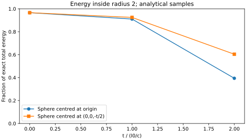

# S1-A result: verified analytical Hopfion

Date: 2026-10-31 (Australia/Melbourne). Experiment: S1-A-001. Model: B0-H11.
Status: implementation and local verification complete; submitted for maintainer review.

## Outcome

The (1,1) analytical Hopfion has been implemented and checked. It satisfies source-free Maxwell equations and null-field conditions within the stated numerical checks. Net electric flux is consistent with zero. Localisation decreases over the sampled times even in a sphere moving with its analytical centre. This is a reproducible baseline, not evidence for a charged or self-confined electron.

## Reproduction and provenance

Code commit: [7306700](https://github.com/RDHomeProjects/ElectronFieldTopology/commit/7306700fffbc9202dddbeb46a6fbc7044245301a).
The recorded run used that clean code commit (dirty_tree=false). This report is added afterwards; it does not change the numerical code.

- [Model and equation mapping](../../docs/models/B0-H11.md)
- [Configuration](config.json)
- [Measured metrics](metrics.json)
- [Run manifest and SHA-256 checksums](manifest.json)

```bash
uv sync --frozen --all-groups
uv run --frozen pytest -q
python3 scripts/check_docs.py
uv run --frozen eft-benchmark --config experiments/configs/hopfion-s1.json --output artifacts/s1-local
```

The output directory must be new or empty. The manifest records source/lock/config hashes, commit, environment, command and generated artifact hashes. Full field slices (PNG/SVG) are reproducible from the command and included in CI artifacts; they are not all stored in source history. Artifact retention is 14 days; the scalar evidence and localisation figure are committed here. Runtime for the recorded numerical sampling and plots was approximately 3.43 seconds on this environment; installation and tests are additional.

## Validation results

17 tests passed locally and in [GitHub Actions on the code commit](https://github.com/RDHomeProjects/ElectronFieldTopology/actions/runs/41063845596). Documentation CI also passed. Tests include an independently reduced Cartesian expression, exact symbolic divergence/curl identities, known origin fields, radial energy integration, null invariants, multiple enclosing surfaces, quadrature convergence and input validation.

| Check | Measured result | Interpretation |
|---|---|---|
| Exact symbolic Maxwell identities | Zero after symbolic simplification | Polynomial reference satisfies the equations |
| Maximum finite-difference Maxwell residual | 0.0250351, 0.00628425, 0.00157266 at h=.04,.02,.01 | Approximately 4x improvement per halving; second-order truncation |
| Maximum normalised E dot B over sampled times | 3.63e-16 or less | Orthogonality consistent with round-off |
| Maximum normalised E2 minus B2 | 8.97e-16 or less | Equal magnitudes consistent with round-off |
| Off-centre sphere electric flux, orders 8/16/32 | 7.69e-11, 6.11e-16, -1.39e-15 | Converges to zero, not emergent charge |
| t=0 radius-4 energy quadrature errors, orders 8/16/32 | 5.51e-3, 3.78e-6, 2.13e-14 | Independent radial-integral agreement |
| Exact all-space t=0 energy | 2 pi^2 = 19.7392088022 | Derived from radial expression; normalisation is arbitrary |
| Integrated t=0 energy inside radius 8 | 19.7380347797 | Finite sphere excludes 0.00117402248 energy |
| Radius-8 tail-corrected t=0 energy error | 2.49e-14 | Separates quadrature error from missing tails |

Null errors use u as denominator. Derivative residuals are absolute dimensionless errors at 40 fixed seeded points, not global error bounds. Surface flux and radial quadrature use other samples.

## Localisation result

Energy fractions use the exact all-space total 2 pi^2 as denominator. The moving sphere is centred at (0,0,-t/2); measured finite-domain centroids follow this trajectory approximately. Radius is 2 in both cases.

| Time | Fixed sphere | Moving sphere |
|---|---:|---:|
| 0 | 96.6271% | 96.6271% |
| 1 | 91.0720% | 92.4888% |
| 2 | 39.4118% | 60.3779% |



Moving-sphere t=2 energy integration converges from 11.9181952049 at order 8 to 11.9181164451 at order 16 and 11.9181164450 at order 32. The fraction change is far larger than this quadrature difference.

This demonstrates finite-time loss of energy concentration for this solution and radius. It is not a perturbation-stability test, proof about all future times or a no-go theorem for every field model. A visually persistent knot is not the same diagnostic as persistent energy confinement.

## Numerical review notes

An initial symbolic equality check exposed SymPy's unevaluated zero-times-i representation; algebraic expansion resolves it to exact zero without changing the equations. A localisation convergence-ratio check initially compared orders already at floating-point saturation; the final test uses coarser 8/16/32 orders to expose convergence and retains its absolute accuracy check. No physics parameter or benchmark tolerance was adjusted to obtain nonzero charge or confinement.

## Requirements evidence

| Requirement | S1-A evidence |
|---|---|
| SCI-001/004 | B0-H11 source equations, units, domain and normalisation |
| SCI-002 | Symbolic divergence, sampled convergence and enclosing-surface tests; evolution preservation remains S2 |
| SCI-003 | Charge/energy/angular momentum separated; no quantum-spin inference |
| SCI-005, NUM-001 | Published analytical solution, independent algebra and reusable package |
| NUM-004 | Localisation diagnostic and field projections; numerical knot invariant still deferred |
| REP-001/002 | Clean code commit, hashes, environment, actual metrics and limited interpretation |
| SW-001 | pyproject.toml and uv.lock; frozen installation |
| CI-002 | Benchmark workflow runs tests and generates artifact evidence on pushes/PRs |

## Limits and next task

No independent time evolution, boundary-flux conservation study, Lorentz-boost test, topology invariant, perturbation stability, interaction calculation or quantum model has been implemented. Finite-volume P and J are diagnostic estimates, not precision electron-property comparisons. No value here is in coulombs without separately chosen physical field/length scales.

Proceed to S2: select and validate an independent Maxwell evolution scheme against this analytical evaluator, with controlled boundaries and convergence. AI assisted code and report preparation; the primary equation source is the published paper, not AI output.
