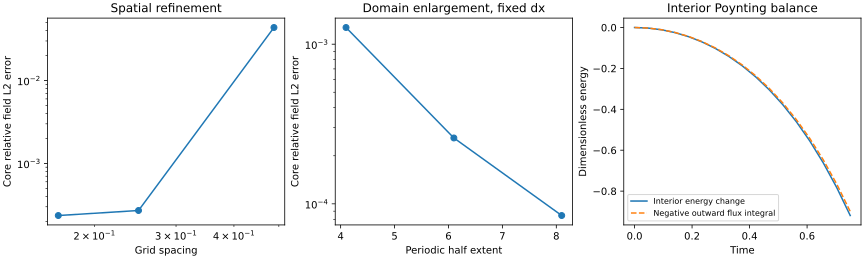

# S2 result: independently propagated Maxwell fields

Date: 2026-10-31 (Australia/Melbourne). Experiment S2-001, model B0-H11-PSATD.
Status: merged via [PR 4](https://github.com/RDHomeProjects/ElectronFieldTopology/pull/4). Numerical evidence below is the original S2 run.

## Outcome

A solver independent of the Hopfion time formula now propagates sampled initial data. All 10 experiment acceptance checks passed. 26 automated tests passed locally and in the [hosted evolution workflow](https://github.com/RDHomeProjects/ElectronFieldTopology/actions/runs/41065519771). Hosted analytical and documentation checks also passed on the code commit. The numerical fields approach the known analytical solution under spatial refinement and domain enlargement. Energy/momentum conservation and divergence checks pass for the periodic representation. Interior energy loss is accounted for by outward Poynting flow with a quantified, convergent diagnostic defect.

This is a short-time periodic-reference validation, not an isolated-space confinement simulation, topology verification or electron model.

## Reproduction and evidence

Clean code commit: [1ba64a9](https://github.com/RDHomeProjects/ElectronFieldTopology/commit/1ba64a9b4de3acb0a56ce411893f8fc4ce452522); dirty_tree=false. This report is committed subsequently without changing numerical code.

- [Configuration](config.json), [metrics](metrics.json), [manifest/checksums](manifest.json)
- [Equation and boundary specification](../../docs/models/B0-H11-PSATD.md)
- [Method decision and acceptance targets](../../docs/decisions/ADR-0002-s2-solver.md)
- [Research issue 3](https://github.com/RDHomeProjects/ElectronFieldTopology/issues/3)

```bash
uv sync --frozen --all-groups
uv run --frozen pytest -q
python3 scripts/check_docs.py
uv run --frozen python -m electron_field_topology.evolution_benchmark --config experiments/configs/hopfion-s2.json --output artifacts/s2-local
```

Use a new or empty output directory. The recorded nine-case run, including diagnostics and plot generation, took 19.01 seconds locally, excluding installation/tests. Source/lock/config hashes, interpreter, platform, numerical precision and thread environment are retained. The bounded workflow supports manual dispatch after it is on the default branch; no recurring compute is scheduled.

## Independence and initialisation

The engine accepts arrays and spacing, not a Hopfion function. It advances only their Fourier modes. The analytical expression is called once for initial data and separately outside the solver for error comparisons. Independent plane-wave, zero-mode, projection, reversal, subdivision and conservation controls test the propagator.

Finite-box continuation is periodic. The sampled fields are projected onto transverse Fourier modes once. Its size is measured and decreases as the box grows; this is an initial-data modification, not a prediction of emergent charge. Increasing resolution alone cannot remove it. The central error is much smaller than the global projection correction but remains nonzero at initial time.

## Spatial study

Fixed periodic half extent L=6.1, final time .75, 16 flux intervals. Error is combined E/B relative L2 over the actual grid-aligned central cube. Requested half extent 1.5 is rounded to the nearest node; actual extents are recorded per case. Different grids therefore approximate, rather than exactly duplicate, that physical integration region.

| Grid | dx | Final core field error | Balance defect / initial interior energy |
|---|---:|---:|---:|
| 25^3 | 0.488000 | 4.362820% | 1.179569% |
| 49^3 | 0.248980 | 0.027025% | 0.247178% |
| 73^3 | 0.167123 | 0.023506% | 0.105916% |

The small improvement between the two finest grids is an observed finite-box/initial-projection floor, not evidence for a new physical effect. Coarse error and diagnostic errors are retained; no tolerance was weakened.

## Domain study

Fixed dx=.2, same time and output intervals. The actual central cube half extent is 1.6 for every domain case (nearest-node tie rounded upward).

| Periodic half extent | Grid | Global initial projection correction | Final core field error |
|---|---|---:|---:|
| 4.1 | 41^3 | 1.406178% | 0.127172% |
| 6.1 | 61^3 | 0.556908% | 0.025855% |
| 8.1 | 81^3 | 0.280872% | 0.008448% |

Larger boxes reduce the central error. There is no absorbing boundary, PML or claim of infinite-space evolution at arbitrary times. Long-time wraparound is not tested and must not be interpreted as confinement.

## Energy, momentum and divergence

Maximum relative full-periodic-box energy drift across all cases: 5.551e-16.
Maximum periodic momentum drift divided by initial energy: 9.000e-14.
Maximum endpoint Fourier divergence: 2.530e-16.

Periodic total energy conservation is a mathematical property of this closed numerical system, not proof of self-binding. On the finest spatial grid, the independent interior balance is:

```text
Interior energy change       = -0.919285328008
Integrated outward flux      = 0.899484265480
Sum (balance defect)         = -0.019801062528
Defect / initial energy      = 0.105916%
Defect / |energy change|      = 2.153963%
```

The last number is important: the transported energy is smaller than the initial interior energy. We do not claim round-off accuracy for boundary transport. Spatial quadrature dominates this defect and decreases on refinement.

## Time checks

Vacuum modal updates are exact in time for the represented Fourier system. One, two, four and eight substeps agree to at most 4.026e-16 relative L2. This is subdivision invariance, not a measured temporal convergence order for a finite-difference integrator.

Temporal surface-flux quadrature uses 8/16/32 intervals at fixed N=49. Successive integral differences are 0.002924649 and 0.000731439, ratio 3.998489, consistent with second-order trapezoidal quadrature. The raw balance defect increases slightly toward a spatial-quadrature floor: coarse time error partially cancelled spatial error. This cancellation is retained and explained, rather than selecting the smallest-looking defect.



## Requirements and limitations

SCI-002: transverse projection and Fourier constraints are explicit and tested.
NUM-002: periodic energy/momentum plus interior energy/flux balance measured.
NUM-003: three spatial grids, three domains at fixed spacing, timestep-subdivision invariance and three temporal-flux quadratures.
CI-003: bounded manually dispatchable workflow, timeout, summary and artifacts.
REP-001/002: clean-code provenance and retained coarse errors/approximation floors.

No perturbation stability, Lorentz-boost verification, quantum analysis, nonlinear interaction, charge derivation or topology invariant is implemented. The periodic reference does not replace a validated open-boundary solver for later experiments needing isolation. No electron-property prediction is claimed.

## Review notes and next stage

A test initially reused the name of its magnetic initial array as a loop variable; the test was corrected without changing solver equations. Nearest-node selection now uses an explicit tie rule so the domain study compares the same interior cube. Acceptance thresholds were defined in issue 3 and ADR-0002 before the numerical study.

Proceed to S3 after review: relativistic transformations, localisation/width diagnostics and bounded perturbation tests, with periodic-boundary effects treated explicitly. AI assisted implementation/report preparation; equation sources remain primary literature.
