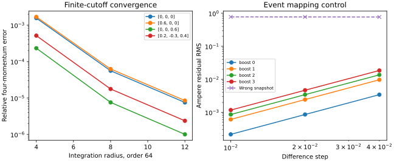

# S3-A: analytical Lorentz covariance

Question: does an event-consistent passive Lorentz wrapper preserve the known Hopfion's source-free equations and covariant energy/momentum, within measured numerical errors?

**Result:** all seven bounded experiment acceptance checks passed, along with 41 automated tests and documentation checks. This verifies the selected observer transformations and controls; it does not establish new dynamics or an electron model. Implementation is proposed for review; the full S3 stage remains incomplete.

## Identity and reproduction

Issue [6](https://github.com/RDHomeProjects/ElectronFieldTopology/issues/6). Requirements REL-001/002, SCI-001/002/004, BND-001 (analytical unbounded evaluation only), REP-001/002, CI-002/003. [Equation and convention specification](../../docs/models/B0-H11-Lorentz.md); [configuration](config.json), [all scalar metrics](metrics.json), [provenance manifest](manifest.json).

The retained evidence was produced from clean code commit [`c371841`](https://github.com/RDHomeProjects/ElectronFieldTopology/commit/c371841a72972da54f237fd0a82ea733c32c99b3), dirty_tree=false. The subsequent documentation/evidence commit does not alter the numerical source. The manifest records SHA256 hashes of package sources, configuration, lockfile and generated artifacts; artifact hashes refer to their unchanged basenames after copying into this report directory.

```bash
uv sync --frozen --all-groups
uv run --frozen pytest -q
python scripts/check_docs.py
OMP_NUM_THREADS=1 OPENBLAS_NUM_THREADS=1 uv run --frozen python -m electron_field_topology.relativity_benchmark --config experiments/configs/hopfion-s3a.json --output artifacts/s3a-evidence
```

Use a new/empty output directory. Python 3.12.14; NumPy 2.5.4, SciPy 1.18.1, Matplotlib 3.11.2; float64/complex128. The numerical/plotting run took 3.94 seconds on the recorded host. Timestamps, platform and commands are provenance, not expected byte-identical rerun outputs. Numerical values should agree within the declared tolerances. Hosted CI reruns the bounded study and uploads metrics/plots/manifest for 14 days; consult the PR's final-head checks. The versioned evidence here remains available after artifact expiry.

## Local covariance and residuals

Four observer velocities: (0,0,0), (.6,0,0), (0,0,.6), (.2,-.3,.4). Deterministic seed 314159; 96 random common events plus generic non-null field controls. The identity, inverse, collinear and noncollinear composition controls also pass in the automated suite. Noncollinear composition retains the full Lorentz matrix, including its spatial rotation.

| Check | Worst observed error |
|---|---:|
| Lorentz metric / matrix inverse | 2.22e-16 |
| Event round trip | 4.44e-16 |
| Vector fields vs independent tensor transform | 1.33e-15 |
| Field inverse | 1.33e-15 |
| Common-event Hopfion comparison | 5.88e-15 |
| Generic non-null invariants, normalised | 4.98e-16 |
| Hopfion null invariants, normalised | 2.56e-16 |

All are below the predeclared 1e-12 threshold. The error definitions and scale denominators are specified in the model document and implementation; they are not experimental uncertainties.

At target t'=.3, independent central differences at h=.04,.02,.01 give successive RMS residual ratios **3.9618..3.9981** across div E, div B, Faraday and Ampere, consistent with second order. There is no numerical evolution timestep in this analytical wrapper.

The deliberate wrong-snapshot control transforms spatial coordinates but discards the corresponding source times. Its finest RMS residuals are div E=.8726, div B=.9434, Faraday=.8113 and Ampere=.7771. They remain large under refinement. This negative control demonstrates that small null invariants or transformed field components alone do not validate a field over spacetime. It is retained in metrics.json.

## Integrated four-momentum

At target t'=0, increasing spheres are integrated using Gauss-Legendre r/mu and periodic azimuthal quadrature. The independent all-space reference is Lambda(v)(2 pi^2,0,0,-pi^2), with the source ratio Pz/U=-1/2 from Hoyos et al. Section 2.2 and the amplitude normalisation independently established in S1. Local field transformations do not insert this target into the integrand.

Relative Euclidean four-component error; order 64:

| Velocity | Radius 4 | Radius 8 | Radius 12 |
|---|---:|---:|---:|
| [0, 0, 0] | 0.0015531831 | 5.5833675e-05 | 7.5528801e-06 |
| [0.6, 0, 0] | 0.0016782592 | 6.2355376e-05 | 8.5026556e-06 |
| [0, 0, 0.6] | 0.00023226205 | 7.5738148e-06 | 1.0061755e-06 |
| [0.2, -0.3, 0.4] | 0.00051378808 | 1.765108e-05 | 2.3690908e-06 |

Worst finest error **8.5027e-6**, or **0.00085027%**, below the predeclared 2e-4 bound. At fixed radius 12, separate orders 24/40/64 distinguish quadrature refinement from missing tails. The largest order-40 to order-64 change is 2.915e-09 relative to the all-space reference norm, much smaller than the retained cutoff error. Absolute error against the all-space reference need not decrease monotonically with order because quadrature error can partly cancel a missing tail; raw cases are preserved.

The all-space invariant M^2=U^2-|P|^2=3 pi^4. The largest radius-12 relative M^2 discrepancy is 4.0540e-5. This positive invariant for a distributed electromagnetic configuration is compatible with locally null fields; the arbitrary length/amplitude units do not predict electron mass. A finite-sphere integral is not itself required to transform as a closed isolated four-vector.



## Electric flux and interpretation

An off-centre target sphere at t'=.3 (radius 2, centre (.2,-.1,.3)) was checked at orders 24/40/64 in every frame. The maximum finest |signed electric flux| / integral |E dot n| is **1.36e-15**. The raw signed and absolute integrals are retained. This agrees with zero charge for smooth source-free fields; energy redistribution or a boost has not generated electric charge.

There is no periodic boundary or transverse projection here: only diagnostic integration is truncated. The test does not independently evolve Maxwell fields, demonstrate confinement, trace topology, quantify perturbation stability, determine quantum spin/statistics or select a nonlinear extension. S2 remains the independent periodic evolution benchmark. Tested boost speeds are <=.6; no claim is made about floating-point accuracy arbitrarily near light speed.

## Requirement evidence and next task

| Requirement | Evidence / remaining limit |
|---|---|
| REL-001, REL-002 | Declared conventions, independent tensor and component-sign controls, event mapping, inverse/composition, invariants and second-order residuals |
| SCI-001/004 | Existing source-free model retained; units, metric, indexing, normalisation and source passages mapped |
| SCI-002/003 | Zero electric-flux controls; electric charge and quantum spin are not inferred |
| BND-001 | Unbounded analytical field; tail and quadrature studies for integrals. Open numerical boundary validation remains pending |
| NUM-003 | Three difference steps, integration radii and quadrature orders |
| REP-001/002 | Immutable clean-run manifest; raw cases and wrong-snapshot negative control retained |
| CI-002/003 | Bounded push/PR/manual workflow; timeout, read-only token, summary and artifacts |

Next is S3-B: derive and implement energy-centroid and localisation-width diagnostics, test the centroid-energy/momentum relation independently, and quantify spatial tails. S3-C perturbations and S3-D/S4 topology remain separate.

AI assistance: Codex drafted the derivation mapping, implementation, tests and report. Primary sources supply the equations; automated checks and this report do not replace independent scientific review.
