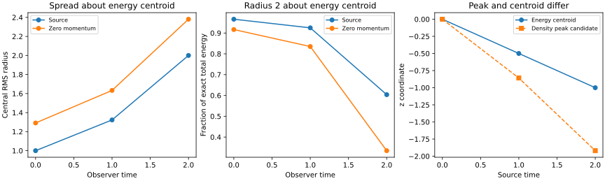

# S3-B: energy-centroid motion and localisation

**Result:** the refined bounded study passes all 12 acceptance checks. The automated suite has 51 passing tests. The source Hopfion's central RMS radius grows from 1 to 2 between t=0 and t=2. In the zero-total-momentum frame its centroid stays at the origin while its width also grows. This verifies the selected moment diagnostics and records spreading of this known solution; it does not establish a confined electron.

S3-A was merged via [PR 7](https://github.com/RDHomeProjects/ElectronFieldTopology/pull/7), merge commit 38e75ea, before this stage. S3-B implementation is proposed for review; S3-C/D remain pending.

## Scope and reproducibility

[Issue 8 and original acceptance thresholds](https://github.com/RDHomeProjects/ElectronFieldTopology/issues/8); [equation derivation, source passages and conventions](../../docs/models/B0-H11-Centroid.md); [configuration](config.json); [all scalar cases](metrics.json); [manifest](manifest.json).

The retained refined and coarse studies both ran from clean code commit [`73da3fc`](https://github.com/RDHomeProjects/ElectronFieldTopology/commit/73da3fc419d7065caecae2f10b36631178ab35a8), dirty_tree=false. The later evidence/documentation commit does not alter numerical sources. Source/configuration/lock and output SHA256 hashes were verified after copying. Unchanged artifact basenames preserve manifest hash checks in each report directory.

```bash
uv sync --frozen --all-groups
uv run --frozen pytest -q
python scripts/check_docs.py
OMP_NUM_THREADS=1 OPENBLAS_NUM_THREADS=1 uv run --frozen python -m electron_field_topology.localisation_benchmark --config experiments/configs/hopfion-s3b.json --output artifacts/s3b-evidence
```

Use an empty/new output directory. Python 3.12.14, NumPy 2.5.4, SciPy 1.18.1, Matplotlib 3.11.2, float64/complex128. Refined study runtime 27.17 seconds on the recorded host. Environment/platform/commands and timing are in the manifest; timestamps are not expected to reproduce byte-for-byte. No dependency change or new physical dynamics was introduced. Bounded push/PR/manual CI retains artifacts for 14 days; the versioned results here persist independently. Consult the PR for final-head hosted checks.

## Independent motion, boost and origin controls

Source times and observer times are 0,1,2. Four frames: source; v=(.6,0,0); v=(.2,-.3,.4); zero momentum v=(0,0,-.5). The code integrates fields directly on each equal-time observer slice. It compares with references from the separately derived source U=2 pi², Pz=Jz=-pi², R=(0,0,-t/2), and the transformed conserved angular tensor M. No measured centroid is fitted to produce its boost reference.

| Check | Maximum observed error |
|---|---:|
| Generic non-null stress tensor vs rank-2 Lorentz transform | 7.105e-15 |
| Classical angular momentum origin identity | 8.882e-16 |
| Direct centroid vs transformed boost charge | 2.819e-12 |
| Measured centroid secant velocity vs exact P/U | 1.411e-12 |
| Angular tensor error / reference total energy | 4.197e-12 |
| Virial quadratic central-width relation, relative | 3.008e-12 |
| Finest centroid quadrature increment | 8.513e-08 |
| Finest central RMS² quadrature increment | 2.645e-07 |

Generic tests also verify symmetry/tracelessness of stress-energy, coordinate-translation behaviour and J_about_a=J_about_0-a cross P. Changing the angular reference point leaves the energy centroid and covariance unchanged. Angular momentum about the energy centroid is separately integrated. These are classical quantities and do not measure quantum spin.

At v=(.6,0,0), t'=0, the directly integrated centroid is (0,-.3,0), agreeing with the angular-tensor prediction. The source centroid worldline passes the origin, whose Lorentz image is still the origin; using that as the equal-time centroid misses by .3. The negative control is retained explicitly. No paraxial Hall-shift coefficient was imported.

## Width growth and contained energy

The independently derived source formula sigma²=1+3t²/4 is reproduced. Maxwell stress-energy gives the general central-width quadratic relation in the model document. This is an energy-weighted width in three-dimensional space, not a field-line knot size or a detector image width.

All lengths/times below are dimensionless, with arbitrary amplitude and l0=1. Fractions refer to a radius-2 sphere centred at the predicted energy centroid and are normalised to exact transformed all-space energy.

| Observer time | Source RMS radius | Zero-momentum RMS radius | Source contained energy | Zero-momentum contained energy |
|---|---:|---:|---:|---:|
| 0 | 1.000000000 | 1.290994449 | 96.62713% | 91.66443% |
| 1 | 1.322875656 | 1.632993162 | 92.48885% | 83.50970% |
| 2 | 2.000000000 | 2.380476143 | 60.37788% | 33.45039% |

The zero-momentum centroid stays within 1.47e-14 of the origin at these times. Its central width grows despite that stationary centroid; the field redistributes energy outside the fixed radius-2 region. The source-frame fixed-origin energy fractions are also retained (at t=2, 39.41183%, versus 60.37788% about the moving centroid). The largest order-40 to order-64 change in the retained centroid-centred energy fractions is 6.11e-15. These comparisons distinguish translation from spreading.

A constant-width interpretation fails: source central RMS² changes from 1 to 4. Conservation of total energy, momentum or field-line topology would not make this width constant.



## Density maximum and energy centroid

Bounded grid searches at 17/25/33 points per axis on [-4,4]^3, with four box-constrained local starts each, yield candidate density maxima near z=0, -.85809434 and -1.91963956. The source energy-centroid z values are 0, -.5 and -1. At t=2 the separation is approximately .91964. Finest two peak positions agree within 1e-4 and lie inside the search box. Optimizer status and raw search cases are retained.

This reports a candidate maximum of instantaneous u=(E²+B²)/2. It is not a certified global maximisation, probability centroid, cycle-averaged intensity measurement or quantum trajectory. A separate scalar density reduction and independent initial radial/angular moments validate the field-derived observables.

## Tail bias and retained failed resolution

All-space quadrature uses r=s/(1-s), angular orders 24/40/64 and radial orders 48/80/128. It is a numerical integral over unbounded space, not a finite evolution boundary. Separate finite spheres at t=2, order 64 retain missing tails; no analytical answer is inserted outside them.

Absolute central RMS² error against the finest all-space integral:

| Velocity | Radius 4 | Radius 8 | Radius 12 |
|---|---:|---:|---:|
| [0, 0, 0] | 0.1215827 | 0.008340979 | 0.002178558 |
| [0.6, 0, 0] | 0.1509754 | 0.01083701 | 0.002768771 |
| [0.2, -0.3, 0.4] | 0.05054469 | 0.003105188 | 0.0007847965 |
| [0, 0, -0.5] | 0.3489467 | 0.02849482 | 0.00752561 |

Finite-cutoff widths converge substantially more slowly than total energy because they weight the tails by squared distance. The zero-momentum finite-sphere centroid is also biased (about 8.16e-5 at radius 12) although the all-space centroid is essentially zero. These cutoff errors must not be confused with physical centroid drift.

The original equal-radial/angular setup24/40/64 failed four of the twelve criteria: boosted centroid, centroid velocity, angular tensor and finest quadrature increment. The other eight passed. Its worst finest centroid error was 6.03e-6, exceeding the original 1e-6 threshold. A radial-only diagnostic gave 6.24e-9 at radial 96/angular 64, while angular-only 64/96 left 6.03e-6, isolating radial quadrature error. We increased radial nodes rather than loosening any threshold. The standard run now uses 48/80/128 radial nodes while angular orders remain 24/40/64.

The [coarse metrics](coarse/metrics.json), [configuration](coarse/config.json), [clean-run manifest](coarse/manifest.json) and [figure](coarse/localisation.svg) preserve that failed-resolution result. Reproduce it with:

```bash
OMP_NUM_THREADS=1 OPENBLAS_NUM_THREADS=1 uv run --frozen python -m electron_field_topology.localisation_benchmark --config experiments/configs/hopfion-s3b-coarse.json --output artifacts/s3b-coarse-evidence
```

Expected exit status 1 after writing evidence, because four verification checks fail. It is an accuracy control, not a new physical model or a hypothesis success. The main refined config is the CI acceptance run.

## Requirement mapping and limits

| Requirement | Evidence / limit |
|---|---|
| REL-003 | Explicit Maxwell stress-energy derivation, energy centroid vs density peak, boost charge, angular origin and independently predicted motion |
| NUM-003 | Three angular/radial refinements, finite radii and contained-energy quadratures; failed resolution preserved |
| NUM-004 | Independent centroid/width/contained-energy curves. No newly computed knot invariant or traced topology |
| SCI-003/004 | Units, slice, metric, index and sign conventions; classical J distinguished from quantum spin |
| BND-001 | Unbounded analytical evaluation with integration errors separated. Open-boundary numerical evolution remains pending |
| REP-001/002 | Two clean-code manifests, unchanged source/artifact hashes, all scalar cases and negative controls |
| CI-002/003 | Bounded push/PR/manual job with timeout, read-only token, summary and artifacts |

This stage evaluates a known analytical solution. It introduces no independent propagator, new charge law, nonlinear binding, perturbation stability test or experimental electron comparison. S2 remains the independent periodic solver reference. Tested boosts are <=.6 and times<=2; numerical acceptance alone is not an unrestricted theorem about floating-point accuracy.

Next: S3-C, classify divergence-compatible perturbations by both null invariants and test the conserved difference-energy baseline of linear Maxwell evolution, alongside local energy redistribution and domain sensitivity. No generic perturbation should be assumed to preserve the null knot family. S3-D/S4 topology instrumentation remains separate.

AI assistance: Codex drafted the derivation mapping, implementation, tests and report. Primary sources supply the physical framework; these checks do not replace independent scientific review.
