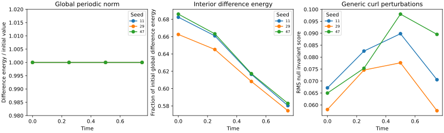

# S3-C: classified perturbations and literature alignment

**Result:** all 13 predeclared bounded experiment checks and 60 automated tests pass. The selected source-free perturbations follow linear Maxwell evolution: global difference energy remains constant while energy in a local cube changes. Generic seeded curls violate null conditions even though their divergence constraints remain satisfied. These verify the numerical framework and classify the selected trials; they do not establish isolated knot stability, self-confinement or an electron model.

S3-B was merged via [PR 9](https://github.com/RDHomeProjects/ElectronFieldTopology/pull/9), merge commit 73900ad, before this stage. S3-C is proposed for review. Topology instrumentation S3-D/S4 remains pending.

## Provenance and reproduction

[Issue 10 and original acceptance](https://github.com/RDHomeProjects/ElectronFieldTopology/issues/10); [equation/source mapping and derivation](../../docs/models/B0-H11-Perturbations.md); [configuration](config.json); [all scalar results](metrics.json); [manifest](manifest.json).

Evidence code commit [`b70b565`](https://github.com/RDHomeProjects/ElectronFieldTopology/commit/b70b5657bdd7c17e9740ed28d007b8b747a7a315), dirty_tree=false. Subsequent evidence/documentation changes do not alter numerical sources. Source, configuration, dependency-lock and generated artifact SHA256 hashes were checked after copying. Artifact basenames are unchanged, so hashes also apply within this directory.

```bash
uv sync --frozen --all-groups
uv run --frozen pytest -q
python scripts/check_docs.py
OMP_NUM_THREADS=1 OPENBLAS_NUM_THREADS=1 uv run --frozen python -m electron_field_topology.perturbation_benchmark --config experiments/configs/hopfion-s3c.json --output artifacts/s3c-evidence
```

Use an empty/new output directory. Python 3.12.14, NumPy 2.5.4, SciPy 1.18.1, Matplotlib 3.11.2, float64/complex128. Run time 50.50 seconds on the recorded host. Commands, platform, thread settings and dependency versions are in the manifest; timestamps/timings are not expected to reproduce byte-for-byte. Existing PSATD source and dependency lock are unchanged. Bounded push/PR/manual CI has a read-only token, timeout 10min and 14-day artifacts; versioned scalar evidence persists here. Consult the PR for final-head hosted validation.

## Where the observations align with primary literature

These short excerpts were checked against the linked primary texts. They are quoted solely for comparison, with surrounding assumptions retained. Agreement means the selected calculations reproduce a stated Maxwell expectation; it is not experimental confirmation of an electron hypothesis. Third-party quotations retain their original rights.

| Expected behaviour and exact excerpt | Source and precise location | Measured alignment | Scope of the comparison |
|---|---|---|---|
| “Since Maxwell’s equations are linear” | Feynman, Leighton and Sands, [Lectures II-20](https://www.feynmanlectures.caltech.edu/II_20.html), Section 20-1, paragraph preceding Eq.(20.25); Section 20-2 extends superposition to three-dimensional waves | Combined minus base agrees with independently evolved delta: maximum relative field discrepancy 6.621e-14. Global difference-energy drift is at most 9.77e-15 | Superposition and norm conservation in the periodic linear problem. No nonlinear attraction or asymptotic relaxation follows |
| “is a symmetry of the equations of motion” | Hoyos, Sircar and Sonnenschein, [arXiv:1502.01382v2](https://arxiv.org/abs/1502.01382v2), Section 2.1, paragraph after Eq.(2.9), describing electromagnetic duality | Duality preserves local energy: maximum normalised core total-minus-base response 2.03e-16. Analytical special-family null score is at most 1.898e-16 | Their displayed alpha-to-i-alpha example is a quarter-turn; our continuous phase follows directly from linear complex Maxwell Eq.(2.2), rather than importing a fitted angle |
| “electric and magnetic fields be everywhere orthogonal” | Irvine, [arXiv:1110.5408v1](https://arxiv.org/html/1110.5408v1), abstract; null and frozen-field conditions discussed in Sections1 and3 | Analytical amplitude/duality controls retain orthogonality and equal field norms. Each of the nine generic curl trials changes the two invariant fields by more than 0.005681 in the declared normalisation | This confirms the distinction between vacuum constraints and the stronger special-family conditions. We do not compute shear-free flow, helicity or field-line topology, or claim to reproduce Irvine's unravelling example |
| “it flows away through the boundaries of that region” | Feynman, Leighton and Sands, [Lectures II-27](https://www.feynmanlectures.caltech.edu/II_27.html), Section 27-1 opening local-conservation discussion; Eqs.(27.2), (27.14)-(27.15) supply the diagnostic equations | Seed 11 interior difference-energy fraction falls 68.24355% to 58.03347%, while its full-box norm remains constant. Finest local balance defect is 0.4837% of initial interior difference energy; time-flux refinement ratio 4.0150 | The balance is approximate nodal/time quadrature in a periodic numerical solution. Its residual is retained, not presented as exact conservation in a finite cube |

No numerical tolerance was changed; all thirteen criteria passed in development and the clean evidence run. Neither literature quotations nor passing verification checks certify an uncomputed topological invariant.

## Cases, constraints and classification

Reference grid 61 cubed, period 12.2, duration .75, outputs 0,.25,.5,.75. Eleven main cases: three deterministic curl seeds 11/29/47 at relative field norms .01/.05/.1, plus amplitude and constant-duality controls at .1. Independent spatial and domain studies add three cases each, with three flux-time quadratures. Length, time and field scales are arbitrary dimensionless units.

Each curl is a spectral curl of a seeded Gaussian vector potential, with deltaB initially zero. Its scale is calibrated once per seed on the reference grid, then held fixed in spatial/domain comparisons. Combined, base and delta fields are evolved independently using the existing propagator. A longitudinal gradient is retained only as a rejected constraint control.

| Verification | Largest observed value |
|---|---:|
| Periodic divergence maximum across sampled cases | 1.812e-14 |
| Superposition relative field discrepancy | 6.621e-14 |
| Relative global difference-energy drift | 9.77e-15 |
| Analytical special-family combined null score | 1.898e-16 |
| Periodic special-family null-score difference from periodic base | 1.259e-17 |

The reference base has a measured initial transverse-projection correction of .00556908 (0.5569% global field L2). Its core null score is 4.5991e-5 initially and 6.7183e-5 at t=.75; it is not exactly the unbounded null Hopfion. Amplitude/duality periodic controls track this nonzero base score. The separately evaluated analytical controls are null to roundoff. Projection is performed once for the base and never silently repeated for accepted combined/delta fields.

Actual perturbed fields are characterised by both RMS(E.B)/RMS(u) and RMS((E²-B²)/2)/RMS(u). For .01 curl trials their initial combined score ranges .0056801 to .0066326; for .1 it ranges .0580746 to .0671488. The raw components and change relative to the base are retained separately. Constraint compatibility therefore does not imply null-family membership in these trials.

The longitudinal gradient has raw maximum divergence 4.62366. Explicit projection removes essentially all its field norm (remaining energy fraction 1.28e-31). It is marked unaccepted and is not used as physical vacuum evolution data. This verifies that the constraint diagnostic does detect an invalid input.

## Global norms and local redistribution

For reference-grid curl trials, U_delta/U_base=epsilon² to the declared roundoff tolerance. The tested epsilon values therefore correspond to difference energies .0001,.0025,.01 of base energy. This is energy of the difference field, not U_total-U_base; the latter also includes interference cross terms and need not scale quadratically.

At epsilon=.1, the native interior cube is [-1.2,1.2]^3. Fractions below use initial full-box difference energy as the denominator:

| Seed | Interior fraction at 0 | Interior fraction at .75 | Initial perturbed combined null score |
|---|---:|---:|---:|
| 11 | 68.24355% | 58.03347% | 0.0671488 |
| 29 | 66.25370% | 57.44569% | 0.0580746 |
| 47 | 68.60115% | 58.29360% | 0.0649602 |

The fractions are identical across amplitudes for a given seed within rounding, as expected from linear propagation and quadratic difference energy. Global norm conservation coexists with local redistribution. It is not evidence that a perturbation remains near a knot or that the background attracts it.



## Resolution and domain sensitivity

The response is (final combined core energy-final base core energy)/initial base core energy on the **same** fixed physical 17 cubed observation grid in [-1.2,1.2]^3. Fourier interpolation accounts for the native FFT origin before energy is formed. This avoids changes of region when the native spacing changes; fixed observation quadrature remains finite.

Spatial grids 25/49/73 at half extent 6.1. Domain grids 41/61/81 at dx=.2 (half extents 4.1/6.1/8.1). Seed 11, epsilon=.1; calibration parameters are held fixed.

| Study | Coarse response | Middle response | Fine response | Finest absolute increment |
|---|---:|---:|---:|---:|
| spatial | 0.0396034132 | 0.0398576893 | 0.0398572733 | 4.16e-07 |
| domain | 0.0398571829 | 0.0398572687 | 0.0398572756 | 6.879e-09 |

Both finest increments are below the predeclared .005 bound. These are numerical sensitivity increments, not rigorous error estimates against infinite space. The domain-study initial base projection corrections decrease 1.4062% to .5569% to .2809%. The periodic boundary and modified initial data remain explicit limitations; short-time interior agreement does not establish isolated long-time stability.

## Local Poynting balance and unresolved quadrature floor

For canonical seed 11, epsilon=.1, integrate the **standalone delta field** through the six native interior cube faces. In dimensionless energy units:

| Time intervals | Interior energy change | Integrated outward flux | Defect / initial interior energy |
|---|---:|---:|---:|
| 8 | -0.020151202 | 0.020672937 | 0.387361% |
| 16 | -0.020151202 | 0.020776830 | 0.464497% |
| 32 | -0.020151202 | 0.020802706 | 0.483709% |

Successive flux increments have ratio 4.015023, consistent with second-order trapezoidal time integration. The finest residual is 0.4837% of initial interior energy, or 3.233% of the magnitude of transported energy. The defect increases slightly as time quadrature is refined: coarse time error partly cancels the remaining spatial/diagnostic error. Thus time-flux convergence is not claimed to eliminate the total balance error. This stage has not independently separated every spatial contribution to that floor. It is retained as a limitation rather than adjusted away.

## Requirement mapping and next gate

| Requirement | Evidence and practical limit |
|---|---|
| NUM-005/006 | Repeated seeded, amplitude-controlled trials; source-free constraints and both null invariants; difference-energy baseline and local redistribution. No unrestricted stability theorem |
| NUM-003 | Spatial/domain sensitivities on fixed physical samples; flux-time refinement with residual retained |
| SCI-002/003/004 | Explicit divergence constraints, units, field normalisations and periodic-data projection; classical diagnostics distinguished from topology and quantum spin |
| BND-001 | Periodic domain/initial-data limits measured; no absorbing-boundary or isolated long-time validation |
| REP-001/002 | Clean code/configuration/environment manifest; all cases and rejected longitudinal control retained |
| CI-002/003 | Bounded push/PR/manual workflow with read-only token, timeout and evidence artifacts |

Next is S3-D/S4 topology instrumentation: declare potential/gauge, boundary and zero-mode conventions before helicity computation; validate on known controls and pair any topological conclusion with tracing/theorem assumptions and numerical errors. A conserved scalar or successful null-condition check alone cannot certify each field line's topology. Candidate topology searches and modified dynamics remain later tasks.

AI assistance: Codex drafted the derivation mapping, software, tests and report. Literature quotations were checked against the linked primary texts. These calculations are numerical verification of a stated classical model, not independent experimental evidence; scientific interpretation remains subject to maintainer review.
