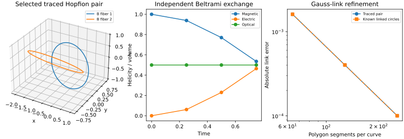

# S3-D: validated helicity and linking instruments

**Result:** all 13 bounded benchmark checks and 76 automated tests pass. Two explicitly traced analytical Hopfion magnetic-field fibers close to numerical precision and yield an oriented Gauss-link estimate 1.000100407 at 256 segments, converging toward the expected single link. Independent all-space potentials reproduce He=Hm=pi²=U/2. Periodic gauge/mean-mode and signed modal controls also pass.

This is numerical evidence for the selected pair and validation of the instruments. It is not a certification of all field lines, topology persistence under perturbations, particle self-confinement or electron properties.

S3-C was merged via [PR 11](https://github.com/RDHomeProjects/ElectronFieldTopology/pull/11), merge commit 1de7714, before implementation. This S3-D implementation is proposed for review; broader S4 candidate work remains pending.

## Provenance and reproduction

[Issue 12 and prospective acceptance](https://github.com/RDHomeProjects/ElectronFieldTopology/issues/12); [equation map, conventions and derivations](../../docs/models/B0-H11-Topology.md); [all scalar cases](metrics.json); [configuration](config.json); [manifest](manifest.json); [finest traced curve coordinates](trace-curves.json).

The evidence ran on clean numerical code commit [`851c482`](https://github.com/RDHomeProjects/ElectronFieldTopology/commit/851c4824edd7e62e4b3a9121dfc34ca351011375), dirty_tree=false. Later evidence/documentation changes do not modify numerical sources. Source/config/lock and artifact SHA256 hashes were checked after copying; retained artifact basenames preserve manifest hash checks within this directory.

```bash
uv sync --frozen --all-groups
uv run --frozen pytest -q
python scripts/check_docs.py
OMP_NUM_THREADS=1 OPENBLAS_NUM_THREADS=1 uv run --frozen python -m electron_field_topology.topology_benchmark --config experiments/configs/hopfion-s3d.json --output artifacts/s3d-evidence
```

Use an empty/new output directory. Python 3.12.14; NumPy 2.5.4, SciPy 1.18.1, Matplotlib 3.11.2; float64/complex128. Run time 38.52 seconds on the recorded host. The manifest retains commands, platform and environment; timestamps/timings are not expected byte-identical. Dependency lock and prior Maxwell propagator are unchanged. Hosted push/PR/manual CI is bounded with a 10-minute timeout, read-only token and 14-day artifacts; versioned scalar/curve evidence remains here after expiry. Consult the PR for final-head checks.

## Alignment with primary literature: exact short excerpts

The quotations below were checked against the accessible primary texts. They identify the expectation actually tested, with qualifications alongside each measurement. Quoted material retains its original rights.

| Exact excerpt | Primary location | Measured agreement and limits |
|---|---|---|
| “any two such circles are linked to each other” | Irvine, [arXiv:1110.5408v1](https://arxiv.org/html/1110.5408v1), Hopf-fibration paragraph after Eqs.(1)-(3), before Fig.1 | The selected traced B pair yields L=1.000100407 with second-order polygon refinement and explicit closure/disjointness checks. This supports that pair's expected unit linking; it does not numerically verify every circle in a fibration |
| “It also has finite helicities” | Hoyos, Sircar and Sonnenschein, [arXiv:1502.01382v2](https://arxiv.org/abs/1502.01382v2), Section 2.2 Hopfion paragraph following Eq.(2.20), specifying He=Hm=U/2 | An independent unbounded Bateman-potential integral gives each 9.86960440108928 at times 0 and .75, agreeing with pi² to 7.55e-15 relative error. Length/amplitude are the repository's declared unit scales, with no electron parameter fitted |
| “They are gauge invariant” | Hoyos et al., same version, paragraph after Eq.(2.10), explicitly conditioned there on all-space integration | Our separate periodic zero-mean problem has a derived periodic-boundary cancellation; adding a periodic gradient and constant potential shift changes helicity by at most 2.705e-16 of initial energy. This tests the periodic derivation, not an automatic import of unbounded boundary assumptions |

Irvine's Section5 also supplies a counterexample to identifying conserved helicity with preservation of individual knotted field lines. Our non-null modal examples demonstrate separate-helicity exchange and conserved optical helicity; we do not claim to reproduce its unravelling example or infer a topology change from our scalar diagnostics.

L19 and L15 remain literature context, but current full-text retrieval was blocked. No new equation audit or quotation from either source is claimed in this stage. The implementation instead uses the inspected Irvine/Hoyos equations and independent mathematical controls.

## Explicit field-line closure and oriented linking

Curves are integrated from the unbounded analytical B field at t=0, from seeds (1,0,0) and (.5,0,0), solving dr/ds=B/|B|. There is no periodic wrapping or imposed large-distance closure. The first is independently a unit circle in y=0; a positive tangent-section return is accepted only after position and tangent checks. The measured original gap is recorded before any tiny endpoint correction for closed polygon quadrature.

| Segments per curve | Traced pair oriented link | Error against +1 | Largest original closure gap |
|---|---:|---:|---:|
| 64 | 1.001608577073 | 0.001608577 | 9.191e-10 |
| 128 | 1.000401732361 | 0.0004017324 | 7.846e-12 |
| 256 | 1.000100407376 | 0.0001004074 | 6.438e-14 |

The finest arclengths are 6.283185307180 and 7.853981633974. The largest tangent mismatch is 1.031e-13; the largest endpoint correction is 6.438e-14. Minimum distance between the sampled polygon segments is 0.499962351. Nonadjacent self-segment checks also pass. These are sampled-curve checks, not a formal enclosure of an exact smooth trajectory.

The finest link increment is 0.000301325; its error is 0.0001004074 (about .01004%). No result is rounded to an integer to pass acceptance. The ODE tolerance/maxstep and polygon samples are refined together; known-curve controls below independently isolate the polygon quadrature's order.

Our sign convention is (dr1 cross dr2).(r1-r2)/(4pi |r1-r2|³). The printed triple-product ordering in Irvine Eq.(5) has the opposite oriented sign. We therefore compare its unsigned Hopf-link property while fixing our sign by independent oriented controls.

| Segments | Known linked circles, expected-1 | One orientation reversed, expected+1 | Separated circles, expected0 |
|---|---:|---:|---:|
| 64 | -1.001608577072 | 1.001608577072 | -4.417e-18 |
| 128 | -1.000401732361 | 1.000401732361 | -1.104e-18 |
| 256 | -1.000100407376 | 1.000100407376 | 9.939e-18 |

The known linked pair consists of perpendicular circles whose spanning disk has one downward piercing; reversing one orientation reverses the answer. Degenerate, open, mutually intersecting and self-intersecting inputs are rejected by automated controls. The uniform-field negative trace exhausts its arclength 4 budget with a gap 4, is marked open, receives no endpoint correction and is rejected by the linking routine. This failure is retained in the scalar metrics.



## Independent unbounded helicity reference

Use V=alpha grad(beta)=C+iA from Hoyos Eq.(2.8). This is not the Fourier Coulomb potential and is not fitted to an expected helicity. Its curls are checked by independent central differences against E/B. Successive residual ratios are approximately4; finest normalised RMS curl errors are 0.0001118 and 0.0001007.

All-space radial compactification uses angular orders 24/40/64 and radial 48/80/128 at times 0,.75. Each He/Hm agrees with pi² at the finest relative error 7.55e-15, with finest relative increment 1.098e-14. The last few roundoff digits need not improve monotonically. This is a separately evaluated full-space reference, not an extrapolation from a periodic or finite subvolume helicity.

## Periodic Coulomb potentials and mean fields

For transverse zero-mean data, Ahat=i k cross Bhat/|k|² and Chat=i k cross Ehat/|k|², setting each potential's zero mode to 0. The routine rejects nonzero mean and longitudinal inputs instead of silently changing them. Tests confirm both rejections.

Real Hopfion samples are first projected once using the existing recorded transverse projection. E/B means are then explicitly removed and recorded before helicity of the periodic fluctuations is computed. At fixed dx=.2:

| Periodic half extent | Initial magnetic helicity of fluctuations | Initial electric helicity of fluctuations | Removed mean energy / pre-removal energy |
|---|---:|---:|---:|
| 4.1 | 9.685031062 | 9.685031062 | 0.0897160% |
| 6.1 | 9.825338643 | 9.825338643 | 0.0134683% |
| 8.1 | 9.854295990 | 9.854295990 | 0.0033717% |

These values approach the independently known full-space value as the box grows, but they are helicities of different periodic fluctuation problems. Neither gauge invariance nor a comparison of three boxes turns them into the helicity of the original unbounded field. The removed mean vectors, projection corrections and all later samples are retained.

Across signed modal and periodic Hopfion controls, the largest relative curl reconstruction/Coulomb divergence check is 9.623e-16; periodic gauge-change error / energy is 2.705e-16. The gauge test adds a nontrivial periodic scalar gradient and a constant potential shift, with zero field means ensuring the latter has zero helicity contribution. No unbounded surface-term cancellation is assumed in that test.

## Independent modes, exchange law and source-normalisation issue

For signed q=±1,±2 in a period2pi cube, the independent Beltrami solution has B=cos(qt)b0 and E=sin(qt)b0, with curl b0=q b0. It gives Hm=V cos²(qt)/q, He=V sin²(qt)/q and Hopt=V/(2q). The largest modal helicity error / volume is 5.729e-16. Opposite-helicity modes cancel the scalar while retaining nonzero energy 248.050213442. Nonzero energy therefore need not imply nonzero helicity.

**Normalisation audit:** with Hm=integral A.B and He=integral C.E, integration by parts yields Hm'=-2 integral E.B and He'=+2 integral E.B. The last equality printed in Hoyos Eq.(2.12) omits that factor of two under its Eq.(2.10) definitions; its null conclusion remains unchanged because E.B=0 there. The PDF equation was visually checked. We use the explicitly derived factor and verify it independently against the signed modal solution, rather than treating the printed null-case line as a non-null evolution law.

For the mean-removed periodic Hopfion plus canonical seed 11 curl perturbation, magnetic helicity changes 9.685031062 to 10.710968648, while electric helicity changes 10.837731109 to 9.811793522 over t=0 to .75. Their optical combination stays near 10.261381085; largest optical drift / initial energy across the tested domains/exchange runs is 3.401e-16.

| Time intervals | Magnetic exchange defect | Electric exchange defect | Largest defect / initial energy |
|---|---:|---:|---:|
| 8 | 0.0078418735 | -0.0078418735 | 0.0003753965 |
| 16 | 0.0019577285 | -0.0019577285 | 9.371795e-05 |
| 32 | 0.00048926133 | -0.00048926133 | 2.342131e-05 |

The independent q=1 time-integration increment ratio is 4.002199, consistent with second-order trapezoids. The generic finest defect is below the predeclared 1e-4 bound; raw residuals remain visible. Separate helicities exchanging in a non-null field, or their conserved optical sum, provide no proof of a persistent knot.

## Requirement evidence and next task

| Requirement | Evidence / remaining scope |
|---|---|
| TOP-001 | Separate gauge/boundary/mean conventions; independent signed/cancelling helicity controls; closed-curve linking and selected directly traced fibers. Full fibration and perturbed topology remain unverified |
| SCI-003/004 | Declared fields, normalisations, domains, gauges and orientations; helicity/linking distinguished from electric charge, angular momentum and quantum spin |
| NUM-003 | Three polygon/trace refinements, analytical quadratures, periodic domains and exchange-time quadratures |
| REP-001/002 | Clean-code manifest, all scalar cases, finest curve coordinates and retained rejected mean/longitudinal/open controls |
| CI-002/003 | Bounded CPU push/PR/manual workflow, read-only token, timeout and artifacts |

Next is S4-A: specify and implement a small literature-defined constraint-compatible Bateman (p,q) family, with declared admissibility, budget and rejection ledger. Recheck primary construction equations before coding. Expand seed/time/closure controls before claiming a knot type or topology persistence. No broad optimisation sweep or modified dynamics is justified by the present instrument checks alone.

AI assistance: Codex drafted the derivation mapping, software, tests and report. Primary-source excerpts were checked against accessible texts; numerical controls and this report do not replace independent scientific review or experimental evidence.
