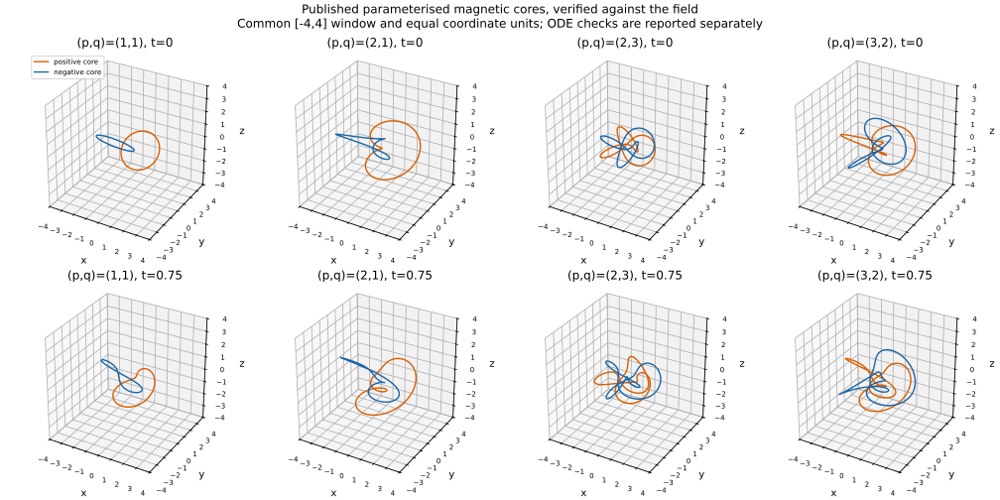
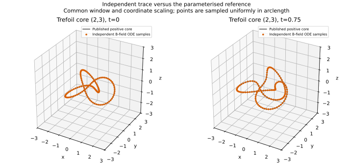
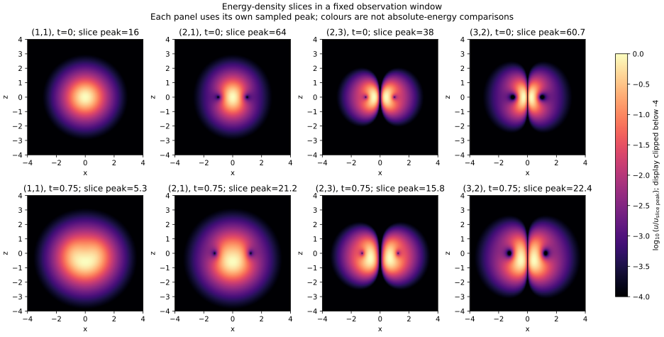
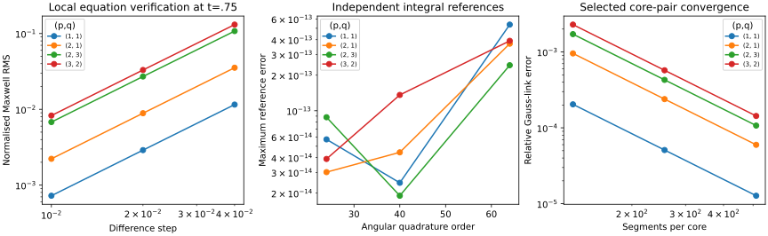

# S4-A: bounded Bateman catalogue with graphical results

**Result:** four fixed regular null Maxwell candidates pass all 12 experiment checks, and 91 automated tests pass. Sixteen default core traces close at the two selected times, with two additional trefoil-refinement traces and one return-section guard also closing. Independent all-space energy, momentum and helicity agree with published references within the recorded errors. These results validate this bounded catalogue and selected core evidence; no optimiser, new physical theory, arbitrary-line knot certificate or electron model is introduced.

This is a **stacked PR on [S3-D PR 13](https://github.com/RDHomeProjects/ElectronFieldTopology/pull/13)**, which was still unmerged when this evidence was prepared. No earlier PR is merged by this task. Merge/review the prerequisite first, then retarget this PR to main as appropriate.

## Reproduction and provenance

[Issue 14 and prospective acceptance](https://github.com/RDHomeProjects/ElectronFieldTopology/issues/14), [model/source mapping](../../docs/models/B0-Bateman-PQ.md), [configuration](config.json), [all scalar cases and ledger](metrics.json), [trace coordinates](trace-curves.json), [manifest](manifest.json).

Clean numerical commit [`ff0d6ea`](https://github.com/RDHomeProjects/ElectronFieldTopology/commit/ff0d6eac91de849a31aee0a607a8bb1a2558c659), `dirty_tree=false`. Later evidence/documentation changes leave numerical sources unchanged. Source/configuration/lock and generated artifact SHA256 hashes were verified after copying; unchanged basenames preserve manifest hash checks in this directory.

```bash
uv sync --frozen --all-groups
uv run --frozen pytest -q
python scripts/check_docs.py
OMP_NUM_THREADS=1 OPENBLAS_NUM_THREADS=1 uv run --frozen python -m electron_field_topology.candidate_benchmark --config experiments/configs/bateman-s4a.json --output artifacts/s4a-evidence
```

Use a new/empty output directory. The numerical/plotting run took 47.07 seconds on the recorded host. Python 3.12.14, NumPy 2.5.4, SciPy 1.18.1, Matplotlib 3.11.2; float64/complex128. Platform, thread settings and exact commands are in the manifest. Timestamps/timings are provenance, not expected byte-identical rerun outputs. The dependency lock is unchanged. Bounded push/PR/manual CI retains artifacts for 14 days; versioned evidence remains here. Consult the PR for final-head hosted results.

## Mathematical construction and independent expectations

Following [Kedia et al., arXiv:1302.0342v1](https://arxiv.org/abs/1302.0342v1), Eqs. (5), (9) and (11), define the same unbounded Bateman coordinates used by the baseline:

```math
D=r^2-(t-i)^2,\qquad
\alpha=\frac{r^2-t^2-1+2iz}{D},\qquad
\beta=\frac{2(x-iy)}{D}.
```

The regular monomial family is

```math
\mathbf{F}_{p,q}=\mathbf{E}_{p,q}+i\mathbf{B}_{p,q}
=\nabla\alpha^p\times\nabla\beta^q
=pq\alpha^{p-1}\beta^{q-1}\mathbf{F}_{1,1}.
```

Retain the raw $pq$ factor; no amplitude is fitted to electron mass or any measured charge. Units are $c=\epsilon_0=\mu_0=\ell_0=1$. An independent symbolic power-gradient route checks the implementation, while the $(1,1)$ case reproduces the previous evaluator exactly.

From [Hoyos et al., arXiv:1502.01382v2](https://arxiv.org/abs/1502.01382v2), the conserved-quantity list after Eq. (2.22) and helicity Eq. (4.48), the references are

```math
H_m=H_e=2\pi^2pq\frac{p!q!}{(p+q)!},\qquad
U=(p+q)H_m,\qquad
\frac{P_z}{U}=-\frac{p}{p+q},\quad P_x=P_y=0.
```

Helicity is integrated independently using the decaying potential $\mathbf{V}=\alpha^p\nabla\beta^q=\mathbf{C}+i\mathbf{A}$. This is an unbounded Bateman gauge, not the periodic fluctuation problem from S3-D. No angular-momentum convention is imported from the paper.

| Family | Reference energy $U$ | Each reference helicity $H_m=H_e$ | $P_z/U$ |
|---|---:|---:|---:|
| $(1,1)$ | 19.739208802 | 9.869604401 | -0.50000000 |
| $(2,1)$ | 39.478417604 | 13.159472535 | -0.66666667 |
| $(2,3)$ | 59.217626407 | 11.843525281 | -0.40000000 |
| $(3,2)$ | 59.217626407 | 11.843525281 | -0.60000000 |

These values use arbitrary dimensionless normalisations. Energy and helicity are different physical quantities with their respective scale conversions; the table is not a comparison of electron masses or quantised electric charges.

## Core gallery at two times

The inspected coprime core loci use

```math
\alpha_0=\sqrt{\frac{p}{p+q}}e^{iq\theta},\qquad
\beta_0=\sqrt{\frac{q}{p+q}}e^{-ip\theta+i\delta},
\qquad \delta\in\left\{0,-\frac{\pi}{q}\right\}.
```

The initial positions come from inverse stereographic projection; later positions follow the straight null Poynting flow described in the construction:

```math
\mathbf{r}_0=\frac{(\Re\beta_0,-\Im\beta_0,\Im\alpha_0)}{1-\Re\alpha_0},
\qquad
\mathbf{r}(t)=\mathbf{r}_0+t\frac{\mathbf{E}_{1,1}\times\mathbf{B}_{1,1}}{u_{1,1}}(\mathbf{r}_0,0).
```



**Reading the figure:** orange and blue denote positive and negative core-level branches, not electric-charge signs or field direction. Every panel uses the same $[-4,4]^3$ window and equal coordinate units. These are **published parameterised reference curves**, verified for field tangency and transport, not curves produced by the independent ODE. $(2,3)$ and $(3,2)$ are the literature's trefoil-core family; no independent knot polynomial or chirality certificate is computed here. The $(1,1)$ and $(2,1)$ cores are unknotted components with different mutual linking.

## Independent field-line traces

The B-field ODE starts from phase .17 on each branch, independently of the displayed analytic derivative. At both $t=0$ and $t=0.75$, all 16 default traces close. Two additional positive-trefoil traces use tighter ODE tolerance. Across these and the guard control, the largest accepted closure gap is 3.075e-10, tangent mismatch 5.408e-10 and normalised core-level error 1.178e-09. Endpoints are corrected only after both closure checks pass; each tiny correction is recorded.

The expected complex core level is checked independently along the samples:

```math
\alpha^p\beta^q=\pm M_{p,q},\qquad
M_{p,q}=\left(\frac{p}{p+q}\right)^{p/2}
\left(\frac{q}{p+q}\right)^{q/2}.
```



**Reading the figure:** the grey line is the published positive core, while orange points come from independent adaptive field-line integration and are sampled uniformly in arclength. The two methods overlap within their numerical error. This tests selected cores at the stated times, not all field lines in the surrounding tori.

### Return-section regression control

A tangent-plane crossing is not sufficient to close a knot. A separate $(2,3)$ seed at phase .8 first returns at arclength 13.027815722 with a seed gap 0.816588617 and tangent mismatch 1.138636869. The extended tracer retains that miss and accepts a later return at arclength 19.869176532 with a gap 1.043e-10. It never joins the distant first endpoint to manufacture a curve.

The default catalogue phase .17 already closes at its first return. The guard is explicitly a different seed; the report does not present the default runs as examples of that failure mode. Full return ledgers, including repeated laps within each fixed budget, remain in the metrics.

## Energy-density slices



The plane is $y=0$ and the observation window is fixed. Each panel shows $\log_{10}(u/u_{\mathrm{slice\ peak}})$, using its **own sampled slice peak**, with the display clipped below $-4$. Peak values are printed in the panel titles and retained in the metrics. Colours therefore compare shape within panels and must not be read as common absolute-energy levels or full three-dimensional/global maxima. The plotting window is not a cavity or evolution boundary. These images show field structure, not a confinement proof or detector intensity measurement.

## Convergence and selected pair linking



The left panel shows combined finite-difference Maxwell residuals at $t=0.75$. Successive ratios lie in 3.96910–3.99780, consistent with second order. The largest finest normalised residual is 0.008277. Both null invariants have a maximum combined RMS score 1.697e-16.

The middle panel shows the largest error against independent all-space $U$, momentum and helicity references. All are already near floating-point summation limits: the largest finest reference error is 5.372e-13. More quadrature points can increase roundoff-level summation error; no monotonic improvement is claimed at that floor. The criterion is independent reference agreement and bounded finest increments, not the visual slope of this roundoff-level curve.

The right panel shows Gauss-link error for the two parameterised branches. The fixed convention is the S3-D polygon Gauss integral with no rounding to integers. Parameter $\theta$ orientation is not necessarily the B direction on both branches; signs below refer to that parametrisation. The independent winding-product expectation is $\lvert\operatorname{Lk}\rvert=pq$.

| Family | Expected absolute core-pair link | Signed estimate at $t=0$, 512 segments | Signed estimate at $t=0.75$, 512 segments |
|---|---:|---:|---:|
| $(1,1)$ | 1 | -1.000012743 | -1.000019966 |
| $(2,1)$ | 2 | -2.000119471 | -2.000141842 |
| $(2,3)$ | 6 | -6.000642660 | -6.000823176 |
| $(3,2)$ | 6 | -6.000859656 | -6.001066338 |

Largest finest relative link error is 0.0001777231. All finest increments satisfy the predeclared .005 bound. These link integrals use parameterised core polygons; independent ODE closure, tangency and level checks support their identification as the selected B cores. The lower-resolution stored ODE sample polygons are not substituted for the linking-refinement data.

**Literature convention audit:** the v1 preprint's special-case ring prose gives a count twice the winding product. That numerical statement is not imported into the S3-D calibrated Gauss convention: the Hopf control fixes unit linking and the $(2,1)$ pair yields approximately two. The selected curve construction, invariant formulas and field/tangency checks are separately verified. This discrepancy is retained; neither the Gauss normalisation nor tolerances are changed to force agreement with every printed number. No claim is made that a particular later journal convention has been audited.

## Admissibility and deferral ledger

| Requested powers, JSON | Disposition | Reason |
|---|---|---|
| `[1, 1]` | `admitted` | within declared regular coprime family and budget |
| `[2, 1]` | `admitted` | within declared regular coprime family and budget |
| `[2, 3]` | `admitted` | within declared regular coprime family and budget |
| `[3, 2]` | `admitted` | within declared regular coprime family and budget |
| `[0, 1]` | `invalid_parameters` | positive integer powers required |
| `[-1, 2]` | `invalid_parameters` | positive integer powers required |
| `[1.5, 2]` | `invalid_parameters` | positive integer powers required |
| `[2, 2]` | `deferred_link_family` | valid noncoprime link family, outside current coprime-core catalogue |
| `[4, 5]` | `deferred_budget` | regular monomial family, outside this catalogue budget |
| `[true, 1]` | `invalid_parameters` | positive integer powers required |

Four requests are admitted, four are invalid inputs for the regular integer-power generator, and two are **valid family requests deferred by this catalogue's policy/budget**. In particular $(2,2)$ is a link family, not a failed Maxwell solution. No optimiser, preferred electron-like candidate or unreported rejection is introduced.

## Short primary-literature comparisons

| Exact excerpt | Precise source | Measured alignment and limits |
|---|---|---|
| “a new family of null solutions” | Kedia et al., [arXiv:1302.0342v1](https://arxiv.org/abs/1302.0342v1), abstract; Eq. (5) and field Eq. (11) | The four selected fields have roundoff-level null scores and second-order Maxwell residual convergence. This checks the admitted monomial examples, not every holomorphic family |
| “symmetric under interchange” | Hoyos et al., [arXiv:1502.01382v2](https://arxiv.org/abs/1502.01382v2), paragraph after Eq. (4.48) | The $(2,3)$ and $(3,2)$ helicities agree, while their momentum/energy ratios differ as separately predicted. This does not make the complete vector fields identical |

The linked passages were checked directly, including the core parametrisation in the PDF. Quotations retain third-party rights. Mathematical displays follow [GitHub's documented MathJax/LaTeX Markdown syntax](https://docs.github.com/en/get-started/writing-on-github/working-with-advanced-formatting/writing-mathematical-expressions), using math fences and dollar-delimited inline expressions. All four graphical renders were inspected; the documentation checker verifies links/fences, not the physical interpretation.

## Scope and next task

This stage implements the SRCH-001 generator and SRCH-002 request-ledger infrastructure for a fixed four-member catalogue, without performing an optimisation/search, with SCI-004/005 and NUM-003 verification. TOP-001 is respected by pairing scalar invariants with selected core geometry and independent trace checks. It adds no broad search, numerical evolution of the higher-order initial data, arbitrary-line knot invariant, open-boundary isolation, nonlinear binding, electric charge or quantum-spin result. A known family label and visually knotted core do not establish electron properties or stationary energy confinement.

Next is S4-B: extend controlled seed/time sampling away from the cores, quantify closure versus quasi-periodic trajectories, and define independent knot/link classification gates before ranking any broader family. Review the printed convention discrepancy and published theorem assumptions before extending topology claims. The earlier periodic solver remains a separate reference; unbounded analytical sampling here is not independent time propagation.

AI assistance: Codex drafted the derivations, code, tests, graphs and report. Primary texts supply the construction and independent mathematical expectations; numerical checks and graphics do not replace scientific review or experiment.
