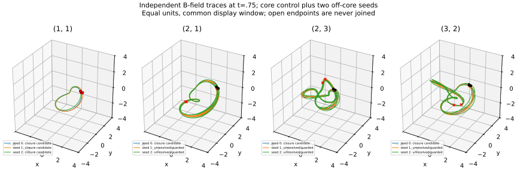
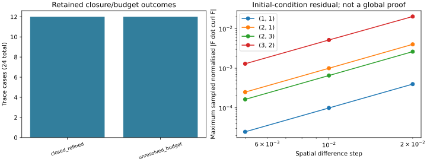

# S4-B — bounded off-core sampling and independent polygon invariants

31 October 2026 (Australia/Melbourne). [Issue 30](https://github.com/RDHomeProjects/ElectronFieldTopology/issues/30), [source/acceptance map](../../docs/models/B0-S4B-Offcore.md), [scope decision](../../docs/decisions/ADR-0005-s4b-resumption.md). The maintainer explicitly resumed this bounded stage while the larger literature review remains incomplete. Level 4 stays deferred.

## Measured result

**12 of 24 cases closed with trace-refinement agreement; 12 exhausted the stated budgets without accepted closure.** Every positive-core control closed. Off-core Hopfion samples closed; the off-core samples for the higher families remained unresolved. Finite non-closure is not a proof of an open or quasiperiodic orbit. All outcomes and section returns remain in [the metrics](metrics.json).

| Family (p,q) | Refined closures | Unresolved within budget | Determinant on accepted closed polygons |
|---|---:|---:|---:|
| (1, 1) | 6 | 0 | 1 |
| (2, 1) | 2 | 4 | 1 |
| (2, 3) | 2 | 4 | 3 |
| (3, 2) | 2 | 4 | 3 |

Each family has three initial seeds at each of two times: one positive-core control, an x-offset .15, and a z-offset .2. Seeds are transported from t=0 with the established baseline null flow. Each magnetic trace is integrated at fixed time. These are deterministic snapshot samples, not random coverage of all lines, material trajectories or independently evolved fields.

Coarse/fine arclength budgets were 40/80, tolerances 1e-9/1e-11, max steps .15/.075 and trace samples 128/256. Observation radius 12 and 20,000 RHS evaluations are numerical budgets, not physical boundaries. All finite-budget cases remain part of the result; they are not omitted from a success fraction.

## Closure and topology evidence

Largest fine accepted position gap: **1.06337e-12**; tangent mismatch: **5.83649e-13**. Largest paired-sample trace-refinement distance: **2.52872e-10**. Endpoints were corrected only after closure tests passed; unresolved endpoints were never joined. All returns, including misses, were retained. Exact-zero and near-zero controls were rejected before ODE evaluation.

Closed fine traces were sampled as 64/128/256-segment polygons and checked using three independent projection directions, with at least two regular projections required at every resolution. Exact-integer Fox cofactors and determinants agreed across those gates. Independent torus-curve controls recover determinants 1, 3 and 5 and are invariant under reversal/reflection. The determinant can detect some nontrivial polygons but cannot uniquely identify a knot. In particular, determinant one is not proof of an unknot, and determinant three alone is not a trefoil identification. All computed `knot_type` fields remain `not_identified`. There is no certified ambient-isotopy error bound from these polygons to the continuous ODE line.

Independent signed crossing counts for the selected positive/negative **parameterised core pairs** agree with signed Gauss integration at 128/256 segments in all eight family/time cases. Largest finest discrepancy: **0.00426652**. These are link controls, not classification of every sampled off-core pair. They preserve S4-A's calibrated Gauss convention rather than replacing it with the historical preprint's differently scoped ring-count prose.



Common plotting limits are an observation window; paths may continue outside the displayed area. Black markers denote starts and red crosses denote ends. The plots do not establish confinement or label an unresolved trajectory quasiperiodic.

## Integration of the literature findings

| Finding | Implemented or retained disposition |
|---|---|
| L24, initial nullness alone is insufficient | Added a source-mapped sampled initial complex-curl diagnostic; retained analytic/smooth-flow hypotheses |
| L15, non-vanishing assumptions and invariant tori | Added explicit zero/near-zero guards, normalised-flow extension analysis and finite-budget statuses; no torus-filling label from a missed closure |
| L21, helicity/linking distinctions | Added independent signed diagram-link checks against Gauss, with closure/disjointness/projection controls |
| L25, map and normalisation requirements | No reinterpretation of physical helicity as an integer Hopf invariant |
| L28, writhe is geometry rather than complete knot class | Writhe remains optional; independent Fox determinants added from targeted primary source L35 |
| L22/L23/L26/L27/L29, boundaries and constrained minima | No new helicity boundary formula, minimisation dynamics or self-binding model; constraints/scaling remain future gates |
| L20/L30–L34 and the negative R32 record | Original access/model/quantum limitations retained; no equations imported from abstract-only entries; out-of-scope evidence not promoted |

The [main register](../../docs/literature/README.md) and [BibTeX](../../docs/literature/references.bib) now carry influential recovered sources L20–L34, the Moffatt correction, and methods source L35. Historical label collisions are preserved in [the alias map](../../docs/literature/bibliography-aliases.json). New references do not become recursion seeds.

The largest sampled initial normalised null residual was **3.7966e-16**. The largest finest normalised complex-curl residual was **0.00129728**, with observed step-refinement ratios **3.91682–4.01596**. These support the implemented local diagnostic; they do not prove a global theorem. The algebraic normalised-flow extension does not make a physically zero field non-vanishing.



## Validation and reproducibility

**116 local tests passed**, including independent knot/link, exact integer, null/near-zero, analytic circle/helix, later-section-return, coordinate-transport and budget rejection controls. Documentation checks, workflow YAML parsing, unique bibliography keys and source/prose whitespace checks passed. Generated Matplotlib SVG path-line spaces are preserved byte for byte and excluded from whitespace lint. The numerical study satisfies all ten predeclared instrument checks below. Passing these checks does not turn the unresolved cases into closed ones.

| Instrument acceptance | Passed |
|---|---|
| all eight core controls close on refinement | True |
| closed refined polygons pass independent invariants | True |
| closed polygons exist | True |
| independent diagram links agree with gauss | True |
| initial sample null below 1e-12 | True |
| initial sample complex curl finest below 0.002 | True |
| zero and near zero seeds guarded | True |
| normalised flow extension finite unit | True |
| advected seed coordinate error below 1e-12 | True |
| unresolved traces not artificially closed | True |

The clean evidence run used local code snapshot `0c6b9e6a7aa59b6723a7df8691cefb884b15e5dd` with `dirty_tree=false`, from a materialised tree verified against GitHub main `1652b0194902209c2a6c01ded8cc4baef4fd4874`. The local snapshot ID is not presented as a public GitHub commit. [The manifest](manifest.json) records complete numerical-source hashes, the unchanged dependency-lock hash, configuration, versions, precision, CPU/thread environment and artifact hashes. These hashes permit checking a fresh clone independently of local commit history. Elapsed local runtime was 225.1 seconds; this is not a performance guarantee.

```bash
uv sync --frozen --all-groups
OMP_NUM_THREADS=1 OPENBLAS_NUM_THREADS=1 uv run --frozen pytest -q
python3 scripts/check_docs.py
OMP_NUM_THREADS=1 OPENBLAS_NUM_THREADS=1 uv run --frozen python -m electron_field_topology.offcore_benchmark --config experiments/configs/offcore-s4b.json --output artifacts/s4b-local
```

Use a new/empty output directory. Retained evidence: [configuration](config.json), [metrics and full return ledger](metrics.json), [independent trace samples](trace-curves.json), [manifest](manifest.json). The manifest also lists PNG preview hashes; those previews are generated and uploaded by the experiment workflow, while the equivalent SVG figures are committed here. No earlier numerical result, dependency lock or tolerance was changed. An exploratory dirty-tree run is retained locally as development evidence and is not substituted for this clean run.

## Limits and next review

This delivers the bounded off-core instrument tranche. A complete knot identifier, rigorous continuum isotopy bounds, broad seed/domain coverage, near-zero robustness studies and further interpretation of the unresolved trajectories remain open. No new dynamics, isolated long-time evolution, confinement, electric charge, quantum spin/statistics or electron model is inferred. The comprehensive literature passes, full dataset publication and final review-wide impact closure remain unfinished; PR 17 is separate. Larger searches or S5 changes need a later scope decision.

AI assisted source mapping, implementation, testing and reporting. The original papers remain primary sources; this finite numerical assessment is not independent expert certification.
