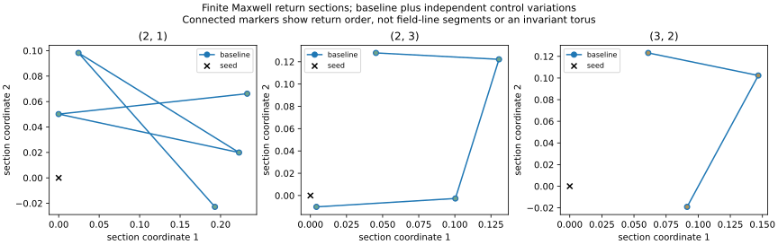
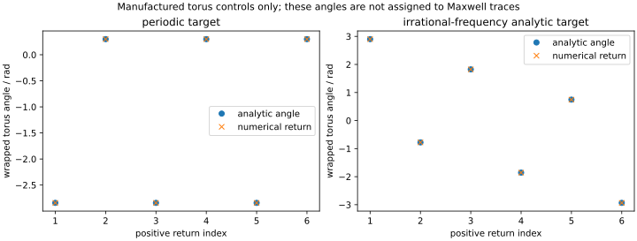

# S4-C — bounded return-map diagnosis followed by a model-feasibility decision

31 October 2026 (Australia/Melbourne). [Issue 33](https://github.com/RDHomeProjects/ElectronFieldTopology/issues/33). [Fixed specification and controls](../../docs/models/B0-S4C-ReturnMap.md); [primary-equation audit](../../docs/models/S5-feasibility-audit.md); [decision ADR-0006](../../docs/decisions/ADR-0006-model-feasibility.md).

## Diagnosis

The 33 one-control-at-a-time diagnostic runs produced **30 unresolved arclength-budget cases and 3 evaluation-budget cases**. The three additional z-offset replication seeds also remained unresolved. Neither outcome proves quasiperiodicity or infinite-time nonclosure. Both selected Maxwell closure controls closed, and the manufactured periodic/irrational targets behaved as their analytic constructions require.

| Family | Baseline positive returns within length 80 | Unresolved diagnostic runs | Evaluation-limited runs |
|---|---:|---:|---:|
| (2, 1) | 5 | 10 | 1 |
| (2, 3) | 4 | 10 | 1 |
| (3, 2) | 3 | 10 | 1 |

This study uses three primary x-offset initial seeds at t=0, plus three z-offset replications. It does not add families or provide broad statistical coverage. S4-B's other related-time observations are not counted as new independent trajectories here. [Every case, setting and section-event position is retained](metrics.json).

## Independently varied controls

Baseline: tolerance 1e-11, max step .075, arclength 80, near-zero ratio floor 1e-8, observation radius 12, 20,000 RHS evaluations. Eleven settings per primary seed change only length (20/40), tolerance (1e-9/1e-10), max step (.15/.0375), floor (1e-6/1e-10), or radius (6/24). All other controls stay fixed.

**29 comparable prefixes matched**, comprising **26 variant/reference comparisons and three baseline self-checks**. Maximum common-event position difference was **1.37153e-10**; arclength difference **2.18137e-10**, versus the predeclared absolute comparison limit 1e-5. Counts within the shared evaluated interval also agree. Thus the retained returns are repeatable over the completed comparisons; the study finds no control-sensitive return displacement above that threshold. This is not a complete solver/domain-convergence theorem.

There are four `insufficient_returns` comparisons: the three evaluation-limited runs, and the (3,2) length-20 run which has no positive return in that short observation. Halving max step to .0375 reaches the unchanged 20,000-evaluation cap for all three families. These are **resource limits**, not evidence of physically different orbits. The interrupted solves provide no certified partial interpolant; an empty returned-event ledger in such a failed solve must not be interpreted as proof of no earlier crossings. The length-20 no-return case is separately an observation-length limit.

No near-zero or radius event terminated the completed diagnostic runs. The sampled primary seeds are well away from the guarded zero regime, so unchanged results under those floors do not establish robustness for arbitrary near-zero trajectories. Radius checks here are observation guards, not electromagnetic boundaries. No threshold or budget was increased to turn a nonclosure into a success.



These points lie in seed-centred transverse planes. Lines connect return indices for reading order; they are neither field-line segments nor fitted invariant tori. Repeated variations largely overplot. Cases without available return points remain in the scalar ledger. No Maxwell rotation number or angular interpretation is assigned. A few orbit sequences do not reconstruct the map on an entire section.

## Manufactured controls and instrument acceptance

The geometric test field is derived explicitly from a torus embedding with theta'=1 and phi'=omega. With the positive y=0 section, analytic return angles are phi0+2*pi*k*omega modulo 2*pi. A rational omega=.5 target closes; the sqrt(2) analytic target does not falsely close within the budget. The latter is represented approximately in floating point; its known irrationality is a property of the analytic target, not a proof inferred from the plot or from a binary float.

Largest wrapped return-angle error: **1.20065e-14**; largest torus-equation residual across sampled points and all event positions: **8.85403e-15**. Largest section-plane residual across all recorded maps: **9.62662e-15**. These validate the event/coordinate instrument, not a claim that the Maxwell trajectories have the same torus dynamics.



| Predeclared instrument check | Passed |
|---|---|
| exactly 33 diagnostic and 3 replication runs | True |
| one control changes per variant | True |
| closed Maxwell controls close | True |
| manufactured periodic control closes | True |
| manufactured irrational control not falsely closed | True |
| manufactured return angles below 1e-6 | True |
| manufactured torus residual below 1e-7 | True |
| section plane residual below 1e-9 | True |
| every return position retained | True |
| unresolved endpoints not corrected | True |

## Model-feasibility decision after diagnosis

[ADR-0006](../../docs/decisions/ADR-0006-model-feasibility.md) records explicit dispositions using these observations **and** independent action/charge/energy constraints:

| Route | Decision |
|---|---|
| Unchanged smooth source-free Maxwell as a charged bound-electron route | No-go for that route; retain B0 as the reference |
| Smooth invariant NLED retaining the same null backgrounds | No-go as a binding fix for that retained sector; other sectors are not excluded |
| Skyrme–Faddeev static energy | Conditional-go only to a small, fixed-coupling static-energy specification/validation as a neutral binding-mechanism reference |
| Charged internal-field alternative | Defer a solver pending independent finite-size, charge, causal/stability and parameter audits |

No candidate is selected as a physically adequate electron model and no extended physical dynamics are implemented. The conditional static-energy target has extra fields; its Hopf charge is not electric charge, its scale depends on coefficients, and a dilation balance is not full stability. The charged alternative's input charge normalization and length scale limit which quantities are predictions; inputs alone do not establish infeasibility. The decision would not be reversed merely by discovering that one finite-budget orbit eventually closes.

The [main bibliography](../../docs/literature/README.md) and [BibTeX](../../docs/literature/references.bib) identify the newly inspected equation locations and pinned versions for L16 Goulart, L27 Faddeev–Niemi and L07 Faber–Kobushkin. The audit distinguishes source statements, project algebra and interpretations. Final journal/preprint reconciliation and the comprehensive literature review remain open; level 4 stays deferred. Existing S4-B evidence is preserved unchanged.

## Reproduction and provenance

**123 local tests passed**, including analytic torus returns, an independently differentiated embedding, event-count sensitivity, short-budget prefix matching, plane validation, and all previous numerical controls. All ten instrument checks passed. Documentation checks passed for 67 Markdown files; workflow YAML, bibliography uniqueness and source/prose whitespace checks passed. SVG path-line spaces are retained byte for byte for artifact-hash fidelity. Both figures were visually inspected.

Clean local snapshot `44e5c57de5e49c340eddec46accab4bb19b05922` ran with `dirty_tree=false`, based on a baseline tree matching GitHub main `8696b4190bbc739eea366f061bfbee66a9c82662`. The local snapshot is not claimed as a public GitHub commit. [The manifest](manifest.json) binds complete source/config/lock and artifact hashes, environment and dependency versions. The local runtime was 224.2 seconds; it is not a hardware-independent timing guarantee.

```bash
uv sync --frozen --all-groups
OMP_NUM_THREADS=1 OPENBLAS_NUM_THREADS=1 uv run --frozen pytest -q
python3 scripts/check_docs.py
OMP_NUM_THREADS=1 OPENBLAS_NUM_THREADS=1 uv run --frozen python -m electron_field_topology.returnmap_benchmark --config experiments/configs/returnmap-s4c.json --output artifacts/s4c-local
```

Use a new/empty output directory. Retained [configuration](config.json), [metrics](metrics.json) and [manifest](manifest.json) are complete for this diagnosis. PNG preview hashes also appear in the manifest; the workflow generates/uploads those previews and equivalent SVGs are committed here. Development-run outputs remain local and do not replace clean evidence. AI assisted derivation, source auditing, implementation and reporting; this is not independent expert certification.
