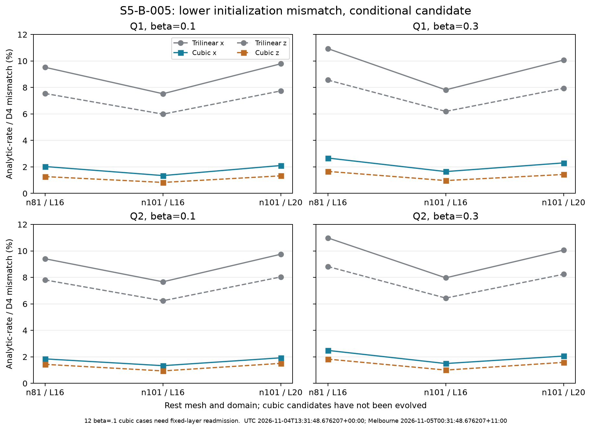

# S5-B-005: reconstruction and registration assessment

Assessed UTC: 2026-11-04T13:35:35.703463+00:00; Australia/Melbourne: 2026-11-05T00:35:35.703463+11:00.

Run: `20261104t131812z-4e8c880c`. Workstation source commit: `461c9bc41d1979bf9d5f20a584eafa530d1999d8`.
Evidence SHA-256: `321a46ae81be7d799b7a392d1a94b573405c0fe9582babe9395a650c21be15e4`.

## Decision

**Complete the diagnostic study as assessed, with its scientific gate open. Retain the cubic method as a conditional comparison candidate. Readmit its fixed-layer data before any new motion trial.** No production initializer is replaced by this assessment.

All 24 moving cases show lower analytic-rate/D4 transport mismatch, with reduction 75.56–86.13% (median 81.00%). Absolute RMS reductions are also 75.85–86.30%, so the result is not solely a changed relative denominator. However, 12 raw cubic candidates violate the lab fixed layers. The independent smooth controls passed, but did not test this lab-mask/stencil interaction. Neither the smaller mismatch nor a phase fit establishes improved evolution.

## Evidence and verification scope

The terminal reports 30/30 completed cases, controls passed, no error and 227.482 seconds wall time (3 minutes 47.482 seconds). Completion was UTC 2026-11-04T13:21:59.990451+00:00 / Melbourne 2026-11-05T00:21:59.990451+11:00. Exit timing is supplied separately by the terminal, not authenticated as a ZIP member.

Verified independently here: ZIP CRC, unique/safe member names, exact SHA-256, all 37 hashed members (38 total), JSON/ledger/CSV agreement, canonical config hash, recorded input fingerprint, exact 30-case matrix, 66 inventoried source files, 11 implementation source hashes, and scalar aggregates. All 30 original initial-state replay flags are true in the recorded measurements. Full NPZ fields were not attached, so those field-derived values and bit-exact initial-state replays were not independently re-executed here.

The analytic controls were re-executed using the matching code and locked dependencies; all numeric control results matched the archive exactly, apart from the new timestamp. Off-node field orders 3.04–3.10 and first-derivative orders 1.97–2.44 support the declared third-order value/second-order derivative reconstruction. This is not fourth-order interpolation or a physical-mesh convergence result.

## Native-grid initialization measurements

| Q | beta | Cases | Mean original mismatch | Mean cubic mismatch |
|---|---:|---:|---:|---:|
|1|0.1|6|8.0175%|1.4851%|
|1|0.3|6|8.5853%|1.7813%|
|2|0.1|6|8.1499%|1.4977%|
|2|0.3|6|8.7498%|1.7424%|

Means equally weight the six deterministic cases in each Q/beta group; these are not population estimates or a pooled physical norm. The diagnostic compares the analytically differentiated initializer rate with the tangent-projected lab D4 transport rate. It is not centroid-speed error, a PDE residual theorem or an electron observable.

Across moving cases, the old mismatch ranges 5.9855–10.9805%, and the cubic mismatch 0.8304–2.6716%. Core-only reductions are 75.59–86.59%, so the reduction is not explained entirely by excluding the boundary. The candidate changes both n and its analytic rate; native-grid field changes are 0.01129–0.17643% relative L2. It is not merely a different derivative applied to an identical initial state.

At L=16, changing rest nodes 81 to 101 (h=.2 to .16) reduces candidate mismatch by 27.76–45.19% in all eight matched moving comparisons. There are only two physical spacings and independently readmitted rest states, so do not assign a converged order. At matched h=.2, enlarging L=16/n81 to L=20/n101 changes the candidate mismatch by ratios 0.8284–1.0513. The domain result is not uniformly monotonic; it does not close tail or inertia sensitivity.

## Fixed-layer failure: what it means

All original initial states have exactly north field and zero rate on the fixed layers. All 12 beta=.1 raw cubic candidates exceed the existing 1e-10 numerical-constraint scale there. Maximum component deviations are |n−north|=8.2765228e-4 and |v|=8.1425741e-4 in model units. The other 18 cases (six rest and twelve beta=.3) have only roundoff-level deviations. Unit length and tangency still hold globally: maxima 6.66e-16 and 1.67e-16. Sphere constraints and fixed-layer constraints are different checks.

A C1 interpolant can overshoot between two north-valued rest nodes because the four-point stencil also includes a non-north third node. The boosted coordinate of an inner lab fixed layer can fall in this interval at beta=.1. This does not contradict a smooth constant-north join at the exterior face; the lab has two fixed nodal layers, not just an exterior point. The original compact smooth test had a wider north region and did not expose this interaction.

The separately labelled manufactured probe uses a rest n81/L16 grid with two exactly north layers and one non-north interior node. At beta=.1 the inner lab fixed coordinate maps to rest x=-7.8441976; trilinear deviation is zero but cubic deviation is 0.00669187. At beta=.3 it maps outside the rest box (x=-8.1866054), and both return north with zero rate. These probe amplitudes are synthetic and are not substituted for the measured soliton deviations. [Probe source](probe_fixed_layers.py) and [measured probe output](boundary-probe.json) reproduce the mechanism.

This concerns raw **candidate initial data**. They were never evolved; the result does not invalidate the old trajectories, diagnose reflected radiation in them, or demonstrate that this artifact explains their shape error.

## Comoving and phase registration

A known Lorentz/comoving map was used, with no fitted speed, centroid, spatial-axis rotation or deformation. Both retained snapshots were sampled by the same cubic operator on a 41-cubed central rest-coordinate cube, held fixed between t=0 and t=1 within a case. Cube sides vary between 11.8594 and 16 model units across cases. Thus domain/grid comparisons also change the sampled region and quadrature; one sampling grid supplies no sampling-convergence proof.

Moving evolved-versus-own-initial raw L2 differences range 0.2068–1.5801%; the restricted internal SO(2) phase registration gives 0.1930–1.5801%. The x-direction runs have no meaningful phase reduction. The z-direction runs have phase angles 0.000917–0.004633 radians and only 4.24–7.87% relative reduction in the L2 residual. Most of the discrepancy remains after this restricted fit. A fitted internal phase is not physical quantum spin or a demonstration of electron rotation.

Rest-state residuals range 1.07184e-6 to 8.25789e-5 in relative L2. The Q1 L16 rest residual increases on the finer rest state, while the larger Q1 L20 state is much quieter. This is not a monotonic continuum convergence claim.

Initial-reference, final-reference, evolved-versus-own-initial and reference-change metrics are recorded separately. Replacing the comparison reference with a cubic one leaves the underlying old final fields unchanged. Two x-direction final-reference comparisons are identical up to roundoff; a numerical sign at that scale is not a worsening. The smaller reference residuals in other cases cannot establish that cubic-initialized trajectories will be better.

These comoving residuals differ from the original full-lab-grid shape gate in mask, sampling and reference. The original 1% shape threshold is not reapplied here to manufacture new pass/fail classifications.

## Original gates retained

The selected dt=.01 half of the original campaign retains 3/30 all-check passes, 25 tail failures, 9 shape failures and 2 momentum failures (overlapping). These are exactly the finer-step subset of the original 60-case counts: 6 passes, 50 tail failures, 18 shape failures and 4 momentum failures. The missing half was not reassessed as new data. No threshold or original check flag was changed.

## Next stage: S5-B-006 with boundary readmission first

1. Add a thin-north-layer, off-node lab-mask regression control for beta=.1 and .3 along x/z. Explicitly apply the existing fixed-layer/sphere/tangent constraints to new candidate data, or justify a compatible boundary reconstruction. Record pre/post field and rate corrections, preserve the analytic chain-rule rate on free nodes, and remeasure D4 residuals. No silent smoothing, damping, fitted D4 velocity or threshold change.
2. Only after those checks, prepare a focused beta=.3 x/z method comparison on matched Q1/Q2 rest states, with original and cubic initializers (eight nominal arms at one declared dt and observation window). Record both starting fields/rates and energy/momentum/boundary admission; a known tail failure stays a failure. This is a method test, not general isolation acceptance.
3. Assess that tranche before deciding temporal refinements, a third physical mesh and larger boxes at matched spacing. Retain the predeclared motion gates and quantify tail, momentum, shape and inertia separately. Do not launch another 60-case sweep automatically.
4. Keep Q17/Q19 motion after adequate low-Q control, then Q18 fresh fine starts/conditioning and bounded further-Q work, including optional Q20/Q24. The conditional spin/quantization and external-probe papers do not bypass numerical convergence.

No new production run, model-action change, external coupling, quantum spectrum or electron acceptance is included in this publication. AI assisted verification, analysis and report preparation; external scientific peer review is not claimed.

## Per-case audit table

|Case|Old rate %|Cubic rate %|Raw comoving %|Registered %|Fixed layers need readmission|
|---|---:|---:|---:|---:|---|
|q1-n81-L16-b0-a0-dt0.01|n/a|n/a|0.002202|0.002202|False|
|q1-n81-L16-b0.1-a0-dt0.01|9.521554|2.030081|0.384437|0.384437|True|
|q1-n81-L16-b0.1-a2-dt0.01|7.545327|1.270443|0.271185|0.254081|True|
|q1-n81-L16-b0.3-a0-dt0.01|10.933038|2.671554|1.360577|1.360577|False|
|q1-n81-L16-b0.3-a2-dt0.01|8.559693|1.661431|0.923248|0.850808|False|
|q1-n101-L16-b0-a0-dt0.01|n/a|n/a|0.008258|0.008258|False|
|q1-n101-L16-b0.1-a0-dt0.01|7.525149|1.346563|0.293627|0.293627|True|
|q1-n101-L16-b0.1-a2-dt0.01|5.985524|0.830366|0.206814|0.192953|True|
|q1-n101-L16-b0.3-a0-dt0.01|7.819610|1.648827|0.923064|0.923064|False|
|q1-n101-L16-b0.3-a2-dt0.01|6.192940|0.971718|0.639792|0.589431|False|
|q1-n101-L20-b0-a0-dt0.01|n/a|n/a|0.000107|0.000107|False|
|q1-n101-L20-b0.1-a0-dt0.01|9.788274|2.106793|0.367329|0.367329|True|
|q1-n101-L20-b0.1-a2-dt0.01|7.739078|1.326601|0.257166|0.240690|True|
|q1-n101-L20-b0.3-a0-dt0.01|10.066663|2.303906|1.162660|1.162660|False|
|q1-n101-L20-b0.3-a2-dt0.01|7.940117|1.430429|0.797427|0.738874|False|
|q2-n81-L16-b0-a0-dt0.01|n/a|n/a|0.002243|0.002243|False|
|q2-n81-L16-b0.1-a0-dt0.01|9.407205|1.845640|0.442696|0.442696|True|
|q2-n81-L16-b0.1-a2-dt0.01|7.807233|1.434106|0.333981|0.319819|True|
|q2-n81-L16-b0.3-a0-dt0.01|10.980486|2.486411|1.580109|1.580109|False|
|q2-n81-L16-b0.3-a2-dt0.01|8.820770|1.828238|1.129724|1.071068|False|
|q2-n101-L16-b0-a0-dt0.01|n/a|n/a|0.004612|0.004612|False|
|q2-n101-L16-b0.1-a0-dt0.01|7.666886|1.333333|0.324230|0.324230|True|
|q2-n101-L16-b0.1-a2-dt0.01|6.235220|0.939118|0.256798|0.245671|True|
|q2-n101-L16-b0.3-a0-dt0.01|7.965668|1.494530|1.032168|1.032168|False|
|q2-n101-L16-b0.3-a2-dt0.01|6.438627|1.002117|0.795616|0.755260|False|
|q2-n101-L20-b0-a0-dt0.01|n/a|n/a|0.004734|0.004734|False|
|q2-n101-L20-b0.1-a0-dt0.01|9.749404|1.926462|0.423036|0.423036|True|
|q2-n101-L20-b0.1-a2-dt0.01|8.033713|1.507691|0.326578|0.311716|True|
|q2-n101-L20-b0.3-a0-dt0.01|10.057616|2.059775|1.335191|1.335191|False|
|q2-n101-L20-b0.3-a2-dt0.01|8.235436|1.583163|1.011682|0.959143|False|

Recompute the compact evidence checks with [verify_assessment.py](verify_assessment.py). Its JSON output records provenance, limits and every derived case/group metric.
