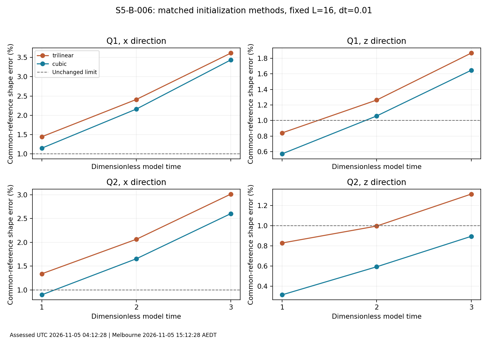
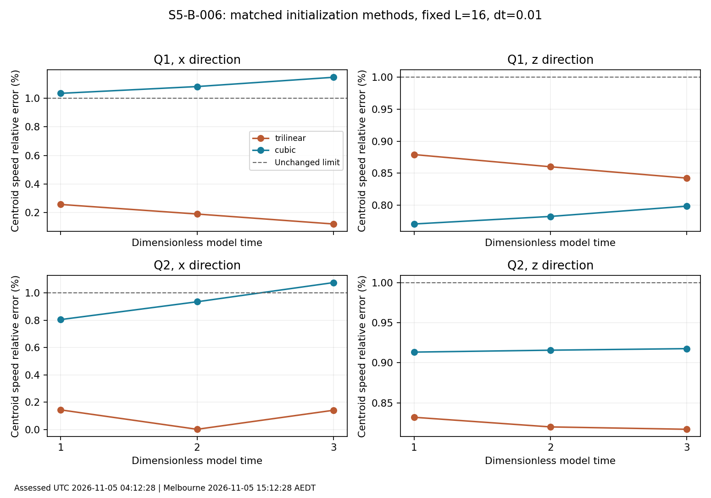

# S5-B-006 assessment: cubic initialization helps shape, but motion remains unaccepted

Assessed UTC: 2026-11-05T04:12:28.812263+00:00; Australia/Melbourne: 2026-11-05T15:12:28.812263+11:00.

## Decision

The eight focused trajectories completed and all 48 constrained initial-state admissions passed. Cubic initialization improves both the common-reference shape diagnostic and the own-initial comoving comparison in all 12 matched Q/direction/time pairs. Retain it as the candidate initializer for a staged convergence study. This is a measured method improvement, not acceptance of a freely moving isolated soliton or electron model. The scientific gate remains **open**.

Across 24 milestone evaluations there are **24 tail failures, 16 shape failures, six momentum failures and four speed failures**, with overlap. No milestone passes every original gate. The energy, unit/tangency and Hopf-quadrature checks pass in all 24 evaluations. Do not replace the original gates with a favourable subset.

## What was measured

- Run `20261104t142830z-d061b67b`; native source commit `1e3a4ed64ee68bc014846923e4b75845a5c20cf5`, tracked tree clean.
- Q1 and Q2 retained stationary n101/L16 rest states; boosts beta=0.3 along x or z; trilinear/cubic under the identical existing sphere/tangent/fixed-layer projection.
- Original neutral SF action, metric +---, c=1, dimensionless model units; D4-action-projected-RK4-v1, CPU float64. No charge, quantum dynamics, applied external force or altered evolution kernel.
- Rest spacing 0.16; boosted longitudinal lab grid 107 nodes, other directions 101, side L=16; longitudinal lab spacing 16/106. One physical grid, one box, one dt=0.01, 300 steps per arm. T=1/2/3 are observation times, not timestep refinement.
- Recorded wall time 37028.121 s = 10 h 17 min 8.121 s. Finished UTC 2026-11-05T00:45:38.844277+00:00 / Melbourne 2026-11-05T11:45:38.844277+11:00. Measured time was about 2.75% below the original 38076.127 s estimate; this does not calibrate a larger-grid cost precisely.

## Integrity, retention and independent checks

1. The attachment is byte-identical to the GitHub run archive: SHA-256 `4ced49b9bc30deb186c5cacfc634870a96fe2c36ae6643db79fa2fdd2fdf0db5`. All 143 ZIP members pass CRC; the ledger covers 142 payload members. The attached summary also matches the archived summary.
2. All 12 scientific source hashes match the checked-out PR58 code. Attempt manifests bind the original six numerical source files, source commit, physical configuration and clean tracked tree. Inspection against merged main shows no changes to the existing time/initialization/evolution/dynamics kernels.
3. Independently replayed energy/momentum reductions, centroid least-squares slopes and speed residuals at all 24 milestones from the recorded histories. Checked all 61 diagnostic steps per arm, all 24 segment manifests/results and original thresholds from the authenticated old low-Q evidence ZIP. No gate mismatch was found.
4. Re-ran the manufactured interpolation and thin-fixed-layer/event controls in this assessment environment; both passed. These validate instruments, not a new native trajectory. Environment here differs from native Python3.12.14/NumPy2.5.4; native metadata remains in the attempt manifests.
5. GitHub Release `archive-workstation-20261105t015855z-b7d90f43` is published. The catalog records 525 files, 3569785036 source bytes (3.57 GB, 3.32 GiB), four payload parts, plus index/manifest/restore tool. Downloaded index and manifest hashes match the Git catalog and live release asset digests. All compact members, eight admitted checkpoint seals and 24 milestone checkpoint seals match that manifest. The retained workstation receipt reports all remote payload bytes download-verified at UTC 02:33:22 / Melbourne 13:33:22 on 5 November.

**Verification boundary:** this assessment did not independently download the four bulk parts or replay NPZ field calculations. Shape, topology, shell-energy, registration and full-state method differences are authenticated workstation measurements. Scalar/history replay and metadata-to-checkpoint hash crosschecks do not independently establish their physical correctness. The two verification scripts state this explicitly. Original measured records, including their pending-review labels and initial retention warning, remain immutable; this later assessment and the release verification supply the subsequent interpretation and retention status.

## Fixed-layer issue: corrected initialization, limited claim

All 48 admissions satisfy exact held n=north and v=0. The 12 raw cubic beta=0.1 cases reproduce the earlier leak, reaching 8.2765228e-4 in a field component and 8.1425741e-4 in rate. The common projector removes it. Maximum free-node corrections are 3.3306691e-16 in field and 1.6653345e-16 in rate; post-projection unit/tangency maxima are 4.4408921e-16 and 1.6653345e-16. This fixes compatibility of the initial data with the declared boundary; it does not remove the reflecting boundary or establish domain independence.

The production beta=0.3 arms need only roundoff-scale projection corrections. No beta=0.1 cubic trajectory was evolved: those 12 corrected low-speed admissions are not low-speed stability evidence. All eight `original_raw_replay_bit_exact` flags refer to the old raw trilinear reference, not to equality of cubic and trilinear fields or exact replay of previously evolved endpoints.

**Reporting ambiguity retained:** `prepare_case` constructs the old trilinear state in `raw_n/raw_v` to verify prior replay and then records its rate diagnostic as `raw_transport` for both methods. Thus a cubic row's `raw_transport` is the **old baseline**, not its own unprojected cubic rate. A fall from that value to `admitted_transport` is a reconstruction-method difference, not a correction produced by the nearly roundoff-size projection. `raw_state_sha256` still names the actual raw method-specific state from `readmit`. No raw report or driver is rewritten here. Future records should use explicit baseline/method-specific field names before new production.

For the four production pairs the admitted full-grid analytic-rate/D4 mismatch falls from 6.1929–7.9657% (trilinear) to 0.9717–1.6488% (cubic). This is a transport consistency diagnostic, not a fitted velocity or proof of a boosted discrete solution.

## Common-reference shape and speed results

The shape norm compares the evolved field with the same translated trilinear static reference for both methods. Speed is a fit to continuum-energy centroid over the entire interval from t=0 to the stated milestone, not an instantaneous final speed. Both thresholds stay at 1%. Smaller shape error does not guarantee a better speed estimate.

|Q / direction|T|Shape old (%)|Shape cubic (%)|Reduction (%)|Speed old error (%)|Speed cubic error (%)|
|---|---:|---:|---:|---:|---:|---:|
|Q1 / x|1|1.4435|1.1471|20.5295|0.2576|1.0348|
|Q1 / x|2|2.4106|2.1612|10.3489|0.1906|1.0822|
|Q1 / x|3|3.6136|3.4374|4.8771|0.1210|1.1470|
|Q1 / z|1|0.8418|0.5731|31.9144|0.8791|0.7705|
|Q1 / z|2|1.2632|1.0590|16.1640|0.8600|0.7823|
|Q1 / z|3|1.8655|1.6451|11.8193|0.8423|0.7983|
|Q2 / x|1|1.3388|0.8966|33.0301|0.1441|0.8045|
|Q2 / x|2|2.0634|1.6540|19.8381|0.0023|0.9347|
|Q2 / x|3|3.0136|2.6031|13.6210|0.1414|1.0749|
|Q2 / z|1|0.8287|0.3153|61.9496|0.8319|0.9133|
|Q2 / z|2|0.9966|0.5932|40.4806|0.8199|0.9156|
|Q2 / z|3|1.3135|0.8947|31.8820|0.8169|0.9176|





The common-reference shape reduction is 20.53–61.95% at T=1, 10.35–40.48% at T=2, and 4.88–31.88% at T=3. Cubic does not eliminate accumulating discrepancy. Q2/z cubic remains below the shape threshold through T=3 (0.8947%, versus 1.3135% old); it still fails the tail requirement. Q1/x cubic exceeds the speed limit at all three milestones (1.0348–1.1470%); Q2/x cubic exceeds it at T=3 (1.0749%). The old x-direction speed errors are lower. This may reflect competing initial-data, discrete-stress/centroid and finite-box effects; the present single-grid result cannot identify or apportion the cause.

## Own-initial comparison and full-state differences

The independent reference choice also favours cubic: own-initial known-comoving raw errors reduce by 69.43–72.55% at T=1 and 33.04–45.77% at T=3. After the restricted internal SO(2) phase fit, reductions are 69.29–72.15% and 24.55–45.76%, respectively. No centroid, speed, spatial rotation or deformation is fitted away. These comparisons help show that the improvement is not solely an artifact of the shared trilinear shape reference. They remain sampled measurements, not a full-field convergence proof.

The 33-cubed comoving cube sides are 11.4, 10.8 and 10.2 at T=1,2,3. Within a milestone both methods share the same region/operator; between milestones the region shrinks. Do not infer a temporal convergence order or a fixed-region growth law from those numbers. Phase fitting is only an explicitly restricted global internal comparison, not a spin or quantum measurement.

The direct full-grid cubic/old field difference is 0.6728–1.0313% at T=1 and 1.3221–1.9079% at T=3. Rate-relative differences grow from 4.5599–6.4400% to 6.5382–9.7528%. The CSV also retains absolute RMS and rate-difference/field-scale metrics because a small rate denominator can exaggerate a relative difference. This difference is between two evolving initial-data methods; it is not an estimated error against an exact solution.

## Conservation, tails and time-window limitations

- Discrete energy drift is 1.5734e-12 to 5.6108e-9 across all milestone evaluations, well inside the unchanged 1e-3 gate. This verifies the recorded discrete conservation measure; it does not bound field error or speed error. The continuum-energy diagnostic is separately retained. Source power and force are zero. Per-attempt balance values restart; history replay uses the original t=0 energy/momentum throughout.
- Momentum/initial-energy drift fails the 1e-3 gate in Q2/x for both methods at T=2 and T=3, and Q1/x for both at T=3. Fixed walls and the spatial discretization remain possible contributors; no isolated momentum conservation follows from energy conservation.
- Hopf quadrature remains within the 5% gate (Q1 near -0.997, Q2 near -1.996), with positive corner-cone diagnostic. This is not an exact knot-type or integer-topology certificate, and cannot imply electron charge.
- All 24 shell-energy fractions exceed the unchanged 0.001 limit. At T=3 the fractions span 0.0013715–0.0035882 (0.1372–0.3588%), or 1.37–3.59 times the 0.1% limit. Every initial state already exceeds this shell gate, so the failure was not created solely by extending the observation time. The cubic/old tail differences are small and mixed; initialization did not cure the box problem.
- The shell is the outer two model-length units, not a measured outgoing flux, reflection coefficient or loss of total energy. No external absorbing layer or moving boundary was used. Small shell fractions can coexist with accurate energy conservation in a closed reflecting box. They matter because the intended claim is isolated motion.
- The initial 99%-energy-radius clearance is about 2.7102–2.7188 for Q1 and 3.2044–3.2389 for Q2. At T=3 the geometric indicator is false for every Q1 arm and true for Q2. It is only a 99%-energy geometric indicator: Q2 is not certified reflection-free, since finite tails exist outside that radius. Q1 T=3 must be treated as particularly boundary-sensitive, not as an isolated stability observation.

## Development-plan decision and next work

S5-B-006 is **assessed/open**. The focused initialization/time-window tranche is complete, while physical convergence within this study remains outstanding. Keep the next priority under S5-B-006; do not advance automatically to high-Q motion or quantum quantization. [ADR-0014](../../../../../docs/decisions/ADR-0014-focused-motion-assessment.md) records the decision.

1. Before another production run, disambiguate baseline versus method-specific raw transport names in new outputs, preserving historical bytes. Use a fixed common comoving analysis region over all compared times and retain the present full-grid common-reference diagnostics. Validate sampling refinement separately from physical mesh refinement.
2. First conduct a small temporal audit at T=1 with beta=0.3 and the same admitted cubic arrays: Q1/x (speed tradeoff) and Q2/z (best shape comparator), dt=0.01/0.005/0.0025, reusing authenticated dt=0.01 endpoints where equivalent. Fresh step-zero metadata must bind each dt while preserving the same n/v state. Use full-state n/v and centroid/stress differences, not energy drift alone. Predeclare tolerances before launch; do not loosen existing gates. Expand temporal work if these sentinels disagree.
3. Then separate domain from physical-grid effects. At rest spacing 0.16, an L=24/n151 rest box matches the current L=16/n101 spacing; lab longitudinal counts must follow the same boost rule. Readmit the larger-box rest solution and document changes to the core/rest residual and tails, rather than silently adding vacuum padding. Include a zero-speed control so residual rest-state relaxation is not misidentified as motion. Test common inner regions and unchanged shell width; keep the box study distinct from a mesh study.
4. Add a third actual physical spacing at fixed box only after those checks. Existing L16/n81 and n101 sources plus a genuinely finer L16/n121 rest state are candidate levels; their unequal spacing ratios require the corresponding convergence analysis, and all states must be equally readmitted. Longer T requires a larger validated window, not a longer run in the same small box. Do not confuse a finer renderer or analysis sampling grid with a solver grid.
5. Reassess classical inertia/kinetic-metric and low-Q symmetry controls only when their domain/mesh sensitivity is bounded. Preserve the literature-led configuration-space/FR restrictions; neither an improved trajectory nor an animation supplies a quantum spectrum. Q17/Q19 motion, Q18 fresh fine starts/conditioning and additional Q including optional Q20/Q24 stay downstream, with their historical negative findings intact. Coupling, apparatus and detector models remain prerequisites to external-field or Stern–Gerlach predictions.

This sequence is an assessment recommendation for the next handover, not an executed larger study. No native solver, tolerance, boundary condition, full-field array or renderer output is changed by this publication package.

## Reproduction and scope

From repository root (standard library only):

```bash
python3 reports/s5-b/006-focused-motion-convergence/assessments/20261105t041228z-a1c49633/verify_assessment.py \
  --evidence reports/s5-b/006-focused-motion-convergence/runs/20261104t142830z-d061b67b/evidence.zip \
  --repo . --output /tmp/s5-b-006-reverified.json
python3 reports/s5-b/006-focused-motion-convergence/assessments/20261105t041228z-a1c49633/verify_retention.py \
  --folder reports/s5-b/006-focused-motion-convergence/assessments/20261105t041228z-a1c49633 --repo . \
  --evidence reports/s5-b/006-focused-motion-convergence/runs/20261104t142830z-d061b67b/evidence.zip \
  --output /tmp/s5-b-006-retention-reverified.json
```

`milestone-metrics.csv` retains all 24 rows; `method-comparisons.csv` retains all 12 pairs. Verification JSON and control results include UTC/Melbourne timestamps. CSV rows contain both assessment timestamps; plots carry a dated caption. Reverification produces a new output timestamp; never overwrite the immutable recorded verification.

Requirements: NUM-002/003, BND-001, REL-002, REP-001/002, SCI-003 and VIS-001 scope preserved. Equation/source mapping remains in [SF-focused-motion](../../../../../docs/models/SF-focused-motion.md) and [SF-physical-time](../../../../../docs/models/SF-physical-time.md). No new theoretical equation or literature claim is introduced. AI-assisted analysis and reporting; no external scientific peer review claimed.
