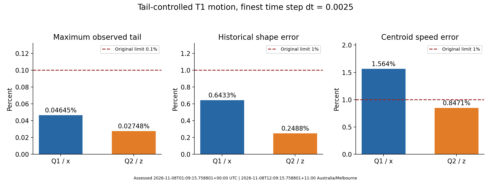
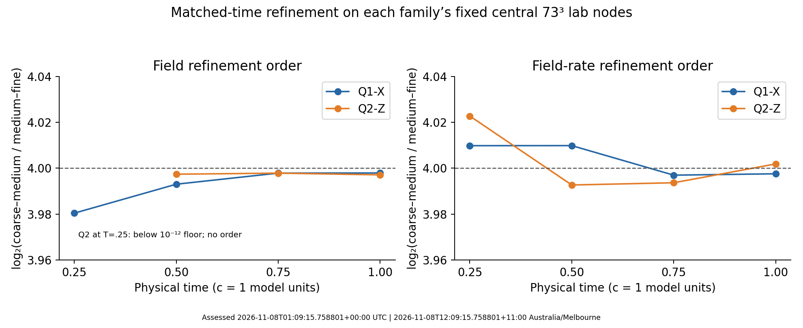

# S5-B-006 assessment: tail-controlled motion and temporal convergence

UTC: 2026-11-08T01:09:15.758801+00:00; Australia/Melbourne: 2026-11-08T12:09:15.758801+11:00.

Run: `20261106t212927z-589f5f5d`. Analysis record: `20261108t010058z-672ebb4c`.
Native source commit: `422bbcf59810938d26437f7dce9f6be83e3fb1a8`. Reviewed PR61 head: `6c214afe141ecd4c538acf7aafa72551c6adfd4d`.

## Outcome and decision

The larger, freshly admitted boxes correct the observed outer-shell problem for this T=1 experiment. All six selected trajectories completed, with **zero failures in 126 recorded tail observations**, and no domain fallback. Their largest observed tails were **0.046450% for Q1/x** and **0.027480% for Q2/z**, below the unchanged **0.1%** criterion and the separate 0.09% runtime reserve.

Time-step refinement is consistent with fourth order on the fixed spatial lattices. At T=1, halving dt reduces the measured field/rate differences by approximately 16. Q2 passes all seven original case gates at all three dt. Q1 passes six gates but retains a **1.563660% centroid-speed error**, exceeding the original 1% limit. This error is effectively unchanged by temporal refinement. **The study is assessed; its physical-mesh/domain gate stays open.**

The next experiment should isolate physical-grid and finite-domain effects, with centroid/initialization controls, rather than repeat a broad time-step sweep. This is a bounded neutral classical-field result. Higher-Q motion, spin methods and external probes retain their registered prerequisites.

## What was executed

The production matrix was frozen in [the admitted temporal specification](../../../../../docs/models/SF-admitted-temporal.md). No new trajectory or optimizer run was launched for this assessment.

| Family | Readmitted rest box | Rest spacing | Moving lab grid | Moving lab spacing | Speed / duration |
|---|---|---:|---|---|---|
| Q1/x | L24.32, n153 |0.16 |161×153×153 |0.152,0.16,0.16 |beta 0.3, T1 |
| Q2/z | L20.16, n127 |0.16 |127×127×135 |0.16,0.16,0.1504477612 |beta 0.3, T1 |

Each family used dt=0.01/0.005/0.0025: 100/200/400 moving steps. The identical full field-and-rate initial-state hash is retained across its three dt. Families use different boxes and directions, so Q1/Q2 differences are not an isolated test of Q alone. The selected domains were the first declared choices; neither fallback was invoked. Each case has one uninterrupted attempt. The workstation completed in **67,853.01 seconds (18 h 50 m 53 s)**, ending 7 November 2026 at 16:20:20 UTC / 8 November 03:20:20 AEDT.

The model remains the neutral unit-vector field with metric +---, c=1 and dimensionless length/time/energy, CPU float64, unchanged D4 nodal Hamiltonian and projected RK4 physical-time step. Two held outer layers remain. Optimizer iterations prepare rest states; they are not physical-time observations. Renderer exports were disabled for production. Equation and convention references are the existing [physical-time](../../../../../docs/models/SF-physical-time.md), [relativistic](../../../../../docs/models/SF-relativistic.md) and [focused-motion](../../../../../docs/models/SF-focused-motion.md) specifications.

## Integrity and independent replay

The uploaded summary matches the compact archive byte for byte. The ZIP SHA-256 is `9c57be7d19ef234e16f05fee517a8146ae71c5de20edb53d5dcb4fdec0f861d1`:62 members,61 hashed payloads, CRC and member ledger verified. Native source/configuration hashes and the original low-Q thresholds match the repository. [The compact replay](verification.json) independently reconstructs linear-fit centroid velocity, energy/momentum drifts, tail fractions, original flags, the endpoint audit and all reported temporal orders from the retained records.

The full Release [archive-workstation-20261107t233600z-d1c399ad](https://github.com/RDHomeProjects/ElectronFieldTopology/releases/tag/archive-workstation-20261107t233600z-d1c399ad) was independently downloaded for this assessment. All six tar segments and **128 files /6,048,737,963 payload bytes** match the published index and per-file manifest. [The download receipt](download-verification.json), [index](release-index.json) and [manifest](release-manifest.json) anchor this check to the Git catalog. All 52 NPZ files are covered, including admitted states, rest inputs/results, latest/final states and matched-time snapshots.

[The full-field replay](full-field-verification.json) checks model/config/code identity, float64 finiteness, unit/tangent constraints, held-layer values, exact warm-start embedding and state hashes. It recomputes both final rest diagnostics and all six final motion assessments, including topology quadrature, historical shape, cubic reference and fixed-comoving errors. Separate explicit D4 energy/kinetic/current contractions verify rest/initial/final energy, momentum, centroid and shell energy. Matched-time vector-field/rate norms are independently recalculated on the original central73³ regions and, additionally, each whole lab grid. The closed-form geodesic time control is rerun. These are read-only checks of the existing model and data, not an independently derived physical model or a rerun of the production trajectory.

The saved verification receipt is not passed off as a new bulk download when the installer runs: local installation rechecks compact evidence and the saved retention chain. Instructions below allow a researcher to download the arrays and repeat the full replay separately.

## Tail mitigation and rest admission

| Quantity | Q1/x | Q2/z | Declared limit |
|---|---:|---:|---:|
| Rest relative force |7.39452e-6 |1.15425e-5 |1e-4 |
| Rest maximum acceleration |5.90652e-5 |6.63650e-5 |1e-3 |
| Rest width 2 tail |0.0538299% |0.0301544% |0.1% |
| Initial boosted width 2 tail |0.0463517% |0.0274452% |0.075% reserve |
| Initial width 3 guard |0.0841569% |0.0591484% |0.1% extra guard |
| Predicted coasting T1 width 2 tail |0.0465066% |0.0274832% |0.075% reserve |
| Largest evolving width 2 tail |0.0464498% |0.0274798% |0.1%;0.09% runtime reserve |

Q1 required 50 readmission iterations; Q2 already met the declared preparation limits and required 0 new iterations. Both were measured afresh. The original source field embedding is exact, with north-vacuum extension outside its support; subsequent Q1 readmission is explicitly a changed prepared state. No field compression, taper, energy rescaling, altered action, moving boundary, reduced shell width or relaxed tolerance was used.

The shell is the original width 2 nodal outer-shell diagnostic using continuum diagnostic energy; the width 3 guard is additional. It is distinct from the discrete Hamiltonian used for conservation. Observations are at physical-time increments 0.05,21 per case, so a pass is established at the 126 observations, not at every RK stage or every intervening instant. A low shell-energy fraction does not measure a reflection coefficient, prove the boundary exerts no influence, or establish an infinite-domain limit. The earlier 24 tail failures and all failed stationary screens remain unchanged historical records.

## Motion results and original gates

Percent columns below multiply the stored dimensionless fractions by100. The requested speed is0.3. Energy drift is scaled by initial discrete Hamiltonian; momentum drift by its magnitude. Maximum tail uses all21 observations; the original final-tail flag is also retained.

| Family | dt | Fitted axial speed | Speed error % | Historical shape % | Maximum tail % | Energy drift | Momentum drift /E0 | Original case gates |
|---|---:|---:|---:|---:|---:|---:|---:|---|
| q1-x | 0.01 | 0.295309019257 | 1.5636602 | 0.6432783 | 0.0464498 | 1.494e-11 | 3.397e-05 | speed fails |
| q1-x | 0.005 | 0.295309019365 | 1.5636602 | 0.6432783 | 0.0464498 | 4.502e-13 | 3.397e-05 | speed fails |
| q1-x | 0.0025 | 0.295309019372 | 1.5636602 | 0.6432783 | 0.0464498 | 1.299e-14 | 3.397e-05 | speed fails |
| q2-z | 0.01 | 0.297458764013 | 0.8470787 | 0.2488438 | 0.0274798 | 9.246e-13 | 2.047e-06 | pass |
| q2-z | 0.005 | 0.297458764034 | 0.8470787 | 0.2488438 | 0.0274798 | 2.671e-14 | 2.047e-06 | pass |
| q2-z | 0.0025 | 0.297458764036 | 0.8470787 | 0.2488438 | 0.0274798 | 4.240e-16 | 2.047e-06 | pass |

All energy, momentum, constraint, shape, topology and final-tail flags pass. Exactly three speed flags fail, all Q1. There are three complete seven-gate passes, all Q2. The retained limits are energy 0.1%, momentum/E0=0.1%, shape 1%, speed 1%, tail 0.1%, unit/tangency errors<1e-10, and Hopf quadrature within 5% with positive corner cone.

At finest dt, Q1/Q2 final Hopf quadratures are -0.9969370/-1.9962489 and corner cones 0.933778/0.934329. These are finite-grid instruments, not exact integer certificates or electric charge. Near-roundoff Hamiltonian drift is a numerical observation in this T=1 window, not a proof of exact continuum energy conservation or physical stability.

The original 1% shape gate uses the **historical trilinear static reference**. It is not silently replaced by a cubic or fitted reference. Separate finest-dt projected-cubic raw errors are 0.648869% (Q1) and 0.246932% (Q2); own-admitted fixed-comoving raw errors are 0.331580% and 0.220482%. These have different references/regions and should not be ranked as if they were the same observable. Target-phase adjustments remain separately identified; no fitted translation, speed, rotation or deformation is used to hide the raw error.

## Temporal refinement

All three time steps share each family's full admitted field and rate. Compare snapshots at T=0.25/0.5/0.75/1 on one fixed central73³ lab-node region **within each family**. Its physical dimensions differ between families because of the anisotropic lab spacing. Field norm denominator is the reference field minus north; the rate denominator is the reference rate. The fine/coarse names describe time steps, not spatial meshes.

| Family | Time | Medium–fine field difference | Field order | Medium–fine rate difference | Rate order |
|---|---:|---:|---:|---:|---:|
| q1-x | 0.25 | 1.20898e-12 | 3.980424 | 4.21265e-11 | 4.009820 |
| q1-x | 0.5 | 3.22077e-12 | 3.993030 | 4.84008e-11 | 4.009844 |
| q1-x | 0.75 | 4.41633e-12 | 3.997867 | 6.71055e-11 | 3.996976 |
| q1-x | 1 | 5.04847e-12 | 3.997917 | 8.55759e-11 | 3.997566 |
| q2-z | 0.25 | 8.72039e-13 | below floor | 2.58899e-11 | 4.022727 |
| q2-z | 0.5 | 2.04012e-12 | 3.997386 | 4.18273e-11 | 3.992692 |
| q2-z | 0.75 | 3.08304e-12 | 3.997857 | 5.49145e-11 | 3.993658 |
| q2-z | 1 | 3.84672e-12 | 3.997106 | 7.74365e-11 | 4.001864 |

Observed order is log2(coarse–medium difference / medium–fine difference). The predeclared 1e-12 reporting floor is preserved. Q2's T=0.25 medium–fine field difference 8.72039e-13 is below that floor: **no field order is asserted there**. The 15 reportable orders span3.980424–4.022727. The separate uniform geodesic controls give orders 3.980126 and3.992746.

At T=1 the central field medium–fine differences are 5.04847e-12/3.84672e-12, and rate differences 8.55759e-11/7.74365e-11 for Q1/Q2. This supports the expected temporal behavior of this fixed-grid calculation. It does not establish the continuum field or prove that small energy drift bounds shape/speed error. The additional whole-grid comparisons and their floor decisions are in the full-field receipt; they do not replace the original comparison region or gates.

Q1's fitted speed changes by only about 1.14e-10 between dt=0.01 and 0.0025, against a speed deficit about 0.004691. Q2's changes by about 2.28e-11. Temporal truncation at these dt therefore cannot plausibly explain the observed percent-level deficits in these data. This does not identify which spatial, finite-domain, preparation or diagnostic contribution dominates.

## Endpoint audit: four facts remain separate

| Historical S5-B-009 arm | Strict final stationarity | Preceding regular window stable | Final observation regular | Original regular-endpoint certificate | Native status |
|---|---|---|---|---|---|
| Q1/L20.16 |false |false |false |false |stationarity_unresolved |
| Q1/L22.08 |true |true |false |false |stationarity_unresolved |

The retained stop reason is Armijo line-search stall. A good L22.08 final residual and a preceding stable window do not retroactively make the final observation regular. The audit independently reconstructs these facts from authenticated old records; it changes no optimizer path or historical label. The current motion-preparation readmission uses the already declared S5-B-008 limits and is separate from the stricter S5-B-009 settling certificate.

## Diagnosis and the next experiment

The successful engineering change was to provide and readmit larger boundary-admitted boxes. It corrected the measured shell failures without changing the shape/velocity criteria. Comparing older L16 cubic T=1 endpoints, Q1 tail fell from 0.304286% to about0.04635% and shape from 1.14713% to 0.64328%; Q2 tail fell from 0.133464% to 0.02748% and shape from 0.31534% to 0.24884%. However, Q1 speed error changed from 1.03479% to 1.56366%. Preparation and box changed together, so these are contextual comparisons, **not a controlled one-factor estimate of box effects**. They disprove the assumption that simply lowering the tail necessarily fixes every motion observable.

The initial analytic boost rate is not exactly the discrete transport generator of this finite lattice. Recorded full-domain/core D4 transport residuals are approximately 1.6036%/1.5671% for Q1 and 0.9369%/0.9365% for Q2. This motivates spatial and interpolation controls; resemblance in scale to the speed deficit is not causal proof. Similarly, the continuum diagnostic momentum/energy ratio is not an exact discrete Noether identity on this fixed box, so its difference from beta must not be used as a substitute speed gate.

Recommended sequence within S5-B-006:

1. **Centroid and initialization controls first.** Replay a known projected-cubic coasting field on the same grids, test static/zero-speed states, and quantify centroid-fit and sampling bias separately from evolved motion. Retain the analytic prescribed beta and original field/rate state. The added read-only kinematic controls are recorded in the full-field receipt and discussed in the supplement below.
2. **Physical-grid refinement at fixed box.** Use at least three declared physical spacings, matched physical comparison regions and identical model/action/boundary policies; start with Q1/x because its speed gate fails. Converge rest preparation consistently, authenticate newly generated states, and use temporal settings justified by the present three-dt result with a limited finer-dt confirmation on the new finest mesh. Do not merely change node count together with L and call that an isolated mesh test.
3. **Matched-spacing domain pairs.** Retain Q1 L24.32 and Q2 L20.16 as the admitted references; compare a predeclared larger box at the same physical spacing and matched observation window. Recheck the width 2/width 3 reserves after fresh readmission. Large boxes cost memory and time, so screen admission before committing to trajectories.
4. **Orientation and longer-window controls as needed.** Cross Q1/z and Q2/x to separate direction/anisotropy from charge class, then extend time only when the domain reserve remains adequate. Revisit classical inertia/kinetic-metric sensitivity on physically converged states rather than infer spin from current motion.

Do not tune beta to the measured centroid, replace the analytic rate by a fitted lattice rate to force a pass, compress/taper the field, loosen a threshold, or shrink the comparison region. Such alternatives would define separate experiments and must not rewrite the current result. A new run handover should freeze the feasible physical-grid/domain matrix and expected cost before execution; this assessment package launches no new long run.

The canonical roadmap retains Q17/Q19 motion after adequate low-Q validation, fresh-start Q18 and further-Q assessment in view of the earlier linked alternative, followed conditionally by justified spin/symmetry and external-field/apparatus studies. No new paper-specific mechanism or unverified quantization assumption is inserted into this numerical assessment. The previously registered literature-to-method distinctions remain.

## Added full-array controls

All 52 NPZ files represent **29 unique full field/rate states**. The replay compared 462 numerical scalars; the largest absolute replay discrepancy was 4.24e-14, within the recorded tolerances. The same model kernels are used for the standard diagnostic replay; energy/current contractions and temporal norms additionally have separate explicit implementations. This checks reproducibility and internal measurement consistency, not independence of the physical theory.

Whole-lab-grid T=1 medium–fine errors are 2.21836e-10 (Q1 field),1.90012e-8 (Q1 rate),9.33136e-11 (Q2 field) and4.09789e-9 (Q2 rate). Their observed orders are 4.023964,3.978350,4.032690 and3.927310 respectively. Across all eight whole-grid times, orders span 3.876029–4.097419. The whole-grid errors exceed the central-region errors, so the particularly tiny central numbers must not be described as whole-box errors. Both regions support approximately fourth-order refinement, with roundoff and error-mixture qualifications at these tiny differences. [full-field-comparisons.csv](full-field-comparisons.csv) retains all values and regions.

A new read-only control samples the known projected-cubic coasting reference at T=0/0.5/1 on each actual lab grid, with the same fixed layers and centroid diagnostic. Its endpoint displacement divided by T=1 is compared with the prescribed beta; this three-sample secant is **not** the production 21-observation least-squares fit and is not a new evolved trajectory.

| Family | Known-coasting secant speed | Relative error % | Evolved finest-dt fitted speed | Evolved relative error % |
|---|---:|---:|---:|---:|
| Q1/x |0.299952205560 |0.0159315 |0.295309019372 |1.5636602 |
| Q2/z |0.299991681951 |0.00277268 |0.297458764036 |0.8470787 |

The same centroid instrument can recover nearly the prescribed motion for a kinematically translated field in these boxes. Its measured kinematic bias is therefore much smaller than the evolved speed deficit. This weakens a simple explanation based entirely on centroid sampling or truncation of a perfectly coasting reference. It does not disentangle discrete PDE dispersion, rest/boost consistency, physical-grid anisotropy or boundary interaction in the evolving solution. The planned controls should quantify these contributions with matched preparation and grids, without subtracting the kinematic error to manufacture a passing speed flag.

## Reproduction, publication and limitations

[README.md](README.md) gives exact compact replay, archive restore, full-array replay and plotting commands. Saved scalar tables use LF and carry both timestamps. [record.json](record.json) identifies inputs, source/configuration, field retention and outcome. [SHA256SUMS](SHA256SUMS) covers this new immutable record. The original compact run and archived fields are referenced in place, not duplicated or edited.

The local handover adds this assessment to existing PR61, updates the sole roadmap register and regenerates current status, development plan, canonical study plan and indexes. The new decision is [ADR-0017](../../../../../docs/decisions/ADR-0017-admitted-temporal-assessment.md). Source kernels, configs, locks, original records and Release assets remain byte-identical. Essential checks cover record/path/hash/link invariants and replay; installation does not rerun the 18-hour experiment. Hosted checks are respected on the resulting PR head before optional merge.

Limits: one beta, one selected direction and finite spatial mesh/domain per Q, T=1, discrete shell observations, finite-grid topology, prepared classical neutral fields. Temporal convergence and a shell pass do not establish spatial/domain convergence, isolated persistent motion, quantum spin, electromagnetic response or an electron representation. AI assisted this replay, interpretation and publication tooling; the measurements and independently repeatable calculations are the evidence.
