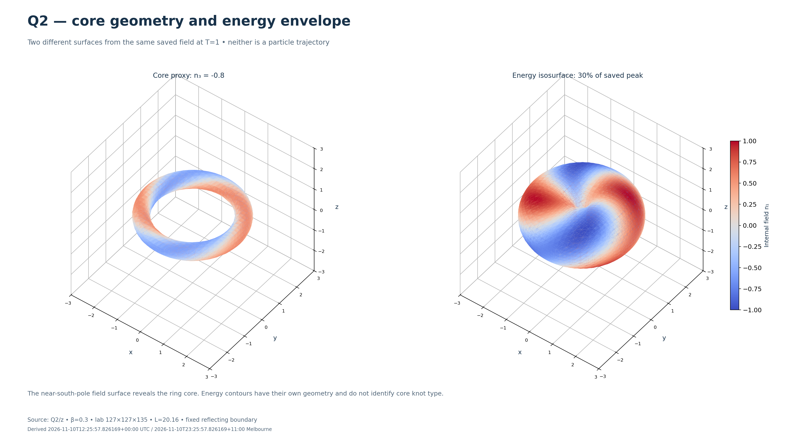
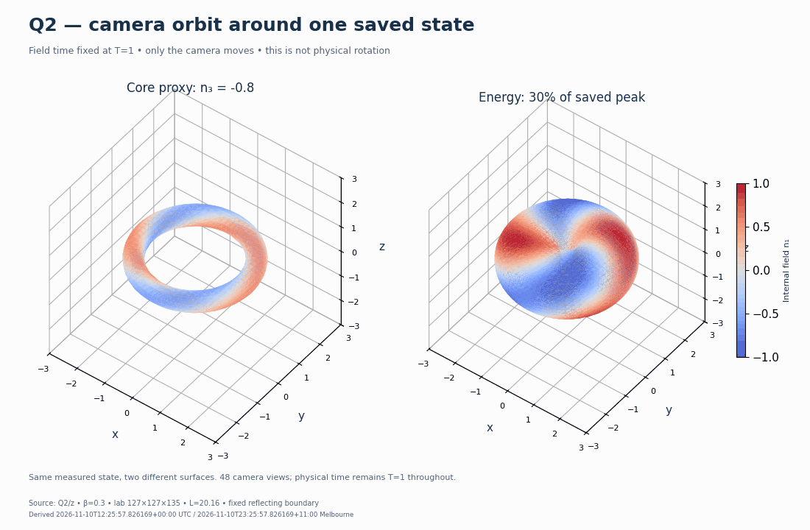

# Q2 detailed analysis — browser image and animation gallery

This gallery uses the **previously completed T=1 Q2/z temporal-refinement study**, not the short reference in the ongoing Q3/Q4/Q7 campaign. It adds derived views of the retained numerical fields; it does not run new dynamics or change the assessed scientific result.

[Open the offline browser gallery](index.html) after downloading this folder, or select individual PNG/GIF files in GitHub. GitHub displays HTML as source.

Select any PNG below to inspect the high-resolution image. Select a GIF to play the animation directly in the browser. The camera orbit, physical-time samples and diagnostic replay are deliberately labelled as different kinds of animation.

## High-resolution static images

| Image | What it shows | Resolution |
|---|---|---|
| [Core geometry and energy envelope](q2-core-and-energy-4k.png) | Near-south-pole field surface versus an energy-density contour at the same T=1 state | 3840 × 2160 |
| [Structure, field colour and energy slices](q2-structure-4k.png) | Finest-dt energy isosurface, internal-field colour, cross-sections and in-plane energy flux | 3840 × 2160 |
| [Five recorded motion states](q2-recorded-motion-4k.png) | The actual retained states at t=0, 0.25, 0.5, 0.75 and 1, with the same view and colour scales | 3840 × 2160 |
| [Motion and temporal-refinement diagnostics](q2-diagnostics-4k.png) | Centroid displacement, Hamiltonian drift, shell-energy fraction and whole-grid time-step differences | 3840 × 2160 |

[](q2-core-and-energy-4k.png)

The core view uses the internal-field level n₃=-0.8 as a proxy around the south-pole core. The energy envelope uses a fixed level at 30% of the largest continuum energy density over the five saved states. The two surfaces represent different quantities. Colour is the internal component n₁, with a fixed range from -1 to 1; it is not velocity or electric charge. A core view alone is not a knot certificate.

## Browser-playable animations

| Animation | Frames and playback | Interpretation |
|---|---|---|
| [Camera orbit: core and energy](q2-camera-orbit.gif) | 48 camera views of one fixed T=1 state, about 12 frames/s | Only the camera moves; the field is not physically rotating |
| [Recorded physical motion](q2-recorded-motion.gif) | Five saved full-field states, 1.4 seconds per frame | Actual computed states; no invented intermediate fields or temporal interpolation |
| [Diagnostic replay](q2-diagnostic-replay.gif) | 21 diagnostic observations, about 5.6 frames/s | Cursor follows recorded measurements; it does not imply 21 retained full-field snapshots |

[](q2-camera-orbit.gif)

Playback speed is a viewing setting. Time and length are in dimensionless model units, not electron seconds or metres. The physical replay loops back to t=0 after its final recorded frame.

## Calculation represented

The source is run `20261106t212927z-589f5f5d`, calculated at commit `422bbcf59810938d26437f7dce9f6be83e3fb1a8`, with beta=0.3 along z, T=1, a 127×127×135 moving lab grid, L=20.16, and fixed reflecting boundary layers. Three time steps were assessed: 0.01, 0.005 and 0.0025. The full-field views use the finest time step; diagnostic comparisons retain all three.

The [existing assessment](../20261108t010058z-672ebb4c/ASSESSMENT.md) remains authoritative. Its Q2 cases pass all seven original gates in this finite T=1 window. The finest-dt fitted centroid speed is approximately 0.297458764, a 0.8471% error against beta=0.3; the maximum measured width-2 tail is approximately 0.02748%, below the original 0.1% criterion. These results do not establish spatial/domain convergence, isolated long-time stability, electric charge, quantum spin or an electron model.

The pictures show a core window with coordinates within ±3 model units. Full-box diagnostics are calculated before display cropping. Static surface meshes use native calculation nodes and display-only linear isosurface interpolation. The display has more pixels than the calculation has spatial samples; 4K image resolution is not a new physical mesh. The camera movie retains the same surface definitions and scales, and the recorded-motion replay uses only saved times. Energy-flux arrows are scaled for display.

## Storage and browser access

The modest PNG and animated-GIF derivatives are stored directly in this immutable dated report record, beside their recipe, verification and checksum ledger. GitHub's native image viewer can display them when selected, and the study index links here. GitHub documents native [PNG/GIF image viewing](https://docs.github.com/en/repositories/working-with-files/using-files/working-with-non-code-files).

Large float64 checkpoints remain in the existing [verified Release archive](https://github.com/RDHomeProjects/ElectronFieldTopology/releases/tag/archive-workstation-20261107t233600z-d1c399ad), anchored by the [Git catalog](../../../../../data/archives/20261107t233600z-d1c399ad/README.md). No full field is added to Git. This gallery does not depend on expiring Actions artifacts, LFS pointers, an HTML file displayed as source, or a separate website. Every GIF has a declared 10 MiB ceiling, checked before publication.

The source archive, earlier reports, simulation code and scientific thresholds are preserved. New renderings should be added as new records, not substituted into these paths.

## Provenance, checks and reproduction

[render-verification.json](render-verification.json) records source checkpoint hashes, native state/configuration/source identities, float64 constraints, full-box diagnostic checks, renderer environment, surface settings, image dimensions, decoded GIF frame counts/durations and output hashes. The fresh recovery is selective: seven required checkpoint members are downloaded and verified against the catalog-anchored manifest; it is not described as a fresh verification of the whole archive. [acquisition.json](acquisition.json) retains the read receipts. [source-selection.json](source-selection.json) records exact archive members and offsets; [render-profile.json](render-profile.json) fixes display settings.

To reproduce into a new directory from a checkout containing this record:

```bash
export OMP_NUM_THREADS=2 OPENBLAS_NUM_THREADS=1 PYTHONDONTWRITEBYTECODE=1
gallery="reports/s5-b/006-focused-motion-convergence/assessments/20261110t121649z-176b2be9"
uv run --frozen --python 3.12.14 python "$gallery/render_gallery.py" \
  --repo . --cache "$HOME/EFT-Q2-media-cache" \
  --output "$HOME/EFT-Q2-media-rerender-$(date -u +%Y%m%dT%H%M%SZ)"
```

The renderer refuses a nonempty output directory, authenticates the existing source chain and calls no optimizer or physical-time step. It can download about 0.63 GB of selected original checkpoint bytes on a cold cache. It uses the committed NumPy/SciPy/Matplotlib dependencies and Pillow supplied with Matplotlib. Small pixel differences between renderer versions are possible; the exact source, profile, environment and selected states are recorded. Source measurements and original acceptance decisions remain distinct from display choices.

All output records and visible image footers carry UTC and Australia/Melbourne timestamps. AI assisted the read-only rendering and publication; these are visualizations of numerical evidence, not new experimental evidence.
