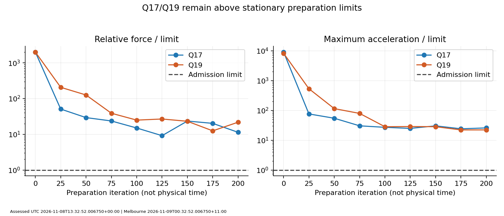
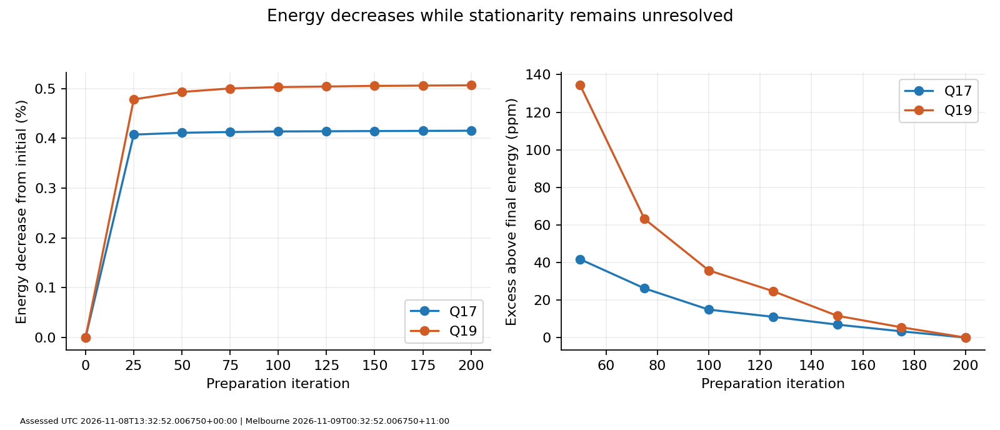
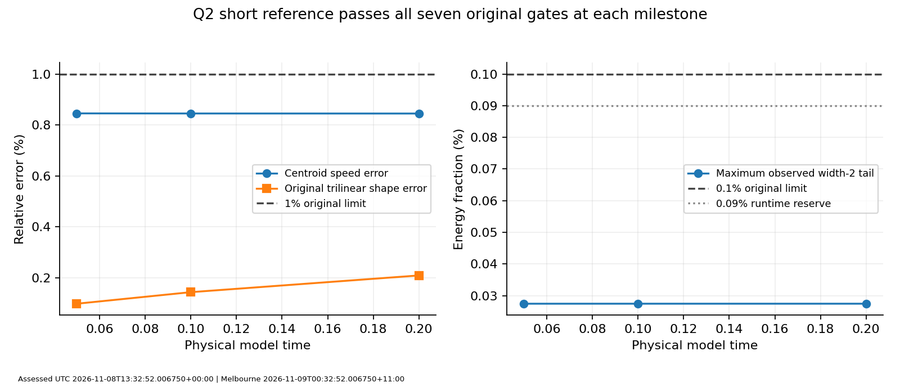

# Q17/Q19 coarse preparation assessment and Q2 short reference

UTC: 2026-11-08T13:31:39.521682+00:00; Australia/Melbourne: 2026-11-09T00:31:39.521682+11:00.

Study **S5-B-007**. Run `20261108t022631z-7e649031`; measured source commit `8c2c9ed492f35a6cc0615085f8ca42479a6227e0`; reviewed publication head `92a5cc24c2b8192ed0b2b9d64e2e0a42f8414529` in [PR62](https://github.com/RDHomeProjects/ElectronFieldTopology/pull/62).

## Decision

The inexpensive screen worked as designed: the Q2 short motion reference passed, but **neither Q17 nor Q19 reached stationary preparation**, so neither was evolved. Record both as `preparation_unresolved`, not failed moving knots, lost topology or physical rejection of these Q values. The coarse endpoints and original 129³ inputs remain usable parents for a separately specified follow-up.

Neither higher-Q candidate qualified for a finer moving-field campaign. Follow the predeclared fallback to **Q2 numerical controls and physical-mesh/domain convergence in S5-B-006**. Q1 stays parked, including its original 1.563660% speed failure. Do not spend a long higher-Q trajectory or automatically launch a finer mesh to work around a failed preparation gate.

## What actually ran

The native campaign began8 November 2026 at 02:26:31.713625 UTC /13:26:31.713625 AEDT and finished03:36:17.179105 UTC /14:36:17.179105 AEDT: **1h9m45.57s**. Exit0 and `complete_pending_review` mean the planned screen was recorded; the native outcome is preserved in the immutable run.

| Arm | Rest grid | Stationary work | Physical-time work | Outcome |
|---|---|---|---|---|
| Q2 reference |127³, h0.16, L20.16|Retained D4 rest field;0 optimizer calls|beta0.3 along z, dt0.01, T0.2,20 steps|`screen_pass`|
| Q17 |97³, h0.24, L23.04|4 calls of50 iterations;200 accepted iterations|Not started|`preparation_unresolved`|
| Q19 |97³, h0.24, L23.04|4 calls of50 iterations;200 accepted iterations|Not started|`preparation_unresolved`|

The Q2 lab grid is127×127×135 over the same20.16 lengths, retaining longitudinal resolution after contraction. Higher-Q rest inputs were sampled exactly at every second original 129³/h0.12 node on unchanged coordinates, then extended with16 north-vacuum nodes per face. This was neither a physical shrinking nor a change to energy coefficients. No Q17/Q19 boost admission, moving milestone, dt0.005 confirmation or temporal comparison ran. Empty higher-Q motion/confirmation records are deliberate skips, not measured passes.

CPU float64, metric+---, c=1 and the fixed-coefficient neutral Skyrme–Faddeev model are unchanged. Model length/time/energy are dimensionless; optimizer iterations are not physical time. This is the D4-action/projected-RK4 numerical scheme. The old cell functional and this D4 lattice approximate the same continuum model but have different finite-grid stationary points. The old static labels cannot replace fresh D4 readmission. The exact normalization, sources and equation map remain in [the static specification](../../../../../docs/models/SF-J2015-static.md), [the physical-time specification](../../../../../docs/models/SF-physical-time.md) and [the frozen screen contract](../../../../../docs/models/SF-higher-q-screen.md).

## Stationary preparation results

Original limits: relative force<=0.0001; maximum acceleration<=0.001; absolute Hopf-magnitude error<=5%; positive corner-cone margin; unit error<1e-10. The force is the relative L2 tangent-gradient residual of the D4 Hamiltonian, and acceleration is computed with its physical kinetic matrix. These are separate tests.

| Final rest metric | Q2 | Q17 | Q19 |
|---|---:|---:|---:|
| Discrete energy |1.99948549715528|10.8901322222097|11.9342896381113|
| Relative force |1.15425e-5|0.00113764|0.00218160|
| Force / limit |0.1154|**11.3764**|**21.8160**|
| Maximum acceleration |6.63650e-5|0.0258645|0.0222044|
| Acceleration / limit |0.06636|**25.8645**|**22.2044**|
| Signed Hopf quadrature |-1.99615573356|-16.7543313700|-18.7412133785|
| Hopf-magnitude error |0.192213%|1.445110%|1.362035%|
| Minimum corner-cone margin |0.933802|0.776143|0.780873|
| Width2 rest energy tail |0.0301544%|0.0272852%|0.0576819%|

Both higher-Q endpoints pass the sampled topology/constraint checks but fail **both** stationary residual tests. All recorded preparation observations retain positive cone margins, Hopf errors below5%, and unit errors below1e-10. Approximate Hopf quadrature and continuity diagnostics do not identify an extracted K(7,2) curve or certify that it persisted through relaxation. No new core-curve extraction/identification was performed.

| Preparation change, initial to final | Q17 | Q19 |
|---|---:|---:|
| Energy |10.9355633528 →10.8901322222|11.9950593974 →11.9342896381|
| Energy decrease |0.415444%|0.506623%|
| Relative force reduction factor |176.93|92.10|
| Maximum acceleration reduction factor |351.36|371.24|
| Last50-iteration relative energy decrease |6.916e-6|1.1639e-5|

Each native batch reports `iteration batch complete`; the final native result is `checkpointed` at iteration 200/pass 4, with no error reason. The screen exhausted its four-call preparation allocation. It did **not** terminate on an Armijo stall, a detected topology failure or the three-pass 1e-10 energy-stagnation test. The result's native `wall_seconds` describes the last optimizer invocation, not all four calls or the campaign; the campaign timestamps above supply total elapsed time.

Energy decreases throughout the retained sampled history, while the residual norms oscillate. Q17's smallest sampled force is0.000916254 at iteration125; Q19's is0.001250991 at iteration175. Even these are9.16× and 12.51× the force limit. The sampled acceleration minima are still about24.16× and22.16× the acceleration limit. There is no sampled earlier endpoint that qualifies and no justification to cherry-pick a lower residual as an accepted rest state. The conjugate-gradient direction and line-search starting value are reset at batch boundaries by the existing readmission algorithm. This is a plausible efficiency issue to test, not an established cause of the unresolved endpoints.

## Why this is not the earlier tail failure

The final higher-Q **rest** width2 tails are below 0.1%, and also below the0.075% initial/predicted-coast reserve in magnitude. That comparison is descriptive only: boosted width2, width3 guard, fixed-layer projection and predicted-coast admission were **not reached** for Q17/Q19. A small rest tail cannot confer moving-field admission.

A read-only residual-localization probe places the final acceleration maximum near(1.68,-2.16,-0.72) for Q17 and(2.16,-1.92,-0.48) for Q19, far inside the box. The maximum acceleration in the outer width2 shell is only7.6081e-6 and1.5023e-5 respectively, compared with interior maxima0.0258645 and0.0222044. The shell contains about2.2740e-7 and2.6771e-7 of the squared tangent-force norm. Thus the measured blocking residual is overwhelmingly interior. This does not prove the absence of finite-box influence, but it gives no evidence that increasing L alone will cure the present preparation problem. Repeating the previous tail-domain ladder is not the leading next experiment.

Potential explanations remain finite preparation allocation, optimizer efficiency/reset cadence, coarsening/aliasing and inherited-basin conditioning under a different lattice action. One mesh and one retained source per Q cannot separate them. Earlier read-only finer representations also had substantial D4 residuals before relaxation; interpolation alone is not a cure. A controlled new preparation study would vary one factor at a time and retain original-source starts alongside endpoint warm starts. No such extra optimization has been run for this assessment.

## Q2 motion reference

All seven original case gates pass at each of T0.05/0.1/0.2: energy, momentum, constraints, original trilinear-reference shape, centroid speed, topology and tail. All 21 recorded width2 tail observations pass both the0.1% criterion and0.09% runtime reserve. Initial width2 tail0.0274452%, width3 guard0.0591484% and predicted-coast width2 tail0.0274112% pass their frozen reserves.

| Model time | Speed error | Original shape error | Maximum observed tail | Original criteria |
|---|---:|---:|---:|---:|
|0.05|0.845576%|0.098725%|0.0274480%|7/7 pass|
|0.10|0.845210%|0.144050%|0.0274520%|7/7 pass|
|0.20|0.844998%|0.209623%|0.0274525%|7/7 pass|

At T0.2 the centroid fit gives vz=0.297465004778 against beta0.3. Maximum Hamiltonian drift is1.93358e-13; momentum drift divided by initial energy is6.03458e-8. The additional projected-cubic reference has raw relative L2 error0.0434975%; this does not replace the original shape gate. Signed final Hopf quadrature is-1.99624598593 with positive cone0.934334. This one short dt0.01 reference confirms a functioning control/continuation path. It does not measure a temporal order or close Q2 physical-mesh, domain, long-time or isolated-motion requirements. Near-perfect energy conservation does not remove its approximately0.845% centroid-speed discrepancy.

## Independent verification and retained data

- [Archive verification](archive-verification.json): all six assets independently downloaded and hashed; two segments totaling1,511,147,520 bytes; all 79 manifested payloads totaling1,511,077,768 bytes checked for exact membership, size, mode and SHA-256, then restored to a fresh directory. [Original archive index](release-index.json), [manifest](release-manifest.json) and [asset identities](release-snapshot.json) are retained here.
- [Compact verification](compact-verification.json):41 ZIP members,40 hashed payloads; duplicate published files agree with ZIP bytes; all 26 numerical-source files and the exact configuration hash match. Independent scalar least-squares/energy/momentum/tail replay agrees with every Q2 milestone. Native optimizer allocations/statuses and all skipped higher-Q work are checked.
- [Field verification](field-verification.json):23 full float64 NPZ files,12 distinct canonical field/rate states; exact original-source embedding, checkpoint source/config/model geometry, constraints, fixed layers, segment-resume continuity and snapshot hashes verified. Initial/final rest metrics for all three arms and all three Q2 moving milestones replayed:234 numeric comparisons, maximum absolute difference9.40e-14. Explicitly expanded D4/positive-sigma/two-form energy and current contractions independently cross-check the named instrument outputs.
- [Replay log](field-replay.txt) retains UTC/Melbourne times. Re-evaluation used Python 3.12.14, NumPy 2.3.5 and SciPy 1.17.0; the original workstation used Python 3.12.14, NumPy 2.5.4, SciPy 1.18.1. The numerical agreement is recorded with relative1e-8/absolute1e-11 replay tolerances; these verification tolerances do not alter scientific gates. The exact environment strings are retained in the receipts.

The full-field [research release](https://github.com/RDHomeProjects/ElectronFieldTopology/releases/tag/archive-workstation-20261108t130946z-bb3606a9) remains the authoritative binary retention location, with [its descriptive usage guide](release-research-readme.md). Compact run files, prior assessments, publication hashes, release assets and original handover are unchanged. This assessment is a new record, not a rewrite of the measured run's `complete_pending_review` status. The roadmap marks the study assessed separately.

## Recommended next work and options

1. **Return to Q2 numerical controls under S5-B-006**, honoring the coarse-screen fallback. First isolate centroid/interpolation and D4 stationarity measurement effects with read-only controls; then specify a fixed-box physical-mesh comparison and a matched-spacing larger-box comparison. Freshly readmit every rest/boosted field and retain all original reserves. Choose the smallest matrix that separates these errors before any long trajectory. Q1 stays parked.
2. **Keep S5-B-007 open for conditional preparation diagnosis.** A small, separately registered stationary-only test could compare additional same-grid preparation against a finer h0.192 representation, using the same action/thresholds and both original 129-source starts and retained200-iteration warm starts. Preserve conjugate-gradient reset cadence or study it explicitly; never silently change it. Q17 is closer in relative-force residual, Q19 has the lower maximum acceleration, so these numbers do not establish a physical winner. A finer-grid cost increase is not yet justified by a successful coarse moving arm.
3. Only after strict stationary and boosted boundary admission should either candidate receive a fresh matched motion screen from t0, then an optional half-dt consistency test. Longer motion and at least three physical meshes/domain checks remain subsequent gates. Reusing a coarse moving endpoint as a substitute for finer initial data is not allowed; there is no higher-Q moving endpoint from this run anyway.

Do not relax thresholds, rescale knot dimensions, increase the box blindly, assign electric charge/spin, or interpret stationary iterations as motion. Q18 fresh-start/conditioning and additional-Q work remain in their registered conditional order. This assessment does not change equations or establish a new experimental electron prediction. AI assisted the analysis/report and reproduction scripts; the observations are from authenticated numerical data, with independent scientific review still needed for stronger interpretations.

Requirements: NUM-001/002/003, BND-001, REL-002, SCI-003/004, REP-001/002. See [ADR-0019](../../../../../docs/decisions/ADR-0019-higher-q-preparation-assessment.md) and the generated [study plan](../../../../../docs/plans/s5-b/007-higher-q-motion.md). Reproduction and the publication procedure are in [README.md](README.md).
