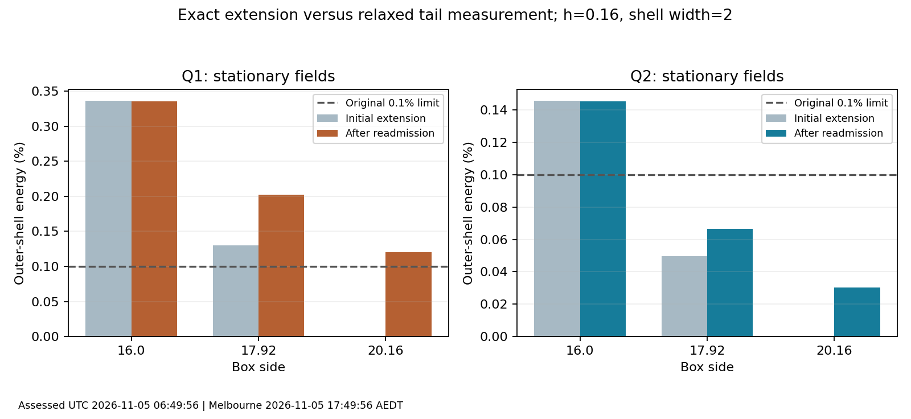
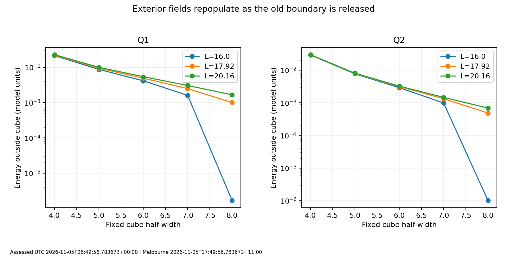
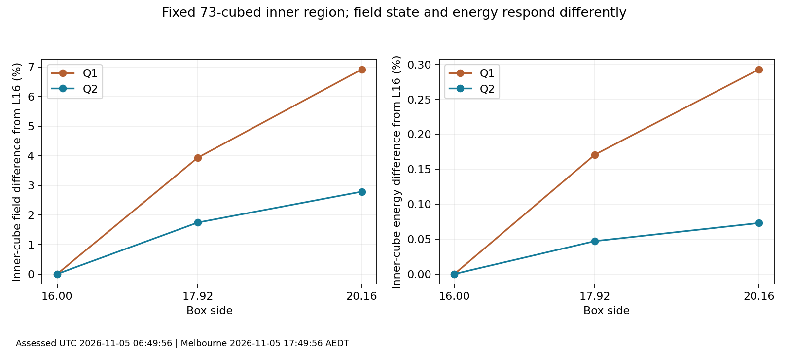

# S5-B-008 assessment: domain enlargement mitigates Q2 tails; Q1 remains open

Assessed UTC: 2026-11-05T06:49:56.783673+00:00; Australia/Melbourne: 2026-11-05T17:49:56.783673+11:00.

## Finding and disposition

All six stationary readmissions completed and met the predeclared stricter force/acceleration, unit, fixed-layer and approximate-topology conditions. **Q2 passes the original 0.1% stationary shell-energy gate at both L17.92 and L20.16. Q1 fails at both requested larger sizes.** The two L16 controls also fail, giving two tail passes and four failures in the six-case experiment. The four requested larger-box cases contain two passes and two failures. Workflow state is **assessed**; the overall scientific gate remains **open**.

Domain enlargement is a supported potential correction for the stationary Q2 shell failure, with L17.92 the smallest passing size tested. L20.16 offers more shell margin. Neither size is certified domain-independent or qualified for arbitrary moving windows. No passing stationary Q1 box has been established. The original 24 moving-case tail failures remain unchanged.

## Experiment and provenance

- Run `20261105t053203z-576d1edc`, source commit `56bc6b5e442fecbf923f9eec8fcb227eaceff976`, clean tracked source. CPU float64; parent neutral SF model, +--- metric and c=1, dimensionless length/energy units. Only stationary optimization was performed.
- Q1/Q2 retained n101/L16 inputs were copied exactly into equal-spacing centred domains: L16/n101, L17.92/n113 and L20.16/n127, all h=0.16. Larger fields initially had north vacuum outside the original footprint. Formerly fixed interior layers became free. No field compression, amplitude/energy rescaling, coupling change, taper, new physical-time evolution or GPU-functional substitution.
- The unchanged time-lattice D4 Hamiltonian and readmission optimizer were used. New preparation targets were force<=1e-4 and acceleration<=1e-3; original force<=1e-3 and acceleration<=1e-2 were separately checked. Tail threshold remained0.001, shell width2. Three box lengths at one spacing constitute domain sampling, not three physical mesh resolutions.
- The two L16 controls underwent the same tighter readmission. They took25 iterations each; all four enlarged states took50, for250 optimization iterations in total. These iterations are not physical time.
- Completed UTC2026-11-05T06:20:08.588374+00:00 / Melbourne2026-11-05T17:20:08.588374+11:00. Wall time2884.265s =48min4.265s.

## Tail measurements

The diagnostic is continuum-energy density summed over nodes with any |x_i|>=L/2-2, divided by total energy inside the box. It does not estimate all energy outside the computational domain, lost energy, radiation or a reflection coefficient. The optimized discrete Hamiltonian is recorded separately. No shell penalty enters the objective.

|Q|L|Initial shell (%)|Relaxed shell (%)|Relaxed shell energy|Tail gate|
|---|---:|---:|---:|---:|---|
|1|16.00|0.335946|0.335621|0.004118854|fail|
|1|17.92|0.130012|0.202260|0.002479493|fail|
|1|20.16|0.000000|0.120632|0.001477627|fail|
|2|16.00|0.145515|0.145288|0.002905578|fail|
|2|17.92|0.049508|0.066603|0.001331504|pass|
|2|20.16|0.000000|0.030154|0.000602713|pass|



At L20.16 the relaxed Q1 fraction is0.120632%, **20.63% above** the0.1% limit. Relative to the newly readmitted L16 control, its fraction falls64.06%, but remains a failure. Q2 falls54.16% at L17.92 and79.25% at L20.16 relative to its L16 control. Its margins below the limit are33.40% and69.85%, respectively. These percentages describe this stationary experiment only; the earlier boosted/moving measurements use different field/rate states and laboratory grids.

Both L20.16 initial fractions are exactly zero because the shell starts at |x|=8.08, beyond the original L16 footprint. The initial north extension therefore contains no energy in that shell. Relaxation repopulates it: Q1 ends above the limit and Q2 below it. A zero tail immediately after padding cannot qualify a larger-box equilibrium. At L17.92 the fraction also increases during readmission: Q1 from0.130012% to0.202260%, Q2 from0.049508% to0.066603%.

## Moving shell versus a fixed physical region

The shell moves outward when L increases. To distinguish that effect from a change in the field, compare energy outside the same original inner cube (any |x_i|>=6) on every domain:

|Q|L16 exterior energy|L17.92 exterior energy|L20.16 exterior energy|L20.16 change from L16|
|---|---:|---:|---:|---:|
|1|0.004118854|0.004877508|0.005388813|+30.83%|
|2|0.002905578|0.003140460|0.003245925|+11.71%|



Energy outside that fixed cube **increases** as the old boundary is released:30.83% for Q1 and11.71% for Q2 from L16 toL20.16. The lower moving-shell fraction therefore does not mean the field has become intrinsically more confined. It means the expanded domain allows exterior structure to form while placing the outer boundary farther away. The r99 radius also grows: Q1 from5.4141 to5.5908, Q2 from4.8767 to4.9081.

Absolute shell energy decreases with domain size, while total continuum energy decreases slightly; the improvement is not produced by inflating the denominator. The final discrete Hamiltonian drops by0.19182% for Q1 and0.05741% for Q2 from the relaxed L16 control toL20.16. Optimization deliberately lowers energy; these changes are not energy-conservation errors or measurements of emitted radiation.

## Common-region field sensitivity

All final pairs were compared at exactly matching physical nodes, with derivatives evaluated on each full domain before cropping. The common73-cubed region has side11.52 and is centred at the original origin; the original101-cubed footprint has side16. No centroid, rotation, phase or deformation was fitted. The field norm is normalized by the reference texture ||n-north||. This inner cube includes a substantial surrounding field, so its percentage is not a direct percentage deformation of the knot core.

|Q|Domain pair|Inner field L2 difference (%)|Inner energy difference (%)|Inner density L1 difference (%)|Original-footprint field difference (%)|
|---|---|---:|---:|---:|---:|
|1|16 / 17.92|3.9375|0.1709|0.5482|7.1245|
|1|16 / 20.16|6.9272|0.2930|0.9483|12.6968|
|1|17.92 / 20.16|2.9322|0.1223|0.4010|5.4686|
|2|16 / 17.92|1.7407|0.0471|0.3692|3.9620|
|2|16 / 20.16|2.7881|0.0729|0.5826|6.4357|
|2|17.92 / 20.16|1.0413|0.0258|0.2135|2.4774|



Between the two larger boxes, the inner field difference is **2.9322% for Q1 and1.0413% for Q2**, despite common-region energy differences of only0.12225% and0.02585%. Thus small scalar energy differences do not establish full-field agreement. Differences from L16 are larger. These are descriptive measurements, not a new convergence pass/fail threshold; the1% moving-shape gate concerns a different comparison and must not be imported retroactively.

The integrated continuum stress remains nonzero and domain-sensitive. Its trace/energy decreases from about1.8463% to1.2608% for Q1 and0.7825% to0.4901% for Q2 betweenL16 andL20.16. These discrete finite-box diagnostics reinforce the need to assess boost/motion consistency independently. They do not constitute a force measurement or a new virial acceptance gate.

## Stationarity and limitations

All six final states meet the strict preparation gates. Final relative forces range7.05e-6 to9.00e-5; maximum accelerations range4.84e-5 to9.05e-4. Q1/L17.92 stops closer to those limits than the other final states. The common stopping policy is consistent, but equal stopping thresholds do not imply identical residual errors. Unit errors are roundoff-scale, held layers exactly north, and Hopf quadratures remain near -0.997 and -1.996. These are approximate topology diagnostics, not exact knot certificates.

The study uses continuation from the same retained fields rather than independent fresh seeds. It does not prove a global minimum, eliminate possible residual old-box effects, quantify tail settling under further tightening, establish an asymptotic domain limit, or measure boundary reflection. Only final initial/latest checkpoint pairs are retained for field replay; intermediate tail evolution cannot be reconstructed from the scalar histories alone. No physical-time trajectory was computed.

## Verification actually performed

1. The uploaded evidence is byte-identical to PR59 and to the archived evidence: SHA-256 `721c3b28762ddf5880ec8cfbaeb65c08097b86fc01bc53c37d13ef1410c5b4fa`. All48 ZIP members pass CRC and the47-member ledger. All six case/result/history/config/manifest records, CSV values, gate arithmetic and original input hash references were checked. Twelve scientific source files match the native source map. The existing numerical kernels are unchanged from merged PR58.
2. Independently downloaded the published full Release payload, verified the297871360-byte tarpart SHA-256 and its authenticated manifest, then verified all74 files totaling297809632 payload bytes. The Git catalog and workstation verification receipt agree. This includes all12 initial/final NPZ checkpoints and the runnable handover. No source data were deleted or rewritten.
3. Loaded every NPZ with pickle disabled; checked model/scheme, float64 geometry, zero rate, state/config/code/iteration identities and checkpoint seals. All six centred initial embeddings replay bit-exact against the corresponding baseline initial field, including north extension. The original pre-study NPZ files were not independently downloaded again; their hashes are authenticated by the original compact campaign and the native source inventory.
4. Reexecuted all12 initial/final diagnostic evaluations through the recorded implementation and compared588 numeric scalars. Separately implemented the D4 zero-exterior stencil, continuum energy, discrete sigma Hamiltonian, shell integration and12 common-region comparisons in NumPy. All agree. Independent energy differences are zero in this environment, maximum Hamiltonian difference4.44e-16 and maximum tail-fraction difference2.17e-19. These are replay discrepancies, not estimates of physical discretization error.
5. Diagnostic replay used Python3.12 with NumPy2.3.5/SciPy1.17.0; native manifests record Python3.12.14/NumPy2.5.4/SciPy1.18.1. Replay completed in193.37seconds. No optimization path or fresh physical solution was rerun. Reexecution through the same stationarity/Hopf code is not an independent derivation of that code; the separately implemented energy/tail/core checks provide narrower independent confirmation.

## Corrective-action decision

- **Q2:** retain L17.92 as the smallest tested passing stationary box and L20.16 as the larger-margin stationary reference. Neither is automatically selected for production motion: boosts, observation windows, core sensitivity and convergence still require their own checks.
- **Q1:** retain the two requested failures. L20.16 improves the tail substantially but cannot be relabelled compliant. A next modest candidate is L22.08/n139 at h0.16, rather than assuming L24 is necessary. This is a proposed next test, not a prediction that it will pass. A separately recorded tightening/tail-settling check of the retained L20.16 endpoint would help distinguish residual relaxation from domain extent before a larger production choice.
- Keep the0.1% limit and shell width unchanged. Do not shrink the field, rescale energy, taper tails, switch functionals or choose a passing initial padding measurement to obtain compliance. Preserve the common-region diagnostics alongside the tail fraction.
- S5-B-008 is assessed/open. Prepare the narrow remaining Q1 correction/settling check before accepting stationary references for new production motion. The previously planned S5-B-006 temporal audit remains pending; finite-box method tests can be labelled as such, but isolated-motion acceptance must wait. Q17/Q19 motion, Q18 fresh starts/additional-Q work and quantum/probe stages retain their conditional ordering. No new run is launched by this assessment.

[ADR-0015](../../../../../docs/decisions/ADR-0015-stationary-tail-domain-assessment.md) records these decisions. This update changes interpretation and current navigation only. Raw run files, code/configuration, full fields, prior reports, thresholds and published paths remain unchanged.

## Reproduction

From repository root, inexpensive metadata/scalar replay:

```bash
python3 reports/s5-b/008-tail-domain-screening/assessments/20261105t064956z-339196d8/verify_assessment.py \
  --evidence reports/s5-b/008-tail-domain-screening/runs/20261105t053203z-576d1edc/evidence.zip \
  --repo . --retention-folder reports/s5-b/008-tail-domain-screening/assessments/20261105t064956z-339196d8 \
  --output /tmp/s5-b-008-reverified.json
```

For optional full-field replay, point `--run` to the original or verified restored run directory; this reads fields without optimizing them:

```bash
OMP_NUM_THREADS=2 OPENBLAS_NUM_THREADS=1 uv run --frozen python \
  reports/s5-b/008-tail-domain-screening/assessments/20261105t064956z-339196d8/replay_fields.py --repo . \
  --run /absolute/path/to/20261105t053203z-576d1edc \
  --evidence reports/s5-b/008-tail-domain-screening/runs/20261105t053203z-576d1edc/evidence.zip \
  --retention-folder reports/s5-b/008-tail-domain-screening/assessments/20261105t064956z-339196d8 --output /tmp/s5-b-008-full-replay.json
```

The verified catalog is [data/archives/20261105t063134z-4cd07212](../../../../../data/archives/20261105t063134z-4cd07212/README.md). Restore rootr001 to a new directory if needed; retain immutable verification outputs and write replays to new files. CSV rows and plots include both UTC/Melbourne assessment stamps.

Requirements NUM-001/002/003, BND-001, REP-001/002 and SCI-003/004 gain bounded domain evidence and retained failures. No isolated stability, electric charge, quantum spin or electron-model acceptance follows. AI assisted analysis and reporting; external scientific peer review has not occurred.
