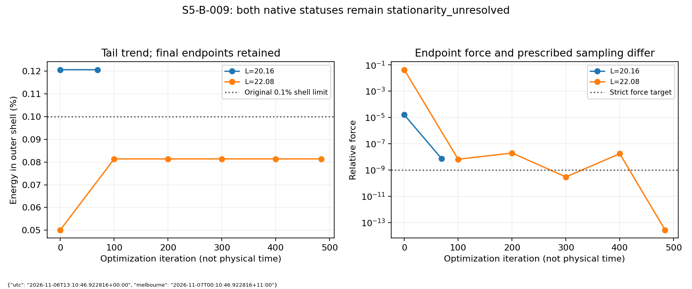
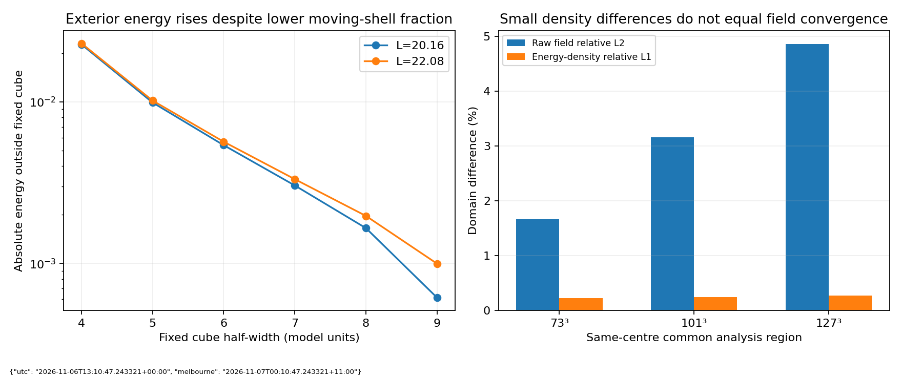

# S5-B-009 assessment: Q1 domain correction and conservative stopping labels

Assessed: UTC 2026-11-06T13:05:24.404933+00:00; Australia/Melbourne 2026-11-07T00:05:24.404933+11:00.
Run: `20261105t212644z-103ef9f4`; numerical source commit `a8249de8eee6f91fd217c028e80dc8edf0ea3acc`.
Publication snapshot: PR60 head `57caf91109a4d7fc84c4eca336cbee145400b6c1`. Compact ZIP SHA-256 `5cc3460d8fa9ddeb6525757ccebfad471088ea6103e248aaa2198a8f24beef27`.

## Disposition

**Q1/L20.16 retains the original tail failure after deeper relaxation. Q1/L22.08 passes the original stationary shell limit and the tight final force targets, while the predeclared regular-observation settling certificate remains unmet.** Both native `stationarity_unresolved` labels and every original gate are preserved. The larger box is a bounded stationary reference candidate, not demonstrated isolated motion or domain independence.

This assessment independently downloaded and authenticated all 52 archived payload files (561,372,854 bytes), checked all 12 NPZ files, replayed eight unique full-field states and compared612 recorded numerical scalars. Separate NumPy D4 energy/tail calculations and three matched-domain comparisons agree. No optimization or physical-time trajectory was rerun. Research runtime versions differ from the native frozen environment; full details and errors are retained in [the replay receipt](full-field-verification.json).

## Results

|Measurement|Q1 L20.16 / n127|Q1 L22.08 / n139|
|---|---:|---:|
|Accepted optimizer iterations|69|484|
|Native stop reason|Armijo search stalled|Armijo search stalled|
|Native status|stationarity_unresolved|stationarity_unresolved|
|Final shell fraction (%)|0.120637735204|0.081394194950|
|Original <=0.1% shell check|Fail|Pass|
|Relative force, target <=1e-9|7.41763390e-9|2.72048805e-14|
|Maximum acceleration, target <=1e-8|6.73244749e-8|1.80790693e-13|
|Tight final stationarity checks|Fail|Pass|
|Earlier preparation 1e-4 / 1e-3 checks|Pass|Pass|
|Three regular tail/core intervals stable|Insufficient observations|Yes,100→200→300→400|
|Final observation on required100-iteration grid|No,69|No,484|
|Complete prescribed settling certificate|Not met|Not met|
|Discrete Hamiltonian|1.225279749702109|1.224720949847018|
|Signed Hopf quadrature|-0.996891500081|-0.996908793929|

Unit errors remain2.22e-16, fixed layers are unchanged north vacuum, and minimum corner cone is >0.933 in both fields. Approximate Hopf quadrature is within the declared5% tolerance; it is not an exact integer or knot certificate. The run lasted9169.239 seconds (2h32m49.239s), ending6 November2026 at 10:59:34 AEDT /5 November23:59:34 UTC. It did not stop on a wall-time cap or consume its 1200-iteration allocation per arm.

## Why the labels remain unresolved

The optimizer can no longer find a sufficiently descending Armijo step. The stagnant-pass condition counts pass endings, including shortened stalled passes: L20.16 ended passes at iterations 50,57,69; L22.08 at 190,390,484. It does not require three complete 200-iteration batches, despite the preparation prose's shorthand. Both final reasons are explicitly `Armijo search stalled`. The recorded energies are flat at displayed float64 precision across the last pass endings. This is consistent with an optimizer precision/descent limit; it is not a proof of dynamical instability or a general float64 error bound.

For L22.08, force checks pass at iteration 300 but the first interval0→100 is still changing substantially, so three small intervals do not yet exist. At400 the intervals100→200,200→300,300→400 are all stable, but the force1.727e-8 and acceleration1.193e-7 exceed the strict targets. At484 the final force and acceleration are far below target and the preceding three intervals remain stable;484 is an irregular final sample. The controller requires the qualification check to coincide with the latest regular observation. It therefore keeps the unresolved label. This timing restriction explains the difference between the excellent final endpoint residuals and the overall label. No historical flag or tolerance is rewritten to turn it green.

For L20.16, only the initial sample and irregular69 endpoint exist. The strict force criteria also remain unmet. It cannot satisfy the three 100-iteration-interval certificate. It does satisfy the earlier stationary preparation criteria by a wide margin. Distinguish endpoint stationarity, measured tail/core changes, controller completion and physical acceptance in future reporting; exercise final irregular/stalled endpoints with small controls before reusing this controller. No future rule revision would retroactively replace these native records.

## What the deeper control establishes

L20.16 started at 0.120631731804% shell energy and ended at 0.120637735204%, a change of only 0.0000060034 percentage points. Its source-to-final central 73-cubed field change is2.4916873e-6 relative L2 (0.00024917%); relative Hamiltonian change is5.4168e-12. Its force fell by roughly 2120-fold. Deeper core stationarity did not remove the approximately20.64% excess over the tail limit. This is strong bounded evidence against a loosely relaxed endpoint being the main explanation of that tail failure; it does not establish the exact infinite-domain solution.

The L22.08 arm starts independently from exactly the same archived source field, extended six north nodes per face at unchanged h=.16. The source127-cubed core is bit-exact, with newly interior former boundary layers free to adjust. The initial tail is0.050136813539%; after relaxation it rises to 0.081394194950% and remains below0.1%, with18.606% headroom. Initial padding is therefore not treated as equilibrium evidence. The final tail is about 32.53% below the polished L20.16 fraction. Within the tested Q1 boxes at this spacing,22.08 is the smallest with a scalar rest-shell pass; the exact minimum passing length is not located.

## Domain and localization limits

|Same-centre common region|Field relative L2 difference|Energy-density relative L1 difference|Common-region energy difference|
|---|---:|---:|---:|
|73³, side 11.52|1.66446%|0.225712%|0.0675872%|
|101³, side 16|3.15911%|0.240657%|0.0714524%|
|127³, side 20.16|4.86483%|0.272827%|0.0728359%|

Derivatives are computed on each complete domain before cropping. No translations, rotations, phases or scale fits remove differences. The small energy change does not imply full-state convergence. Energy outside the same fixed |x_i|>=6 cube rises from 0.00538889293 to 0.00566038126 (about 5.04%); energy outside the original L16 footprint rises from 0.00147770095 to 0.00179902634 (about 21.74%). The99% energy radius grows from 5.59085 to 5.63645. A larger box represents additional exterior field while moving its outer shell; this is boundary mitigation, not evidence that the knot has become intrinsically more localized.

## Integrity and retention

[Compact verification](verification.json):26 unique ZIP members,25 payload SHA-256 matches, correct numerical source/config/input identity and exact native labels. [Full-field replay](full-field-verification.json):12 checkpoint headers/state hashes and eight unique field measurements; separate energy, shell and raw-region computations. [Download verification](download-verification.json):all 52 payload hashes, tar modes, index/manifest/part hash bindings and identical uploaded compact ZIP. Maximum native diagnostic replay differences include force3.45e-15 and acceleration1.86e-16; shell fractions and Hamiltonians replay identically in the recorded diagnostic implementation. Independent energy/tail discrepancies are retained in the replay rows. These checks do not rerun the optimizer path, certify the physical model or establish an isolated boundary.

The uploaded terminal log reports a GitHub HTTP500 while retrieving asset717177616 (`r001-manifest.json`) during final archive verification, after the first52-file verification. All four release assets now exist at [the run archive](https://github.com/RDHomeProjects/ElectronFieldTopology/releases/tag/archive-workstation-20261106t125605z-da3924bf). Independent downloads confirm their hashes and bytes. The workstation's CATALOG/VERIFIED registration must still finish before merge. Reuse the same session and original archive engine; do not rerun the numerical experiment, create a replacement archive, alter the archive engine bytes or delete source fields. The handover supports retrying the original verifier and a hash-pinned public download fallback for transient5xx failures, while preserving engine/checksum checks.

## Recommendation and plan

Publish this assessment alongside the existing run and finish the archive catalog registration in PR60. Do not spend another night repeating the same stationary descent. Preserve L20.16's failure and L22.08's endpoint/shell evidence with the incomplete regular-endpoint certificate. Retain Q2's existing stationary references.

Return to S5-B-006 staged motion convergence: first a small controller/reporting audit for stalled/irregular endpoint handling, then the already planned T=1 cubic Q1/x and Q2/z temporal sentinels at dt=.01/.005/.0025 using fixed common analysis regions and preserved raw/baseline labels. Keep the original small-box boundary failures visible; they can diagnose temporal error without claiming isolated transport. Use the L22.08 Q1 and established Q2 rest references in the subsequent matched-domain motion extension, with new initial-condition/boost/tail admission. A rest pass is not a moving-field pass. Physical mesh convergence, longer-window/reflection control, higher-Q motion, Q18/additional-Q, qualified symmetry/quantization and external probes remain ordered as before. No new calculation is launched by this assessment.

Requirements: bounded NUM-002/003, BND-001 and REP-001/002 evidence; SCI-003/004 distinctions retained. AI-assisted analysis and reproducible arithmetic; external scientific peer review is not claimed. No electric-charge, quantum-spin or electron-model acceptance follows.
