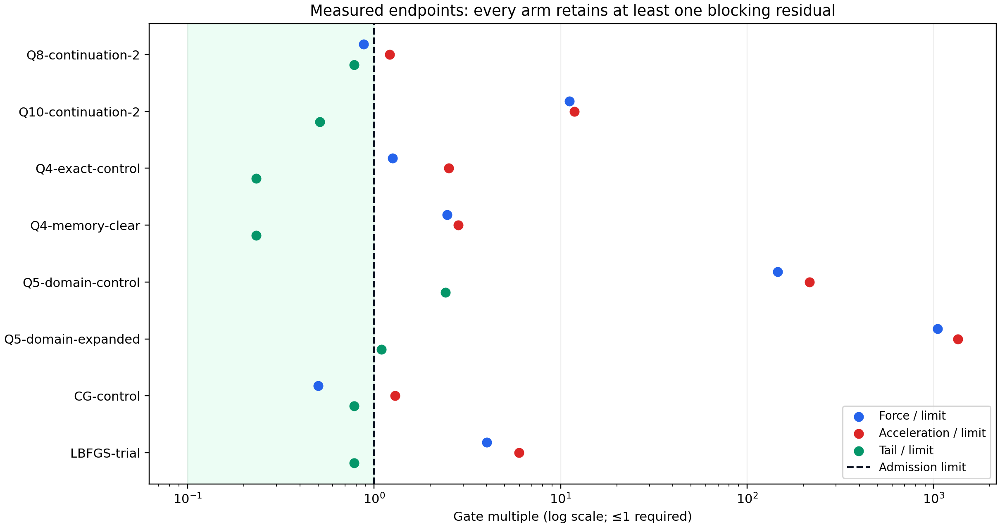

# Q2–Q16 campaign closure and Q17–Q32 feasibility assessment

UTC: 2026-11-16T14:20:49.317997+00:00; Australia/Melbourne: 2026-11-17T01:20:49.317997+11:00.

## Decision

Record the completed Q2–Q16 numerical allocations as assessed, and park further work through the unchanged screening/continuation route. Retain Q2 as the numerical reference and Q3 as a source of stationary and short-motion controls. None of the newly relaxed candidates from the rapid screen and its follow-ups reached all gates for promotion to motion. This closes an allocation and decision cycle; it does not resolve every physical configuration at each Q or establish that those charge sectors contain no useful solitons.

For Q17–Q32, additional static configuration diversity is supported by published numerical work. A long, full-range campaign using the present route is not justified now. A separately specified reproduction pilot can be worthwhile after its purpose and success criteria are fixed. The most useful next result is demonstrated recovery and validation of a known configuration, rather than another broad list of non-converged endpoints.

This package records results and an assessment. It starts zero numerical trajectories. Publication, PR creation and merge run only on the local workstation.

## What the Q2–Q16 work establishes

The rapid screen considered15 Q magnitudes and30 seed variants, reused7 authenticated prior states, and allocated4 priority branches. It produced no new strict survivor, no confirmation branch and no motion trajectory. The later645-step bounded follow-up,600-step targeted analysis,500-step campaign2 and final100-step Q8 solver comparison likewise produced no new candidate that passed all readiness gates. These are successive and branched allocations; native iteration numbers cannot be summed across branches as a single physical history.

The original gates remain relative force ≤1e-4, maximum acceleration ≤1e-3, approximate Hopf-magnitude error ≤5%, positive corner-cone margin, unit error <1e-10, and width2 rest-tail fraction ≤0.00075. Boosted-field, guard, predicted-coast and runtime motion checks remain additional requirements. Numerical model units are used throughout; optimizer iteration is not physical time and Q is not electric charge.

| Q | Recorded disposition | Evidence and remaining limit |
|---|---|---|
| 2 | Retain numerical reference | Stationarity and tail admitted; short original motion reference passes. Bent alternative remains unresolved. No new production allocation; long-time and physical mesh/domain motion convergence remain open. |
| 3 | Retain stationary controls; motion unresolved | Axial stationary fields on coarse/medium/fine and enlarged domain. Some short motion screens pass; z-axis speed changes with mesh/domain. Preserve mixed motion outcomes and later calibration records; no claim of long-lived converged motion. |
| 4 | Park controlled optimizer route | Axial41 medium stationary but tail rejects admission; axial22 exact/memory-clear arms remain above joint gates. Mixed transient benefit does not authorize Q6 transfer. Keep both lineages distinct. |
| 5 | Park; boundary/representation unresolved | Trefoil exact continuation lost representation at native95; restarted coarse/fine fields retained representation but tail failed. Fixed-spacing domain pair still failed readiness. Axial variant also unresolved. If reopened, diagnose newly released boundary layers before another domain change; retain iteration50 pre-loss parent. |
| 6 | Defer further relaxation | Axial6-1 native400 force/acceleration fail after late worsening; paired Q4 memory test gave no endpoint cure. Other axial seed screened only. Retain native checkpoints; no further Q6 allocation under the closed route. |
| 7 | Defer | Original coarse routes unresolved; retained medium trefoil plus100 still fails force/acceleration. No fresh Q7 relaxation or motion justified by these findings. |
| 8 | Park unchanged continuation | Near-ready native750 passed force/tail but failed maximum acceleration. Final paired CG/L-BFGS audit produced no jointly passing observation. Final audit stop condition met; keep native750 plus both final optimizer fields. |
| 9 | Defer | One trefoil control advanced to native100; both residual gates fail. Other axial seed received initial screening only. Budget deferral, not exclusion of Q9. |
| 10 | Park unchanged continuation | Delayed early improvement reversed; native450 force/acceleration fail although energy declined. Further blind continuation lacks measured joint-progress support; retain endpoint and earlier native checkpoints. |
| 11 | Defer; incomplete family coverage | Axial variant received50 steps and missed priority; trefoil representation failed before relaxation. No declared grid represented the second seed; no physical Q rejection. |
| 12 | Defer; incomplete family coverage | Axial variant received50 steps and missed priority; trefoil representation failed before relaxation. No declared grid represented the second seed; no physical Q rejection. |
| 13 | Defer; incomplete family coverage | Axial variant received50 steps and missed priority; trefoil representation failed before relaxation. No declared grid represented the second seed; no physical Q rejection. |
| 14 | Defer; incomplete family coverage | Axial variant received50 steps and missed priority; trefoil representation failed before relaxation. No declared grid represented the second seed; no physical Q rejection. |
| 15 | Defer; incomplete family coverage | Axial variant received50 steps and missed priority; trefoil representation failed before relaxation. No declared grid represented the second seed; no physical Q rejection. |
| 16 | Defer; incomplete family coverage | Axial variant received50 steps and missed priority; trefoil representation failed before relaxation. No declared grid represented the second seed; no physical Q rejection. |

The seed IDs in [the complete screening ledger](SCREEN-LEDGER.csv) identify initial constructions, not certified final knot types. Q is a charge sector containing competing configurations, not a single candidate shape. Six trefoil seeds at Q11–Q16 could not be represented on the declared grids; their zero-step outcomes are explicit resolution deferrals. The other variants'50-step outcomes are budget/priority decisions. Neither kind is a physical rejection.

Q3's original enlarged-domain z screen passed to model time0.5, and a fine-grid x screen passed to0.2. Other z screens failed the speed criterion, with sensitivity to mesh/domain. Those mixed, short observations remain in the immutable survey; subsequent measurement/calibration work is not superseded by this closure. They do not amount to a persistent, physically converged moving electron candidate. Q2's familiar short reference also remains a control rather than a completed long-time convergence proof.

## Final controlled findings

Values below are multiples of each original gate; ≤1 is required. Passing these three columns alone would still require all representation and moving-admission checks.

| Endpoint / controlled arm | Force / gate | Acceleration / gate | Tail / gate |
|---|---:|---:|---:|
| q8-continuation-2 | 0.8802 | 1.209 | 0.7811 |
| q10-continuation-2 | 11.13 | 11.85 | 0.5126 |
| q4-exact-control | 1.254 | 2.509 | 0.2336 |
| q4-memory-clear | 2.463 | 2.821 | 0.2336 |
| q5-domain-control | 146.1 | 215.6 | 2.412 |
| q5-domain-expanded | 1051 | 1347 | 1.092 |
| CG-control | 0.5016 | 1.294 | 0.781 |
| LBFGS-trial | 4.014 | 5.969 | 0.781 |

Q8 stopped at native750 after150 additional steps because recent measured joint progress did not justify the optional100 steps. Its best sampled campaign2 joint state near637 still missed acceleration admission; that observation is not a retained full checkpoint. The final audit started both optimizer arms from the identical retained750 field at the same121³ grid and23.04 box. CG accepted50 steps; retracted L-BFGS accepted50 with56 value/gradient evaluations. Both lowered energy, neither reached joint stationarity, and representation/tail checks remained admitted at the sampled observations. The result supports parking this route within the declared budget, not a universal ranking of optimizers or exclusion of Q8 configurations.

The full-field workstation audit found gradient/kinetic-acceleration identity relative errors8.78e-13 for Q2 and2.96e-13 for Q8, supported by directional finite variation and CPU/array checks. This removes the tested inconsistency hypothesis as a supported explanation for these fields. It does not prove every solver path or model implementation correct. Full-field audit receipts are preserved in [the decision evidence](data/decision-audit-evidence.zip); this synthesis has not rerun the unavailable full fields.

Q4's memory-only reset held alpha and all other settings equal. It improved some intermediate joint measurements but finished worse than exact continuation; neither arm recovered readiness. That mixed result provides no evidence-based reason to apply the same reset to Q6. Q10's delayed early improvement did not persist through native450; falling energy alone failed to predict force and acceleration admission.

Q5's fixed-spacing larger box lowered the final tail relative to its paired control, yet still missed boundary admission and worsened residuals. Initially vacuum-padded shell energy can be zero without demonstrating an admitted relaxed field. Additional formerly fixed layers become free in the larger domain, so an equal initial energy does not imply equal residuals. Representation, domain and optimizer-path effects remain separate findings; larger boxes or finer meshes alone were not shown to cure this seed.

The work therefore produced useful numerical controls, a reproducible filter, retained fields, specific limits on continuation/optimizer changes, and evidence against using energy decay alone to predict readiness. It has not produced a newly validated stable moving electron model. No measured failure should be promoted into a theorem of physical nonexistence.

## What higher Q can add

Sutcliffe's numerical study constructs competing knot/link configurations through Q16, including local minima distinct from the lowest energy found [1]. Jennings's work extends the accessible structures to cable and hyperbolic knots [2]. The following compact map summarizes the author's reported high-Q numerical configurations from the thesis's charge discussion [3]; it is a guide to benchmark selection, not an exhaustive or independently certified catalogue.

| Q | Reported structural example or distinction [3] |
|---|---|
|17|Four-component link; lower-energy two-component alternative|
|18|Torus-knot minimum found; hyperbolic local minimum|
|19|Torus-knot minimum found|
|20|Three-component link|
|21|Link with a knotted component|
|22|First cable-knot local minimum|
|23|Another cable-knot local minimum|
|24–26|Cable links among minima found|
|27–28|Cable knots among minima found|
|29|Cable link|
|30–32|Cable-knot local minima|

This is affirmative evidence that useful static configurations exist in the broader model family. It does not imply that larger Q systematically increases dynamical stability, makes relaxation easier, or selects an electron-like object. A stationary point, a perturbatively robust local minimum and a persistent moving field are separate claims requiring separate evidence. A lowest energy found in a numerical search is not a proof of a global minimum.

The project already attempted Q17/Q19. Both completed200 coarse preparation iterations at97³, box23.04 and missed force/acceleration gates: Q17 by11.38×/25.86×, Q19 by21.82×/22.20×. Neither was evolved. Their interior-dominated residuals did not support enlarging the box as the leading cure. The [prior assessment extract](data/prior-Q17-Q19-assessment.txt) and [provenance](data/prior-Q17-Q19-provenance.json) preserve that result. These inherited seeds and discretizations did not exhaust the published high-Q families.

Published Faddeev–Skyrme simulations also demonstrate nontrivial dynamics and scattering [4]. That establishes that motion is a meaningful property to test in the model; it does not make the Q17–Q32 charge range a special motion threshold. Inference: moving to higher Q without first fixing preparation and representation capability risks repeating the same numerical bottleneck at greater cost.

## Likelihood and value judgment

| Question | Assessment | Basis and practical implication |
|---|---|---|
|Are additional static structures available above16?|Strong affirmative evidence in the literature|Several structurally different reported configurations provide concrete reproduction targets.|
|Will our unchanged screen recover an admitted one?|Unestablished; present evidence argues against immediate scale-up|Prior Q17/Q19 preparation failed, and the latest low-Q controlled continuation did not close readiness.|
|Could a validated high-Q configuration show useful motion?|Plausible conditional research question|Prepare a valid rest state, test perturbations/refinement and then motion; static papers do not answer it for our implementation.|
|Will increasing Q solve the electron objective?|No supporting evidence from this work|Hopf sector and seed geometry do not establish electric charge, spin, scale or a localized persistent electromagnetic object.|
|Is a detailed long Q17–Q32 campaign worthwhile now?|No, under the unchanged route|A small benchmark-first pilot has greater decision value. Broader work becomes conditional on demonstrated capability.|

A numerical probability or success percentage would be unsupported. The existing observations are biased toward chosen seeds, contain budget-censored and under-resolved cases, use different meshes, and share solver/model assumptions. Neither0 new promotions nor early fitted energy/residual curves provide a calibrated probability distribution for untested higher-Q configurations.

For the electromagnetic objective, exact source-free null Maxwell knot families are a separate analytic reference [5]. Their existence supports topology-and-evolution tests, not identification with the neutral Skyrme–Faddeev minima. A Maxwell/FDTD comparison must declare comparable observables and its field equations; agreement of pictures or a reused integer label would not establish physical equivalence. Topology preservation alone does not establish a bounded-size localized energy distribution. Measure energy width, centroid transport, radiation/tails, topology and relevant conserved quantities separately. Before allocating a new high-Q campaign, state whether its purpose is neutral-soliton numerical reproduction or a specified electromagnetic/model-feasibility test.

## Conditions for reopening numerical work

1. **Fix the scientific decision first.** Define the observable that would advance the overall project, the governing action, and how electric charge/localization/motion would ultimately be assessed. Retain the neutral model as a benchmark if that is its intended role. Q32 is a practical proposed upper range, not a theoretical ceiling on possible Q or configurations.
2. **Reproduce one structural benchmark.** Prefer a published Q22 cable configuration with its same-Q competing link control, because that directly tests family/basin coverage missing from a simple axial/trefoil sweep. Reconcile the existing Q22 record before scheduling work. Match the paper's seed, normalization and unconstrained knot evolution; retain Q2 as an instrument control. This is a proposal, not a claim that our retained Q22 field already reproduces the paper.
3. **Require demonstrated readiness and robustness.** At fixed grid and box, resolve joint force/acceleration with unchanged gates. Test mesh and domain separately; retain actual full fields at each decision point. Then test small perturbations and convergence before assigning dynamical stability. If the benchmark remains unresolved within its declared budget, park the expansion and diagnose that limitation.
4. **Add diversity only after success.** A separately constructed, independently identified Q18 hyperbolic case would test a different knot class; reconcile prior Q18 campaigns first. A later Q27 cable case could test replication at higher charge. These are more informative initial targets than treating every integer17–32 as one seed or allocating all16 values immediately.
5. **Promote to motion progressively.** Start a fresh qualified boosted field with the original boundary reserves. Use short matched-motion comparisons, dt refinement and domain controls; extend physical duration only while the required observables remain converged. Static optimization budgets and physical model-time budgets must be separate.
6. **Use trends conservatively.** Vary one factor at a time. Compare linear, low-order polynomial and exponential fits on recent measured windows, with held-out prediction error. Add observations when curvature/residual peaks or disagreement grow. Avoid claiming an inflection of a physical solution from sparse optimizer traces, and require actual measured joint improvement to grant more steps. Record projected crossings as uncertain diagnostics, never as gate passes. Treat near-cutoff and deferred seeds as controls if a broad filter is eventually validated.
7. **Broaden only on a successful pilot.** Predeclare a limited seed/family catalogue for17–32, representation checks before relaxation, adaptive measurement cadence, per-branch caps and explicit deferrals. Allocate detailed long-time work to survivors rather than every Q. A useful pilot must recover known positive controls and show that the filter does not simply remove valid families at the resolution/priority stage.

No meaningful long-campaign hour estimate follows from the present timing. Campaign2 CUDA stepping was only a small fraction of recorded component time; CPU stationarity/topology/tail diagnostics and checkpoint I/O dominated. GPU float64 with CPU qualification remains a sensible future hybrid option, but high-Q grids, family count and observation cost must be benchmarked before predicting wall time.

## Recording, provenance and remaining work

Six exact compact archives are included. All713 manifested payload hashes across them and ZIP CRCs were checked. The rapid-screen parent is20261114t094318z-7800d5c4, correcting the earlier120027 identification. [INPUTS.json](INPUTS.json) retains exact SHA-256 values; [RETENTION.json](RETENTION.json) retains local full-field manifests and source anchors. Compact evidence is not a full-field backup. Original run trees and independently verified full-field copies must remain available; this package neither uploads nor removes those fields.

The publication handover appends a new closure/feasibility assessment, records campaign2 and the final decision audit, and marks the affected numerical allocations assessed while keeping the scientific gate open. Older reports and raw statuses remain immutable. It preserves unrelated roadmap work. Complete source reports are included as [campaign2 assessment](data/campaign2-assessment.html), [decision audit assessment](data/decision-audit-assessment.html), and [preceding targeted assessment](data/targeted-analysis-assessment.html).

The local workstation is required for repository validation, commit, push, PR checks and merge. No CPU/GPU solver run is required for this closure or feasibility conclusion. The numerical full-field audit was performed by the supplied workstation run; this synthesis performs evidence and decision review, not another metric replay or independent scientific peer review. See [the bibliography](BIBLIOGRAPHY.md) for primary sources and retrieval limits.
