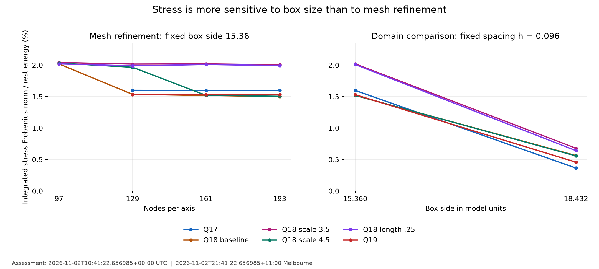
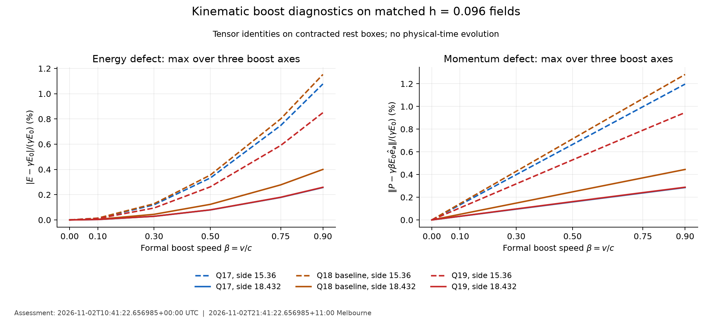

# Scientific assessment: neutral SF dynamics admission

Assessed: **2026-11-02T10:41:22.656985+00:00 UTC; 2026-11-02T21:41:22.656985+11:00 Australia/Melbourne**.
Run: 2 November 2026, 20:08:21.744804–21:22:31.593216 AEDT
(09:08:21.744804–10:22:31.593216 UTC).
Disposition: **numerical admission consistent; substantial finite-domain sensitivity;
physical-time evolution remains pending**.

## Findings that affect the next step

All 31 authenticated endpoints completed without a numerical consistency failure.
All 24 sampled perturbation directions have positive reported curvature at all three
amplitudes. These findings support proceeding to low-Q physical-time solver
implementation and verification. They do not establish a full Hessian minimum,
nonlinear stability, causal evolution for arbitrary data, or electron behaviour.

The principal new diagnostic finding is the sensitivity of integrated stress to box
size. Increasing the box at matched spacing reduces normalized integrated stress by
63–77% in the Q17/Q18-baseline/Q19 comparison, although energy changes by only about
0.3%. Spatial refinement within the smaller box does not remove this stress. A
well-converged scalar energy is therefore insufficient by itself to establish an
isolated moving-particle benchmark. This is additional numerical evidence about the
retained configurations, not a newly established physical law or solution priority.

## Evidence, provenance and verification scope

The unchanged uploaded `evidence.zip` is 155,491 bytes, SHA-256
`d46a8daddc4c975c89e9dd757ff638b319281138376314d298965074ab785804`.
All 36 ZIP members are accounted for: 35 hashed records plus the hash ledger.
There are 31 case results and byte-identical summary copies, 558 speed/axis rows
(465 nonzero-speed rows), 24 trial directions and 72 amplitude records. All endpoint
field hashes, grid spacings and Q labels match the original published PR50 records.
The manifest reports the exact reviewed configuration and no overall time cap.

The workstation source commit is `c515631f4420bf5295ac52195cb9eb7b8b6142ca`.
Its expected tree is `f0decf05a33947b8ebcc761e2e1838471b66cb4f`, reconstructed from the
original saved handoff applied to PR50's merge commit. That local workstation commit
was not fetched from GitHub in this review; the updater verifies its actual tree
before creating the publication worktree. This preserves the exact run-code commit
alongside the assessment rather than substituting a new source revision.

The [standard-library replay](verify_assessment.py) authenticates the archive and
original PR50 records, then independently checks the stress trace, stress norm and
symmetry, every boost's E/P and resolution expressions, the mass-squared cancellation
identity, quotient arithmetic and 54 base-free curvature differences. Bulk field NPZ
files are absent. Field integrals, metric extrema, centroid/tail values and original
perturbed energies are authenticated records, not independently rerun field calculations.

| Recomputed consistency metric | Largest observed error |
|---|---:|
| Energy versus original static result, relative | 2.89e-15 |
| Stress trace versus E4−E2, divided by E0 | 1.14e-15 |
| Direct beta=.6 boosted-density integral versus tensor rule, divided by E0 | 2.13e-15 |
| Stress-tensor asymmetry, divided by E0 | 2.58e-17 |
| Mass-squared identity, absolute dimensionless error | 2.67e-15 |

These compare matching quadratures/algebra; they are consistency checks, not estimates
of continuum, finite-box or evolution error. The [verification ledger](assessment-verification.json)
contains unrounded values, all 31 endpoint metrics and the limitations.

The recorded manifest-to-summary wall time is **4,449.848 seconds (1 h 14 min 9.8 s)**;
per-endpoint times sum to 4,449.644 seconds. The launch-folder timestamp and supplied
outer exit log give approximately 1 h 14 min 17 s including startup, as previously
reported. This is CPU admission-analysis timing, not physical simulated time or a
prediction of the future nonlinear solver's runtime.

## Integrated stress and domain sensitivity

Write Sij=integral Tij_rest d³x and s=||S||_F/E0. This norm is an anisotropic stress
measure; the trace alone can hide cancellation. All values below use model units.
The matched comparison is **161³ versus 193³ at h=.096**, increasing box side from
15.36 to 18.432. Comparing the .08 fine grid directly to the .096 larger box would
mix spacing and domain changes, so it is not the basis of these percentages.

| Branch | Smaller-box s | Larger-box s | Reduction in s | Relative energy change |
|---|---:|---:|---:|---:|
| q17-neighbour | 1.5968% | 0.3642% | 77.19% | 0.2855% |
| q18-baseline | 1.5171% | 0.5628% | 62.90% | 0.2993% |
| q18-scale35 | 2.0189% | 0.6790% | 66.37% | 0.3338% |
| q18-scale45 | 1.5188% | 0.5570% | 63.32% | 0.2982% |
| q18-ell025 | 2.0085% | 0.6408% | 68.10% | 0.3285% |
| q19-neighbour | 1.5293% | 0.4576% | 70.08% | 0.3175% |



At fixed side 15.36, Q17 has s=1.59995%, 1.59678%, 1.59933% on 129³/161³/193³;
Q19 has 1.52959%, 1.52930%, 1.53063%. These are effectively plateaus at the displayed
scale. Q18-baseline changes from 1.53476% to 1.51711% to 1.49946% over the same meshes;
its larger-box value is 0.56279%. The scale-3.5 and length-.25 Q18 branches plateau
near 2% in the smaller box and also improve substantially with the larger domain.

**Interpretation:** finite-domain effects and the domain's influence on the relaxed
field are material. These are separately relaxed fields, not the same frozen field
integrated over two cutoffs, so the result does not uniquely separate boundary support,
missing tails, residual forces and small field/basin changes. One enlarged domain also
does not establish an infinite-volume limit. Preserve this uncertainty.

For the matched Q17/Q18-baseline/Q19 cases, the recorded outer-region energy fraction
falls from about 0.825–0.953% to 0.254–0.300%. This region is the union outside the
central cube of side 0.8L; it is a finite-box shell proxy, not measured energy outside
the computational box or radiated energy. The lower shell fraction is consistent with
reduced sensitivity but is not an absorbing-boundary validation.

Centroids are static snapshots: e.g. Q18-baseline's fine-grid x centroid is .5930 and
larger-box x centroid .5771 in model units. Their offsets do not measure a velocity
or trajectory. This analysis neither pins nor dynamically translates the fields.

## Lorentz energy and momentum diagnostics

The [specified action and stress convention](../../../docs/models/SF-relativistic.md)
give, for a formal boost along axis a on the Lorentz-contracted original rest box,

```math
E_\beta=\gamma(E_0+\beta^2 S_{aa}),\qquad
P_a=\gamma\beta(E_0+S_{aa}),\qquad P_b=\beta S_{ab}\quad (b\ne a).
```

These are kinematic tensor identities, not independently evolved trajectories or
newly resampled lab-grid fields. E=gamma E0 and P=gamma beta E0 require negligible
integrated stress for an isolated stationary reference. The run does not force those
relations or suppress deviations.

The table gives maximum defects over the three coordinate axes at beta=.9.
Energy defect is |E−gamma E0|/(gamma E0); momentum defect is
||P−gamma beta E0 e_a||/(gamma E0), **not** divided by the ideal momentum itself.

| Endpoint | Energy defect | Scaled momentum defect |
|---|---:|---:|
| q1-control | 0.2310% | 0.2567% |
| q2-control | 0.1540% | 0.1711% |
| q22-control | 1.3074% | 1.4526% |
| q17-neighbour-193 | 1.0778% | 1.1975% |
| q17-neighbour-domain | 0.2569% | 0.2854% |
| q18-baseline-193 | 1.1172% | 1.2426% |
| q18-baseline-domain | 0.4001% | 0.4447% |
| q19-neighbour-193 | 0.8444% | 0.9401% |
| q19-neighbour-domain | 0.2587% | 0.2881% |



The fine-grid Q17/Q18-baseline energy defects exceed 1% at .9, while their larger-box
values are below .5%. This does not constitute a pass/fail assessment of a moving
simulation: the later 1% free-flight target also requires independent evolution,
resolution convergence and boundary control. Q22 is only a 129³ regression control in
this particular dataset; its positive trial curvature and established static topology
do not replace a larger-domain dynamics assessment.

A small apparent invariant-mass defect is also not independent validation. From the
same formulas we derive and replay

```math
\frac{E_\beta^2-|\mathbf P_\beta|^2}{E_0^2}
=1-\beta^2\sum_j\left(\frac{S_{aj}}{E_0}\right)^2.
```

The linear stress terms cancel. Consequently a mass-squared diagnostic can look very
accurate even when individual energy/momentum defects are of order one percent. This
is an algebraic explanation of the recorded numbers, not an observed mass prediction.

## Kinetic metric and sampled perturbations

The recorded minimum tangent kinetic eigenvalue is 1.0; the largest recorded tangent
eigenvalue is 14.8146; the largest local tangent condition number is 5.65693. The
rest-state kinetic matrix is positive for the model as specified. These local rest
properties do not prove hyperbolicity in every moving sector or global nonlinear
well-posedness. A conditioning number is not an instability growth rate.

There are **four smooth trial directions on each of six endpoints**, evaluated at
epsilon=.002,.001,.0005: 24 directions, not 72 independent directions. All reported
second variations are positive. The largest relative spread across the three epsilons
is 7.525e-7.

| Endpoint | Directional second variation range at epsilon=.0005 | Maximum relative epsilon spread |
|---|---:|---:|
| q1-control | 0.945111–1.490133 | 2.2e-07 |
| q2-control | 1.878215–2.178092 | 3e-07 |
| q22-control | 6.742430–12.620848 | 3.38e-07 |
| q17-neighbour-193 | 3.872400–10.740006 | 6.28e-07 |
| q18-baseline-193 | 5.240513–10.233411 | 6.73e-07 |
| q19-neighbour-193 | 3.767566–11.648052 | 7.52e-07 |

This is useful finite-direction evidence. The directions are neither a complete nor
an orthogonal normal-mode basis; they do not systematically include translations,
rotations, long-wavelength deformations, localized reconnections or all unstable modes.
The quotients depend on chosen directions/domain and are not measured particle
frequencies. Nonzero first variations remain recorded; exact stationarity is not claimed.
The enlarged-domain Q17/Q18/Q19 endpoints did not receive curvature probes in this run.

**Replay limitation:** the original native-C central energy used for curvature was not
saved explicitly. It can be inferred consistently from all 12 amplitude/direction
records per endpoint, but that is not independent verification of its absolute value.
The inferred value differs from the original static energy by about 6.2e-13 to 1.25e-10.
This is compatible with different large-sum floating-point evaluations, but bulk fields
are unavailable here to establish the exact cause. Mixing these baselines at epsilon
.0005 shifts reconstructed curvatures by up to about .001. The reported positive
curvatures have a much larger margin; no negative direction is revealed by that check.

The verifier therefore replays baseline-free differences and quotient arithmetic,
records the inferred baseline and its limitation, and does **not** claim a full
independent absolute second-variation calculation. Future probe output should explicitly
retain the native central E0 and energy parts. No tolerance or historical data was
changed to conceal this gap, and a fresh full campaign is not required to publish it.

## Development disposition and next gates

1. **Record this tranche and retain the original evidence.** Execution and numerical
   consistency are complete within their stated scope; full stability is unresolved.
2. **Implement and validate physical-time evolution on low-Q/simple controls first:**
   vacuum, small-amplitude/great-circle waves, consistent constraints and mass operator,
   then Q1/Q2 rest/free-flight controls. Use three spatial and temporal resolutions,
   energy/momentum/flux and centroid/localization diagnostics. Minimize neither physical
   energy nor momentum during an evolution step; any boundary dissipation needs accounting.
3. **Provisional first higher-Q benchmark: the larger-domain Q17 state.** It has the
   lowest larger-domain stress among the three compared Q17/Q18-baseline/Q19 branches
   and a source-grounded selected K(7,2) static reference. This is an engineering choice,
   not a global energy, electron-suitability or stability ranking. Recheck its actual
   evolved discretization, include enlarged-domain perturbation checks and retain Q19
   as a comparison. Keep Q18 as the observed linked configuration, not the unreproduced
   published hyperbolic state. Q22 remains an optional cable regression after suitable
   field/domain admission.
4. **Begin actual free flight at beta=.1/.3** after solver controls. The .5/.75/.9
   cases remain conditional on resolution and boundary margins. For the larger-domain
   h=.096 rest field, preserving longitudinal rest resolution at .9 requires lab
   h_parallel<=.04185. Keeping lab side 18.432 would require at least 443 odd-numbered
   nodes along motion; a fully isotropic 443³ grid is not mandated. This is a sampling
   bound, not a CFL or sufficient accuracy guarantee. Faster time stepping cannot
   repair an under-resolved contracted field.
5. **Return to Q18 fresh fine starts and additional Q values after this dynamics
   tranche**, as requested. Retain fresh amplitude-4 129³/193³ controls, the unfinished
   amplitude-1 fine-grid conditioning comparison, and optional source-grounded Q20/Q24
   comparisons. This admission run did not execute those controls or resolve Q18's
   start-grid/basin confound.

Charged dynamics remains deferred under ADR-0008. Hopf degree is not electric charge;
no classical circulation or trial frequency establishes quantum spin/statistics. No
S6 interaction, S7 quantum/experimental, electron model, or publication-priority gate
is closed by these data.

## Sources and requirement mapping

- Jennings, *Cabling in the Skyrme–Faddeev model*,
  [arXiv:1412.8597v2](https://arxiv.org/html/1412.8597v2), Section 2 Eq. (2.1)
  and Table 1: established static energy and selected branches; see the original
  [PR50 assessment](../../q18-neighbours/q18-neighbours-20261102T022100+1100-165739/ASSESSMENT.md).
- Hietarinta et al., *Scattering of knotted vortices (Hopfions) in the Faddeev–Skyrme
  model*, [arXiv:1108.5551v1](https://arxiv.org/pdf/1108.5551), Sections 1.3/2/3.2:
  constrained physical-time evolution, boosted relaxed initial fields and boundary
  treatment. Moving/scattering Hopfions are established prior work; this review does
  not reproduce their physical-time trajectories or adopt their numerical controls.
- Our metric, normalization, stress and boost derivations are stated in the
  [neutral specification](../../../docs/models/SF-relativistic.md). The mass-squared
  cancellation above is a direct algebraic consequence, not a new priority claim.

SCI-003/004 and REP-001/002 gain authenticated records and explicit uncertainty;
MOD-001/002 and REL-001/002 gain admission diagnostics. NUM-002/003/005 for the future
physical-time solver remain open. The wider literature review and level 4 remain
incomplete/deferred. AI assisted verification, derivation and reporting; no external
scientific peer review is claimed.
