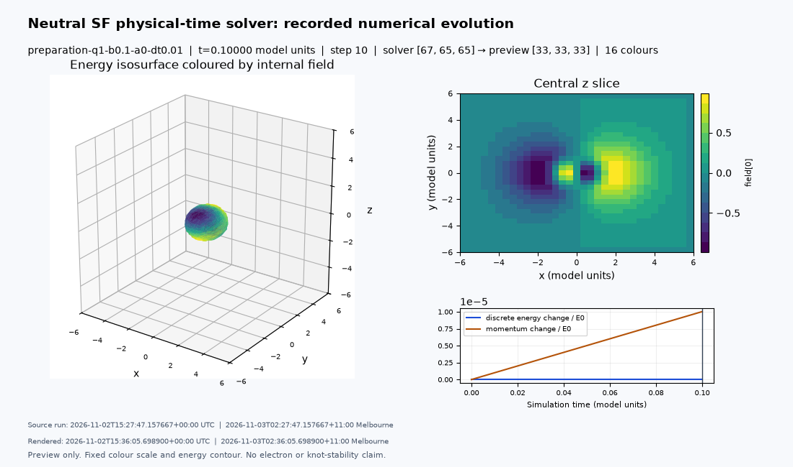

# Stationary low-Q readmission and physical-time motion preparation

Recorded UTC 2026-11-02T15:32:16.944561+00:00; Australia/Melbourne 2026-11-03T02:32:16.944561+11:00.

## Delivered and pending

The [workstation campaign](../../docs/plans/sf-lowq-motion.md) now readmits low-Q
fields to the physical-time lattice energy, blocks boosted tests on failed rest
admission, and measures rest/controlled motion with time/grid/domain comparisons.
It supports self-contained seeds and optional authenticated retained static fields.
There is no overall compute-time/pass cap. Numerical stagnation and topology failures
are explicit unresolved outcomes. Background/status/checkpoint stop/resume and separate
offline rendering are provided; all results and assessments retain UTC/Melbourne dates.
The full 60-trajectory production matrix has **not** been run here.

## Measured readmission controls

Both final-code preparation candidates have 65³ nodes, L=12 and h=.1875. They start
from fresh rational fields rather than silently reusing old cell-energy endpoints.

| Q label | Initial energy | Final lattice energy | Relative force | Max rest acceleration | Hopf quadrature | Iterations |
|---|---:|---:|---:|---:|---:|---:|
|1|1.92756552|1.23222252|3.80595e-4|3.86777e-3|-0.99340106|50|
|2|2.61299638|2.00466854|9.01157e-4|3.48047e-3|-1.99222265|50|

Both meet the predeclared finite-lattice residual, acceleration, cell-cone, unit and
5% Hopf-quadrature criteria. Their source hashes match the final readmission source;
[Q1](q1-fine/result.json) and [Q2](q2-fine/result.json) retain full scalar histories,
configs, provenance and checkpoint hashes. This is finite-box stationarity, not
long-time/perturbation stability or an exact integer Hopf certificate. The rounded
published static low-Q energies remain independent comparison references, not numbers
to fit by changing K or tolerances. Boundary and discretization effects remain.

A coarser 49³, L=12 Q1 development probe initially decreased its energy but eventually
failed the 5% Hopf diagnostic: final |Qh|=.941466, relative force .09879, E=1.221052.
Its lower energy is **not** an accepted better soliton. The [coarse record](q1-cg/result.json)
and exact [development source](q1-cg/readmission-source.py) are retained, including the
source hash matching its manifest. An earlier L-BFGS development prototype also stalled
with inadequate residuals; [its record](q1/result.json) is preserved for history. Its
exact prototype source was not retained, so it is excluded from final-code validation
and no reproducibility/physics acceptance claim is based on it.

## Actual short physical-time tests

Q1 was evolved at rest and beta=.1 along x, to t=.1, at dt=.02 and .01. These are
real nonlinear RK4 trajectories from the readmitted field, not translated images.
The comparison reference is the event-consistent translated static interpolant.

| Case | dt | Relative shape L2 error | Fitted speed | Energy drift | Outer-shell energy |
|---|---:|---:|---:|---:|---:|
|Rest|.02|7.06643e-7|7.28e-15 magnitude|1.80e-16|1.20683%|
|Rest|.01|7.06645e-7|1.09e-14 magnitude|0 reported at saved rows|1.20683%|
|Boost x, beta=.1|.02|4.59848e-4|.100535596|1.90e-11|1.25943%|
|Boost x, beta=.1|.01|4.59849e-4|.100535594|5.83e-13|1.25943%|

The short boost's speed error is about .536%, shape error .046%, and scaled momentum
drift about 1.00e-5. Halving dt improves energy conservation, while speed/shape errors
are almost unchanged: temporal accuracy alone is not the outstanding issue. Spatial
sampling/interpolation and finite-domain effects require the larger controlled matrix.
The shell fraction exceeds its .1% target in **every** small-box case, so all overall
case gates fail despite the small conservation defects and finite-lattice stationarity.
No threshold was weakened. These short tests are not accepted isolated free flight.
See [boost record](preparation-q1-b0.1-a0-dt0.01/assessment.json) and each case's
physics/manifest/history/result. The default production matrix therefore uses L=16/20,
h=.2/.16, both Q labels, beta=.1/.3 and x/z directions with two time steps.

## Software and transfer controls

[Validation](validation.json): 52 targeted tests pass, including finite energy
variation, static/dynamic tangent-force consistency, optimizer restart/decrease,
failed-topology retention, lab resolution, calibrated anisotropic Hopf quadrature,
whole-run history combination, repeated campaign runs, export independence and the
previous wave/manufactured/renderer controls. The retained [smoke records](smoke-records/SUMMARY.md)
exercise intentional admission failure, two rest trajectories, skipped boosts, compact
evidence and restart without relaxing gates. The full campaign remains for the workstation.

Background Linux PID start-identity logic has targeted tests, including boot and PID-namespace identities to avoid false matches after reboot or namespace changes. A background launch without verifiable process identity stops its own new child and
provides foreground mode as a fallback. The preparation executor
uses isolated process namespaces, so native persistent background start/status/stop
was not validated here; direct foreground campaign execution and checkpoint/evidence
paths were tested. The installer and workstation command checks are separately recorded
in the handoff. No native workstation GUI control is implied. The maintainer confirmed
ParaView5.11.2 loaded the earlier wave data after switching Outline -> Volume; this
procedure is now in the renderer documentation and local renderer output.

Actual readmission timings were 152/166 seconds for the two preparation fields under
concurrent CPU workloads. The four 65³ trajectories took approximately42,101,64,103
seconds for5/10/5/10 steps respectively, including diagnostics/checkpoints/exports.
These preparation-host figures are not a workstation estimate. The full refined CPU
matrix is substantially larger and may require overnight or multiple-day execution;
its time/space/domain controls are not cut off by a two-hour budget. Status reports
actual progress; a completed process can still have failed/scientifically unresolved gates.

All bulk fields/previews remain local. The handoff includes a small solver-generated
Q1 preview and renderer example; compact numerical evidence is versioned here. Rendering
still consumes Float32 display copies independently of Float64 scientific states.
The new launcher renders only after the campaign process stops.
The supplied low-Q profile exports a coarser33³ display grid; a bundled two-frame
example is derived from the full-resolution initial/final Q1 checkpoints. It is a
short-time display trial, with very small displacement and failed tail acceptance.

 Changed camera/palette/
frame settings never change physical resolution, equations, precision or stopping gates.

## Next scientific decision

Review the full production temporal/spatial/domain results before choosing any longer
observation window or proceeding to Q17 with Q19 comparison. The optional extended
configuration adds a third spatial/time level and longer observation; it is an option,
not automatic scientific acceptance. Q18 fresh fine-start/conditioning and additional-Q
work (including optional Q20/Q24) remain recorded. Open/absorbing boundaries, full
perturbation stability, charged dynamics, electron properties and novelty remain open.
AI assisted implementation and analysis; no independent scientific peer review is claimed.
