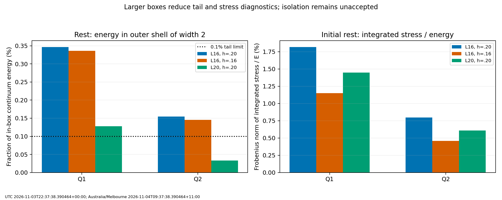
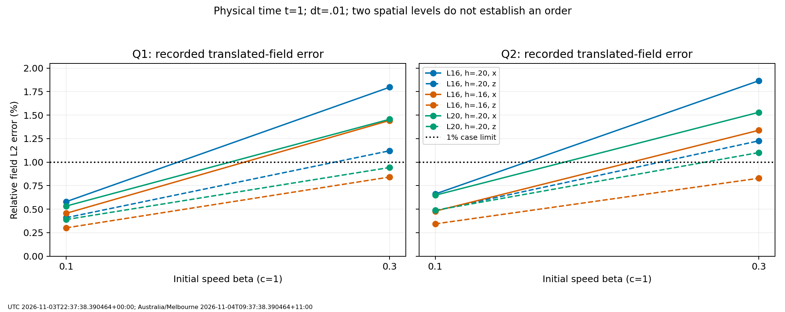

# Assessment of the low-Q physical-time campaign

Assessed: UTC 2026-11-03T22:37:38.390464+00:00; Australia/Melbourne 2026-11-04T09:37:38.390464+11:00.

Disposition: **bounded Q2 low-speed case passes; global motion acceptance remains unreleased**.

## Evidence and verification

Campaign: `lowq-motion-2026-11-03T104629-568611+1100-30672`.
Started UTC 2026-11-02T23:46:29.980261+00:00; Melbourne 2026-11-03T10:46:29.980261+11:00.
Finished UTC 2026-11-03T16:45:55.594121+00:00; Melbourne 2026-11-04T03:45:55.594121+11:00.
Elapsed 61,165.614 seconds: 16 hours 59 minutes 25.614 seconds.

The submitted archive SHA-256 is `780cfff1d5be5fe9e61b238206aceb6a6f47a82350e8ce257c76cc79f56d8784` and matches the workstation output.
All 390 ZIP members pass CRC validation; all 389 listed SHA-256 hashes match, with no missing,
extra or duplicate members. The separately supplied summary is byte-identical to the archived one.
The hash index is not self-hashed; the external whole-archive digest covers it.

The verifier replays 960 saved scalar-history rows, 540 case-check flags and all 70 comparison
pairs (30 temporal, 20 spatial, 20 domain). Six stationary candidates and all 60 expected cases
are present, with one complete attempt each and final physical time t=1. No external forcing,
work or impulse is recorded. All runs use the neutral model, the declared D4 action/RK4 scheme,
and fixed reflecting boundaries. The rest geometry and moving-axis contracted-resolution
planning are explicit in the retained configurations.

Eight campaign numerical source files match snapshots reconstructed from the retained handoff
and the pinned GitHub base. All run manifests report clean commit
`0eb911649ec085a34d6505963a5ecd0c6764b717`. This is source-content corroboration; the complete workstation Git
repository and full field checkpoints are not in the submission.

Verification is independent replay of retained scalar histories, arithmetic and decision logic.
Shape norms, Hopf quadrature, cell-cone margins, tail fractions, radii and stress integrals require
full fields for independent recalculation. For those quantities, the report authenticates the
recorded values and rechecks their threshold arithmetic; it does not claim new field analysis.

## Outcome against the declared checks

|Check|Pass|Fail|Interpretation|
|---|---:|---:|---|
|Discrete energy drift|60|0|Worst relative drift 2.02821e-8; limit 1e-3|
|Momentum change / initial discrete energy|56|4|Failures are Q2, beta=.3, x direction on the two h=.2 boxes|
|Saved unit/tangency constraints|60|0|Recorded saved-state errors satisfy 1e-10|
|Translated-static field shape|42|18|Limit 1%; all failures are at beta=.3|
|Centroid speed|60|0|Moving relative errors 0.01650% to 0.93487%; limit 1%|
|Recorded Hopf/cone diagnostics|60|0|Approximate integral and positive-cone checks, not an integer certificate|
|Outer-shell energy|10|50|Only the Q2 L20 family clears the 0.1% limit|
|Initial particle E/P comparisons|60|0|Bounded initial check; does not establish particle physics|
|Initial radius-based clearance|60|0|Smallest post-window margin 1.58594 model length units|
|All case checks together|6|54|Only Q2 L20 rest and beta=.1 along x/z, at both dt values|

Failure counts overlap: the 50 tail, 18 shape and four momentum failures are not disjoint cases.
Both rest and moving states must be considered. All 30 Q1 cases fail at least the tail check;
all 20 Q2 L16 cases also fail that check. All ten Q2 L20 cases pass the tail check, but four
beta=.3 cases fail shape and two of those also fail momentum.

## Rest admission, tails and stress

All six candidates satisfy the declared lattice stationarity, acceleration, unit, cone and
approximate Hopf limits. Their residuals are not equally small: Q1 L20 is markedly more relaxed
than Q1 L16. This changes the source-state error between comparisons and must be retained.

|Rest candidate|Discrete energy|Relative force|Max acceleration|Hopf integral|Final rest tail|Initial stress norm / E|
|---|---:|---:|---:|---:|---:|---:|
|q1-n81-L16|1.224607207|0.000205059|0.00104231|-0.9918253|0.34675%|1.8189%|
|q1-n101-L16|1.227634638|0.000508123|0.00260393|-0.9968189|0.33591%|1.1487%|
|q1-n101-L20|1.222352940|2.45535e-06|8.50655e-06|-0.9920174|0.12760%|1.4477%|
|q2-n81-L16|1.998195720|0.00021671|0.00144564|-1.9903377|0.15466%|0.7984%|
|q2-n101-L16|2.000634106|0.000351158|0.00312445|-1.9961183|0.14551%|0.4569%|
|q2-n101-L20|1.997069430|0.000140818|0.000453215|-1.9904501|0.03330%|0.6076%|

At matched rest spacing h=.2, increasing L16 to L20 reduces the final rest shell fraction by
63.20% for Q1 and 78.47% for Q2. Q1 still has 0.12760% in the shell, above the 0.1% limit;
Q2 has 0.03330%, comfortably below it. The corresponding normalized stress norms fall by
20.41% and 23.90%, respectively. The discrete rest energies change by only -0.18408% and
-0.05637%. Energy agreement alone therefore remains a weak isolation diagnostic.

The shell fraction uses in-box continuum energy density, with width 2. L16 and L20 shells
start at absolute coordinate 6 and 8, respectively. It is not a measurement of escaped energy,
the unknown energy outside the box, or a direct numerical error bound. Its small changes in
the rest runs and its presence initially indicate a persistent tail; this evidence does not
identify reflected radiation as the cause of failure.

The domain comparison also changes the fresh seed cutoff from 6.4 to 8 and independently
readmits the field in each box. It is an end-to-end domain comparison, rather than a pure
boundary perturbation applied to identical central initial data. Further comparisons should
retain this distinction. Reflecting walls and nonzero tails preclude an inference of exact
boundary independence from the 99%-radius clearance calculation.



## Motion at low and moderate speeds

The most useful bounded reference is Q2 on L20 at beta=.1. At dt=.01, x motion has fitted
centroid speed 0.09998136673 (relative error 0.0186333%), field error 0.648089%, momentum
change / E0 0.0284659%, and final tail 0.0320163%. Z motion also passes, with speed error
0.823993% and shape error 0.487366%. Passing these cases does not close spatial/domain
convergence, longer-time behaviour or perturbation stability.

|Q2 L20 beta|Direction|Speed error|Shape error|Momentum change / E0|Final tail|Failed checks, dt=.01|
|---|---|---:|---:|---:|---:|---|
|0|rest|1.54671e-16 model units|0.004763%|0.000000%|0.033301%|all pass|
|0.1|x|0.0186333%|0.648089%|0.028466%|0.032016%|all pass|
|0.1|z|0.823993%|0.487366%|0.000907%|0.032892%|all pass|
|0.3|x|0.459059%|1.530063%|0.136749%|0.026992%|momentum,shape|
|0.3|z|0.720966%|1.101710%|0.003380%|0.030133%|shape|

At beta=.3, shape errors range from about 0.82875% to 1.86575% across all geometries and
directions. Every x-directed beta=.3 family fails the 1% shape check. Q2's larger box has
shape errors of 1.53006% (x) and 1.10171% (z); its x momentum error is 0.136749%, above
the 0.1% limit. The h=.16 Q2 L16 x momentum error drops to 0.0923872%, but its shape and
tail checks still fail. A larger box alone does not remove the moderate-speed discrepancy.

All moving centroid speeds satisfy the predeclared 1% check, but z-directed errors commonly
remain near 0.7-0.94%. Motion of the energy centroid, field-shape preservation and momentum
conservation are separate observables. Agreement of the centroid alone does not imply a
rigidly transported localized solution.



## Temporal, spatial and domain comparisons

Halving dt from .02 to .01 leaves the reported endpoint shape errors almost unchanged:
the largest absolute change in relative L2 error is 1.71109e-8. The largest paired endpoint
continuum-energy difference is 8.68747e-9 relative. Thus reducing dt alone is unlikely to
resolve the observed percent-level field discrepancy on this matrix.

There is an additional sampling issue in the original comparison: diagnostics every five
steps means speed is fitted to 11 time samples for dt=.02 and 21 for dt=.01. Fitting at
identical saved physical times reduces the maximum temporal velocity difference from
3.33870646e-06 to
1.10131224e-08 model velocity units.
The maximum common-time centroid difference is
1.39381766e-08.
Much of the original temporal speed difference therefore reflects sample weighting of a
slightly nonlinear centroid trajectory, rather than a timestep integration discrepancy.

At fixed L16, h=.20 to .16 reduces moving shape errors by 19.67-32.43% in every paired
motion family. This is useful evidence of spatial sensitivity, not a measured convergence
order. Centroid speed errors do not improve monotonically in every direction. The largest
spatial pair velocity difference is .00244680; the largest matched-rest-spacing domain pair
difference is .000399329 model velocity units. Directional interpolation/sampling, differences
in the relaxed source state, discrete Lorentz errors and finite boundaries remain hypotheses;
the compact evidence cannot isolate their respective contributions.

The same-spacing L20 moving grids preserve at least the planned contracted-axis resolution,
but their rounded node counts need not have exactly the same lab spacing as L16. A third
spatial level, matched-time diagnostics and comparisons of full fields on common coordinates
are needed for a stronger convergence statement. The existing pair file compares scalar
error magnitudes, not the L2 norm of the difference between two computed endpoint fields.

## Energy, topology and boost interpretation

The conserved numerical quantity is the discrete Hamiltonian. Continuum diagnostic energy
also varies slightly: its worst history-relative change is 2.19528e-4 (0.0219528%), much
larger than the discrete energy drift but still small. They should not be interchanged.
Saved constraints follow projection; small post-projection defects alone do not demonstrate
integration accuracy. The retained projection corrections are small but nonzero (largest
recorded nodal field correction 1.42532e-7; rate correction 6.90541e-6).

The largest endpoint change of Hopf quadrature relative to nominal Q is 1.40687e-4
(0.0140687%). All reported endpoint cell-cone margins stay positive, minimum .886786.
These are encouraging retained diagnostics. They do not establish exact topology throughout
every physical step or a complete knot identification.

Initial particle energy defects are at most .157419% and momentum defects .421381%, below
the 1% initialization limit. Finite-box stress-adjusted comparison defects reach .124768%
and .296329%, respectively. These are formal comparisons of a sampled boosted field with
rest-field integrals; they do not replace the physical-time trajectory or demonstrate
isolated Lorentz covariance. Reproducing the retained formulae is distinct from proving
them exact for these finite-box/interpolated states.

## Recommended next work

1. Preserve and publish this bounded result, including every failed check and exact source
   hashes. Mark low-Q motion as partially demonstrated, with the global gate still open.
2. Before another broad production matrix, run a focused local diagnostic on retained fields:
   common-time centroid fits; initial boosted-field residual/acceleration; reference-interpolation
   consistency at t=0; and full-field endpoint comparisons on common coordinates. Keep the
   scientific grid separate from renderer exports. None of these field diagnostics was executed
   by this compact-record review.
3. Use a third spatial level for a small subset: beta=.3 x (worst shape/momentum) and a z
   comparison, with matched-time output. For Q1 additionally test a larger box at fixed h and
   quantify rest-tail/stress and initial-state changes. Select box size by measured convergence;
   do not weaken the tail or shape limits to obtain a pass. No new run is launched here.
4. Keep Q2 L20 beta=.1 as a provisional numerical reference. Retain Q1 for the separately
   proposed spin/quantization-method benchmark once its numerical domain issues are controlled.
   A good Q2 motion control is not an electron identification or an inference about spin.
5. Defer Q17/Q19 production free flight until this motion diagnostic is understood. Keep Q18
   fresh fine-start/conditioning and additional-Q comparisons (including optional Q20/Q24) in
   the plan. The separate electromagnetic-model feasibility assessment can proceed alongside
   this numerical work.

No isolated long-time stability, perturbation spectrum, high-Q motion, electromagnetic
charge, quantum spin/statistics, detector outcome or electron-model acceptance follows from
this campaign. This review uses AI-assisted arithmetic and source inspection; independent
scientific peer review is not claimed. There is no arbitrary overall runtime cap proposed.

## Reproduction

From this assessment directory, using an environment with Python and NumPy:

```bash
python3 verify_assessment.py --archive evidence.zip --summary ORIGINAL-SUMMARY.md --output replay
```

The verifier writes a newly timestamped ledger and case/comparison CSV files under `replay`.
It does not run or import the solver. `build_report.py` additionally uses Matplotlib to render
the report and figures from the retained verification ledger. Bulk field and preview files
remain on the workstation. The supplied evidence archive is unchanged.
