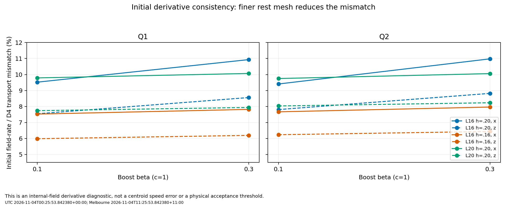
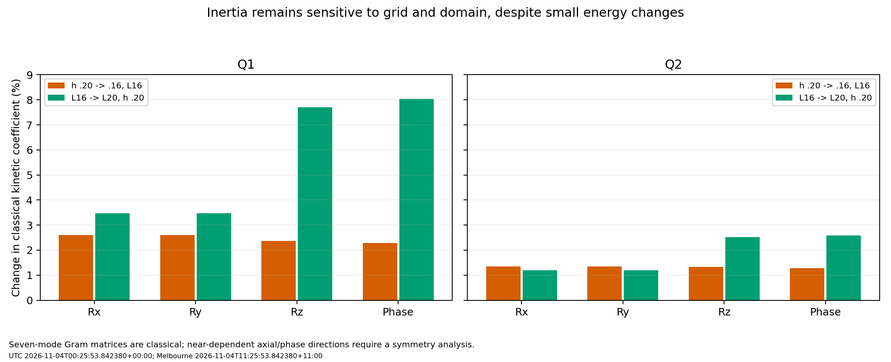

# Scientific assessment of retained full-field motion diagnostics

Assessed: UTC 2026-11-04T00:25:53.842380+00:00; Melbourne 2026-11-04T11:25:53.842380+11:00.

**Disposition: endpoint replay confirmed; initialization and domain sensitivity remain;
the global motion gate stays open.** No new physical-time solve was performed in this review.

## Integrity and scope

The two uploaded ZIPs are byte-identical, SHA-256
`4e5978e94243165fdde882536c57ca2f5268abfbfad2d67a55c1f8fe5a9127d4`. One dataset was reviewed. The separate summary
matches its archived copy. All 142 indexed member hashes and ZIP CRCs verify, with
143 members including the index. The linked original motion archive has SHA-256
`780cfff1d5be5fe9e61b238206aceb6a6f47a82350e8ce257c76cc79f56d8784`; all 389 indexed hashes verify too.

The workstation reports clean diagnostic commit `66ef00c1b56a7c5eadd0bf623dc71f41bf1afe78`.
All 13 recorded diagnostic/numerical source hashes match the retained handoff source
snapshots. The inventory's 126 file references and fingerprint link to the six original
rest and 60 initial/final states. Sixty initial-state reconstructions are reported
bit-exact, and all 540 endpoint numeric comparisons match within the declared replay
tolerances. All six rest metrics and all 70 pair records are accounted for.

This review independently rechecks hashes, record consistency, threshold arithmetic,
equal-time scalar fits, matrix symmetry/eigenvalues and the summary statistics. The
workstation's full-field results are authenticated records; the raw scientific field
arrays remain local and were not independently recalculated in this review. Initial
checkpoint files have no older independently published file checksum: the diagnostic
records their bytes and checks their reconstructed state on the workstation. Source
content matching is not a separate retrieval of the complete unpublished Git commit.

The diagnostic finished 4 November 2026 at 11:08:40 AEDT / 00:08:40 UTC. The terminal
exit record reports 984.524 seconds (16 minutes 24.5 seconds), including authentication.
The archived ledger interval begins after initial authentication, so it is shorter.
The six original bounded case passes and overlapping failures (50 tail, 18 shape,
four momentum) are preserved. Successful replay does not turn failed physics checks
into passes or release isolated free flight, stability or electron acceptance.

## 1. Boost reconstruction is reproducible; derivative consistency is limited

Initial field comparison with the declared translated reference is at machine precision:
the largest relative L2 difference is 1.15160e-15. This verifies the implemented
construction against its own declared interpolant; it is not an independent continuum
boost solution.

The tangent field time derivative supplied by the normalized trilinear interpolant
differs from the lattice translation generator P_n[-beta D_a n] by **5.986-10.980%**.
These percentages concern internal-field time derivatives, not centroid velocity.
The best previously reported centroid error of .0186% and an initial derivative
mismatch of about 9.75% therefore refer to different observables and can coexist.

|Q|beta|Axis|h=.20, L16|h=.16, L16|
|---|---:|---|---:|---:|
|Q1|0.1|x|9.522%|7.525%|
|Q1|0.1|z|7.545%|5.986%|
|Q1|0.3|x|10.933%|7.820%|
|Q1|0.3|z|8.560%|6.193%|
|Q2|0.1|x|9.407%|7.667%|
|Q2|0.1|z|7.807%|6.235%|
|Q2|0.3|x|10.980%|7.966%|
|Q2|0.3|z|8.821%|6.439%|

The mismatches decrease for every moving family when the rest mesh is refined, and
are identical between the two dt cases sharing the same initial data. A larger box
at the same nominal rest spacing leaves comparable rate mismatches. Their scale and
trend make initialization/interpolation a strong target for investigation.

This is not proof that the time integrator is defective or that interpolation explains
all shape error. The two constructions differentiate different finite-grid objects.
Normalized trilinear reconstruction is only piecewise smooth; at cell interfaces its
derivative can have a jump. In particular, exact-node evaluation uses a one-sided cell
choice in the current sampler. The D4 translation generator samples neighboring nodes.
Their differences can be substantial even when the initial sampled n fields agree.
The solver's finite-h action also lacks exact continuum boost symmetry.

The relative tangent-acceleration diagnostic ranges from about 31.7% to 101.5% in
moving cases. Its denominator is an acceleration norm, and absolute RMS values differ
greatly with beta and field. It is not a percent speed error or an instability rate.
Absolute RMS residuals do not improve monotonically under every refinement: for
example Q1 beta=.1 x increases from .002916 to .003865 as h is reduced at L16.
RMS comparisons across different box volumes additionally include dilution by the
number of sampled nodes. These residuals should diagnose patterns, not serve as
new retrospective acceptance limits.



## 2. Time integration is well controlled for this observation window

The largest actual full-grid endpoint field difference between dt=.02 and .01 is
3.80045e-7 relative, or **0.0000380%**. That is far below the percent-level spatial,
domain and translated-shape differences in this campaign. The maximum equal-time
centroid velocity difference is 1.10131e-8 model units, independently replayed from
the original scalar histories.

The earlier two fits used 11 versus 21 saved diagnostic times. Equal-time fitting
removes most of that sampling difference. This supports prioritizing initialization
and spatial/domain controls over another global reduction of dt for this same t=1
window. It is not a measured temporal order from three dt levels, a long-time error
bound, or a proof that every observable is temporally converged.

## 3. Cross-resolution and cross-domain fields remain different

Using the 65-cubed raw comparison samples on each pair's common central cube:

|Comparison|Q1 field L2 difference|Q2 field L2 difference|
|---|---:|---:|
|h=.20 versus .16, same L16|2.108-2.157%|1.507-1.573%|
|L16 versus L20, same rest h=.20|7.174-7.462%|3.119-3.326%|

These are comparisons between two computed fields. They differ from each trajectory's
error against its own translated static reference. They include different independently
readmitted source equilibria, seed cutoff changes and possible symmetry registration
effects. They are not a direct estimate of a single trajectory's error against the
unknown continuum solution.

The resting cases already have differences of 2.157% (Q1 spatial), 1.558% (Q2 spatial),
7.174% (Q1 domain) and 3.122% (Q2 domain). Since each rest trajectory changes very little
relative to its own initial state, much of the pair difference likely originates in
the source equilibria. This is an inference, not a measured t=0 pair decomposition.
The current pair audit compared final states; explicit common-grid initial/residual
comparisons are still needed to separate static-state and evolution contributions.

The raw vector comparisons do not register global internal phase or spatial pose.
An allowed internal-phase rotation can change n's componentwise norm without changing
energy density. Compare phase-invariant observables too, and record both unregistered
and consistently registered fields. Establish any transformation from rest states and
hold it fixed for the corresponding moving comparison. Spatial registration must
transform the boost direction consistently; it must not hide x/z dependence.

The three 33/49/65 comparison sampling grids are useful quadrature/interpolant checks,
not three physical solver meshes. Domain differences change by up to about 1.40%
relative between the last two sampling levels, and spatial differences by up to 3.79%
relative. Those changes are small relative to the main field differences but do not
justify a convergence-order claim. The central cubes exclude outer shells and cannot
validate tails or infinite-domain isolation.

## 4. Classical inertia is informative, but not ready for a quantum spectrum

The diagonal coefficients below are entries of the seven-mode finite-box kinetic
Gram matrix, with T=.5 G_AB qdot_A qdot_B, in the declared model units. They are not
quantum angular momenta or energy eigenvalues.

|Rest field|G_RxRx|G_RyRy|G_RzRz|G_phase,phase|Smallest Gram eigenvalue|
|---|---:|---:|---:|---:|---:|
|q1-n101-L16|1.681612|1.681612|1.074861|1.060516|0.0079869|
|q1-n101-L20|1.695843|1.695843|1.130836|1.120186|0.0062262|
|q1-n81-L16|1.638969|1.638969|1.049940|1.036834|0.0075767|
|q2-n101-L16|4.363539|4.363539|4.892113|1.221587|0.0022239|
|q2-n101-L20|4.356706|4.356706|4.949079|1.237363|0.0011261|
|q2-n81-L16|4.305378|4.305378|4.827850|1.206206|0.0021638|

At fixed h=.20, increasing L16 to L20 changes Q1's Rz coefficient by **7.705%** and
internal-phase inertia by **8.039%**. Q2's corresponding changes are **2.511%** and
**2.583%**. The original discrete rest energies change by only .184% and .056% in
magnitude. Static energy agreement is therefore insufficient to validate inertia.
At fixed L16, refinement changes the displayed coefficients by about 2.28-2.60% for
Q1 and 1.28-1.35% for Q2. A third physical mesh and further domain control remain needed.



All retained Gram eigenvalues are positive, but this is a kinetic Gram construction,
not an energy Hessian or nonlinear stability test. There are nearly dependent axial
rotation/internal-phase directions. For the combination with coefficients (1,Q) in
the (Rz, phase) subspace, define C=G_RzRz+2Q G_Rz,phase+Q^2 G_phase,phase.

|Rest field|C|C / (G_RzRz + Q^2 G_phase,phase)|
|---|---:|---:|
|q1-n101-L16|0.0160223|0.75033%|
|q1-n101-L20|0.0124777|0.55431%|
|q1-n81-L16|0.0151949|0.72815%|
|q2-n101-L16|0.0111272|0.11379%|
|q2-n101-L20|0.0056313|0.05689%|
|q2-n81-L16|0.0108237|0.11213%|

This pattern is consistent with the axial character of the source fields. It does
not prove an exact symmetry or null mode on a Cartesian fixed box. A naive inverse
of all seven coordinates can amplify the small eigenvalues and produce spurious
collective energies. Establish genuine symmetries, coordinate dependencies and their
continuum/domain limits before quotienting any mode or constructing a Hamiltonian.
The numerical matrix alone does not select a fermionic quantization prescription.

The supplied Krusch/Speight and Cork papers support this staged approach: configuration
topology and kinetic metrics matter, and a rigid static shape/energy comparison is
insufficient. Their separate quantization assumptions do not derive classical spin,
electric charge, detector probabilities or Stern-Gerlach outcomes here. No mass term,
electromagnetic coupling or quantum solver has been added to the neutral action.

## 5. Boundaries and recommended next decision

The original tail findings persist: Q2 L20 clears the declared shell criterion, while
Q1 L20 still fails it. Per-face fractions and endpoint fluxes are retained, but shells
overlap at edges/corners, and a pair of instantaneous flux samples cannot establish
reflected radiation history or net energy lost from the box. No measured reflection
cause is established by this diagnostic.

Recommended sequence:

1. Publish the diagnostic and this assessment, preserving the original six bounded
   passes, failed gates, exact source identities and all comparison definitions.
2. Compare the current boost reconstruction with a smoother, consistently differentiated
   reconstruction on a few retained rest fields, first without new evolution. Validate
   known analytic fields at exact nodes, shifted/off-node points and boundary extensions;
   test normalization/tangency and event-time derivatives. Keep the old initializer as
   an explicit reference variant. Do not overwrite v with a fitted D4 derivative merely
   to force the diagnostic residual to zero.
3. Add common-grid initial-state and comoving-residual comparisons, phase-invariant
   observables and documented symmetry registration. These existing-field diagnostics
   can distinguish source-state differences before a costly third-grid matrix.
4. If the initialization controls support improvement, run a small controlled beta=.3
   x/z evolution comparison, then a third physical spatial level and a larger Q1 box
   at matched h. Keep action, precision and acceptance limits fixed; validate the
   expected order of the chosen reconstruction rather than assuming it from the PDE
   stencil. A tail pass alone does not establish inertia or isolated-domain convergence.
5. Keep Q2 low-speed motion as a provisional neutral numerical reference. Q17/Q19
   motion follows adequate low-Q control; retain Q18 fresh fine-start/conditioning and
   additional-Q work, including optional Q20/Q24, after this dynamics tranche.
6. Continue the separate charged-theory feasibility assessment. The conditional Q1/Q2
   FR/quantization-method stage follows converged inertia and symmetry controls. This
   does not silently replace the stronger classical-emergence hypothesis or count an
   assumed quantum rule as derived. Experimental apparatus/detector tests remain later.

No new production matrix is launched by this assessment. The result narrows the next
numerical question without identifying an electron or rejecting every possible
topological field theory. AI-assisted analysis; independent scientific peer review
has not been performed.

## Reproduction

```bash
python3 verify_review.py --diagnostic diagnostic-evidence.zip \
  --original original-motion-evidence.zip --summary ORIGINAL-SUMMARY.md --output replay
```

This requires NumPy. It replays compact records and matrix/scalar algebra, not full
fields. The script writes a fresh UTC/Melbourne ledger and LF CSV tables. Build this
report/figures with build_review.py after verification; that additionally uses Matplotlib.
Both source archives are unchanged. Source snapshots document the handed-off code and
are not a complete standalone solver checkout.
