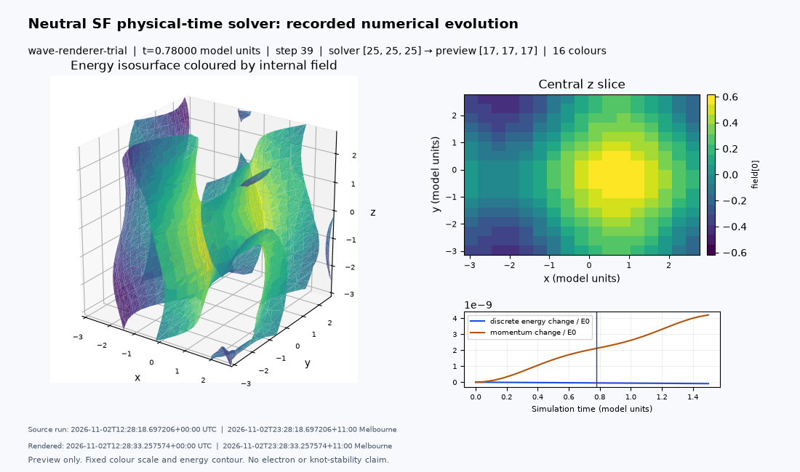

# Physical-time solver and offline renderer: measured verification

Recorded: 2026-11-02T12:35:54.021977+00:00 UTC; 2026-11-02T23:35:54.021977+11:00 Australia/Melbourne.

## Delivered capability

A CPU float64 constrained nonlinear neutral SF solver now advances physical model
time. It includes its field-dependent inertial operator, its time derivative,
constraint multiplier, fourth-order variational spatial discretization and projected
RK4 integration. It has no minimization, artificial damping or energy-reset step.
Periodic and fixed reflecting boxes are explicit alternatives. Rest and event-consistent
boosted static checkpoint import are implemented, but full stationary low-Q/high-Q
motion acceptance remains a later scientific campaign.

The standalone offline renderer reads separately exported display data after the solver
finishes. It writes a 3D energy-surface/slice GIF, PNG and a self-contained HTML player
with play/pause, frame stepping, slider and playback speed. A standard VTI/PVD series
can also be opened in external ParaView. No VTK/ParaView installation or GUI backend is
required for the built-in renderer. The current browser player replays rendered images;
interactive 3D camera control is through ParaView or a changed render-time camera profile.

See [the equations and discrete action](../../docs/models/SF-physical-time.md),
[renderer/export contract](../../docs/offline-renderer.md), and
[ADR-0010](../../docs/decisions/ADR-0010-physical-time-and-offline-renderer.md).

## Numerical evidence

The [measured control suite](control-verification.json) records three spatial and
three temporal refinements, independently derived nonlinear manufactured forcing,
actual travelling-wave evolution, regional stress/energy flux balance, reflecting
walls, constraints and short unrelaxed Q1/Q2 seed checks. The analytic wave is evolved
by the full solver; reference frames are not substituted for numerical output.

| Control | Observed convergence orders |
|---|---:|
| Travelling-wave field | 3.9426, 3.9834 |
| Temporal geodesic | 3.9826, 3.9927 |
| Nonlinear manufactured acceleration | 3.7785, 3.9349 |
| Forced 3D field evolution | 3.7309, 3.8491 |

At the finest one-dimensional travelling-wave resolution, field RMS error is
1.4655e-7, discrete energy drift 4.5741e-13 and momentum change/E0 2.5573e-12.
The temporal geodesic test isolates RK4 order from spatial error. The forced 3D test
uses an explicit theta/phi Euler–Lagrange derivation rather than calling the numerical
RHS to construct its source; nonparallel spatial derivatives exercise the nonlinear
terms. Its source is only a verification aid, never a proposed physical charge source.

Regional continuum-energy and momentum balances include flux through x=-4 and x=0.
Their relative/scaled defects are about .1585%/.1580%, .04020%/.04019%, and
.01014%/.01014% on 97/193/385 nodes with coupled time refinement. The coarse case
fails the proposed .1% target and is retained; finer cases pass. Approximately
second-order convergence is expected from the trapezoidal space/time flux quadrature,
separate from fourth-order field evolution.

A reflecting-wall pulse reverses P/E0 from +.998464 to -.998464. Its energy drift is
2.0582e-6 at dt=.01 (above the stricter 1e-6 control target), improving to 6.4390e-8
at dt=.005. No tolerance was weakened. The wall supplies impulse; the momentum change
is not an unexplained conservation failure or an absorbing-boundary result.

During development a squared centered-first-derivative sigma energy exposed an
alternating-grid zero mode and poor reflected momentum. The final implementation
uses a positive fourth-order sigma action with the standard fourth-order Laplacian;
its variational energy identity and nonzero alternating-mode energy are tested.
This numerical choice and the distinct continuum/discrete energy diagnostics are
explicitly derived in the model specification. The old static cell functional and
its scientific records are unchanged.

Short fresh Q1/Q2 seeds are unrelaxed and evolved only to t=.002 on 17³. These tests
check code/constraint behaviour, not soliton stationarity, exact Hopf classification,
full perturbation stability or isolated high-Q free flight. All such claims remain open.

## Solver-generated renderer trial

The [trial result](demo-result.json) uses a 25³ periodic calculation for 75 steps,
dt=.02, through t=1.5 model units. Its actual source/config/environment fingerprints
are in [the source manifest](demo-source-manifest.json). Preparation runs identify
the working tree explicitly; numerical module hashes, not the uncommitted base HEAD
alone, define the evaluated code. The handoff preserves that source and the example.

The solver exports 26 coarser 17³ preview frames while retaining float64 calculation
states and full-grid diagnostics. On the preparation host it took 13.97 s;
the subsequent offline render took 17.92 s. These are measured preparation-host
figures, not a guaranteed workstation runtime. Discrete energy drift is 8.8189e-11;
maximum unit/tangency defects are 2.23e-16/5.56e-17. Physical model time is distinct
from elapsed wall time and playback frame rate.

The [render record](render-verification.json) retains every displayed source frame
hash, fixed colour range/energy threshold, presentation settings and output hashes.
The full movie/HTML and sample preview dataset are in the handoff ZIP rather than
ordinary scientific source commits. The native ParaView GUI was not benchmarked;
XML structure, x-fast array ordering and components are independently tested.
The offline browser logic is exercised with DOM/timer test doubles and its embedded
PNGs/GIF are decoded; the supplied local commands open it in the workstation browser.

## Independence and remaining gates

Renderer-owned export settings control display cadence, selected cases/resolutions,
arrays and preview sampling. Presentation controls frame selection, colours, camera
and image size. None changes solver grid, dt, precision, force terms or stopping
conditions. Automated export-on/off tests compare exact state hashes and full diagnostics;
checkpoint/resume is also bit-exact even with changed preview settings. Rendering
preserves scientific input files. No plotting dependency is imported by the solver,
and the renderer does not import the physical-time solver.

The completed trial and alternate 8-colour/coarser display are verified without
changing calculation data. Their recorded source/output identities and the handoff
installation checks accompany this report/package. Checkpoints and conservation
records remain authoritative over appearance; display triangles/samples are not
inputs to topology or physics acceptance.

Next: readmit retained stationary Q1/Q2 fields to this new lattice action and quantify
rest residuals, finite-box effects, temporal/spatial convergence and controlled boosts.
Then assess provisional larger-domain Q17 with Q19 comparison and refined perturbations.
Open/absorbing boundaries remain unimplemented; fixed/periodic boxes do not establish
long-time isolated confinement. Retain linked Q18 and return to fresh fine starts,
conditioning and additional Q values after the motion tranche, including optional
Q20/Q24. Charged dynamics remains deferred; no electron, spin/statistics, general
causal-well-posedness or new-solution priority claim is made.

AI assisted derivation, code and reporting. Primary equations, numerical assumptions
and limits are mapped in the specifications; no external scientific peer review is claimed.
